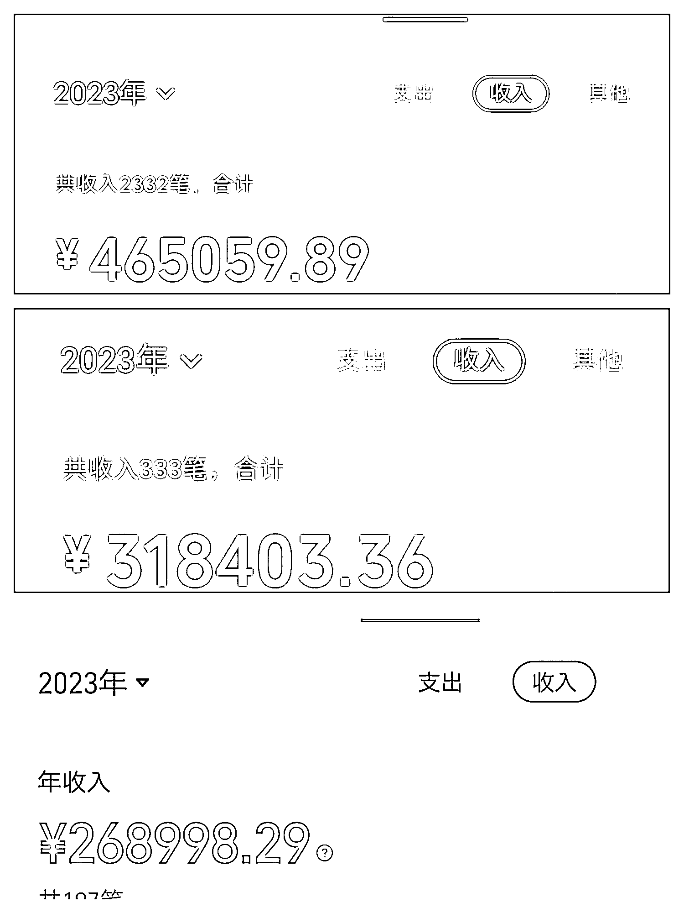

# 大学赚到第一桶金的那个男孩：过去三个月，我踩了哪些坑

## 那位在大学赚到百万的男孩，最近90天的复盘

作者：行一（不吃饭）

日期：2023-10-27

**大家好，很久没在星球里更新了。我是行一，一个还在路上持续学习的连续创业者，现在手上同时在运作一家做流量的公司和一家电商工作室。**

最近非常幸运地吃到了小红书电商的红利，人生第一个百万就这么破了。现在小红书这块业务已经从最初的搬运阶段，升级到自己实拍、主攻高客单产品。模式也在不断进化，从早期无货源，到现在建了中转仓，解决了不少卡点，可以说这块已经成了我比较稳的现金盘。

这个项目就是我在东北起盘的核心支柱。有人问我小红书电商还能不能做，我的答案是肯定能。我觉得市场里不存在做不成的事，只存在比我做得更狠的同行，所以我一直是跟着学、跟着迭代。特别要感谢我的兄弟@阿成，是他一直在前线实操和升级，我才能跟着一起把项目盘活。这里也得说一句，我和成哥很早之前就认识了，还是在进赚钱之前。他就是典型的实干派，我一直觉得这样的人不该被埋没，所以进赚钱后我一直鼓励他多输出。

时间真的转得很快，这三个月下来，对我来说创业的认知又往下沉了一层。

小红书电商虽然是风口要抓，但内心一直没忘本的事：做流量、沉淀私域、攒高质量的人群。

接下来就把我这三个月里干了什么、帮过谁、以及一些新的体会梳理一下。

一）我做的事，基本都是踩坑的记录

二）我帮助的人，反而让我找到了天赋所在

三）关于创业的一些新领悟

详细笔记我放飞书了，快速直达

[`wxm1taza3m.feishu.cn/docx/Bw3ldHnpmoIp8hxcBsmckCqMnIg?from=from_copylink`](https://wxm1taza3m.feishu.cn/docx/Bw3ldHnpmoIp8hxcBsmckCqMnIg?from=from_copylink)

**说实话，我运气确实不错，刚好站上了项目风口。也确实飘过，那阵子年少得意收不住自己，后来才开始接触国学文化，才慢慢明白低调的重要性。现在我笔记本的扉页就写着这几个字。**

接下来我还是会跟在大佬们后面继续学，学更多玩法，把自己的流量基本盘守住打稳。如果你看完有感触，愿意给行一一点支持就太好了。

**希望我们都能龙哥盟。这篇文章主要是想把这段创业经历和教训分享给圈里的朋友，也当成一面镜子，让我自己以后能记住这些思考和坑，低调做事，继续往前走。**

* * *

评论区：

饭饭 : 行一真的厉害！

小浩哥 : 弟弟牛

风沙星辰 : 关于合伙人领悟到了很多，因为你说的情况，我也碰到过一些相同的经历，所以很有感触！

小辉 : 怎么链接呢

书情小跟班 : 优秀

戴智慧 : 行一牛逼哈哈哈

秋风 : 行一牛！！

颜若一 : 厉害啦👍🏻

* * *