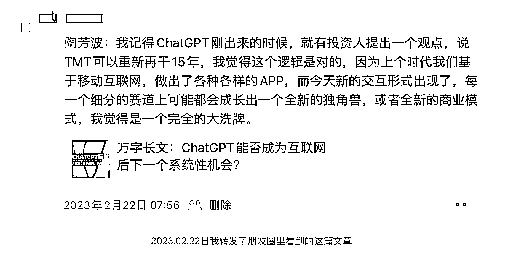

# 八个月玩转 AI，从零到六位数，我把路走了一遍
作者：龙哥

## 入局 AI 八个月小赚 6 位数经历复盘

作者：叫我峰兄
日期：2023-10-25

上周末刚抽出时间，把自己这大半年折腾 AI 的历程梳理了一遍。希望这份复盘能给同样在赚钱里摸索的伙伴一点参考。

先说说赚钱。真的很感谢龙哥大佬打造了这样一个地方。以前的我就是个只会埋头干活的职场新人，对副业一无所知。现在我才明白，原来上班的同时也能做自己的事。赚钱上从选赛道到从0到1的完整方法论都讲得非常清楚，还能碰到一群志同道合的人，有问题时随时能向大佬请教。这个社区真的太有价值了，祝赚钱越来越好，也祝大家都能在这里拿下属于自己的结果。

下面进入正题。

大家好，我是龙哥，目前在一家世界五百强外企做程序员，日常工作是 IT 相关的。这篇笔记主要记录 ChatGPT 爆火后，我在 AIGC 方向的试错与收获，也算是给自己的一次阶段性总结。

一切的起点是今年2月。那时朋友圈里转着一篇万字长文，说得直白点：移动互联网时代靠 APP 造就了无数机会，现在交互方式要被重新定义了。AI 底层能力已经开放，门槛一下子降下来了。每一个细分赛道都有可能孵化出新的独角兽，每个 APP 都可能需要重做。每个人都能用 AI 来提升效率、创业、给自己加Buff。这场浪潮和以前完全不一样。

**这次复盘我按时间线拆成了四个阶段：**

**第一阶段：做 GPT 镜像站试水创业**

**第二阶段：系统研究提示词**

**第三阶段：做私有模型，为企业搭建专属知识库**

**第四阶段：加入点金帮，聚焦企业级 GPT 培训与 AI 解决方案**

### 第一阶段：GPT 镜像站创业

我本身是技术出身，还赶上了小程序的末班车。第一桶金就是做小程序赚的。可惜那片市场现在早已饱和，红海得不能再红海。移动互联网刚落幕，AI 的风口又立刻来了。

当时我就琢磨着，在这种转折点上能抓到什么？很快我就发现一个痛点：当时国内根本打不开 ChatGPT。既然大家都用不了，那我就做个国内可用的跳转站，成为一个中转入口，把使用门槛降下来，让更多人能顺畅上手这个工具。

想法一出来就行动了。我拉了几个平时关系不错的朋友，一说就达成共识，我们的小分队就这么成立了。虽然大家都有主业，只能利用下班和周末来搞，但彼此配合默契，分工明确。从画原型到开发测试再到上线，前后竟然只花了一个多星期。我们的玩法很简单：游客免费体验10次，用完就得充会员。出发点很朴素，就是想着会不会一夜暴富。现实是残酷的，踩的坑比预期多得多，所谓的暴富并没有到来。

想看更详细的踩坑过程，可以去飞书链接里阅读完整版：

* * *

评论区：

模拟宇宙 : 峰兄执行力很🐮请问什么资格可以加入点石帮啊，大厂算法，有数据挖掘和大模型微调应用经验。求链接

乔帮主 : 受峰兄邀请来单独回答下你的留言，方便的话🛰️私聊链接下，我是点金帮创始人[握手]

* * *