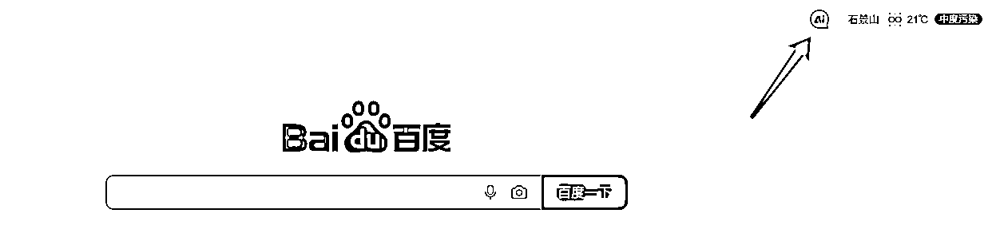
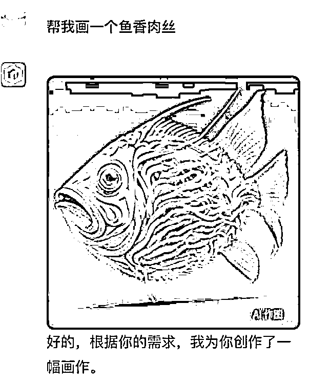
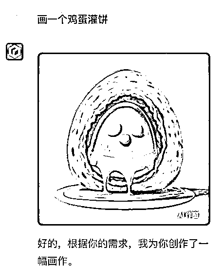

# 被低估的国产大模型：重访百度文心

> 原文：[`www.yuque.com/for_lazy/thfiu8/gelsd9n2y8bi1tlq`](https://www.yuque.com/for_lazy/thfiu8/gelsd9n2y8bi1tlq)

## 一次改观的体验

下午闲下来想找点新奇的 AI 工具玩玩，百度首页的 AI 入口正好映入眼帘。说实话，我对百度系的 AI 并不感冒，早期用过几次，输出质量平平，印象一直停留在起步期。最近朋友圈里关于文心大模型的讨论越来越多，我还调侃过是不是水军太多。抱着试试看的心态重新上手后，认知被彻底刷新了。百度这段时间的演进速度很惊人，确实担起了国产大模型领军者的角色。

回想起来，往昔文心一格画的鱼香肉丝和鸡蛋灌饼，着实有点让人会心一笑。

## 二、文心生态全景速览

在动手体验前，先把百度的 AI 布局盘一盘，方便大家建立整体认知。

既然是了解自家产品，直接让百度自己介绍最省事，我索性懒得去检索了，直接截了对话上图：

想看更清晰的整理版，建议跳转飞书文档阅读：

[`l0lupq5bcjq.feishu.cn/docx/AYSxdU1CYokAHWxgMgccuadpn9d`](https://l0lupq5bcjq.feishu.cn/docx/AYSxdU1CYokAHWxgMgccuadpn9d)

* * *

评论区：

认知小窗-认哥 : 同一问题同时丢给文心一言和通义千问，文心瞬间给出标准答案，通义千问直接摆烂：抱歉我不会[流泪]

叫我峰兄 : 百度还是很给力的，点个👍🏻

* * *