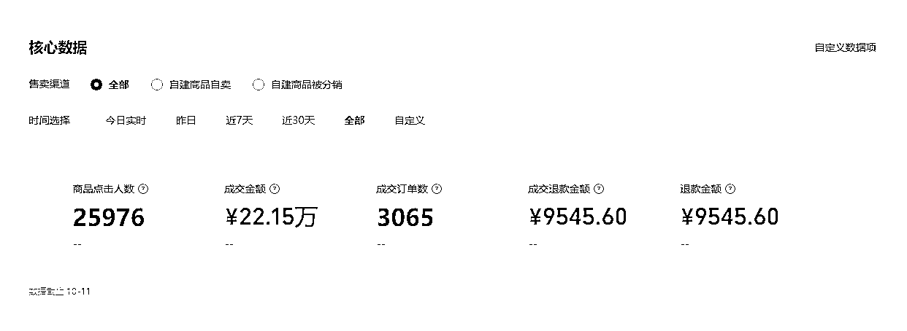

# 100 万 GMV 达成，视频号短视频挂车投流最新玩法
作者：龙哥

先别急着划走。全职做视频号这件事，我已经坚持了整整一年，起点是去年十月。这一年，我几乎没有再碰其它项目，所有精力都押在视频号上。自然流、直播、付费投放、后端运营，这些方向我都轮着试过，最后把火力集中在“短视频带货挂车+付费投流”这条玩法上。

先把最硬的成绩摆出来：6月、7月、8月，三家店铺先后落地；截至目前，总GMV冲到100w+，净利润超过30w。这套打法不是只停在理论层面，而是实打实跑通了。

所以我把整套操作经验整理成了一份完整文档，关键细节都在里面，想深入研究的朋友直接点开：

下面是文档中涉及的几处关键截图：

如果这份分享对你有启发，欢迎在评论区聊聊你的看法，也欢迎转发给同样在视频号找机会的朋友。

原帖出处：https://www.yuque.com/for_lazy/thfiu8/yy0f2nrg8pnogsui

