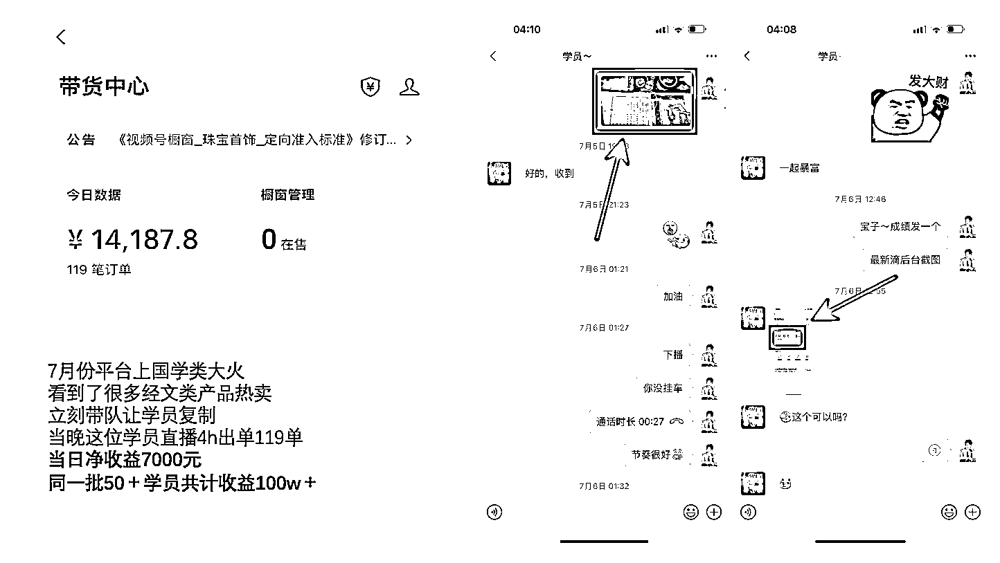
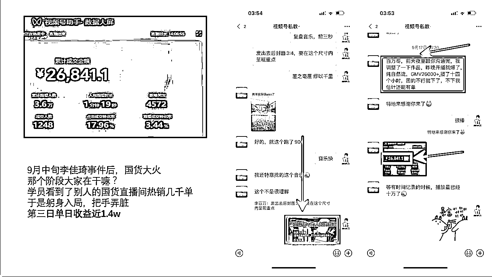

# 从0到100万：我在视频号风口踩过的5个阶段

你可能听过“视频号带货4个月收益百万”的说法，风口确实让不少普通人赚到了钱。我是龙哥，2022年才开始做自媒体，先试过📕，又做过视频号，如今基本把全部精力都押在视频号上。从2022年12月正式入局到现在，我个人累计变现100万，也带出了一批拿到结果的学员。

回看这段路，视频号的风口大概走过了五个明显阶段：

1. **搬运混剪短视频**：把别人的爆款素材拿来二次剪辑，快速起号。
2. **混剪短视频+付费挂车**：在混剪内容里挂商品链接，再叠加付费投流放大。
3. **自然流的“马扁”直播**：靠话术设计和自然流量推荐做转化。
4. **滋补品付费憋单直播**：锁定滋补品类目，配合付费流量制造憋单氛围。
5. **素人IP原创短视频挂车**：素人出镜拍原创内容，然后挂车带货。

（图为：国学短视频搬运混剪学员的成绩展示）
（图为：国货短视频混剪学员的成绩展示）

我一直相信一句话：视频号赚钱，其实很简单——找到一个已经跑通的赚钱案例，然后一比一复刻。在我亲自实操过的玩家里，我认为还有三个方向值得继续深耕：

- 混剪短视频挂车 + 付费投流
- 滋补品类付费直播
- 原创短视频挂车

* * *

评论区也很有意思：李百万本人留言“日拱一卒，与诸位共同龙哥盟”；学员们在下面直呼“百万哥牛逼”；还有人问：“现在平台打击这么严，视频号混剪素材的自然流带货还能跑吗？”

