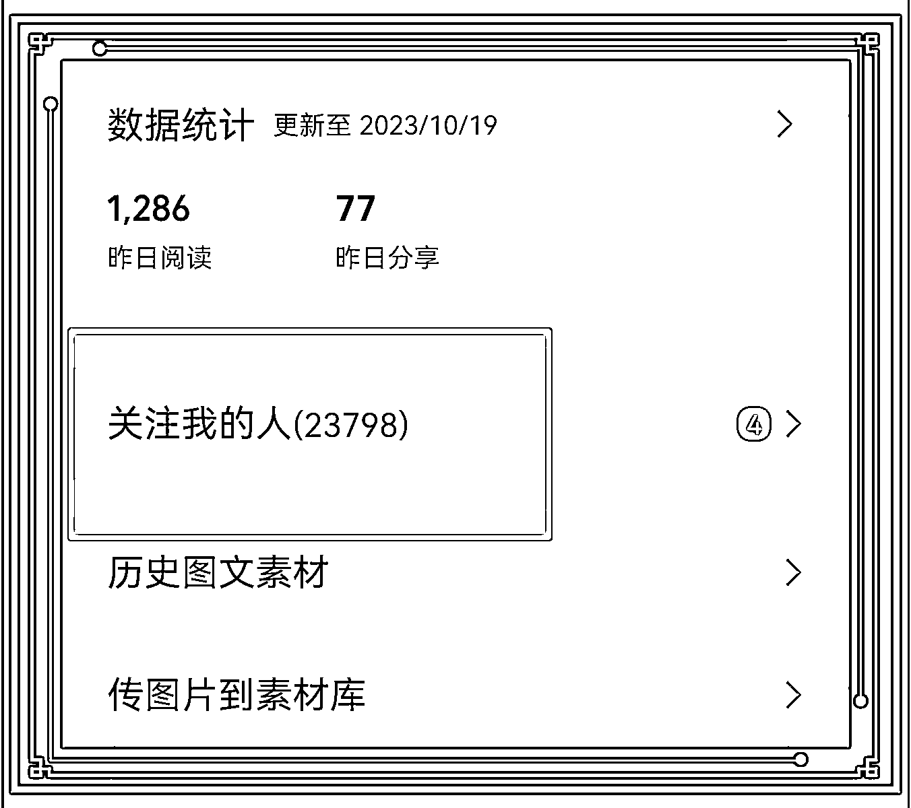

# 1000 天持续输出：一个普通人如何把阅读与写作变成百万收入
作者：龙哥

## 从沉迷游戏，到靠内容建立商业闭环

大家好，我是龙哥。

三年前，我还是一个把大量时间花在手游上的普通人。后来因为一次偶然的尝试，开始接触内容创作，并逐渐把阅读、思考和表达做成了自己的事业。

截至目前，我通过个人品牌运营和内容产品，实现了 100 万以上的收入。

这是我在赚钱社区发布的第三篇文章，前两次分享也有幸入选精华。今天想把连续输出近三年的经历摊开来讲：长期写下去到底能带来什么，以及怎样降低半途而废的概率。

很多人会问：

现在才开始做👸号，会不会已经错过机会？  
持续产出内容，真的还能带来收入吗？

我不讲空泛判断，直接分享一份自己的阶段记录：

- 第 100 天：尚未产生收入
- 第 200 天：仍然是 0
- 第 300 天：累计约 1 万元
- 第 400 天：累计约 10 万元
- 第 500 天：累计约 20 万元
- 第 600 天：累计约 30 万元
- 第 700 天：累计约 40 万元
- 第 800 天：累计约 60 万元
- 第 900 天：累计突破 100 万元
- 第 1000 天：仍在继续……

以上数字均来自真实经营结果，并非包装出来的案例。

## 我是怎样完成收入转化的？

我的路径可以概括为：

持续发布有价值的内容 → 建立个人信任 → 聚拢精准用户 → 设计付费产品 → 通过服务和社群完成变现。

目前，账号累计沉淀了 2.3 万多名关注者，🛰️端新增联系人超过 1.8 万人。

围绕不同需求，我搭建了几类产品：

- 88 元阅读共学项目：已经开展 10 次，每次参与人数都在百人以上；
- 420 元年度成长社群：现有付费成员超过 1500 名；
- 7000 元合伙人项目：目前已有 170 多位伙伴加入。

这套模式并不是靠某一篇爆文突然起飞，而是依靠长期更新、持续积累和不断迭代，慢慢形成了从内容到信任，再到产品的完整链路。

## 坚持的背后，也需要参照系

在这段长期创作过程中，我特别感谢两位持续高频输出的前辈：一位是 老师，另一位是@辉哥奇谭。

他们都保持了超过千日的稳定更新。长期阅读他们的文章，让我看到普通人也可以靠持续表达建立影响力，也让我在低谷期依然愿意把下一篇文章写出来。

完整的方法拆解和更多过程记录，已经整理到飞书文档中，感兴趣的朋友可以继续往下看👇🏻

❤️此前分享的两篇精华内容：

①  
②  

[`t.zsxq.com/13cbfeOzJ`](https://t.zsxq.com/13cbfeOzJ)  
[`t.zsxq.com/13KBqNYYy`](https://t.zsxq.com/13KBqNYYy)

* * *

互动留言：

🌸猫本红豆冰🌟：来给自家人捧场～[呲牙]

🔥逆熵增者💰：哈哈，感谢支持！

GEWO.GUO🌪：这成绩太猛了！

坏脾气的小可爱：连续做了 1000 天，哪怕身体不舒服也没有停更，真的很佩服。

🔥逆熵增者💰：[抱拳]

🔥逆熵增者💰：你发朋友圈的节奏也保持得很好，继续加油。

侠客邢：跟着逆熵增者叶老师学习，持续更新👸号 60 天后，已经拿到了实际收益，而且还不算少。这个团队太强了，必须支持！

微光：太强了！

* * *