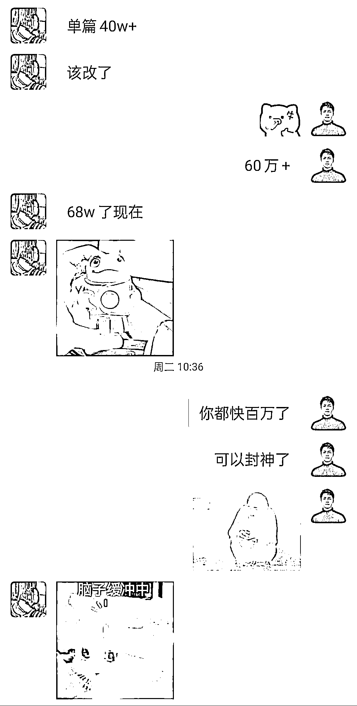
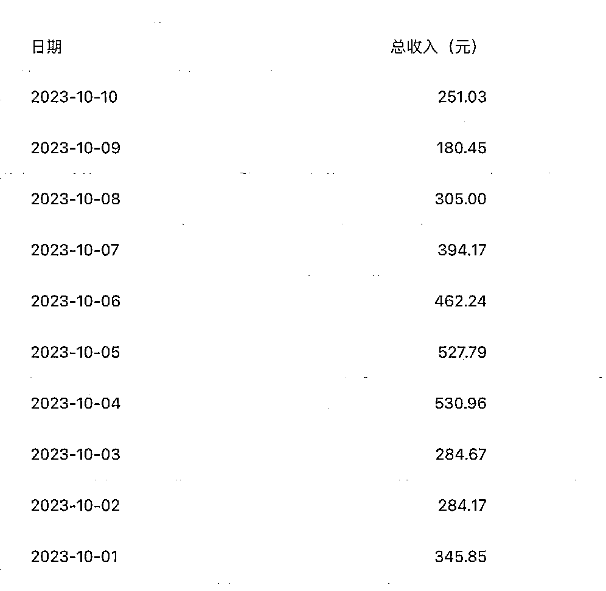
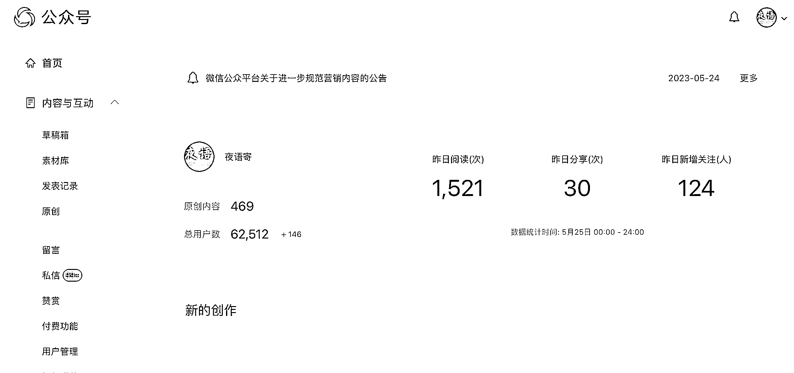

# 从 0 到 100 万 + 阅读，我带学员踩过的爆文赛道选择路

## 带人把👸号做成爆款，关键在于赛道细分与收益放大

作者：辰风

日期：2023-10-18

大家好，我是龙哥。

先报个前置成绩。

前段时间我一直在测试项目，最终锁定了爆文赛道，于是重新激活了旧号开始持续发稿。

我带的一个学员做爆文时效果平平，一周内一直没上池，我直接建议他换赛道，做了职场体制内的对标方向。

**更新了几篇体制、大厂相关内容后，账号立刻进入推荐池，当天阅读就破了 1w+，随后几天持续推流，长尾效应很强，最终拿下了一篇 10W+的爆款。**

简单介绍下我自己。现在我是以自由职业身份在做👸号爆款和视频号两条线。

大二大三时我做过大学生号的代运营，写过几十篇破 5k 的稿子，也有几篇上万。之后自己开👸号，一个号做到 6w+ 粉，另一个 2.6w，其中夜语寄大家可能有所耳闻。

当时账号定位是两性，数据能稳定在 1000+ 阅读，后来广告变现入不敷出，我就转向私域，之后深耕👸号爆款赛道。

跟之前做账号搭建、引流接广告不同，爆文的链路更短，收益更依赖内容本身。基本不用花太多精力研究排版、推广或引流，核心是做更贴近流量的选题。什么题材有流量就模仿、再超越。

我现在在写的几个方向有近现代史、民生、职场和时事热点。今天以近现代史为例，拆解一下我的实操思路。

### 1. 先把网感练出来

要想稳定产出爆款，得先建立爆款的判断力。

多去今日头条、知乎、👸号、网易号等平台逛，观察哪些类型的内容会被推，哪些能带来高浏览和互动。心里要形成一个大致的判断标准，有了捕捉爆款的能力，创作就快很多。

常用做法就是在头条或👸号搜关键词，比如搜近现代史，我会搜毛主席、开国元帅、十大将军这类词。也可直接搜对标号，盯着做近现代史的账号，看它最近的 10W+ 文章。

关注一批垂类号后，系统会持续给你推同类内容，能快速扩充样本池，再做对标。

### 2. 锁定 10 万 + 的可复用模型

找到爆款后，用它的标题去检索。如果该标题已被大量同质化创作，占用已经很高，就不必再跟。

反过来，如果标题下只有少数几篇，阅读量却在几千到上万区间，这个方向就值得拿来二次创作。

爆款的逻辑都是相通的，一个话题一旦火过，之后很长一段时间都会有复燃的机会。拿到标题和内容后，可以直接拆解故事骨架、人物关系，快速进入写作。

**很多号进不了池、被限流，本质是同一篇爆文被搬运太多次。网感决定了你能否及时出手、能否避开红海。**

同类稿子太多，再好的内容也分不到流量，流量池就这么大。

接下来把关键情节提炼出来，我一般用两种方式：

第一种是口述复盘，脑子里过一遍剧情和人物背景，用口述转文字的方式先把素材吐出来。

第二种是打字扩写，在原有框架上补充细节，把内容做厚。

有了初稿后，再对开头、正文、结尾做小范围改写，这样原创度就能过关。

近现代史对文字功底要求不高，用故事化表达即可。介绍人物生平，带一两个小故事收尾，再做简短点评，一篇稿子就成型了。

开头可以用设问切入，正文讲一到三个小故事，按时间线展开，最后做价值升华。整个流程就是我的常规打法。

其实很多稿子完全可以手写，不必依赖 AI。AI 主要是提效工具，选题判断、框架搭建、内容把控这些核心环节，暂时还替代不了。复杂的指令学习成本也高，在没形成稳定产出前，手写更靠谱。

等流量稳定了，再用 AI 批量扩写或做优化，提升产能。

第三种打法是用 AI 扩写。先把爆款原文复制进去，让 ChatGPT 或 Claude 提取框架和风格总结，再指令它按这个框架写一篇 1200 字左右的新稿。

常用指令示例：

“请把以上内容提取框架并总结风格。”

“请按上述风格，以‘xxx’为主题创作一篇原创文章，不得虚构。”

写完后一定要手动润色修改。仅作参考。

#### 1、养老金

标题指令：
根据此标题，写出 6 个吸引人的标题，格式不变

提示词思路：
1)请帮我总结一下这篇文章的写作风格和结构：文章内容
2）请你根据上面分析的写作风格和结构，写一篇类似的文章，要求逻辑清晰，吸引阅读，1500 字左右。

#### 2、近代史

标题指令：
根据此标题，写出 6 个吸引人的标题，格式不变

提示词思路：
1）、为本文列一个框架，后续可手动优化错别字、语序、时间人物细节，避免 AI 乱编
2）、使用该大纲逐步展开，完整叙述，保留原意，原创度不少于 75%，字数不少于 1500 字，细节要多
3）、继续丰富内容，不少于 1500 字

写完后检查原创度，达标就发，不达标就降重。

### 3. 如何定定位

常见的定位有情感八卦、职场、体制内、军事、民生、三农等。

第一步要考虑兴趣点。如果你长期做一个自己完全不感兴趣的领域，很难持续深耕。

我建议找一个自己感兴趣且市场已验证能出爆款的方向，持续钻研。了解这个赛道的更多玩法，提升认知。

兴趣 + 擅长 + 写作能力稍作提升，就能吃到爆文红利。

最近比较有潜力的细分赛道有农民工返乡、近现代史、体制职场、大厂、程序员等。

#### 4. 一稿多用，让收益翻倍

这里的一稿多用，不是把一篇过稿的文章到处投。而是在你拥有首发权和版权的条件下，做多平台同步。

有学员问我遇到收益瓶颈怎么办，我的建议是：

（1）一稿多发，多平台同步发，选题和质量要过关
（2）矩阵操作，用多个垂直账号持续发稿

**最好的复利就是复制，把简单的事情重复做，把一个问题不断放大。**

最后总结核心观点：

现在很多人卡在两个点：起步难、坚持难，数据反馈不理想。

两个解法：

**1.找到契合自己的定位，深耕到底，把项目细节吃透。**

**2.提升原创度，找一个足够细分的赛道。**

进池不稳、被踢出池，本质是竞争激烈、选题泛化。而针对特定人群、特定领域的号，反而很稳定，比如程序员、特定健康群体、SM、乙游、汉字起源、高铁站、房产等账号。

内容过硬就不怕没人看，普通人也能靠爆文赚到钱，保持垂直、坚持更新即可。

**感谢收听，祝大家收入破六位数，爆文收益持续放大。**

**一起龙哥盟。**

* * *

评论区：

咏舍 : 优秀

辰风 : 谢谢姐

曲建伟 : 辰风很棒！

辰风 : 谢谢哥

* * *