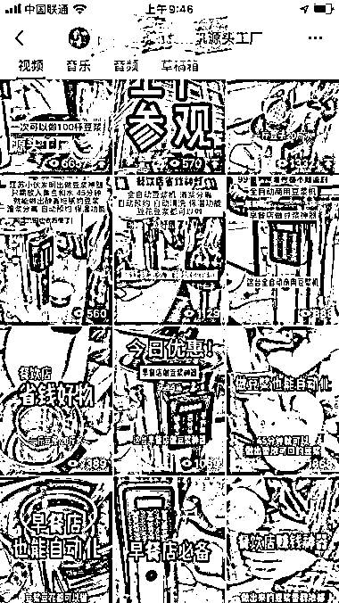
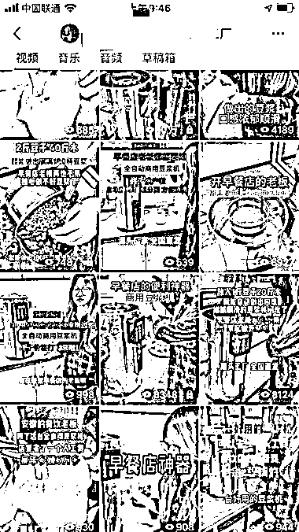
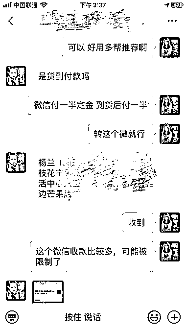
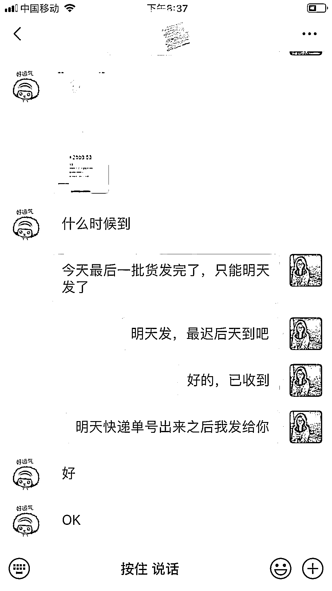
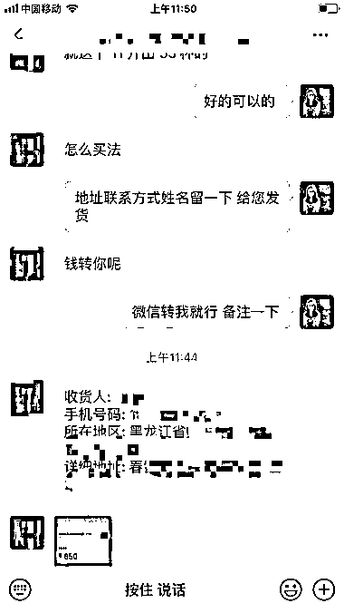
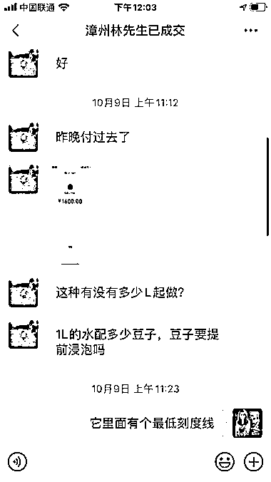

我是子白，先和大家问声好。这几天我捣鼓出了一个小项目，在视频号上给豆浆机厂家做分销。算是“轻资产副业”的典型玩法——前前后后忙活了20天，账户多出9000多块。虽然数目不大，但思路上的启发挺值钱，今天就拿出来聊聊。

我做的事情，说白了就是帮实体厂商在视频号上吆喝。每天发几条视频，等有人感兴趣来私信，我就负责答疑。单子敲定后，发货和售后全都由厂家那边接手。等于我是一个连接客服的角色，不用压货、不用垫钱，启动这个项目基本没花啥成本。

估计有人要问：不办执照能行吗？以我的亲身经历看，真不用。厂家才是真正的卖货方和售后方，我就相当于帮忙带流量，而且个人操作规模很小，根本到不了被追究的程度。这种模式对手里没资金、但时间充裕的新手特别友好，用最小的成本先跑起来，比只停留在想法阶段强太多。

关于付款，我一般默认让买家付全款。要是买家不太放心，我就建议先交50%定金，等顺丰把货送到家门口时再补尾款。这样一来双方都踏实，我也几乎不承担资金风险。

回头复盘，这个项目胜在资源匹配：厂家有成熟的产品和供应链，唯一缺的是流量曝光；我恰好有时间和执行力，帮他们带来咨询和订单。两边各取所需，钱自然就流动起来了。如果你也想搞副业，不妨观察下身边有没有类似的工厂或实体店，需要你这样的“中间人”。

这次实操我整理了不少截图和流程记录，放在飞书文档里了，想详细了解的可以直接点开：

https://nxzg0il06d4.feishu.cn/docx/GCzGd8fnlo3JkSx4p9ccW3uTnqc?from=from_copylink

下面是实操过程中留下的部分截图，可以参考着看：

最后，把当时评论区里大家关心的问答截图也一并放出来，供同样好奇的圈友参考：

