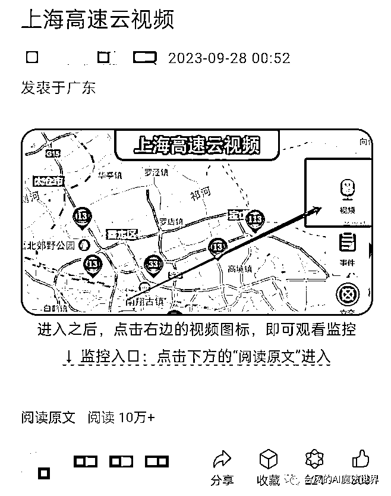
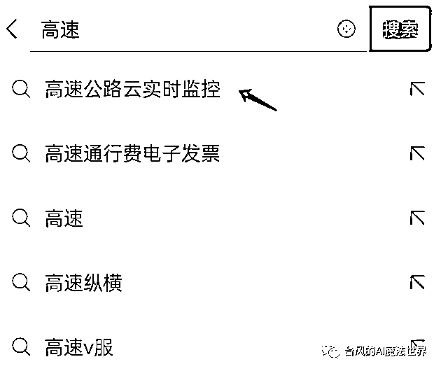

# 新👸号首日连出 15 篇 10w+，它到底抓住了什么？

作者：台风-AI 魔法师

大家好，我是龙哥，专注于 AI 自媒体运营，也是 ChatGPT+自媒体航海教练。

目前，我主要在做 AI 自媒体，👸号矩阵累计粉丝已超过 2 万。同时，我也是 GPT 任务指令<BRTR 原则>的作者，并总结出了一套适用于 AI 创作的“GPT 写作指令法”。

---

9 月 28 日，中秋、国庆假期正式开启。

很多人还堵在高速上时，一个刚注册不久的👸号，突然冲出了惊人的数据。

这个账号的主题是“高速云视频”，注册时间就是 9 月 28 日当天。当天它总共推送了 3 次，发布 16 篇文章，其中 15 篇阅读量超过 10 万，剩下 1 篇也有 5 万多阅读。

**这种成绩，放在爆文领域里，几乎相当于第一次买彩票就中了大奖。**

更夸张的是，它的内容并没有什么复杂技巧。

文章标题基本都采用“地区+高速云视频”的格式，正文配一张图片，再加上几十字的提示语，最后引导读者点击“阅读原文”，进入相关网站查看实时云视频。

从头到尾，几乎都是同一套极简模板。

这个选题属于社会民生领域中相对冷门的一类，也完全不是传统意义上的爆文套路。

标题里没有制造悬念，也没有夸张数字、名人效应、反常现象等常见吸睛元素。

正文同样谈不上精心设计，几十个字的内容反复使用，甚至显得有些简单，严格来说连原创都算不上。

然而，它依然爆了，而且爆得非常集中。

原因就在于，它准确抓住了假期期间的真实需求。

每逢五一、国庆、中秋等长假，大量人会选择自驾出行。尤其是节假日第一天，原本几个小时的路程，可能被堵成十几个小时；有的人开了大半天，甚至还没有离开所在城市。

**此时，“高速”不只是一个普通关键词，而是数亿出行者正在面对的现实痛点。**

在🛰️里搜索“高速”时，联想词中很靠前的位置就出现了“高速公路云实时监控”。这也侧面说明，假期期间，人们确实有查看高速路况和实时画面的需求。

这个账号刚好在需求最集中的时间点出现，又围绕“高速云视频”这一关键词持续发布内容，于是顺利承接了节日流量。

**👸号推荐机制也给了它明显助力，最终让这个看似普通的账号，以简单直接的方式连续打出 15 篇 10w+。**

这种具体玩法有很强的时效性，未必能够原样复制，但其中的思路非常值得研究。

**“高速云视频”的走红，再次证明了一个爆款规律：热点永远值得关注，很多时候，选题本身比写作技巧更重要。**

无论是社会事件、娱乐新闻，还是节假日相关需求，只要找准了用户正在关注的事情，普通内容也可能获得超出预期的传播。

我有一位做短视频的学员，曾经抓住全红婵相关热点，视频本身只是进行了简单剪辑，但播放量依然超过 3000 万。

节假日还有很多相对稳定的选题方向。

比如我曾经注意到一个👸号，它在 9 月 28 日发布了一篇关于中秋朋友圈文案的文章，阅读量直接超过 10 万。到了国庆期间，它继续围绕类似主题创作，又一次取得了不错的数据。

而这个账号平时的文章，通常只有几百阅读。

**这就是“爆款会持续爆”的典型表现：一旦某个主题被流量验证，就应该迅速拆解其中的有效元素，并围绕同一方向持续产出。**

我分享这些案例，并不是想让大家机械复制某一个账号，而是希望大家理解爆文背后的规律。

**对于普通人来说，做👸号爆文，最好优先选择那些已经被市场验证、能够长期持续、并且容易提炼固定模板的领域。**

这样的方向更容易形成稳定方法，也能降低初次入局的难度。

**今年可以看作是👸号进一步释放公域流量红利的一年。**

**从副业角度看，👸号爆文依然是一个值得尝试的项目。**

一篇文章获得 1 万阅读，流量主收益可能在几十元到几百元之间。我的学员中，成绩较好的，一篇文章达到 70 万+阅读，收入就能达到几千元；发挥稳定的人，一天也能有一百元左右的收益。

这个回报，对于普通副业来说已经相当可观。

当然，也有人凭借一篇文章赚到几万元，但这种情况通常属于极少数的头部账号，并不是大多数人都能直接复制的结果。

而现在，AI 正在进一步降低内容生产成本。

如果提前把提示词和写作流程整理好，一篇👸号爆文可能十分钟左右就能完成。真正需要花时间的，反而是寻找那些已经被低粉账号验证过、具备潜在流量的选题。

至于具体写作过程，则可以交给 ChatGPT 辅助完成。

很多人觉得 GPT 写出来的文章千篇一律，充满“AI 味”，其实问题往往不在工具本身，而在于提示指令是否足够清晰、完整、有效。

**一套稳定、成熟、能够用于商业创作的提示指令，价格甚至可能达到几千元。这也说明，编写高质量 GPT Prompt 本身并不是一件简单的事。**

**如果你对👸号爆文提示指令感兴趣，可以参考我之前整理的几篇内容。不少朋友就是借助我分享的情感故事写作指令，成功获得了平台推荐。**

👸号情感爆文写作：10w+就靠这条 ChatGPT 指令了（商用级 Prompt 免费送）

轻松搞定 10w+爆款文案：一看就会的 GPT 写作指令法（自媒体人必学的 AI 教程/结构化提示词）

AI 自媒体：GPT 写作指令的进阶之路-台风（赚钱航海）

---

评论区：

良辰美：感谢拆解。无论是做项目还是创业，都要先抓住目标人群的真实需求，再找到差异化切口。否则只是跟着别人重复，很容易陷入内卷。通过搜索需求进一步挖掘竞争空白，往往就能找到更轻松的机会。

台风-AI 魔法师：没错，参与的人越来越多之后，差异化会变得更加重要。

---