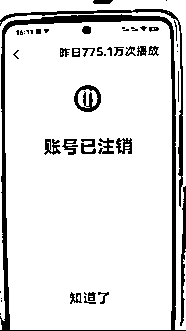
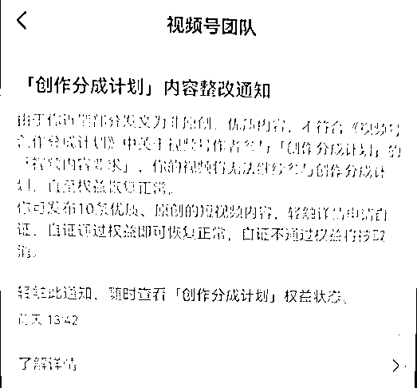
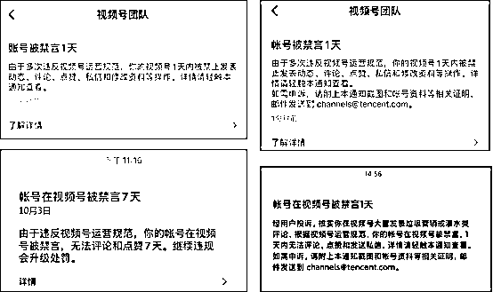
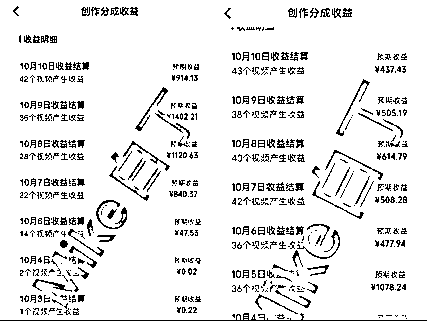
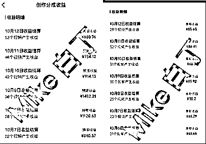
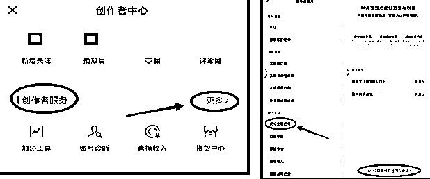
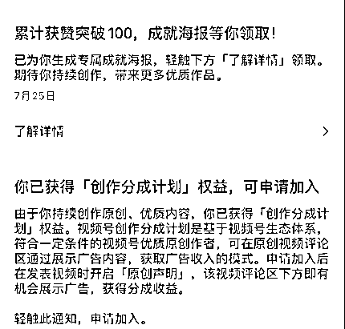
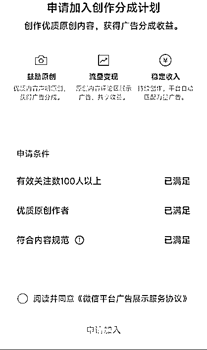
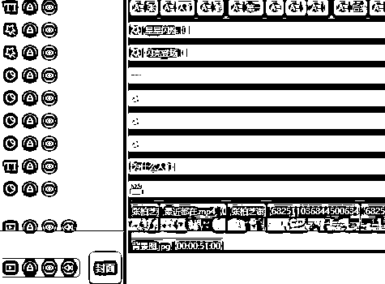
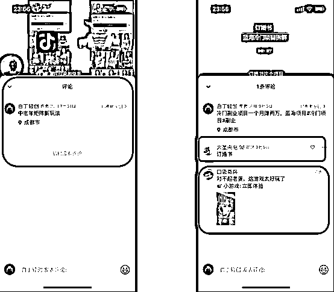

# 冷门赛道复盘：视频号创作分成，一条账号单日到账 1402 元

## 冷门赛道：视频号创作者分成，单号一天进账 1402.21 元

作者： 白丁

日期：2023-10-16

哈喽，我是白丁。从 2013 年起就在互联网里摸爬滚打，跟随移动浪潮一路走来。我的定位是找机会、测模型、跑通逻辑，看到新东西就想上手验证，通常只要我亲自实操就能得出结论。

在赚钱待了半年了，很感谢这个环境。算是第二次来这里做公开拆解，上一次支付宝分成计划的分享被评为精华，这次视频号分成的实操也尽量把细节填满。

最近把视频号创作分成这条线跑通了，也收到了正向回报。**现在这条赛道基本还是蓝海，认知门槛很高**。随便找人聊聊视频号发作品能赚钱，十个人里可能只有一两个人听说过。

多年跑项目的经验告诉我，越是没人看好的时机越值得下注。**信息差越大竞争越稀薄，早进入的收益越厚，晚进入的份额越薄。**我当时的想法就是先试测一下。像支付宝分成出来那会，我也是早期一批去验证的人，最后整理成白皮书被各路付费圈子转存，高研社、龙哥盟、淘金之路这些地方都有我的内容，我的习惯是先在赚钱发完再去别的社群分享。

这次验证周期用了两个月，涉及的垂类也比较多。这条赛道并不是大家说的发就赚。很多分享都是情绪煽动，配一张来源不明的截图就让大家冲。**赚钱从来不是低配的活，越是说无脑的越要警惕。**这两个月我踩的坑不少，封号、被取消分成资格的情况频发，甚至遇到过号内积压几千收益被直接清零的。做任何方法论之前，先评估自己是否扛得住、是否具备相应能力。

给你看一个真实案例，我这个号单条播放常年稳定在千万级，也曾被处理过，并无违规行为，核心问题是原创不足。足以证明风险是真实存在的。

封号是最严重的处置，未提现的收益直接作废，已提现到账的不会追回，腾讯会按规则结算。封号之外还有降权类处置，例如撤销原创标识、限流、取消分成资格。这些处置只要跑过就能避开，都是用成本换来的经验。

需要人工申诉的类型反而更容易处理，提升内容的独创性后很快能恢复分成权限。值得一提的是，分成被取消后重新开通，流量不会被压制，微信在容错上比同行要宽松很多。我最早的一桶金来自👸号时代，能真切感受到微信说的开放不是口号，视频号的包容度确实高。

上面提到的这些惩罚不是为了制造焦虑，而是帮大家提前降温。想把一个赛道做成，绕不开必要的试错。

接下来说点正向的。

实际跑下来的收益体感不错。下方是我矩阵里表现最好的两组账号，日入一两百到三百的号数量不少，整体已经做成矩阵铺量。不是粗制滥造的图片拼贴，而是精细化运营。

最差的账号也能保证日结数十，内容质量和选题方向直接拉开收益差距。来看下我们表现优秀的账号和中等的账号在日常收益上的对比。

最近两天的截图忘记保存，日收益基本维持在一千出头，今天又创高到一千五百多元，可去我朋友圈查证。

同一垂类不同操作者，差距可以拉到数倍。后台数据本身就是两个人操盘的结果，说明能不能做成最终取决于执行力。

在开始测之前，我想清楚一个核心判断：**项目能否持续，关键看钱的来源。**如果收益是平台自掏腰包给创作者，大概率是拉新期，烧完就会停。任何公司都有成本天花板。

**视频号分成里展示的广告卡片，费用并非腾讯自费，而是广告主买单。**腾讯本身也在抽成，为了维持创作者持续生产必须分钱。只要视频号的流量盘还在，广告主的投放就不会断。这套机制就能长期运转，差别只在赚多赚少。

**因此评估长期性，钱从谁口袋出比赚多少钱更重要。**比如七月上线的支付宝分成，前期有收益，后续递减到零，因为创作者的分成是来自支付宝的启动预算，预算耗尽就停止。

**再看视频号的收益结构。**

图中标注的部分就是核心变现来源，点击量越高收益越高。开通分成后，系统会根据大数据为每个观众匹配广告，同一人看同一条视频，展示的广告也可能不同。广告位通常落在评论区第三到第五条，有点击就有收入。

因为属于广告投放，这笔费用是推广成本，支出方是游戏厂商。厂商在腾讯投放卡片，腾讯依据内容类型和人群画像做匹配。形成视频号、创作者、游戏厂商三方共赢：厂商获取进游戏付费用户，腾讯获得广告费，创作者获得分成，腾讯六创作者四。

**视频号分成本质上是广告主的资金池，腾讯也在参与分佣。只要流量规模维持，广告主持续投放，分成就会持续。判断持久度，谁出钱比多少更关键。**

**我判断这条赛道完全可以长期做，平台要内容，创作者要收入。**

理论讲完，说实操思路。我更侧重思维和方向，具体剪辑、配音怎么做网上资料很多，我们在社群里更需要的是方向判断，方向错了，剪得再精致也无意义。

首先，怎么开通视频号创作分成。

开通主要有两条路径

1. 优质内容官方邀约

属于内推机制。只要作品原创度高、画质清晰 720P 以上、时长 15 秒以上、具备明确内容指向，粉丝量不作为硬性门槛，达标就会收到邀请。

2. 触发开通条件

a. 有效粉丝 100
b. 优质原创作者
c. 符合内容规范

a 和 b 的逻辑比较清晰，自拍或二创都算原创，天地没有新东西，重组排列就是创新，视频号对高质量二创是认可的。

c 这条符合内容规范比较模糊，属于官方掌握解释权。规则是用作品去触发，只要能通过机器审核即可，有个小技巧：发布高清度的随手拍，或搬运其他站点未在视频号发布过的视频，都可被判定为原创。但搬运存在风险，视频号目前无画面识别功能，所以搬运务必谨慎。

我们也摸索出最快两天可开通的方法，用优质二创去通过机器审核。在制作上多做加法，配音、拼接、多片段、贴纸等组合处理，原创度很容易被拉满。

为提升效率，建议先做一个固定模板，每次套用模板，只替换内部素材即可。

开通只是起点，做爆款才是终点。爆款等于收入，没有爆款日收益基本为零。

**做爆款的两个抓手：话题与素材。**每个垂类能爆的话题是有限的，能触动情绪的就是爆款密码。我总结的爆款公式：

**1. 高潮前置。**
**2. 内容完整。**
**3. 引导互动。**

开头先抛钩子，例如“万万没想到”“谁都没想到”等，用好奇心抓住人，再把故事讲完整，结尾补一句“你怎么看”引导评论。前五秒完播率高，播放量通常不会差。

流量问题解决后要解决收益问题，**收益的核心变量是赛道和评论量。**

每个视频的流量上限由所属领域的曝光权重决定，权重越高分到的流量越大。因此要优先选择曝光权重大的领域，比如娱乐、游戏、财经等。

再看如何提升分成收益，看两张图：

这是我的个人 IP 账号，已开通分成。第一张图没有广告，第二张图有广告。前面提到过，广告卡片出现在评论区，但需要评论数触发。**只要有一条评论，广告位就会出现。**这是一个小技巧，发布后先用主号或小号自评，就能避免流量损耗，收益至少提升 20%。

目前网友已形成评论习惯，有一条评论就会有人点进去看，评论写得好还能引发跟评，评论越多内容加热越强。

另外要关注广告投放的类型。视频号评论区广告多为游戏，用户群体主要是年轻人及中年人。所以做分成时要注意，流量好但单价低的领域要避开，比如祝福语录流量和评论都不错，收益却不高。尽量挑选年轻人偏爱的赛道，像游戏、科技，点击率更高。

想把一件事做成，必须不断优化。有时候一个细节调整就能带来大幅收益。运营的本质是细节，而非空话。

我的分享就到这里了，希望能帮到更多人。我一直喜欢跑新项目，看到新机会就冲，大多数项目都能跑出结果。

这条路有问题随时找我。

* * *

**评论区：**

子白 : 白丁老师牛🐮牛，跟你吃肉啦！

沐琳 : 老师，1000w 播放，你是一天发了几条？我是做娱乐八卦赛道的，但收益特别少。

白丁 : 主要看你的素材和话题方向

阿润 : 请问视频号需要养号和一机一卡一号吗

白丁 : 不用养号，一机一卡一号

🦌RUSIZI（更图* : 视频都必须一机一号吗

白丁 : 现在做任何平台都已经是这样了吧

阿润 : 谢谢。视频号创作分成计划下面的“符合内容规范”具体是什么呢？我发了 10 条视频了，流量也有几万，但是还是没有符合这个条件。

* * *