# 视频号自然流实战复盘：两天赚到 2200+佣金，完整拆解从选品到直播

大家好，我是 Fam，平时在生财有术里更多时候是“潜水”状态。一直想把自己的实战经历整理出来，但每次总是拖着没写。毕竟社区里高手很多，自己那点成绩似乎不值一提。

不过，既然持续参加了十月份的视频号小航海，这次终于决定认真复盘一次。刚好航海进行到中段时，我借着一个突发热点做出了小爆款，并通过自然流量加直播完成了变现。

这篇文章，就把整个过程、数据、操作步骤和踩过的坑全部记录下来。

项目起因来自“四川某小区恶狗伤人”相关事件。我围绕“驱狗工具”制作热点内容，先用短视频获取自然流量，再把用户引导到直播间完成成交。

## 先看结果

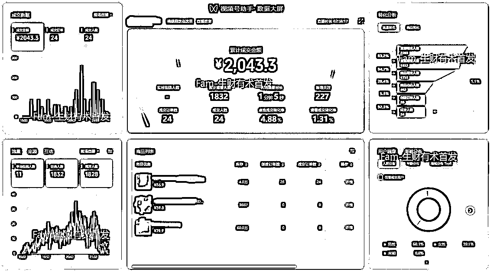

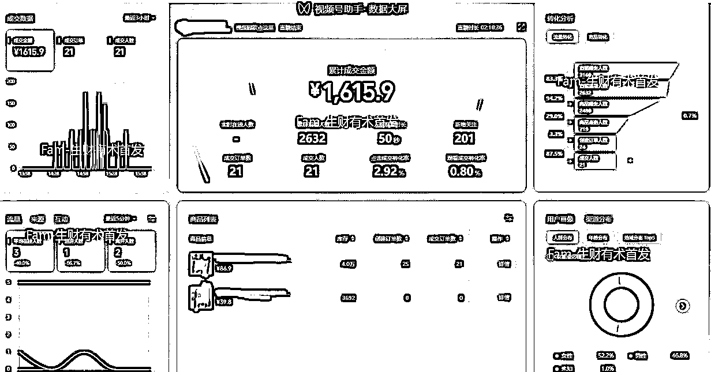

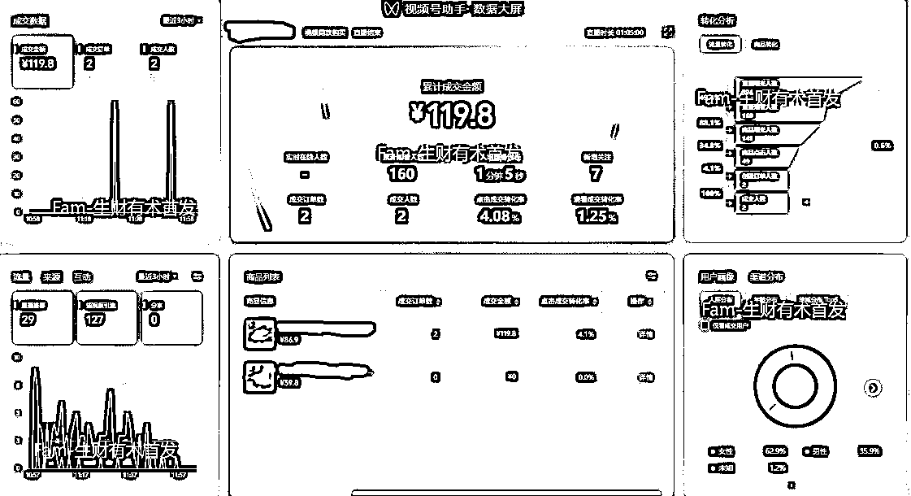

这次实践的整体路径可以概括为：

**确定商品 → 搜集并剪辑素材 → 发布测试自然流 → 直播承接转化**

---

## 一、选品怎么做

### 1. 从正在发酵的热点里找商品

热点往往意味着短期注意力集中。

比如当时频繁出现流浪狗、宠物狗伤人等新闻，我就围绕这些关键词进行搜索，寻找能够解决相关问题的产品。

平时刷视频、看新闻时，如果某个事件短时间内反复出现在你面前，或者身边的人都在讨论，就应该提高敏感度，及时判断它有没有对应的消费需求。

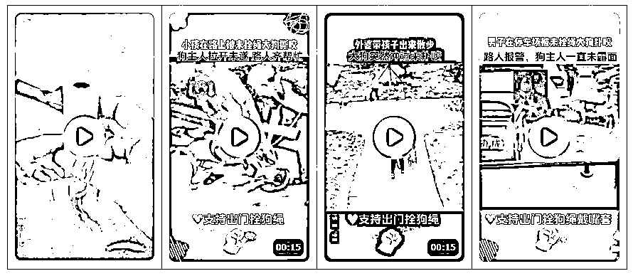

### 2. 研究同行正在卖什么

可以分别在抖音、快手、视频号搜索同类商品，重点观察竞品店铺里的热销产品，再从中筛选自己有机会切入的品类。

不要只看商品本身，还要留意：

- 哪类产品销量更高；
- 同行采用了什么内容形式；
- 用户通常在评论区询问什么；
- 哪些商品已经被市场验证过。

### 3. 结合自身资源和兴趣方向

如果你在某个领域有经验、人脉或资源，也可以从熟悉的方向入手。

比如自己从事软件开发，就可以搜索“软件开发”“软件培训”等关键词，看看哪些账号和产品已经做出了成绩，再研究其内容和变现方式。

这里分享一句我在坤哥（@盗坤）直播间听到的话：

> 赚钱往往是先复制已经被验证的路径，而不是只做自己喜欢的事情。

“我想做什么”和“什么已经有人做成了”，是两套完全不同的思考方式。更稳妥的做法，是先站在已验证的方法上，再加入自己的改进，而不是一开始就完全凭感觉试错。

---

## 二、素材从哪里来

### 1. 用关键词批量搜集素材

可以在视频号、抖音、快手等平台搜索与商品、热点相关的关键词，优先选择近期发布的内容。

数量上，可以先准备大约 25—30 条：

- 约 15 条同一商品、不同表现形式的视频；
- 约 15 条与热点相关、但画面不同的内容。

这样既能保证素材的丰富度，也方便后续进行多种组合测试。

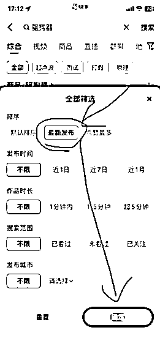

### 2. 素材下载工具

手机端可以使用微信小程序“抖快工具”。

电脑端可以尝试“哼哼猫”“固乔”等软件，不过部分工具需要付费。

### 3. 素材如何剪辑

手机上直接使用剪映即可完成基础剪辑，电脑端同样可以使用电脑版剪映。

常见处理方式包括：

- 添加配音；
- 调整滤镜；
- 画面翻转；
- 插入贴纸；
- 添加文字；
- 裁剪画面；
- 更换或补充背景。

如果对这些功能不熟悉，可以查看剪映官方教程，也可以在生财有术搜索对应关键词，里面有不少详细教程。

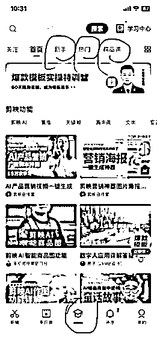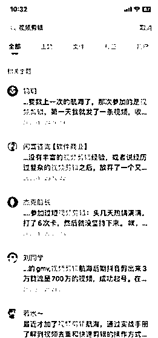

---

## 三、样品怎么准备

刚开始不需要大量囤货，直接在拼多多购买样品即可。

等到商品开始出单，再考虑从 1688 采购。多数商家都支持一件代发，前期可以尽量降低库存和资金压力。

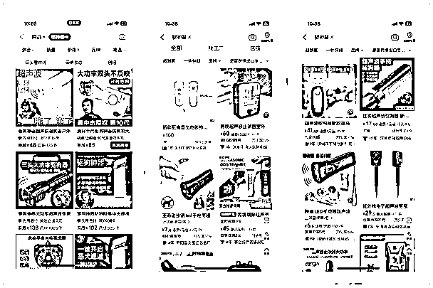

---

## 四、如何搭建一个简单直播间

### 1. 基础设备

我当时准备的设备如下：

- 直播手机 1 部，建议使用苹果 11 Pro，只要保持供电，长时间使用相对稳定；
- 手机支架 1 个，用来固定直播设备；
- 电脑 1 台，用于查看 `channels.weixin.qq.com/shop` 里的直播数据；
- 商品样品 1 个，没有样品时可以先找外观相近的物品代替，直播中偶尔拿起来展示；
- 产品贴图 2 张，用美图秀秀制作后放入直播间；
- 摄影灯 1 个，房间光线充足时可以不用。

### 2. 自然流直播话术

这类直播间不需要复杂的付费投流话术，核心就是让新进入的用户知道商品在哪里、该如何购买。

可以参考下面的表达：

> 欢迎刚进入直播间的哥哥姐姐们。  
> 视频里同款商品都在下方白色购物袋，需要的朋友可以直接点击购买。  
> 有任何问题都可以打在公屏上，主播会为大家详细说明。  
> 已经拍下的朋友，可以在公屏连续打两遍“已拍”，主播会帮大家备注，尽量安排加急发货。  
> 这个产品主要适合用于……  
> 公屏里这位朋友问到的情况是……  
> 我给大家具体解释一下。

之后不断重复这个流程即可。

### 3. 直播时要注意什么

**第一，长时间没有人进入时，可以结束直播后重新开。**

如果连续 30 分钟都没有观众，可以直接下播，重新开启一场。

**第二，看到违规提醒要及时处理。**

直播间出现弹窗提示时，要马上查看原因并整改。比较稳妥的方式是先下播，间隔 5 分钟左右再重新开播。

**第三，及时处理恶意捣乱的同行。**

如果有人在评论区反复干扰，可以点击对方头像，将其设置为不显示评论，必要时直接加入黑名单。

**第四，不能进行明显的无人直播。**

不要长时间没有声音，也不要离开镜头，更不能让商品贴图遮挡主播面部，否则很容易被判定为违规，也容易被同行举报。

---

## 五、需要具备哪些能力

### 1. 选品能力

要想清楚三个问题：

- 卖什么；
- 卖给谁；
- 通过什么方式卖。

新手最有效的方式，不是反复空想，而是先研究已经出结果的竞品，按照“谁赚钱就先研究谁”的思路去做。

### 2. 剪辑能力

至少要能熟练使用剪映，或者具备基础的 PR 剪辑能力，能够把多个素材重新组合成适合发布的视频。

### 3. 直播承接能力

直播间不需要刻意表现得多么复杂，重点是让进来的用户知道：

- 商品在哪里；
- 适合什么场景；
- 如何下单；
- 常见问题怎么解决。

视频号用户中有不少中老年群体，表达越直接、越真诚，反而越容易让用户理解和信任。

另外，也可以参考一些商品贴图形式，把商品图片和卖点文字放进视频里。商品图片可以从拼多多获取，再使用美图秀秀添加文字制作。

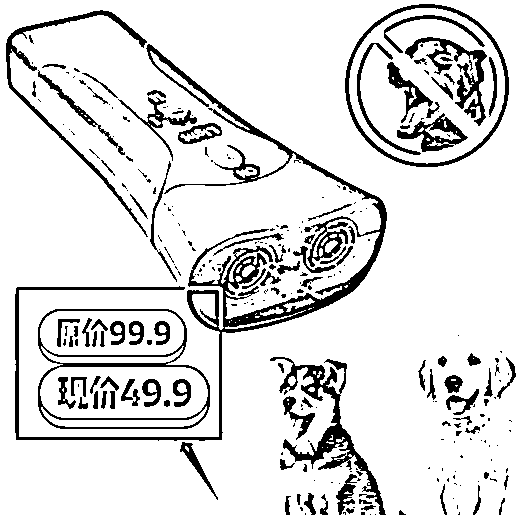

---

## 六、这次项目的时间线

### 10 月 17 日

**23:30**  
产生驱狗产品的选品想法，并搜索确认当时视频号上还没有明显的同类内容。

**23:55**  
上床休息。

### 10 月 18 日

**07:00**  
起床。

**07:10**  
再次搜索时，已经看到相关视频出现，并且有人开始直播。

这个细节让我非常深刻地意识到：热点项目的窗口期可能只有几个小时。想法出现后没有立即执行，往往就会被别人抢先。

**07:30—12:30**  

- 收集热点相关视频 50 条；
- 收集产品相关素材 10 条；
- 整理同行文案 5 条；
- 完成 6 条混剪视频。

**09:53**  
临时找了一部手机创建视频号，并拿家里的电脑转换器进行实拍，先确认账号和直播功能是否正常。

后来发现，苹果 7P 直播时卡顿非常严重，也进一步说明直播设备最好提前规划。

**11:25**  
发布第一条视频，约 5 分钟后开始陆续收到点赞。

**12:26**  
发布第二条视频，数据明显开始加速。

**12:30**  
完成视频号橱窗认证。

**13:57**  
开始直播，引导用户下单。

当时还遇到了实名认证需要家人人脸识别、家人不在家、突然停电、Wi-Fi 故障等一系列突发情况，整个过程非常混乱。

**13:57—21:41**  
断断续续累计直播约 3.5 个小时，期间出现手机卡顿、画面静止，系统还提示直播质量偏低。

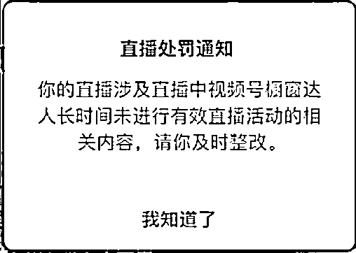

**15:09**  
在拼多多下单购买 3 件样品。

因为直播开始时还没有收到样品，我在家里找了半天，最后拿跑步机遥控器和电脑转接头临时充当展示物，其中电脑转接头还出现在账号发布的第一条视频中。

**20:01**  
陆续收到系统违规提醒，直播间也被同行举报。

做自然流项目时，只要数据开始起来，就可能遇到同行关注甚至恶意举报。只要不是严重违规，通常不必过度焦虑，按照提示整改即可。

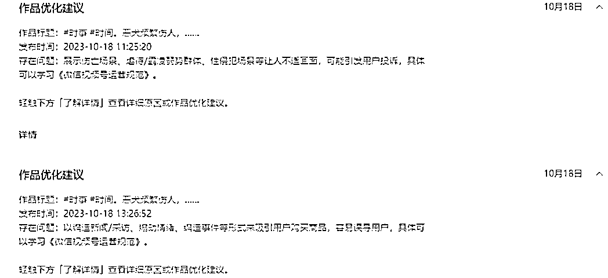

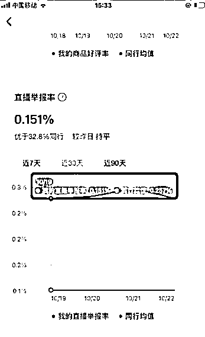

### 10 月 19 日

**09:39**  
仍然收到零散的系统违规提醒。

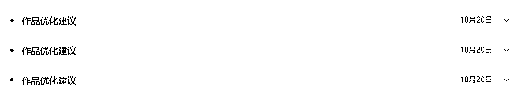

**10:57—19:02**  
断断续续累计直播约 4.5 个小时，期间依旧存在手机卡顿和画面静止问题。

这里再次提醒：视频号建号之后，尽量不要在流量上涨期间随意更换直播手机，否则可能触发账号异常，导致直播断流。

如果确定要做直播，最好在注册账号之前就把设备准备好。

---

## 七、这次最大的失误

### 1. 视频文案里直接写了商品关键词

当时我在发布内容时加入了“驱狗器”等话题。

这样虽然有利于搜索，但也让同行更容易发现你的内容和商品。换句话说，既方便了潜在用户，也方便了同行跟进。

### 2. 视频爆了，样品却还没到

视频开始起量后，我才临时准备直播和样品，导致转化承接不够及时。

做热点项目时，样品、账号、直播设备、发货渠道都应该提前准备。否则一旦内容突然爆发，就会出现流量来了但接不住的问题。

这次的时间差尤其明显：

- 10 月 17 日 23:30：发现选品机会，搜索时还没有相关商品内容；
- 10 月 18 日早上：相关内容已经大量出现，甚至有人开始直播。

如果当时立刻执行，至少可能多拿到几百单，甚至更多。

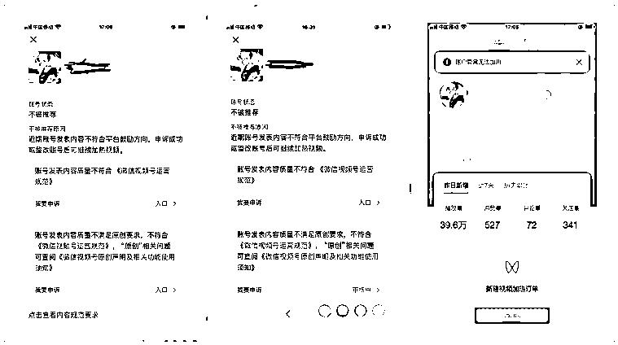

---

## 八、为什么后来没有继续做

不是因为没有账号，也不是因为账号违规，更不是因为内容无法继续加热。

真正原因是样品到手后，我发现实物品质非常差，实际体验和宣传之间差距很大，个人认为属于比较典型的高价低质产品。

如果继续销售这样的商品，即便能够获得佣金，我自己也会觉得不踏实。用户收到货后产生不满甚至投诉，也并不是没有道理。

所以样品收到后，我直接申请退货，决定不再继续做这个品。

这只是我对这款商品的真实体验，并不代表所有正在销售类似产品的人，也没有针对任何圈友的意思。

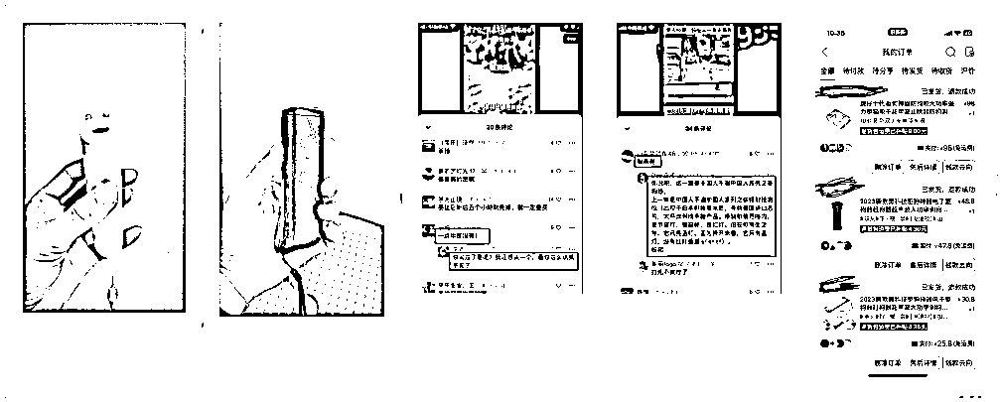

---

## 最后总结

我最终放弃这个品，并不意味着新手不能尝试类似项目。

对新手来说，重要的是先快速跑通一次完整流程：

1. 找到一个有需求的商品；
2. 研究同行和内容素材；
3. 剪出视频并测试自然流；
4. 准备直播间；
5. 承接流量并完成成交；
6. 根据结果复盘优化。

很多事情，别人讲再多，也不如自己真正下场做一遍。只有亲自经历过选品、剪辑、发布、直播、违规提醒、设备故障和售后问题，才会真正理解整个链路。

当然，快速执行不等于什么商品都卖。商品质量、用户体验和长期口碑同样重要。能跑通闭环是第一步，但能不能持续做下去，还要看产品本身是否值得被推荐。

最后，祝大家都能找到适合自己的项目，天天爆单。

也感谢生财有术以及各位分享经验的前辈。这是我第一次进行完整复盘，如果其中有不完善的地方，也欢迎大家提出建议。

