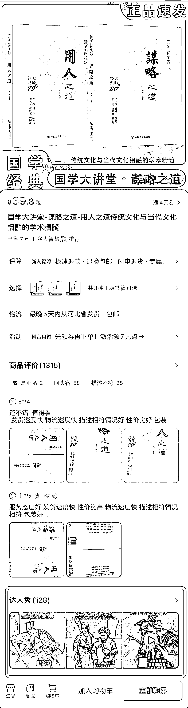
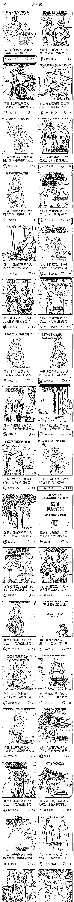
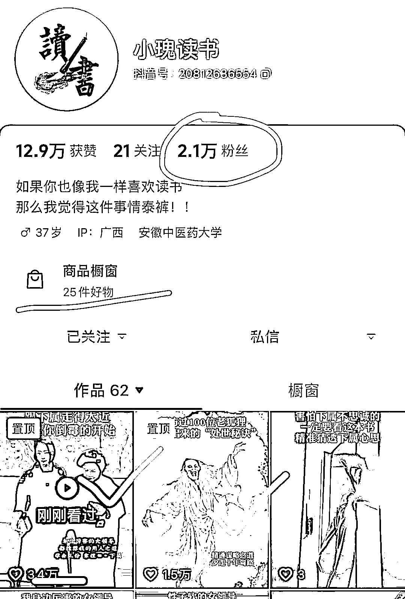
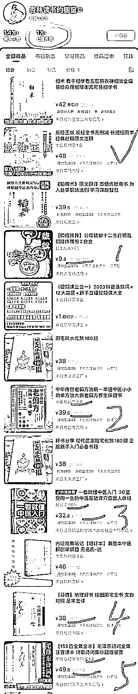

# 用顺藤摸瓜玩转抖音达人秀，低成本挖出可复用的爆款带货脚本

## 低成本，顺藤摸瓜法 2——从达人秀里锁定爆款带货视频

作者： 昊东.Lee

日期：2023-10-16

**前言：这套打法主要服务于深耕爆款带货内容复刻和沉淀，属于需要耐心下功夫的创作积累型玩法。**

## 可以和此前分享过的顺藤摸瓜法 1 配合使用[`t.zsxq.com/13CmAndbN`](https://t.zsxq.com/13CmAndbN)，我常开玩笑称之为商业游击战的穿插战术合集。钱少就靠穿插游击，钱多就靠火力覆盖。

**具体操作思路：**

**1.先锁定一个细分类目，或者直接用产品关键词去搜，再借助带货视频的数据表现挑出一个已经跑通的爆品。**

**2.进入该产品详情页，重点看销量走势、用户评价质量以及店铺整体口碑。**

**3.切到达人秀板块，统计相关视频的互动量级分布，大致分 0-100，100-1000，1000-1w，1w-10w，10w+ 这几个区间。**

**若该品达人秀里点赞最高的视频也只能在 0-1000 徘徊，说明当前市场需求偏弱或创作者内容能力不足，不适合当拆解对象，直接放弃掉。部分新品或小众需求品达人秀数据本身就弱，这类暂时不纳入考量。**

**4.从中挑出点赞异常突出的那一条，判断是否被多位达人二次改编后再次走红，同时排除掉纯靠达人自带粉丝流量的情况。若发现低粉账号和高粉账号都能用同款内容打爆，基本可以判定该脚本击中了用户痛点，具备可拆解复刻的价值。**

**5.点开这条爆款脚本被采用的情况，梳理所有点赞靠前的达人账号，按发布时间倒推找到最早的源头创作者，看看该创作者的粉丝体量以及其他作品的数据表现。再点进他主页里其它表现不错的带货视频，看他带的是啥品，然后把这个新品重新带回步骤 1、2、3、4、5 的循环里继续深挖。**

**6.再打开达人主页的商品橱窗，结合销量、口碑、复购率筛选出他主推的其他潜力品，再次启动步骤 1、2、3、4、5 的循环，形成链条式挖掘。**

备注：文中举例仅为说明方法，实际操作中品控务必自行把关。

* * *

评论区：

弈尘 : [强][强][强][强]

良辰美 : 感谢分享，公众号找爆款文章的逻辑也一样，先把全站阅读量文章抓出来，按时间+阅读量排序，看近一周有没有二创/低粉高赞的文章，那个账号就可以重点拆解

昊东.Lee : 当同一个爆款被不同粉丝量级的达人都能带火，说明它打中了真实需求，只要需求还在，就能持续被复用

* * *