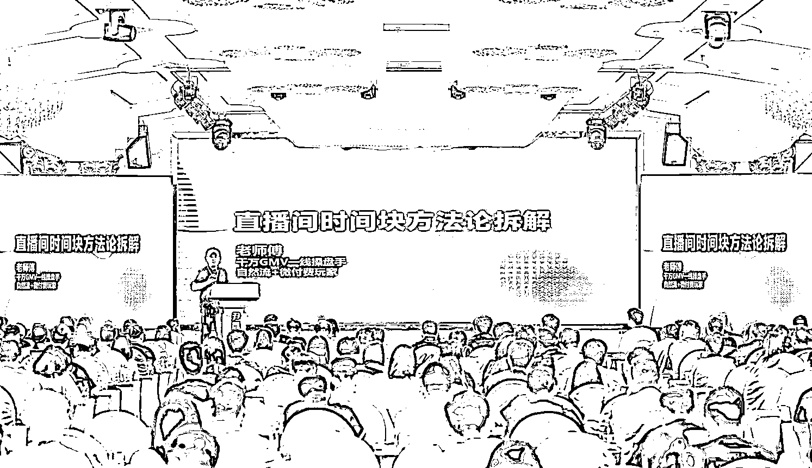
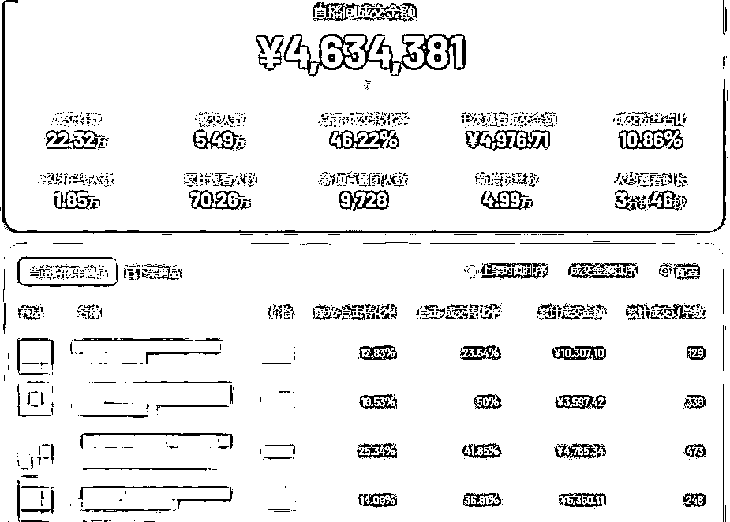

# 单场破百万的背后，是我把直播切成了“时间块”在打
作者：龙哥

很多同学问我，这单场100万到底怎么来的。说白了，不是我会带货，是我学会了和算法赛跑，并且把每一场直播拆成一段段可控的小赛段，在每个赛段里赢下它。

先说清楚底层逻辑。平台的推荐不是一次给定的，它是实时赛马。系统会先试探性投一点流量，看数据反馈，再决定加码还是收回，然后继续试探、反馈、加码。这个循环永不停止。

赛马的核心判定维度就三条：你处在哪个类目、你现在在哪个流量层级、你直播的时间段。简单说，算法会把你放在一个同类目、同层级、同时段的池子里，大家比数据指标，谁强谁吃流量。老号有保护权重，新号也能靠数据表现突围，这就是为什么每天都有新账号冲上来。

懂了这点，就要明白要赢得指标有两个层次。

浅层行为是停留、互动、点关注、刷灯牌，它决定的是来的人多不多，负责把直播间人气拉起来。
深层行为是点击率、点击转化率、GPM，它决定的是来的人买不买，负责把流量沉淀成成交。

浅层做好只是有了人，深层做好才是赚到钱。很多间看着场观很高却卖不动，就是浅层好看深层拉胯，人群被洗不干净，形成恶性循环。

我能预判并干预的三项指标只有三个：停留时长、GPM、点击转化率。这三项在直播中是实时可见的，也是时间块效应最能起作用的地方。操盘手要做的就是盯着大屏，在流量被实时推来的瞬间做阶段性复盘，下个环节该加速、该收敛、该换品。

最关键的是开播前30分钟的预分配流量，也就是我们常说的极速流。它是根据你过往场次的排名给你的首波流量池。这一波拿不住，后面全是被动。预分配=过往排名，实时分配=当下表现。场=预分配+实时分配，你要做的就是一场场优化，把每个时间块的数据都喂饱。

## 流量会走型，型不同打法不同

**L型断崖**
开播就冲上来，30分钟内直接掉。我们常见的原因是产品、话术、节奏没匹配上第一波泛流量。系统惯性推完就没了。
L型背后其实是三种失接：流量太泛接不住、流量量级太小后续没跟上、流量来了但停留时间太短。
这里要区分极速流和泛极速流。极速流里带精准，泛极速流是系统把你临时拉层级了，流量不稳谁都接不住。层级越稳，后续裂变越准。所以起号要稳，不要想着一口吃胖。

起号我一直主张慢起。不是说要几个月，而是前期用单品把人群打极度精准，前端源头准，后端裂变才准。控流速，别被一波泛流量拉爆。马扁起号死得快，就是因为用可买可不买的人群把可留可不留的人留下，人群越来越泛，最后直接凉。

**怎么接极速流？**
没人能100%接住，但50%是必须的。以我常用的260阈值为例，分三种状态：稳定过260、破过但在线波动大、还没破过。
接极速流的核心不是全留住，是筛选出精准人群。绝大多数情况，第一波极速流用直播间的泛爆品或福利品去承接最有效。因为它能最大化满足系统考核的指标。
极速流过来没接住，不代表后续不推了，只是最高流速被降维了。比如顶点5分钟2000人没接住，系统会把最高流速降成5分钟200人继续试探。
这时候要不要卖正价？算法不懂逻辑，它只看你给它什么回报。你能转化就转，不能转就先做停留筛选人群。正价如果是爆品，转正价能拿好数据；如果是低转化正价，转它会拉低GPM，后续流速也会被压。

第一波接住，后60分钟流速基本稳住；前60分钟打好，后120分钟都有底气。这就是时间块效应。注意福利品要和你最终想卖的产品有关联，不然低价带来的泛转化会污染人群，后续更难卖。

**M型双峰**
能再拉起第二波流。原因一般是前60分钟承接不错获得实时分配，直播间出了高转化爆品提升了权重排位，或短视频、付费带来增量。
这时候要立刻判断：第二波在线是停留高带来的还是流速快带来的。
流速快导致的是流量里泛的多，要用短循环话术过渡到平稳去洗人群。
停留高导致的是人货场匹配精准，可以用长循环话术做价值最大化转化。
判断错了，承接策略就全错。

**波浪型多峰**
能做出多峰值的直播间，人货场基本已有优势。在M型基础上，还要做到小时级的精细化。因为系统计算是分秒级，它会根据回传数据重新赛马。
理想状态是每5-10分钟浅层数据和深层数据同时爬升。新号更容易赛马，因为只需要浅层数据。但团队成熟后，5分钟赛一次难度大，可以放宽到10分钟，足够你切换逻辑。
系统想要的是数据被拆成最小单元，越细越容易赢排名。多个小单元叠加就形成小时权重累积。
转化率高但浅层差，或浅层高转化差，都要在实时中补数据。提前准备好话术、品、互动，在缺口处补回来，保持下一个时间块的最低流速不掉。
吃透第一波，60分钟峰值也许上不去，但最低流速会被拉高，持续推流就有了。

总结一句话：直播间只接流量不拉流量，接得好流量自然高。

## 节奏、排品和憋单是执行力

排品基础是引流品、爆品、利润品。引流品负责拉停留承接实时流量。
节奏必须随流速波动调整。流速快时观察是停留高还是人多到来快，如果是停留高就提高商品讲解信息密度，加速承接；流速慢在线低时就转福利或引流款，把进来的人留住，适当放慢节奏配合卡库存、互动，把人留下来为后续流速做铺垫。

爆款上场要微微憋单循环卖。款一般就微憋单+频繁锁单放单，保证停留和互动。款不行就憋单+补福利。承接不住流量的核心原因是节奏和流量节点不匹配。该憋时憋，该放时立刻放。憋时去放单错过流量，放时去憋单又把人气憋死了。

数据策略上，账号权重=小时场观。场观越高权重越高。提高场观本质是提高流量层级，而提高层级靠的是憋在线人数和在线峰值。在线高了平台才会加推流速。

别误解憋单=低价=马扁。好憋单是人性理解+价值塑造。场观不够用憋单做浅层数据，场观过千后用真诚讲解做价值憋单。浅层里最重要的就是停留。只要你能把即时停留拉起来，其他权重考核的优先级都会下降。停留不是靠一个人待整场，而是多个人长时间停留的平均值。

低客单要做成交密度激发推流，高客单要做GPM激发推流。跟赛马对手比，对手5分钟卖多少，就要看清差距。卡库存和封单是中控配合的活，人气不足时及时封单保在线；封单能让犹豫的人下一波更果断下单。无论正价还是福利，都要控单留成交余量做二次憋单，避免一轮转化率过高导致下一波不稳。

说到底很多时候是中控在起号。中控要随时给主播信息、配合展示讲解、带节奏、场控。新人主播配个逻辑清晰的中控，点对点阶段会筛关注列表感知标签精准度，该拉黑拉黑，该成交提醒成交；做实时复盘，调节情绪；用权重话术制造停留互动；卡千次、卡空单、偷单、暗单；回弹幕填尴尬。

至于拉时长，起号期先别追求。拉时长的本质是守流量。付费直播能拉时长是因为流量稳定+人货场强。自然流在线会随时间衰减，平台算平均数据，数据差下一场流量就降。建议先把每场数据做成上升趋势，每场该下播下播，不该下播坚决不下播，做好每个时间节点。

想拿更高流量层级，先配得上它。成交密度不匹配人气就别轻易破层级。层级要一层层过，跳级拿不属于你的流量，号会死得很快。人群泛了，账号就凉了。

## 话术要分时段打

主播不能一套话术走全场。要根据流量波动随时切换。话术大类有长循环、短循环、长短双循环。
长循环约5-7分钟一轮，是常见慢话术。6分钟一个循环里，3分钟价值塑造做专业，1分钟性价比拉状态，30秒信任做真诚。可以在此基础上根据实时数据决定是拉长还是缩短。

把直播切成时间块，在每个块里完成一次浅层+深层的双提升，块块叠加，场场递增。单场100万不是一瞬间的爆发，是30分钟一个时间块、5分钟一个最小单元，稳稳地赢下来。

买单理由 30 秒——情绪拉满，这段可以交给场控或副播来做。

逼单 30 秒——状态打满，同样适合场控或副播承接。

收单 30 秒——情绪平稳甚至偏情绪化，目的也是为了避免冲动下单后立刻退款。

这种长循环的打法，适合的是底盘流速不低并且能保持稳定、在线和停留都还不错的场子，核心目标就是转化。循环的时长要结合产品的客单价和当前流量的层级来定。

过程中会出现一种情况，主播节奏突然被带飞了，在线一下子上来了，想用原有的长循环去接住，结果发现人群没卡住。这就是话术节奏和流量节点没对上，找原因也很难定位。

这时候要先判断清楚，是流速变快了，还是停留起来了。能看到人多且不跑，就说明产品是吃得住的，这时可以更有底气继续用长循环，但要里面穿插短循环，形成长短结合的节奏。

培养新人或帮新人写话术，不必一上来就抠词，先把你要表达的逻辑点拆出来，再往里填内容，反而快且稳。刚才那套逻辑，几分钟就能搭出来，逻辑通了，话术自然就有感觉。

再看短循环的常用逻辑：利益点、留人点、互动点、信任点、可期待点。

短循环适合极速流的最高流速阶段，也适合最低流速缓慢的节点，核心是让话术逻辑贴合流量特征，把留存做到极致。

流速+留存=在线。

短循环时长很短，但是一环扣一环。在流量泛、进速快的时候，你能用它卡住人群特征匹配节点；在流速慢的时候，你也能用它卡住人群特征。因为无论什么流量，场外给你的是曝光，你要用短循环的逻辑把曝光变成进场，进场变成场观，进场承接新的人。

如果流速正常但在线不高，就去做留存优化。影响留存的维度有产品、话术、场景、钩子、内容、福利。

如果流速不正常，就看流速的来源。浅层数据是曝光和进率，深层数据是后续转化。激活流速最直接的是浅层数据，某种程度上可以说一切从停留开始。

高场观的前提是高曝光，曝光人次也能通过 5 分钟数据、半小时数据、上场数据来判断，这就是时间块效应。

浅层数据解决的是流量数量，质量的筛选要靠产品和话术把人群洗透。

话术逻辑理顺后，再去打磨个人状态，情绪化可以放大话术效果。优化两秒这里，优化两秒那里，实时停留和平均停留都会上去。

综合起来：产品+话术+主播状态=节奏，节奏决定转化效率。

人货场是你入局的门槛，不展开说。

无论单品还是多品，至少为一个品准备两种话术逻辑，快慢双话术，以备直播中流量波动时能及时匹配节点，把流量价值吃满。

很多人话术没问题却接不住流量的原因之一，就是话术只有内容没逻辑，没有攻击性，没有利他思维，只有营销思维。

互动带不动怎么办。

先理解为什么要互动。从算法来看，最近一分钟的互动率能直接影响推流，可以理解为分钟级评论=流速。其次，没有互动就没有氛围，客户看到别人互动了，氛围起来了，才更容易下单。所以互动本质上影响流速和转化。优秀的自然流主播拉互动的意识都很强，能随时用个人话术强拉。

但直播间不会无缘无故出现互动，一定是你触发了行为动机：需求、渴望、从众、期待感、冲动感、贪欲、甚至负面点。

你没抓到需求点，想让人行动，就要先给价值来激发行为。价值包括福利价值和情绪价值，通过憋单节奏把价值慢慢塑造起来，期待感就上来了，再配合水军带动，真实互动就会跟上。

不是人设博主的，把互动话术固化进固定流程，不要临时发挥，容易被打乱。想好几个关键点，嵌在短循环里、穿插进长循环里即可。

底层思维反过来想：不断问自己能给对方什么，而不是我要对方做什么。

憋单的时间长短和时机要看实际情况。直播间只有 3 个人去憋单，人会直接憋走。30 个人在的时候可以啰嗦一下，你要憋住即时在线，也就是实时停留。

1-10 人点对点平播来建模建稳。平播、点对点更多靠人性话术，不断挖痛点，但挖出痛点别马上给解法，先放大痛点再给解法。

过程中带来的末端泛流量虽然不是目标人群，也要让他们留下做浅层数据，才能裂变。哪怕冲动消费后退款，这个成交也会影响下一波流量的起量，有价值。

冲动是情绪的积压与释放。积压是塑品和制造期待，释放是放单时刻。塑品憋单时要先制造强期待再放单，放单前用公屏互动测试冲动程度和人数。

塑品的目的是放大产品价值感，让用户觉得买对了。

高人气间的话术重点是身份认同和价值观共情，也就是人货场匹配。要先搞清楚听你话的人是谁，他们在经历什么。

总结：主播可以忘词，但不能忘框架逻辑。

做自然流一定要围绕人性出发。

一个误区：我起新号学了别人在线很高卖得好的话术，为什么在我这没用。因为他们的节奏是控大流量的，我们新号标签不准，流量进秒出，账号曝光了但没进来。

第四节，直播中的精细化复盘

熟练团队不需要下播复盘，主播怪运营运营怪主播最后产品背锅。罗盘上每波数据都在决定后面数据，要做不下播复盘，过程复盘能改变结果复盘。

定一场直播框架要有基本脚本。有经验的团队现场调整，有无脚本团队就需要靠脚本保底。脚本和本场节点不一定完全匹配，但节点出现时有框架就有应急方案，不会慌。

脚本作用是管理主播话术，最受益的是主播，能明确每个时间段做什么，还没做什么，也能传递更多互动内容。

很多复盘只谈场观、GMV、互动多少，这只是统计，不是复盘。高质量复盘是在每一场里找到问题并优化。没有脚本就梳理不清问题在哪，销量低、互动少也说不清。

做脚本的逻辑：

1. 把握节奏，可根据实时状态调整售卖顺序
2. 激活推流：产品热点、卖点、槽点、互动交替进行
3. 主题明确
4. 协作：降低主播压力，十个十分钟重复即可
5. 商品卖点：每款商品设定清晰卖点用以吸引精准用户下单

以开播 2 小时为例，时间块价值排序：0-5 分、5-10 分、10-15 分、15-20 分、20-25 分、25-30 分、30-45 分、45-60 分。每账号流量架构不同，也可分为 0-15 分、15-45 分、45-95 分、95 分以后，按自身阶段划分。

实时复盘先搞清流量从哪来，即流量分配。直播间能否给用户创造价值取决于停留和互动。能否给平台创造价值取决于成交。所以看大盘就能判断是缺浅层还是缺深层数据。

流量数据指标分两维：场观，和流速峰值。流速和峰值要一起拆，直播间不能脱离流速看峰值。单纯看峰值和在线容易忽略阶段数据，造成无效复盘。峰值要结合流速、分阶段看，也就是时间块效应。流速、峰值拆得越细，参考价值越大，比如 5 分钟流速，甚至分钟级。

观察 5 分钟缺了什么，实时停留短，下个节点就补能拉停留的话术。缺成交就改排品，穿插福利品。

有了一定规模场观后，平台会考核深层电商数据，转化能力不达标，流量层级会掉。

健康间是阶段性拉流：先用浅层数据要场观，再测试转化要成交，再扩大场观。即拉升流量、转化流量、继续拉升流量。在保证人群筛选和转化前提下再扩数量，就不会是一波流，会出现二波、三波。

分析直播间一定要实时把数据指标拆到账号阶段、直播时段，而不是只看全场 GMV、转化率。

细节：在线有阈值 260 人，Feed 推荐也有阈值。账号有标签时，推荐占比掉第一时间要拉在线。比如推荐占比 88%，每分钟推 100 人；89%，每分钟推 300 人；90%就推 2000 人。

260 人阈值，无经验团队或受众窄的账号不建议快速破，破得越早越容易死。起号 260 人来得越晚越稳，宁愿在 260 人以下苟住，也别在 1000 人在线暴毙。抖音自然流讲究求慢，不要一场爆流。一直在 200 人左右，GMV 也能做且平稳。第二天就 1000 人，账号歇菜概率很大。260 人以下相对精准，260 人以上抖音对主播能力要求完全不同，因为赛马机制层级不同。

直播时要时刻有数据意识。中控或其他人要在不打扰主播节奏下及时提醒、补数据、补权重话术。

所有话术是随罗盘数据改变的。

起新号第一步建模，第二步破层级。建模成功标准：开播系统推泛流量你能转化→系统加大同属性人群推流→你能稳定转化→系统放大同属性人群推流→你能稳定转化→建模成功。

破层级就是破场观、破在线、破进入，让系统知道你有被利用价值。

容易踩坑的细节：

憋单也是憋停留和流速，憋单前要有基本流速。5 分钟只进几个人时憋单无意义，要点对点把模型更精准，用利益话术和人性话术做基础流速。

憋单品必须验证过，有爆款或潜在爆款才有憋的意义。用福利款重憋，拉来的流速是泛人群，只适合泛爆品。没有爆款后续转化，人群洗不透，憋单意义就没了。

憋流速优先级：停留-互动-转粉-灯牌。

憋单核心是价值塑造，掌握逻辑，长循环话术本身也是在憋单。

憋单适用多种流量架构，关键是节点和流量是否匹配。

接极速流也在憋单，怎么接、用什么品接，按账号制定方案。

总结问题 2：直播准备要做到及时策略调整，不要等下播。账号掉层级是连续几天数据不佳导致，开播中能及时优化，账号存活周期就更长。自然流赛马机制不确定，配合微付费更稳。付费是放大人货场，验证人货场没问题后再配合付费，ROI 基本稳赚不亏。若直播节奏和人货场有问题又大量付费，自然流占比会降，付费也会亏，最后账号死掉。

总结问题 3：现在运营信息差基本没有了，是细节差。不要纠结套路玩法，要纠结细节怎么优化。重心放在产品-场景-话术上。

话术与人群匹配、产品与人群匹配、人群与流量匹配。

* * *

评论区：

如风 : 太干了

* * *