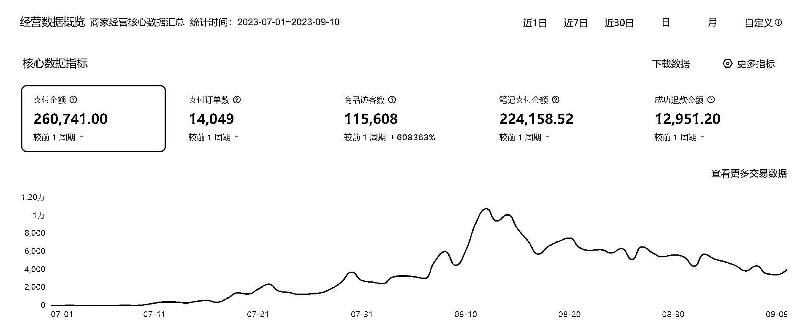
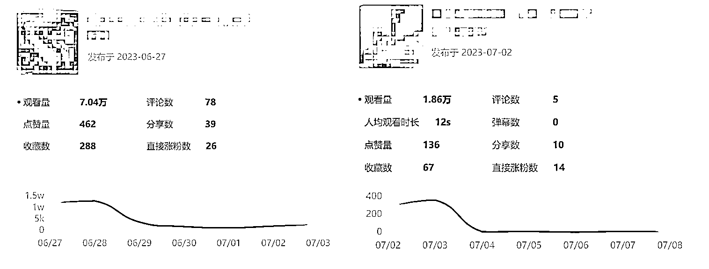
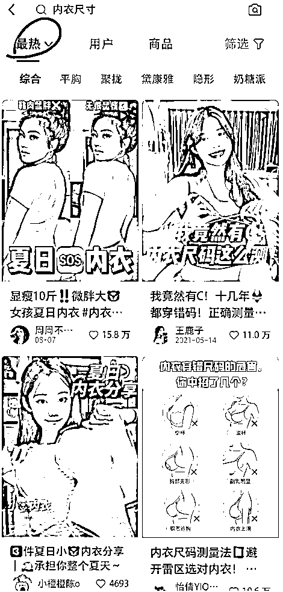
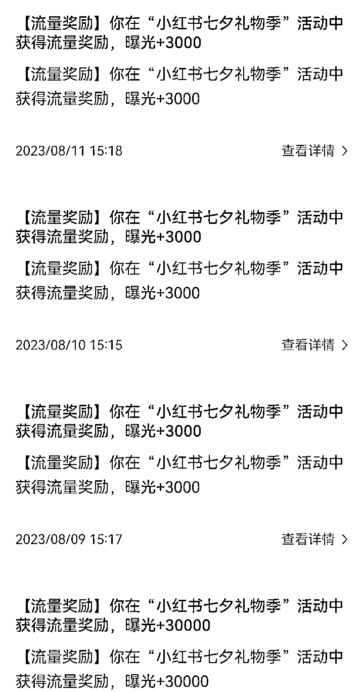

# 乘着规则东风，我在📕做电商，两个月实现26万+变现的实操复盘

## 精华帖 抓住风口，顺应规则，我是龙哥，两个月变现26w+的

作者：未兰子🌱
日期：2023-10-17

大家好，我是做海内外电商的未兰子 Lanny。这次加入赚钱航海的📕店铺项目，把我的真实战绩跟大家同步一下：运营两个月累计变现26w+，累计销量1.4w+。

先简单说下我的背景：

之前做跨境独立站多年，自己孵化过两三个爆品，月利润最高冲到20w。后来在一家工贸一体公司带3人团队做品牌精细化运营，一年后因个人原因离职，团队解散，网站就只剩下自然流量托管，月均净赚约2万。之后在一家公司担任海外推广经理，因长期高压状态身体吃不消，想转自由职业，于是加入赚钱开始研究📕电商。

从8月起手，目前日销稳定在100+以上，峰值到过500+，利润率保持在30%+。可以看到8月冲顶之后数据一直在走下坡，这个下滑原因我后面会拆解。

目前成绩最好的就是这个号。5月加入航海以来，我一共开了6个号，试过5个赛道。其中4个号只是浅尝即止，有出单的2个号，另一个号因为搬运违规被废，虽出了几十单但不计入统计。

我是一人全职在做。对比上班，工作量不小，赚的钱也谈不上暴富，但心态完全不同，我觉得机会点会更多。

下面进入正题，我到底是怎么做的。

**第一步，先把平台吃透**

这也是我当时选择📕店铺航海的原因之一，因为我本来就很熟。

我一直是📕的重度用户。买东西前，以前会去知乎搜，现在基本都搜📕。📕聚集了大量年轻女性，正是消费主力，所以我先感受到它的商业价值。后来平台开放电商，赚钱也同步上了这个航海项目，我就觉得时机到了。Tips：这几年做电商的经验告诉我，能赚钱的很多都是早期入局者，所以要敢于试。

而且📕以图文视频为主，比起知乎长篇大论，视频图片的信任感和信息传达速度更快。我也切身感受到它的推荐算法很强。Tips：这也说明了做SEO布局的重要性。

另外这是一个年轻人分享生活的社区，种草氛围极浓，软广做得润物无声。

我一直做电商，对硬广很敏感，但在📕上，有些笔记明明在带货，看起来却毫无违和，还能学到不少技巧。Tips：多刷笔记就能学到营销套路。

从这些可以看出，**📕带货的核心是解决买家决策前的疑问。**

比如卖内衣的账号，内容往往围绕：
1. 怎么挑合适的尺码
2. 面料怎么选
3. 不同款型怎么挑
4. 使用心得分享
我的多数爆款都是这种话题。

再比如功效类产品互动高的标题通常是：
1. 真实记录，我用XXX一个月后的变化
2. XXX是智商税吗
3. XXX? 能劝一个是一个

这些都是用户在下单前会主动搜索的内容。内容做得好，热度高，转化自然不会差，还显得更专业，涨粉也快。

这类内容可以提前规划。我有几篇干货笔记讲挑选方法、使用注意、成分解析，转化都很不错。观察到的头部账号也以干货为主，热度高的笔记多是分享型。所以我决定把内容做好。

**我认为📕的核心定位是分享知识，而不是硬卖。**

你可以先分享选购指南、用法、注意事项、个人体验，再顺带带产品。这样的内容涨粉更快，平台也更喜欢，流量限制小，能做得更久，复制门槛也高。

明确平台调性后，我有了方向，接下来就从零开始实操。

**1. 萌芽期：定定位**

从可持续产出内容出发来定IP，再定话题，最后找对应产品。我最终锁定健康赛道，因为关注健康的人群正在年轻化。

刚开始我走了很多弯路。

先试过美甲，发现内容很难持续，大多数对标号都是晒图，热度高的多为原创，我不会原创，只能搬运，很难坚持就放弃了。

接着试防晒口罩、防晒衣，模仿热门帖发内容，新号发几篇小眼睛就破千。但当时账号不在自己手上，资金结算麻烦，就没持续运营。**现在回头看，这种法子很适合新号养号。**

试了几个方向后，我才决定做健康类产品，主要有四点考虑：
1. 我自己也关注健康，有需求，可能别人也有
2. 刷到一个店铺销量不错的账号，可以参考
3. 数据显示健康养生主力是一线、新一线城市的年轻女性，18-24岁占比近44%，趋势很明显
4. 这类内容利他性强，可深挖，易涨粉

基于以上，我在健康号上投入了最多精力。

我同时运营多个号，为效率从图文入手，在📕和淘宝逛逛找可参考内容做改写。

一开始我图快，直接下载图加水印表情就发。新号小眼睛蹭蹭涨，粉丝从0到十几个，立马上架产品几天就出单了，觉得📕太好做了。

**但随后笔记连续违规，数据掉到20以内，号废了。**

号虽然废了，但前期数据证明方向是对的，话题好找，店铺有转化，只是粗暴搬运不适合长期做。

纠结一阵后，我果断放弃新号，回到自己老号继续做。

**2. 成长期：优化笔记**

这次找到对标后，我用Canva自己做图。虽然顺利做出两篇点赞曝光不错的笔记，粉丝开始回升。我把之前出过单的产品挂上，同时开始混剪产品相关视频发布。

有个单品出单特别好，我就深挖它的别称、使用场景、功能点，再去淘宝看评论里有哪些可做话题的点，衍生出很多内容。

没样品时我先用淘宝评论区的图视频剪辑，后来自己囤样品拍。

新手做笔记最关键的一点就是学会模仿。笔记拆成封面、标题、内容三部分，分别找📕热榜的做参考。

比如做内衣尺码话题，就搜“内衣尺码”按热度排，看发布时间、博主粉丝量做权重分析，挑最吸睛的标题模仿，再挑最吸引的内容模仿，用ChatGPT重写，标题同理。

我全程没用其他工具，就靠这套方法做出很多爆款。

也可以找最新内容，点赞高粉丝少的，快速跟进。

如果日更枯竭，可以从这四点找灵感：
1. 模仿稍微高一层的账号：用小号关注同量级或稍好的博主
2. 代入买前会犹豫的问题
3. 售前售后客户常问问题
4. 买前会搜的内容：📕搜索框+5118

重复一遍，📕卖货要做内容，内容好才有流量。要站在消费者会关心什么的角度。

比如卖健腹轮，别只讲材质多好，而要围绕马甲线、大肚子、腹肌等话题展开。刚起号更不要只讲硬核健身。

可复用的话题模型：
1. 真实体验分享
2. 我用了X天的变化
3. XXX真的有用吗
4. XXX是不是智商税
5. XXX能劝一个是一个

几个小细节：
1. 封面可带标题，颜色鲜艳，字体大
2. 标题可带emoji

以上都需要多刷📕，吸收这个圈层的表达习惯。

**3. 成熟期：解决货源**

内容跑通、单品日出10+单稳定后，我开始找固定供应商解决发货和物流。

我在1688上找供应商，看销量、价格、评论、店铺粉丝量，找4-5家确定产品集中的产地，锁定两家作为备选。

粉丝量上来后，我担心平台识别搬运素材，就向供应商要实拍图，后来自己拍样品留档，下次换话题也能快速拼剪，省时很多。

但自己发货也踩坑：

1. **一定要留至少X+3天的库存，X为补货天数。**
有一次供应商离得近，当天发次日到，我等快卖完才下单，结果到货是劣质品。供货商说工厂缺货从别家调的，导致客户单子全耽误，丢单加物流评分下降。因为之前拿货一直顺畅，这次没做风险预留。事后我立刻找了另一家备货。因为怕撕破脸影响店铺信息安全，最后还是没闹大。

2. **赠品也要控库存。**
一个印刷品赠品因大雨物流延误，我三四天后才发现，库存断了。临时找附近打印店加急，花了5倍成本买单。赠品也要算库存。

**4. 成熟期：增加流量**

之前笔记带上#商品笔记扶苗计划和当期热话题，自己拍摄的几篇获得了大几千到上万曝光，单量随之暴涨。

**核心是平台规则第一。**所以我会持续关注平台新玩法和可参与话题。写这段时正逢双十一扶持直播，我就立刻去直播了。

另外要重视商业话题，比如我多次参与📕七夕礼物季，流量非常友好。

这些话题都在标签里体现，标签很重要。

常用工具：
1. 视频剪辑：剪映为主，必要时用美图秀秀加滤镜
2. 图片编辑：美图秀秀，会员版文字贴纸音乐更贴合📕、Canva
3. 文案产出：ChatGPT、new bing chat

**5. 选品决定上限**

所有环节里，选品最关键。我运气好选对了产品，一款单品卖了2w+，出单1w+。

这个品的特点是好看又实用，市场上还算新品类，功能实在，好做内容。

因此选品很重要，可用蝉小红等工具辅助，但更多靠运气和坚持。感恩。

这也解释了为什么高峰后下滑：一是同行跟进，市场需求被满足；二是平台流量有奖励期，相关话题少了，流量自然回落。

我现在在筹备养生食补赛道的产品，有资源的可以推荐。

以上就是我的分享。因为时间紧，这几天重心在选品，一边准备用同样思路起新号，一边应对老产品周期下滑，立刻做出调整不能死磕。

最后总结能取得小成果的几个点：

**首先，做你感兴趣且相对擅长的事。**
我对健康知识感兴趣，也愿意深耕；之前有跨境电商和内容营销经验，对好内容更敏感。只要市场够大还没红海，稍微擅长就能有小回报。朋友之前做销讲，后来在抖音做男装直播带货，现在做得比我好。他没选女装也不做内容，而是选男装直播。说明在大赛道里总能找到位置。

**其次，抓住风口。**
📕电商前年就火，现在入场难度更高。就像当年独立站有势头我就去做了。新玩法出现，大胆试。

**还有，顺应平台规则。**
📕重素人种草、有价值内容、好看的图，你照做成功率更高。

最后，现实多变，思考和行动要平衡。

**既要脚踏实地做，也要抽时间思考，两者缺一不可。**

* * *

评论区：
翔叔 : 海外独立站现在还适合入吗？
zhAzha : 不是很理解为什么不做好独立站
未兰子🌱 : 我感觉小众品类还能做，满足特定人群。但整体没有以前好。新手不建议入局，有产品和营销渠道优势的可试试。
未兰子🌱 : 当初不做独立站不是我能完全掌控的。工厂产品问题多，解决慢，也太累。对比📕更印证一句话。前期两三个月独立站基本亏损，测品测不准营销没做好会一直亏。独立站重营销，一人做除非超幸运，不然要堆内容。所以我不会选独立站。
嘉明 Lock : 评论区回复对我帮助很大，及时止损。
龙哥 : 感谢分享，已加精华。
金珠 : 主要品类是健康方面吗？
西瓜🍉 : 需要自己囤货吗？📕出单后是再去1688下单让厂家发货吗

* * *