# 小而美的 90 天 1V1 私教，我是怎么做到客单 4999、好评超 80% 的

## 如何把 90 天陪跑做成轻量又高口碑的交付

作者： 奔跑的十二

日期：2023-10-27

90 天一对一陪跑，定价 4999 元，好评率稳定在 80% 以上，背后的交付节奏其实很清晰。

第一个月主打课程+实操：每天更新一节课，学完立刻落地。
第二个月主打督促+关怀：一对一跟进状态，精修学员作业。
第三个月主打反馈+优化：以学员拿到的实际成绩为依据，针对性迭代账号。

整个 90 天跑下来，只有首月会偏忙，后续基本进入轻松维护期。

下面把我从成交到课程搭建，再到 30 天内完成一次陪跑的完整打法拆开讲。

不多废话，直接上干货。

# 一、我是谁

真诚来自持续的自我介绍。我叫十二，之前用 2 个月做起过 22 万粉的某音号，后来操盘过某位头部大 V 的📕垂类账号，在自媒体赛道里算中上游。

我独立扛过直播销售和训练营交付，也全程负责过私教交付。4 个月做到百万级变现，同时带出不少爆款笔记和变现能力强的博主。

后来我自己开设📕一对一私教班，证据贴在后面：

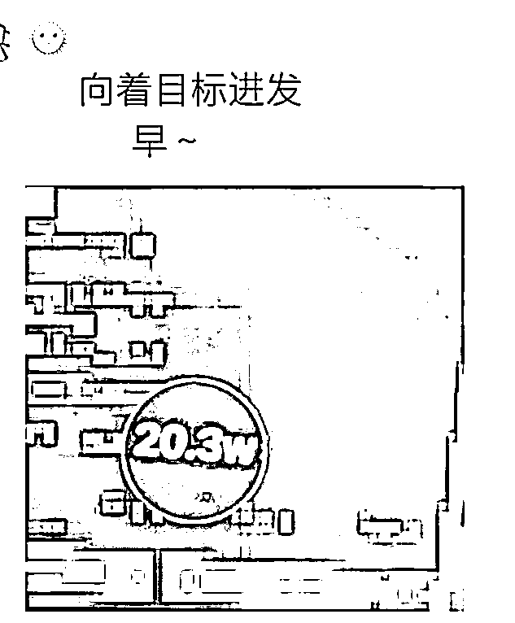

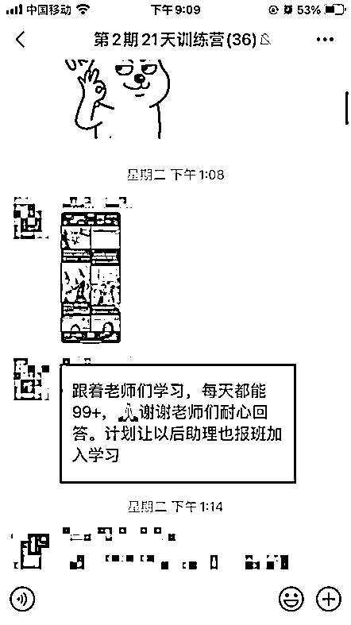

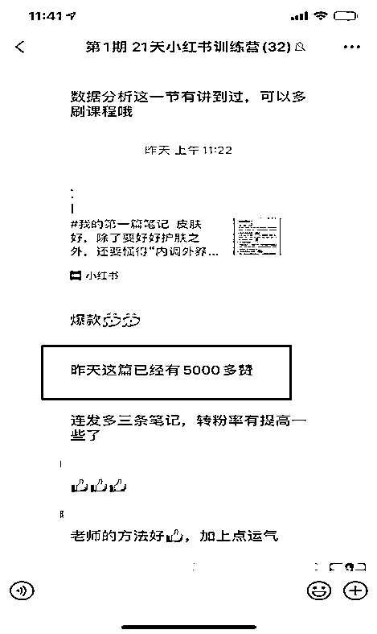

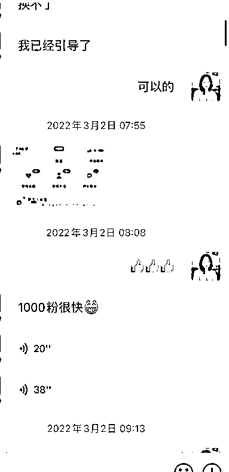

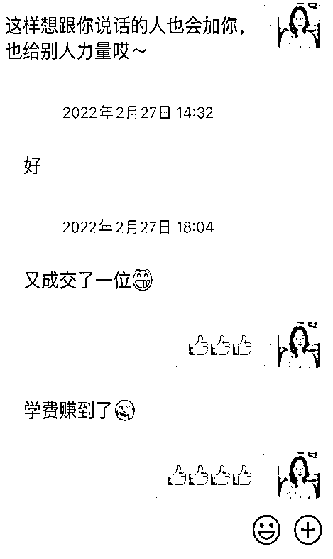

我的私教班已经孵化出多个赛道的优秀创作者，包含低粉就开始赚钱的案例

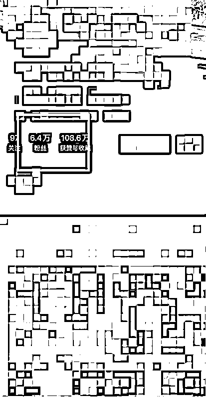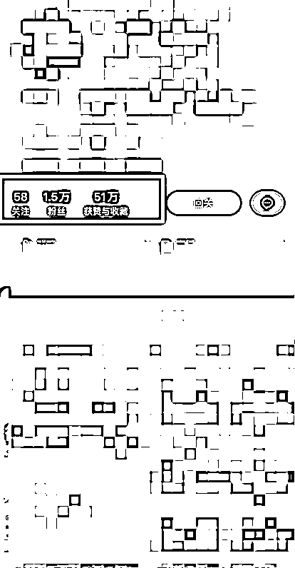

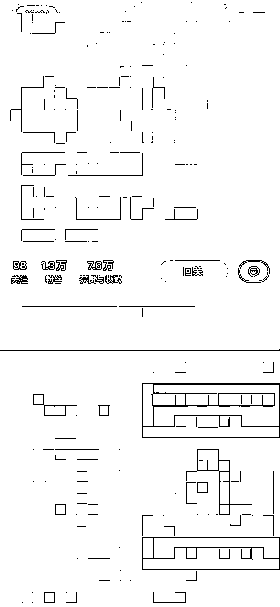

低粉启动变现的账号样本

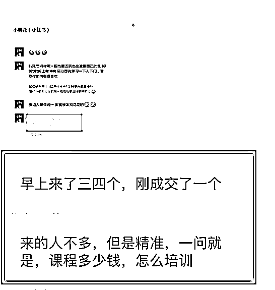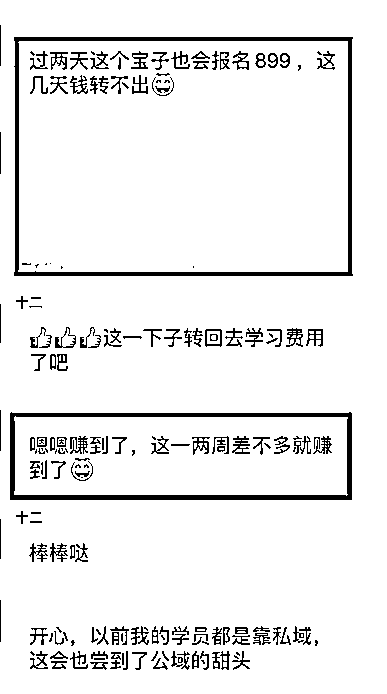

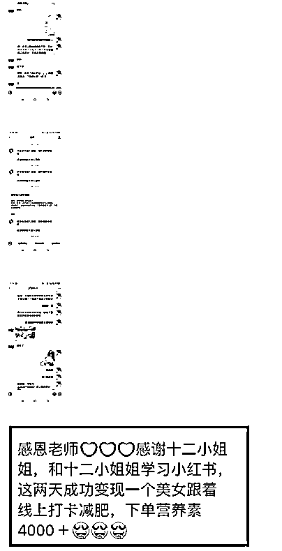

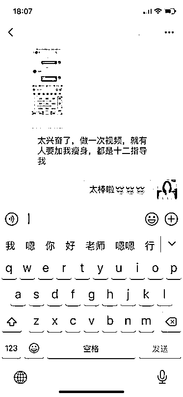

简单说，我服务的人群是：想入局自媒体却无从下手、有产品不知道怎么引流做内容、已经有账号却卡在变现的人。

跟我学自媒体的思路是：10 到 20 篇笔记就能出百赞千赞的爆款。定位阶段就把流量和变现两条线打通，而不是先堆粉丝再想怎么赚钱。

# 二、交付全流程

回到交付本身，我的客单是 4999 元，目前学员好评率在 80% 以上。

获客主要来自直播间和合伙人，分发情况如下：

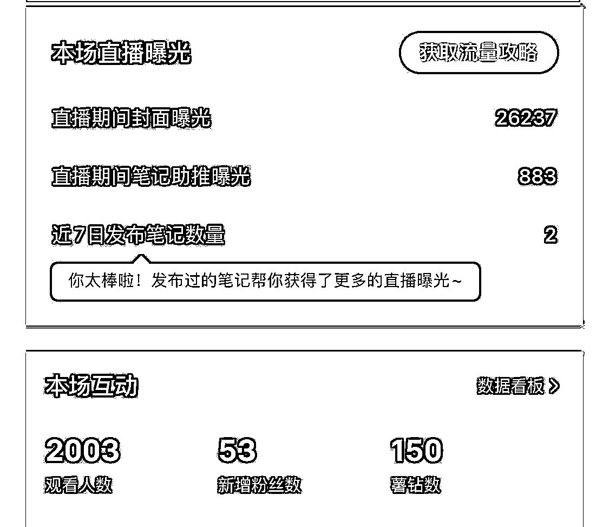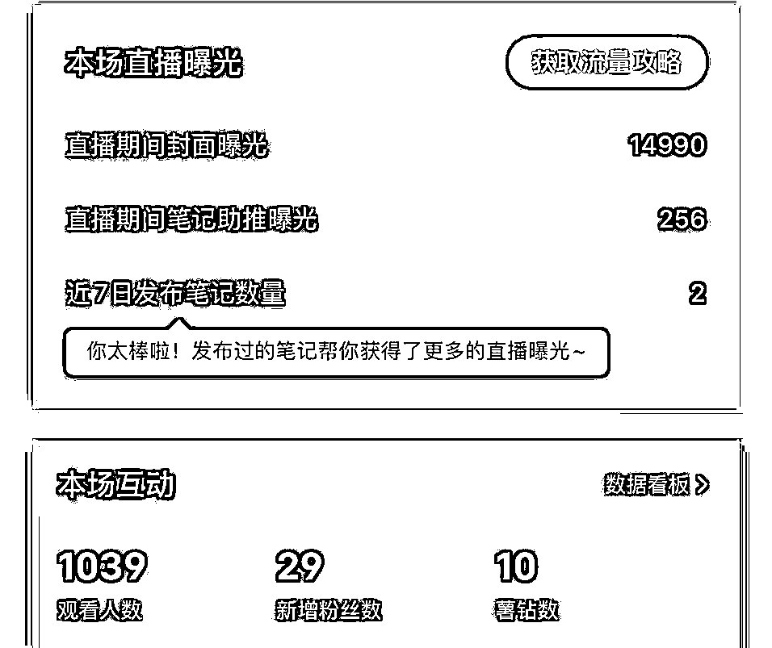

再强调一次，📕直播非常适合普通人上手，小白通常 10 场内就能上手。

我本人每天直播 1 到 3 小时，多在午间或晚间。
直播间或朋友圈直接成交，月变现基本稳定在 1 到 3 万。

交付周期是 90 天，核心组合是课程+实操+监督。

**第一个月：课程+实操**

完成定位电话后正式开课，每天一节课，课程全部开放。不会死板点名，而是日常轻聊进度，“宝，上次剪辑做到哪了？卡在哪一步？群里随时说”。让学员感受到被关注，也会主动汇报。

17 节课学完，普通学员刚好一个月，优秀学员一周就能通关，直接进入一对一改笔记环节，这其实已是第二个月的内容。

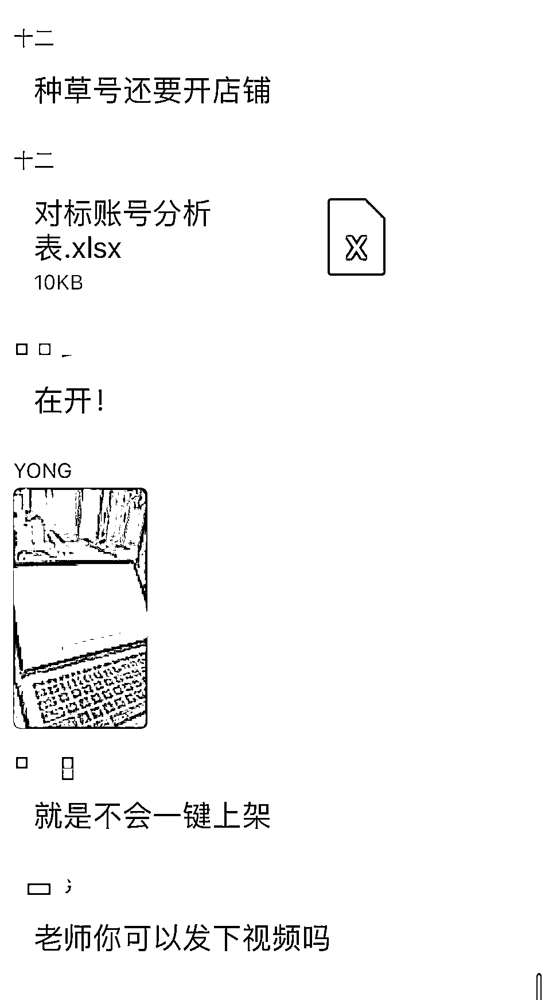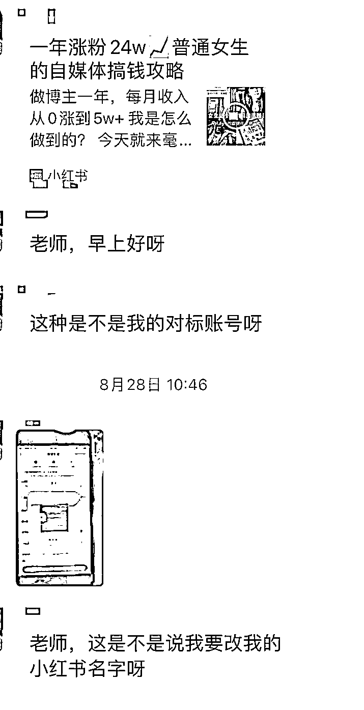

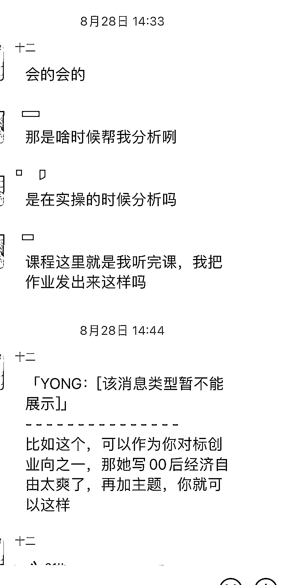

这是我一个做包包创业的学员，通完定位电话后进入作业沟通阶段，现在直播第二场就做到近 5000 的业绩。

**第二个月：笔记一对一修改**

核心是 push 学员保持“每天在做📕”的体感。了解他们当前在做什么，更多时候是情绪、家庭等外部因素导致更新慢，这时需要多关怀、给鼓励。

鼓励能拉近关系，也能激发行动力。每天围绕选题是否找准、脚本拆解是否完成、是否写出来、是否拍摄、发布数据如何、咨询如何回复、朋友圈如何打造，进行循环跟进。

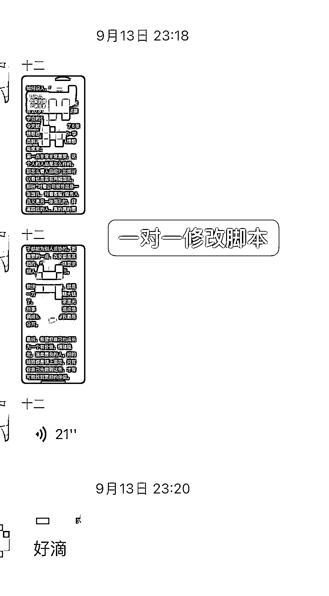

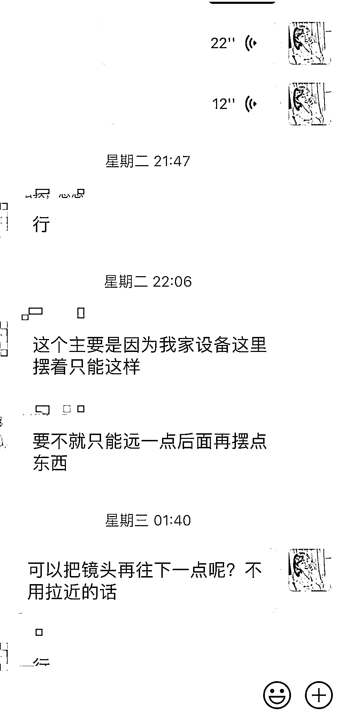

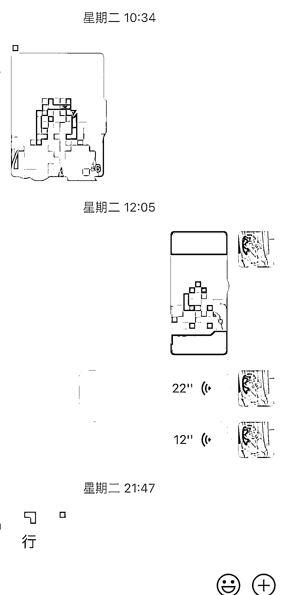

举个例子，我情感赛道的学员发来脚本，我不会逐字重写，而是指出缺失板块、补充方向、拍摄角度和画面优化建议，以及剪辑音效的提升点。

**第三个月：成绩反馈+账号 SOP 优化**

前两个月积累下来，第三个月基本进入出成绩期。不断提醒学员“有结果了记得报喜，我会很开心”，这是双向成就感。

同时询问当下痛点，比如如何更好地交付学员、如何节省内容生产时间等。第一次电话沟通时，我就把赛道定位、变现方向、内容方法全盘梳理清楚，让学员对自媒体建立清晰认知。

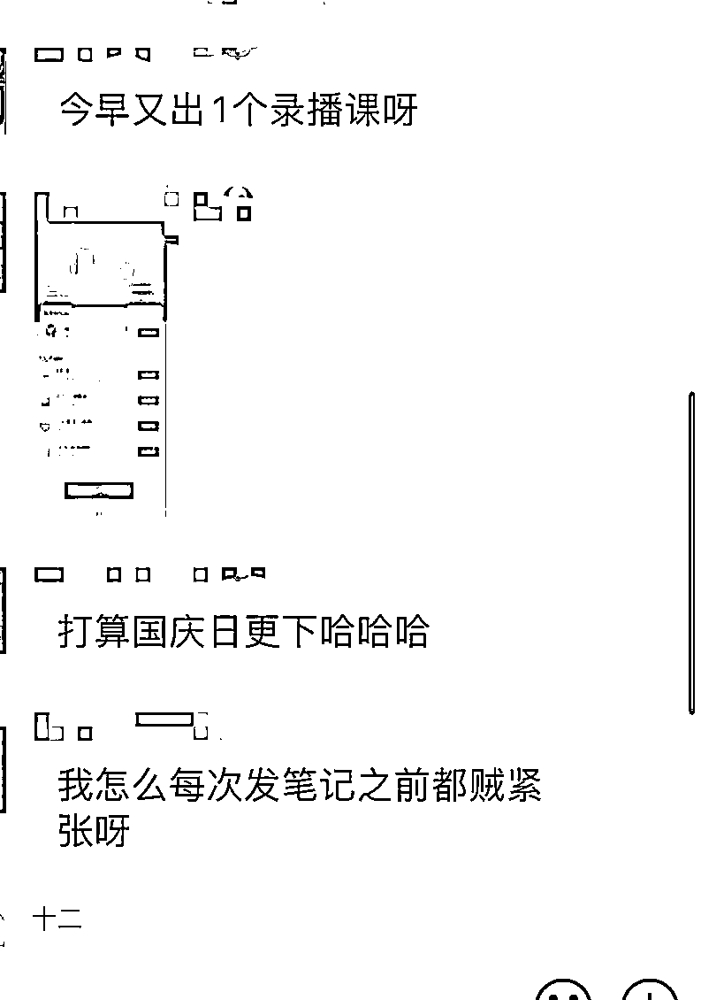

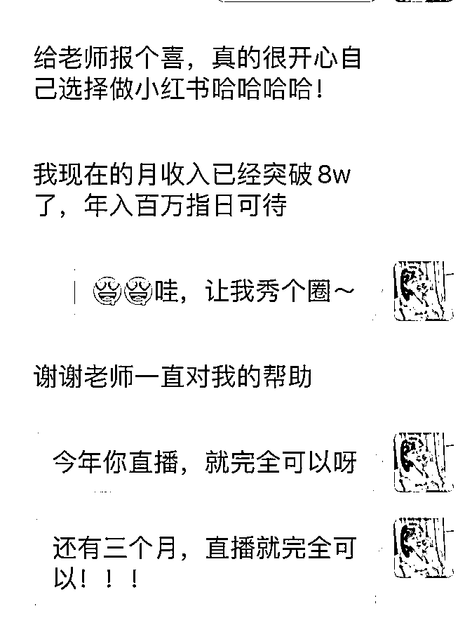

一个是主做雅思的教育赛道学员，已经出成绩；另一个是带了很久、粉丝几万的细分赛道学员，现在在做知识付费。

**📕当下的主流变现方式**

知识付费：内容+直播+薯店
笔记带货：内容+直播+薯店，或内容+直播+视频带货
买手类：直播带货

# 三、课程如何设计

课程设计的起点是定位。

做账号先定江山，不定位就不知道做什么赛道、赛道的赚钱模式是什么、内容如何围绕变现展开。

我的定位环节用表格+电话沟通，沟通完把录音整理成文档给学员。

第二步是讲清做号的误区和底层思维，以及📕当下的红利。很多人听完说普通人能做就冲上来，10 条作品没效果就泄气。这节课就是降预期、提执行力。

有定位、有心态后，教大家怎么找对标。我用 5 步法判断一个账号和单条笔记是否值得对标，并分析选题是带来数据还是带来转化。

拍摄剪辑对新手很关键。我不会一上来就教 VLOG，而是从口播开始，有广告位、可带货、可做知识付费。现在的📕，口播表现力=会笑+眼神不呆。

学会剪辑拍摄后，进入脚本写作：如何拆解、如何写出 60 分及格线的📕内容，新手很好上手。

会写会拍会剪后，再花 2 到 3 节课讲封面和标题，互动+理论结合，氛围更好。

到这里学员就能做出一篇合格笔记。

发布后要懂数据分析：每个指标代表什么、怎么优化改进。

最后根据变现方式分流：走知识付费的学知识付费模块，走带货或接广告的学对应模块。

课程以变现为核心，而不是涨粉，这也是学员能低粉就变现的原因。毕竟来找我是为了学怎么用📕赚钱。

# 四、做长期陪跑的经验

**1. 怎么解决时间精力问题**

90 天交付是越往后越轻松。

第一个月最重，我会把高频问题整理成话术模板，回复消息不敷衍，肯定观点+给出优化方向。

监督频率从每天到隔天再到周更，根据学员执行力动态调整。

学员类型不同，策略不同：执行力不足但其他优秀的多给情绪价值；容易emo的多鼓励少说教；冷淡但执行力差的，尽到指导义务即可。

时间分配上，优先服务情绪稳定、踏实肯干、哪怕短期不出结果也心怀感恩的学员。从 0 养起只是时间问题。把精力放在内容和直播上，自己往前走，学员才能跟上。

我的时间主要在线上，线下事务很少。

**2. 学员执行效果不好的沟通方式**

先定位问题：提醒不到位、不会找对标、时间不够、情绪低落。

找到根因后再决定是电话沟通还是文字详细沟通。

比如我一位美国学员，对对标和选题无从下手，通过电话沟通就解决了。

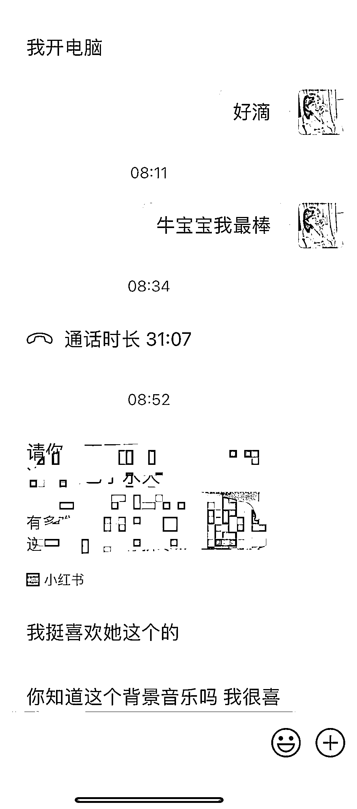

第一个月交付量最大，我会把重复问题固化成话术并个性化调整。目前是我一人操作，答疑尽量用语音或进直播间统一回复。

**3. 常见同类问题的总结处理**

比如学员问“发了一篇数据不行怎么办”。
我通常会回复：我带的学员一般连更 10 到 20 篇才出爆款，你目前篇数还少，每条都要复盘账号问题、花时间在哪个环节、为什么无法持续更新，我们一起解决。宝。

这样既安抚情绪，也给出合理预期。学员认真更新后确实能拿到结果。

每条笔记发布后我都会帮忙修改文案或剪辑方向。也在直播中持续梳理学员常见问题，建立信心和鼓励感。

分享到这里，感谢观看，希望对你有启发。

* * *

评论区：

燕妃 : 讲的很详细，谢谢分享，有收获

奔跑的十二 : 谢谢[呲牙]

风 LJ : 谢谢，讲的一看就是实战总结，受教了[憨笑]

* * *