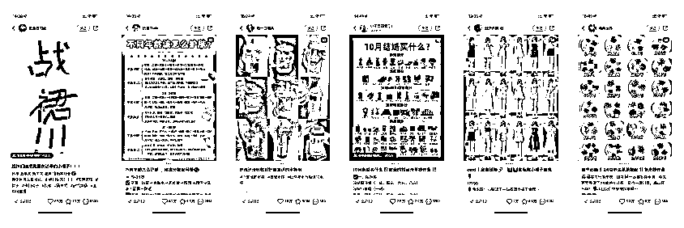
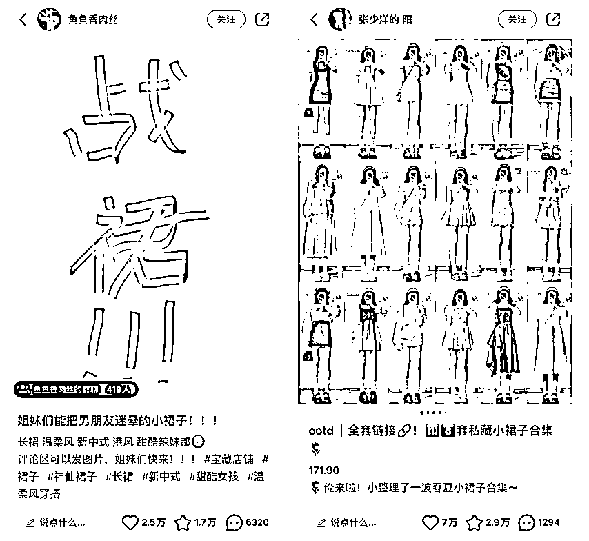
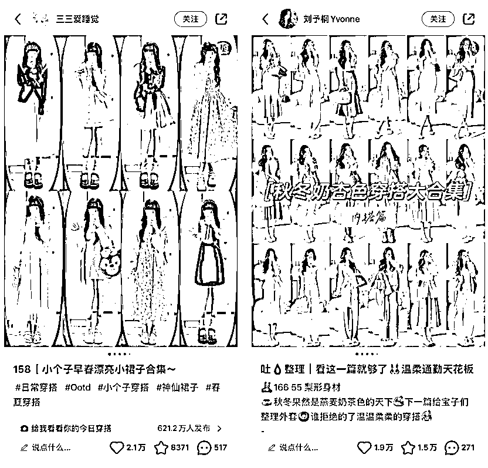
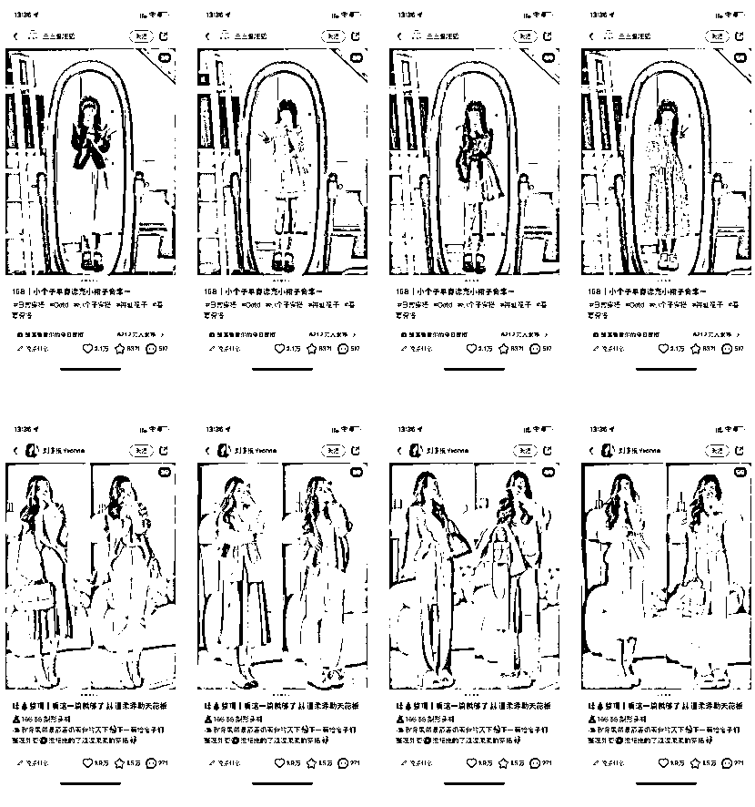
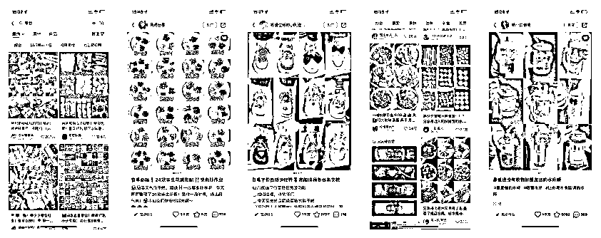
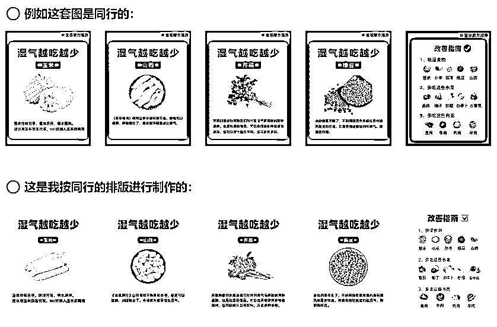
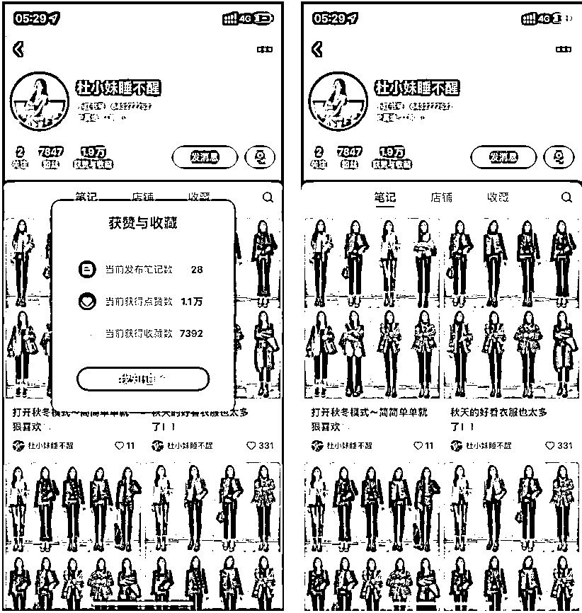
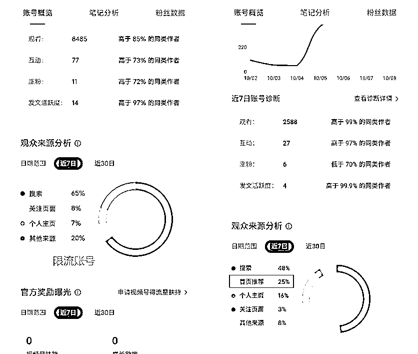

# 📕流量内容的正确玩法：帮你把曝光池越滚越大
作者：龙哥

很多人做📕有个误区：以为开店了就得天天发商品笔记。结果发着发着发现，浏览量越来越低，系统给的那点曝光连自己都看不过去。原因很简单——你一直在做“营销内容”，却忘了发“流量内容”。

什么是流量内容？说白了，就是那些不直接卖货、但用户愿意看、愿意收藏的内容。比如你卖婚纱，你不能只拍婚纱，你得发备婚攻略、婚礼流程、婚礼布置。这些内容看似和订单没关系，但它们是在帮你撒网、帮你拉新。流量内容干的是“触达”的活，营销内容才是“收割”的时机。一个像给庄稼浇水施肥，一个像到最后收成。

算法逻辑上也是这么回事。商品笔记属于典型营销内容，系统只会推给购买意向高的人。意向不高的人根本不点，点击率一垮，系统就认定你这内容不行，展示量自然越来越少。所以要破局，就得靠流量内容把盘子做大。曝光池变大了，你那些真正卖货的笔记才有机会被更多人看见。

每个赛道都有自己的流量内容。婚纱、女装、养生、家居……你刷📕时经常能刷到这类笔记。它们不挂链接，不带车，不直接产生订单，但就是有点赞、有收藏，为什么？因为对用户有价值。价值有了，流量就来了。

## 流量内容怎么做？两种低成本方式

其实做流量内容不需要搞得多复杂，越简单越好，毕竟我们的终极目标还是卖货。我比较推荐两种：

### 第一种：手写/备忘录一句话
这个真的“有手就行”，不用教，写一句有共鸣的话截图发出来就行。

### 第二种：拼图合集
这个重点说一下。拼图合集在各大赛道都很常见，尤其女装这类，点击率很高，拿流量很容易。

具体操作逻辑是这样：先搜你自己赛道的关键词，筛选“图文”，点“最热”，刷一刷就能碰到一堆拼图笔记。找到目标后，除了首图，后面的图都可以去水印存下来，再重新组合拼图，标题照葫芦画瓢发出去。

但切记啊，千万别直接搬运。别人用9张图拼成封面，你可以改成6张拼；他用8张做封面，你用4张。后面的单张图，你也可以改成2张、4张拼一起。总之不要做得一模一样。我自己习惯定个规律，比如9-6-4-2，或者10-8-6-4，按这个顺序随机组合。

拼图制作其实特别简单，用搞定设计、美图秀秀或者醒图都能搞定，稍微研究下就会了。做出来的作品简单粗暴，流量还好拿。每个赛道都有这种玩法，自己花时间挖掘模仿就行。

觉得拼图太单一的话，也可以做干货、攻略、教程类笔记，就是稍微麻烦点。用搞定设计创建个模板，照着同行模仿就行。我们之前做养生号，也发过这种干货类型的图，效果不错。具体选哪种，还得看你自己赛道哪种流量内容更好做。

## 流量内容适合在哪些阶段发？

### ✅ 起号阶段
新号起步时可以多发流量内容，快速获取流量。选题好的话，还能给账号打上精准标签，顺手增加权重。流量内容爆发力强，而且长尾流量很长，很容易涨粉。要知道第一波曝光特别关键，系统会把一部分流量给推荐流，一部分给粉丝。粉丝基础多了，基础播放量就高；内容有互动，系统才会继续给你推。有个账号只发了28篇笔记，就做到7392粉，靠的全是流量内容。

### ✅ 限流阶段
如果你的账号半死不活，或者正在被限流，也可以用流量内容养回来。这时候还死磕商品笔记的话，养号周期至少一个月，甚至更久，过程还特别折磨人。换发流量内容就不一样了，哪怕展现量很少，只要有人看到，就可能留下互动。每多一个互动都是正向反馈，你才有动力继续救这个号。不然没反馈，你会在注销和继续养号之间反复纠结，白耗一个星期最后还是注销，时间全浪费了。建议先发三天不同形式的流量内容，观察流量波动；发满七天，看看首页推荐有没有起色，基本就能判断这号值不值得救了。

### ✅ 平时穿插着发
账号一旦稳定了，也别全都发商品笔记。最好穿插一些流量内容进去。每个赛道呈现形式不一样，但底层逻辑相同。不同阶段有不同的运营方法，一招吃遍天是不可能的。📕的主线永远是把账号养稳，账号稳了，才有爆单的机会。账号半死不活的时候，先别惦记什么大卖。说实话，纯搬运容易把号搞废，纯原创起号又太慢。所以不管你习惯走哪条路，都建议把流量内容结合着一起发，流量起来会快很多。

## 最后两句提醒

第一，流量内容的选题别跑偏，一定要和账号面向的人群有关联。你是卖婚纱的，跑去发美妆攻略就不对劲。

第二，流量内容尽量不要挂购物车。万一挂的东西跟商品不符，很容易被判违规，那就得不偿失了。

这套玩法，本质上就是把你的种草内容放大，用内容去换曝光。学会了，你的📕账号会越玩越顺。

