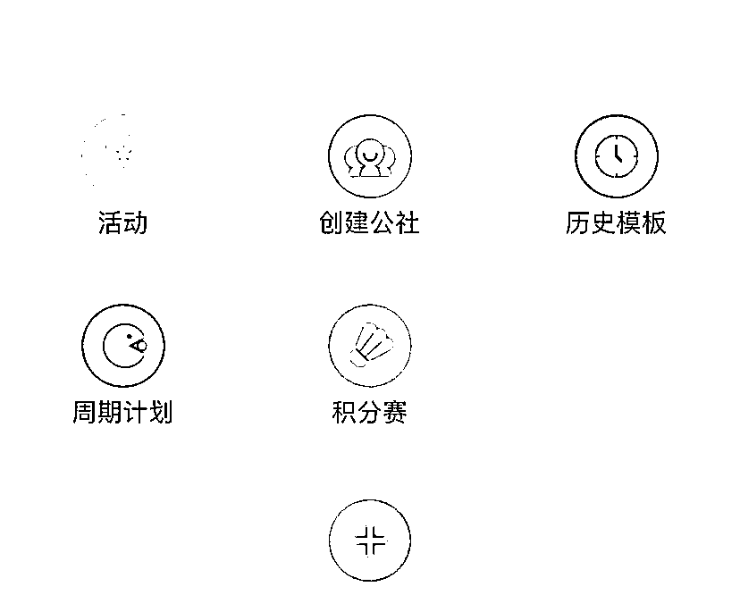
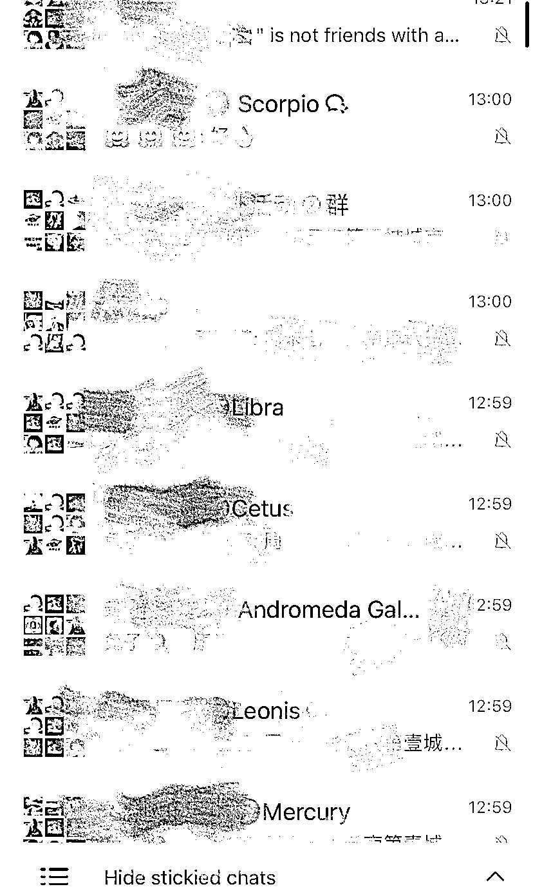
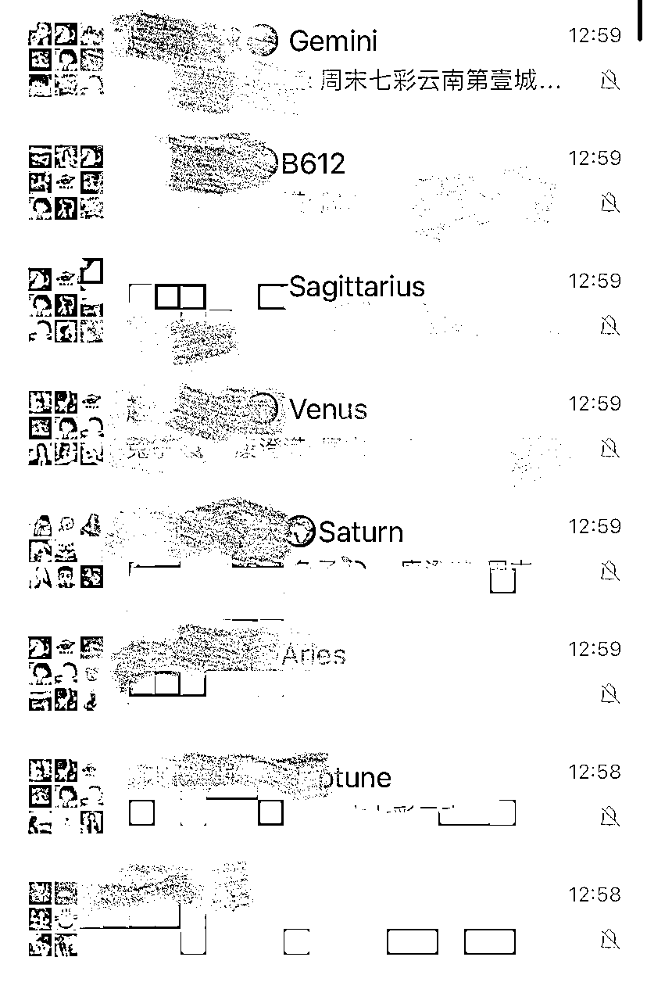
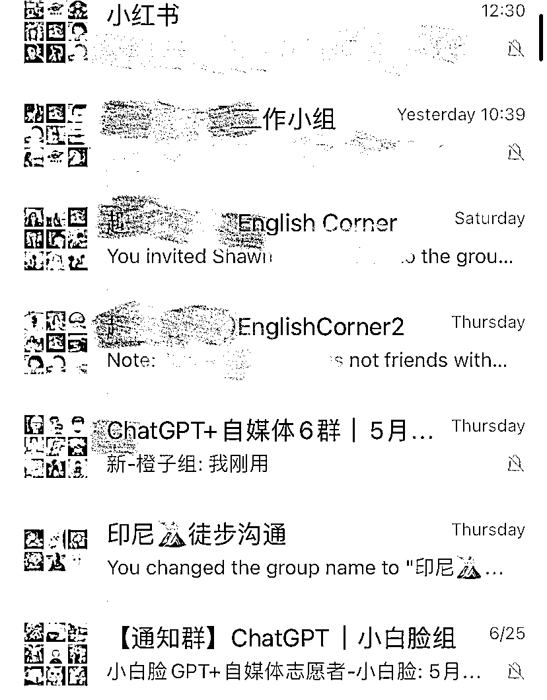
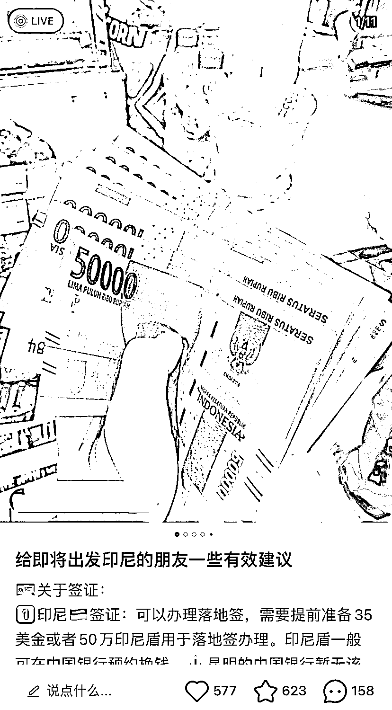
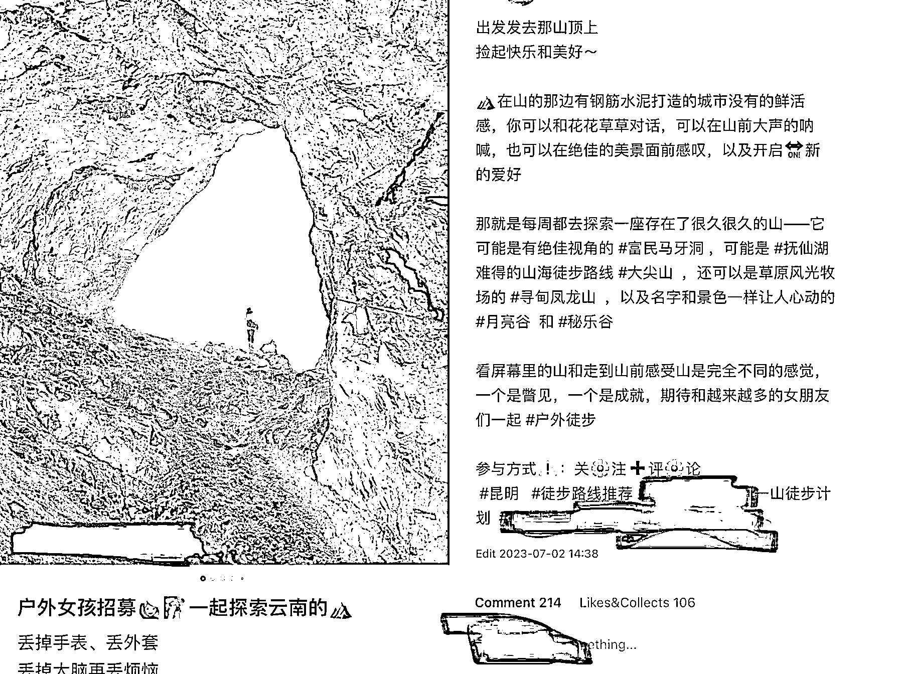
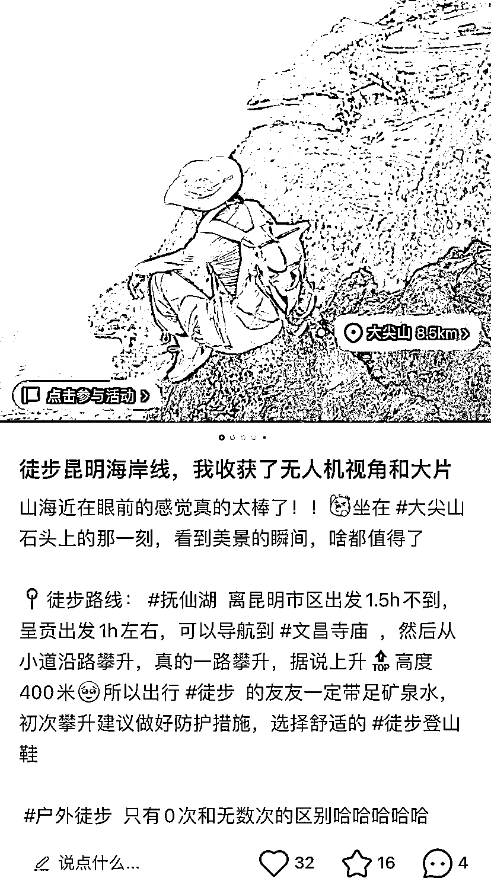

# 单身社交市场怎么变现？从周边徒步与城市局域活动做到月入4万+

> 原文：[`www.yuque.com/for_lazy/thfiu8/dsgsg46u1ngso4tu`](https://www.yuque.com/for_lazy/thfiu8/dsgsg46u1ngso4tu)

## 单身经济能不能做？一群年轻人靠户外徒步+本地局域活动，月流水稳定4万

作者： Seven

日期：2023-10-25

周末想找个徒步搭子、想看最美徒步线路清单、想挖宝藏徒步地……

旅游热退潮后，户外风刮了起来，而最卷也最吃香的板块就是徒步。从虎跳峡、武功山、四姑娘山，到家门口的近郊小步，再到跨省的长线，需求量很大。

这种需求顺手就能做成生意：卖山系装备、登山鞋、帐篷、穿搭灵感、攻略笔记；也可以像小团旅行一样自己牵头组队带路。

我就是靠这套打法在小红书发招募笔记带徒步，每趟下来净赚3万到4万。后来又把盘子做大，做了个本地俱乐部，不只做徒步，还包办城市里的各类局域玩乐，整体收益非常健康。

下面就按我的实操路径讲清楚：怎么发现商机、怎么引流获客、怎么运营转化，从0到1搭起一个本地活动项目，并拿到第一波正反馈。

# 一、为什么要做本地俱乐部

选本地俱乐部这条路，说实话有点半推半就。

一开始纯粹是自己想玩，昆明本地有意思的社交局不多。狼人杀、剧本杀这类关在屋子里坐半天的局我不爱。22年初偶然刷到小红书上的周边徒步活动，去了以后上头，边走边看风景还能认识人，正好符合我社牛的性格，徒步结束后微信好友还涨了一波。

回来我在小红书发了经历，有很多人私信问怎么加入。那一刻意识到这事儿能做。昆明作为云南省会，年轻人口多，地理资源又好，户外徒步的基础条件和流量天花板都摆在那。

**1. 团队怎么凑**

很巧。我们当时去的那场徒步的组织者是两个男生，已经有户外经验，正好在起步，其中一个有领队证，一个小红书有4000+粉丝。再加上我带来的流量，我们一拍即合。我又找了三位同样爱徒步的朋友，一共6个人，正式启动本地俱乐部。

建了个工作小群，把过往的照片素材归拢好，分工在小红书发招募笔记。内容分几类：城市局组织、徒步线路安利等。目的就一个：把人拉到微信群。

群控有个小原则：一个群拉到400人就封顶，留空位给老群友拉朋友。

**2. 社群运营与报名闭环**

引流只是开始。新人进群都很谨慎，潜水是常态。

所以日常朋友圈和群动态的互动必须做起来。活动发布前先在群里丢徒步地的美图，引发围观和讨论，再告诉大家本周有这条线的安排，等正式报名贴出来再来玩。团队成员的朋友圈最好保持半年以上可见，加完微信后别人翻看才有信任感。

报名环节要顺滑，核心解决三件事：活动介绍是否吸引人、报名是否方便、数据是否好管理。我在用小程序papa报名，现在升级到2.0了。免费、活动完秒到账、可做模板复用、图文展示、报名信息一键导出Excel，很适合我们这种高频活动。

再次提醒：活动发布一定要图文并茂。文案要让人读完就想去，图片要一眼能看出景色美、参与人数多、有氛围。

**3. 为什么这类局会火**

我们起步在疫情中期，那会儿跨省出行不方便，出门风险高，大家只能在家门口找乐子。年轻人精力过剩，近郊徒步、露营开始被频繁提及。

露营我们没怎么推。疫情后很多大营地因客流、用地问题倒闭或被叫停。露营组织起来也不轻松：日归没意思，露营过夜又要考虑户外适应度，成本也高，装备挑选就很麻烦。

徒步分短线和长线，我们主推的是周末单日往返，自由选周六或周日，像虎跳峡周末徒步就很火。

更关键的是社交属性。跟外地朋友聊天时他一句点醒了我：你这就是单身经济。想出来玩、想认识人的大部分都是单身，这话很有道理。

# 二、利润到底有多少

**1. 徒步类**

目前常规节奏是每月4个周末，周六周日每天发两条线路。单月流水基本在3万到4万。

单日线路定价在129-149之间，车程远的会偏高，利润率约35%。长线比如虎跳峡、阿布吉措、南亚洛等，利润率能到45%左右。

**2. 城市活动类**

去年飞盘很火，我们也试了。前期投入才1500不到，买队服、飞盘、角标。报名费45元/人，场地费245元/2小时，成本覆盖后就是纯赚场地差价，人越多赚越多，当时收益很可观。

不管做徒步还是城市局，核心都是靠人数规模撑起利润。人数怎么来，看下一节。

# 三、流量从哪来

**1. 社交平台**

主要阵地是小红书。每人每周发3-4篇，线路合集、线路推荐这类干货笔记，能精准吸本地粉，引流进微信群。群里持续互动，活动按时推，同时运营微信公众号做朋友圈二次转化。

小红书有长尾效应。比如下我去印尼火山徒步发的一篇建议帖，到现在每天还有几十赞。不是每篇都会爆，但爆了就带来持续转化。帖子要及时回评论、引导私信，晚来的用户也会按既有路径找到你。

**2. 本地联动**

有了流量和影响力后，会有本地市集、活动平台主动来找合作。合作能扩大知名度、增加入口、补足产品线。比如音乐节市集票务、国家地理影像展的英语角等。合作吃资源，我们两单都是靠认识策划团队直接对接。

前期长线产品不成熟时，我们会和专业徒步俱乐部分销，按人头提成，把报名信息定期给到合作方。

合作的前提是你手上要有活跃的私域，能触达和转化。建议早期先不要想合作，把流量池攒起来，等影响力够了，合作自然会找上门。

# 四、启动门槛、操作步骤和风险

**1. 怎么起步**

**A. 小红书发帖做预热**

无论是前期积累还是后面持续引流，都要坚持发。小红书账号必备。先发徒步线路安利或招募帖，吸精准用户，再建社群。我之前一篇招募帖一周涨70多个精准好友，超过一半都报名参加了活动。

可以借鉴我的文案套路，结合自己城市的线路改写，多用tag分类，被搜到时就能曝光。

线路推荐类笔记很吃留言引导，记得在评论区提示：我们每周都有固定组织，扫码进群。

**B. 社群搭建**

流量进来了就要养群。先定个好记的名字，取不出就用GPT生一个。群公告必须写清群规和使用说明，日常清理广告和僵尸用户。群主要用来发风景、发活动，链接和名片广告一律踢。

公告里可以写：平时会先放活动预热图，活动结束会回传照片合辑，方便参与者分享，也让潜水的人看到真实反馈。

活动前一天要在群里再强调注意事项，报名链接里也要有。

**C. 活动内容准备与发布**

这是技术环节。最好找个有领队证的伙伴一起整理线路。找不到的话，“两步路”这个App很有用，全国徒步线路都有导航，可短可长。自己再用生动的语言写沿途风景和人文，配上图，转化率会很好。

发布就用前面说的报名小程序。

**D. 活动执行与复盘**

每场报名单独拉一个当日小群，减少主群信息干扰，便于点名和核对人数。活动前一天在小群发公告和注意事项。

活动结束后一定要在主群晒图、发总结，并号召大家去小红书发笔记安利，形成二次传播。

**2. 门槛**

1. 团队里必须有持证领队，户外有安全风险，专业的人能降到最低。推荐中探联，有公益培训可考证；
2. 体验要有记忆点：人好玩、照片好看、服务专业，至少占一样；
3. 要有线路资源、拓展资源和大巴车资源；
4. 前端获客能力也是门槛。

**3. 风险**

1. 安全+保险。领队要专业，每次活动必须给参与者买个人意外险；
2. 用户同质化。初期是做户外小白生意，随着认知提高，用户会自己探索，老用户留存是长期问题。

整体来看，自己运营私域做本地活动，是个投入小、反馈快的方向。希望这些实操能帮到想入局的朋友。

* * *

评论区：

胖大魔 : 发现，都可以转相亲[奸笑]
Seven : 确实有人有这个诉求，给参与活动的大家自行链接的机会
胖大魔 : 我 19 年有这样想法，后面想跟人搭伙，谈不拢就没做了。。。主要是同城粉质量一般般，担心太多了
杨彪 : 昆明？
Seven : 是的
杨彪 : 微信链接一个？
Seven : 好呀，wrnbs-12345

* * *