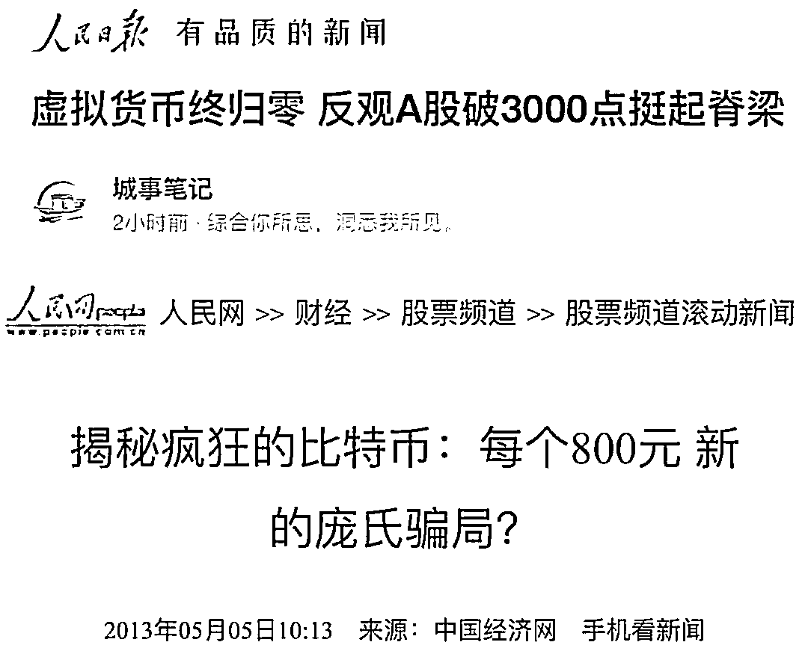
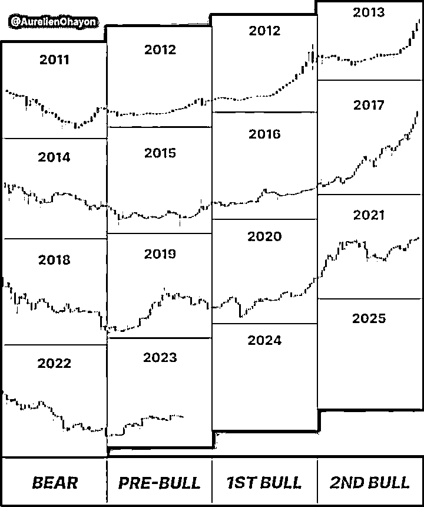
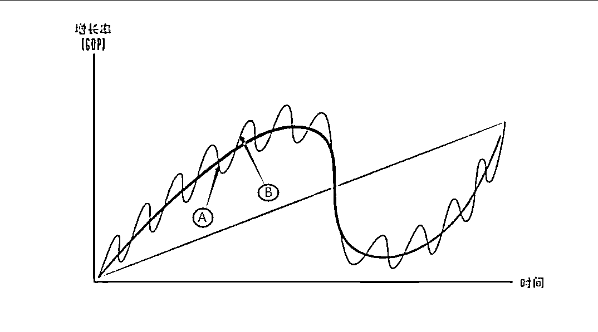

# 30%+ 的均值背后，是这场 100 周定投的实操笔记

## 平均 30%涨幅背后的定投故事

作者： Start9527

日期：2023-10-24

最近 A 股震荡的厉害，外面各种解读层出不穷，甚至连汪峰、章子怡的离婚传闻都被强行和市场预期挂钩。吃瓜归吃瓜，这波波动反而让我对 Web3 赛道的判断更坚定了，也更想把这条路继续布道下去。

先放一张 Web3 圈子里常挂嘴边的那张图。

大 A 还是那个大 A，比特币却早已不是 2013 年的比特币了。从诞生至今的跌宕起伏，堪比西游取经，九九八十一难，每一关都致命，每一劫都伴随黑天鹅。而现在它才走过几关？后面还有多少坑要填？即便路途这么凶险，它的走势依旧是劫劫新高。

对照历史周期的复盘，最稳妥的入场方式就是锚定减半周期。受此启发，我的社区最近启动了一轮为期 100 周的定投实验。首周建仓时比特币的价格在 26500 附近徘徊，写到现在盘面已经浮盈~~15%+~~，到发稿时直接拉到 30% 多。我们的篮子不止 BTC，还涵盖了 ORDI、FLOW、OP 等高波动标的，整体账户的综合收益大约在~~15%+~~，发文时已冲到 30%+。这期就把我们的实操思路拆开聊聊。

本期拆成三个部分：

1. 我们在投什么、为什么投
2. 定投到底有什么用
3. 这次具体挑了哪些币

**特别提示：Web3 有风险，入场需谨慎，因为有可能会损失你的全部本金。**

**1，定投的标的及逻辑**

Web3 的二级市场和传统股票类似，板块众多。粗略划分有：公链、链游、二层、DeFi、元宇宙、基建、平台币、MEME、RWA 等等。

我们的打法是从这些赛道里挑标的。资金安排上以 1000 元为一个单位，经济条件好的可以十倍百倍叠加，资金有限的 0.5 倍、0.2 倍也能玩。

一轮拆成 5-7 份。其中 40% 用来做压舱石，投向 BTC 和 ETH 这类稳健品种。

BTC 的优势在于抗跌和龙头地位，市场份额接近半壁江山，生态也在缓慢扩张；缺点是弹性相对有限。ETH 的生态体量已经很庞大，作为长期老二，涨幅预期通常高于 BTC。40% 的配置是为了底仓安全，即使整体翻 2.5 倍也不至于伤筋动骨。

剩下的 60% 拿去博弈高波动资产，BTC、ETH 之外的基本都属于高风险赛道，长短线各不同。比如：

公链：FLOW、SOL、APTOS、NEAR、ATOM
二层：OP、ARB，以及未发币的 ZK、STARK 系
链游：MAGIC、IMX、AXS
元宇宙：APE、SAND、MANA
基建：LINK、ENS
平台币：BNB、OKB
MEME：DOGE、PEPE、SHIB
DeFi：AAVE、CRV
LSD：LDO、SSV
RWA：COMP 等

从中挑 4-6 个组合，牛市里弹性会放大，惊喜也更多。期间也会混入一些有催化剂的短线品种，快进快出。

**2，定投的意义**

经济本身是周期性的，股票、货币这类资产对周期的反应非常直观，整体是波浪式上行。达里奥对周期的描述里，最关键的就是底部。理论上，底部买入顶部卖出就能拿到超额收益，逻辑清晰，可惜底部什么时候来没人知道。

于是市场总结出微笑曲线式的定投法，正好覆盖底部附近的一段区间。

微笑曲线 A 点开始建仓，B 点开始出售，区间内定投

即便抓不到绝对最低点，只要在底部区间持续买入，就能把成本不断摊薄，逼近理论最低价。等收益兑现一段时间后分批止盈，回报自然可观。这就是定投的核心价值。

操作上大致分两种：定期定额和定期不定额。

定期定额就是比如总共准备 10000u，每周投 100u，投满 100 周。
定期不定额则是顺着微笑曲线做择时，低点多买、高点少买，成本更低。大多数人不想算来算去，直接定期定额也足够，赚得不多，但也不至于踏空。

**3，定投标的筛选**

第一期的组合从上述赛道里挑了 5 个币，仓位分配如下。

**稳健型标的**

**A，BTC，**40% 仓位。当时 ETH 生态表现偏弱，回调明显，所以暂时不急于加仓 ETH。等 BTC 积累到一定量，ETH 生态回暖时再择机置换，甚至用期权做加法。这样也能拿到更多的 ETH。纯撸空投把 ETH 当 GAS 用的另说。

**中低风险型标的，可长期滚动**

**B，FLOW，**基本面很扎实。我曾担任 FLOW 中国社区大使，对项目比较熟。最近 CTO 开始推动 EVM 相关进展，有望在 ETH 二层生态上有所动作，是个很强的长期利好。盘面暂时不活跃，但适合长期定投。

**C，OP，**ETH 二层的代表，ToB 业务很健康，大客户不少，资金压力小。叠加昆汀升级和空投预期，爆发窗口在临近。定投 OP 本质也是曲线定投 ETH。

**D，ORDI，**BTC 生态里最具代表性的 MEME，市值体量不大，弹性往往高于 BTC。我们会持续滚动买入。

以上四个可以作为中长线底仓，除非出现重大问题，我会提前提示换仓或减仓。

**中高风险型标的，短线博弈**

**E，BIGTIME，**12 号启动定投，主要是催化剂驱动。当时市场比较冷清，BIGTIME 成了少见的亮点。开盘已有近 20 倍涨幅，我们仍抄了进去，单日就拿到约 50% 的浮盈，让学员直观感受到赛道的爆发力。

**以上标的仓位均为 15%。**

目前战绩：ORDI 领涨接近~~25%~~，发文时已 60%+；BTC 超过~~15%~~，发文时 30% 左右；FLOW 约~~10%~~，发文时 20%+；OP 相对弱势只有~~5%~~，发文时回升到 15% 左右。BIGTIME 短线多数学员都有收益，也有后期追高被套的，但仓位可控，整体仍被其他标的覆盖。第一期综合收益多在~~15%~~以上，发文时普遍 30%+。

后续我们还会叠加更多技巧，比如挂单策略、盘口深度和市值分析、期权等放大收益的手段。

以上是 Web3Going 社区第一期定投实盘复盘，希望能帮助大家更清晰地理解 Web3 的玩法。我是龙哥盟 Web3 航海四期教练 Start，一起慢慢让 Web3 变现，Gogogo！

* * *

评论区：

暂无评论

* * *