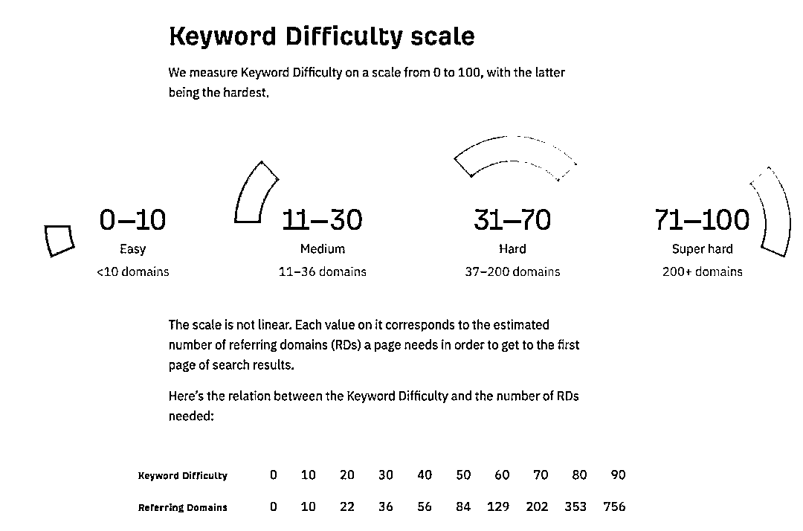
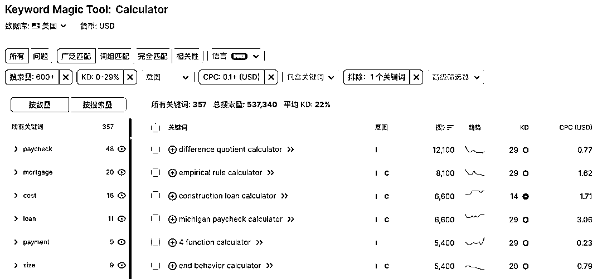
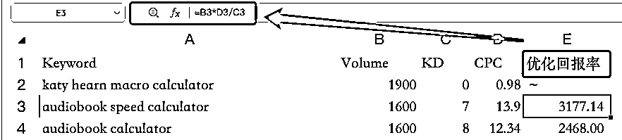

# 选关键词总犹豫？试试这个公式，一算就知道值不值得做
作者：龙哥

很多做独立站或内容站的朋友，都有过这样的困扰：费了半天劲挖出了一堆关键词，真到动手做的时候却卡住了——到底该押注哪个？选错了方向，后面所有功夫都可能打水漂。所以，关键词的筛选环节，往往决定了整个项目的成败。

之前我们聊过怎么从需求出发，一步步把关键词挖掘出来。但挖出来是一回事，怎么判断哪个词值得投入精力去做，又是另一回事。面对一堆数据，很多人还是无从下手。

为了彻底解决这个痛点，我琢磨出了一个自己的判断标准，参考了投资里常见的ROI思路，搞了个叫“KDROI”的指标。有了它，选词就不再是拍脑袋的事。

先简单回顾一下ROI的本质：投入产出比 = 产出 ÷ 投入 × 100%。你花出去的钱能带回多少收益，超过100%就是赚，等于100%保本，低于100%就是亏。这个逻辑放到关键词选择上，同样适用。

我造的公式是：**KDROI = volume × cpc ÷ kd**。

这里面的volume，指的是关键词的月搜索量；cpc，指的是这个词的广告点击单价；kd，则是关键词的优化难度。前面两个相乘，可以理解为这个词本身的价值盘子有多大；再用它除以优化难度，得到的就是“每一分难度投入能换回多少价值”，也就是优化难度回报比。

至于kd这个数值，在Semrush和ahrefs这两个工具里都能查到，尤其ahrefs还专门做了量化处理。

需要说明的是，优化难度并不是一条直线，难度越高，你需要的投入会成倍增加。理论上，可以把kd换算成外链数量，这样会更线性、更精确，但换算过程太繁琐。为了实用，我们就直接用kd做近似计算，误差在可接受范围内。

拿到所有候选词后，逐个算出它们的KDROI，然后按从高到低排个序。排在最前面的，自然就是最值得优先去做的那批词。

光说理论不够直观，咱们拿个真实案例走一遍。打开Semrush，输入“Calculator”这个词，我把筛选条件设成：月搜索量600以上，kd控制在0～29之间，cpc大于0.1，同时排除掉带“near me”的。筛选完之后，系统给到了357个词条。

接着，把结果用CSV或Excel格式导出到本地。只保留Keyword、Volume、KD、CPC这四列，其余的全部删掉。然后新加一列，输入公式`=B2*D2/C2`，往下拉填充，每个词的优化难度回报率就都出来了。最后按这一列降序排列，一张清晰的决策表就完成了。

完整版表格太长，我直接放在这里了：[`text.is/vckdroi`](https://text.is/vckdroi) ，需要的朋友自取。当然，你完全可以自己打开Semrush，输入任何你关心的关键词，按这个方法重新算一遍。

以后选词的策略很简单：优先挑KDROI靠前的那些词就对了。有了这个公式，选词这件事就再也不会让人纠结了。

如果有什么疑问，欢迎在评论区留言，我会尽量解答。

---

有朋友在评论区问到，能不能更省事一点。这里补充一下：基于这个公式，我还写了一个前端小工具。你只需要把从Semrush下载的表格直接上传到工具页面，它就会在浏览器里自动帮你算出KDROI，算完还能下载处理后的表格。数据全程在前端运算，不会上传到服务器，不用担心关键词数据泄露。代码也是开源的，想自己部署的话，不管是本地运行还是用Vercel一键部署，都可以。

项目地址在这里：[`github.com/Kunsect/roi-calculator`](https://github.com/Kunsect/roi-calculator)

感谢大家的认可，希望对你们有帮助。