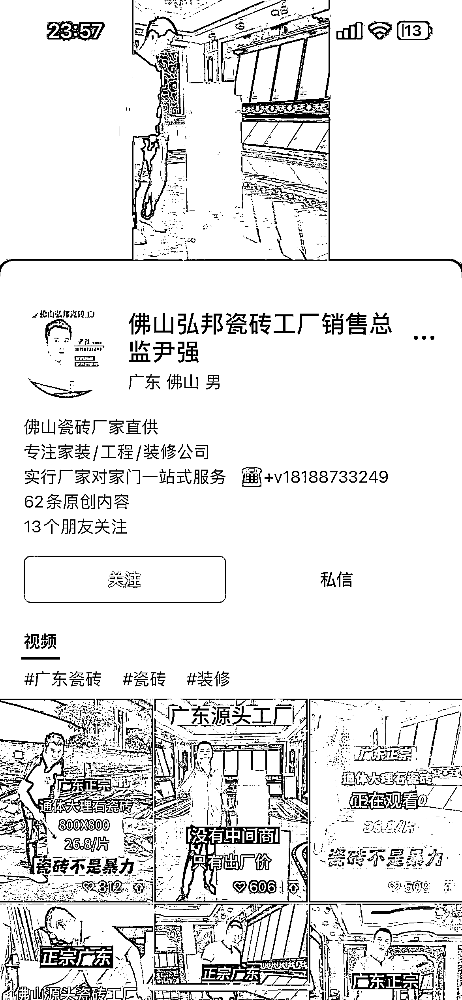
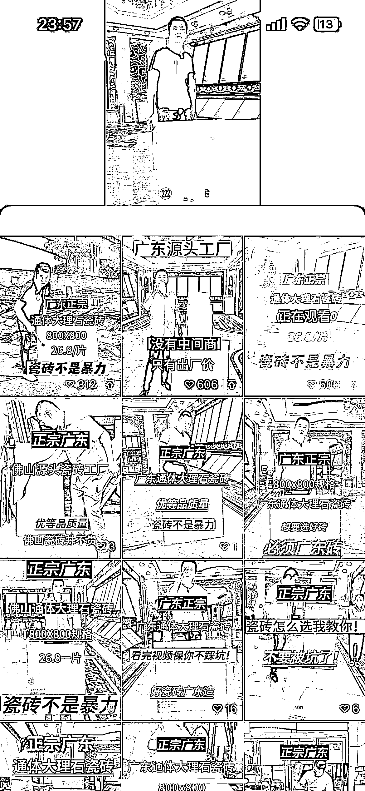
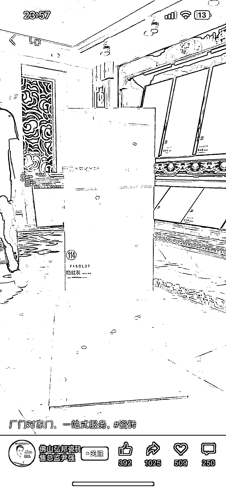
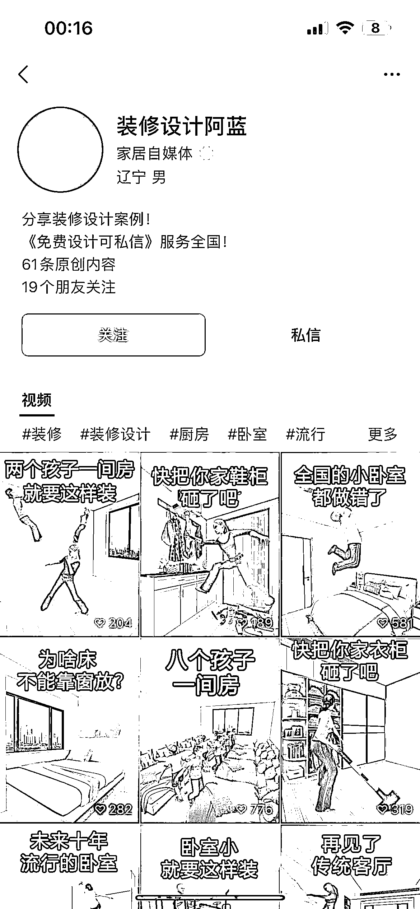
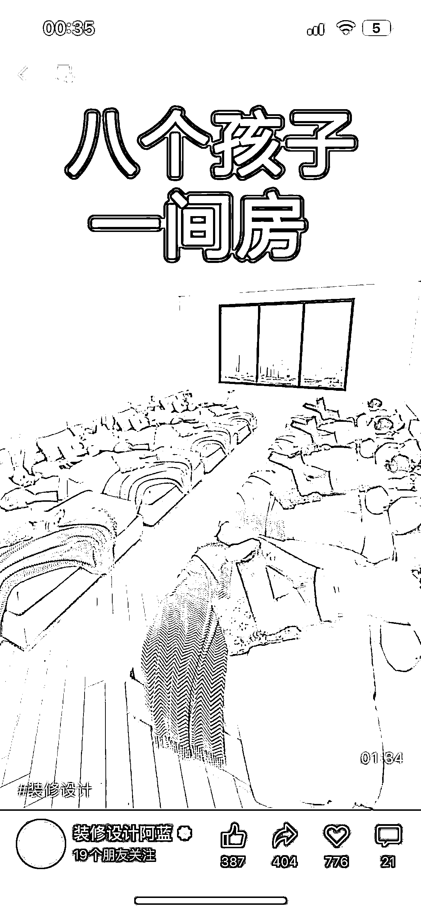

# 做冷门生意也能吃线上这波红利？一套矩阵引流+私域成交的实战打法

一个号打不动就开十个号，一个平台不够就铺十个平台。
尤其是传统线下实体、高客单品类，其实很适合用矩阵做曝光，把流量收拢到私域再成交。

我自己就是做家具实体起家的，一年多一直靠线下跑，业绩平平。后来把触手伸向线上，用闲鱼、视频号、📕、抖音等多点开花，第一次就见效，一天能把120多个人拉进微信，单月净利润稳定在3万到5万左右。

今天就把从线下转战线上，怎么精准捕鱼、怎么高效闭环的经验拆开讲。

**先说背景**

我是21年9月退伍，22年初入局家具实体，起初就在小区访销、返迁房跑量。因为离南康不远，附近客户习惯自己跑厂家拿货，我的月业绩只能勉强糊口。后来决定线上试水，才有了下面的方法论。

### 一、先看项目能不能玩

我能把家具做起来，靠的是这几块底牌：

**1、价格有说服力**
做了1年多实体，和南康、佛山的厂家都熟，懂材质、懂行情。背靠南康供应链，拿货成本比纯做广东货的要低很多。

**2、物流能兜底**
联合了几家电商物流，全国发货都能送装一体，海外线路也通。运费给到的是经销商零售价的85折左右，并且是五包服务，售后不甩锅。

**3、资金压力小**
厂家普遍是半月结、月结。客户先付50%定金，我下单生产，7-10天出货走物流，尾款结清。家具整单利润在20%-30%，回款快，风险可控。

**4、后端可定制**
工厂能根据尺寸、颜色、布料定制，软体、实木、意式、美式、新中式，上千款可选，图册和价目表一目了然，转化很顺。

### 二、前端怎么找流量

核心思路：闲鱼+📕+视频号为主，抖音快手做辅助撒钩子。每个平台打法不同，本质都是先找10个对标号研究，再做成矩阵。

**1、闲鱼**
去年10月入局，到今年1月，主要卖尾货和实木家具，平均利润20%左右。现在平台收1个点手续费，且售后必须自己扛，账期约25天。
来闲鱼的大多是想捡漏的，低价款更好出手。建议用低价引流到微信成交，减少平台纠纷。4个月下来变现5万多，第一次尝到线上甜头。

**2、视频号**
方法源自许总分享。去年11月拿到后没急着上，年后1月底开始测，当天就爆100多微信。一直用到7月，官方开始限硬广图文。累计拉了1.3万私域，单粉平均利润约100元，最大一单是8万的外贸订单，当天还带了两单。平台现在主推真人出镜，得跟着换素材。

**3、📕**
引流到私域比较被动，微信号不能直接放。我的做法是1拖4：认证一个企业号投聚光进白名单，拉蓝V号建群，群里统一发微信。聚光日均花费500左右，单个微信成本约130，能盈利但成本偏高。

**4、抖音、快手**
老阵地了，现在纯靠发内容接单很难分到肉，基本佛系发素材，随缘收单。

### 三、私域怎么养

我前期用的是退伍前拍的照片，很多人问是不是退伍军人，信任感反而更强。私域不能只有产品广告，要有人设、有生活、有情绪。

每天朋友圈发5-8条，多晒成交截图、聊天记录、售后细节。价格大家都能比，服务态度才能留人。客户用语音沟通就回语音，别用打字糊弄，情绪和需求才能听得清。

**四、货源怎么解决**

我有实体店基础，货源是长期合作的。没有经验的外地新人，厂家报价会高出几百。本地熟了就能拿到更低的价格，甚至零售价就是别人的批发价。我也常卖给装修公司和经销商，渠道很深。

想入局的，建议直接去南康、佛山市场跑一圈，每年展会都是捡渠道的好时机。散客价和代卖价差很多，自己去盘清楚。

**五、启动门槛**

1. 行业知识，小白最好有人带2个月
2. 厂家和物流渠道，必须到市场跑
3. 营业执照+收款码，建议注册地在南康或赣州，方便立厂家人设
4. 设备，至少5部手机起步做矩阵
5. 启动资金10万左右，可用信用卡周转

这类零售客户是单次交易，投入不大，靠价格优势走量。做经销或提篮子则要放低利润，走长线。

### 六、高客单私域怎么玩

平台获客成本只高不低，淘宝要直通车，📕要聚光。想活下来，必须把人效做上去。

**1、选品要卡位**
客单价至少1000起，单品利润不低于200。服务10个人的成本和服务1个一样，选品决定天花板。
法是去扒头部IP的小号，看他们的引流素材、朋友圈、话术能不能复用，价格表能不能照搬改价。

**2、适合私域的产品特征**
客单价高、利润高、有复购转介绍、运营成本低。比如知识付费、高仿品类、白酒茶叶、家装建材、留学法律顾问等。选自己能聊透的品。

**3、获取流量的关键动作**
建立自己的素材库、标题库、文案库。找到对标号拆解模仿，再按平台调整形式。📕图文为主，视频号要真人出镜。
我一般先发抖音快手，再视频号，最后📕，能二创就不原创。
矩阵的核心是数量：一个人发4条，不如10部手机发30条。用数量对冲算法。
付费方面，我目前只投📕聚光。抖音快手直播引流到私域的难度变大，视频号自然流量仍可观。📕要上市，限流会更严，该交的平台保护费就交，别总想白嫖。

**4、成交的方法**
流量是本。朋友圈做成5件套+价格表，客户进群直接甩过去，有需求的自然会开口。重点永远是流量从哪来。

### 七、案例拆解

**1、瓷砖行业**
对标：视频号 佛山弘邦瓷砖工厂销售总监尹强。

我之前带徒弟时分析过他的号，人设头像、主页留方式都标准。素材主打真人出镜+大字报价格，单条播放不高，但矩阵批量发，总有爆款。几十万播放能带来几百咨询。只要有一个小展厅，真人出镜就能快速产出。瓷砖客单价1-1.2万，利润1-2千，做好价格表沉淀私域慢慢转化。

**2、装修行业**
对标：视频号 装修设计阿蓝

赛道分设计和施工，地域限制大。设计周期短回款快，更适合做私域。其素材多在抖音、住小帮、📕扒素材，用龙猫工具大师批量下载后二次创作：掐头去尾、抽帧、画中画、转场等。提前准备好设计收费表、营业执照、收款码，建立信任更快。

一招通吃，重点看素材能不能持续带来流量。会看同行就是会上岸。多看同行，同行是最好的老师。有流量你就是爹，没流量啥也不是。

我是阿山，一个沉迷卖家具的搬运工，以上经验希望对你有用。

自我介绍：
①昵称：阿山
②城市：江西赣州
③行业：家具
④个人标签：互联网小白，八年老兵，卑微屌丝小温
⑤公司名称和职务：法人
⑥过往成就：日引流家具粉100+，单人日均引流50-100
⑦可提供资源：1.家具全品类供应链 2.各平台引流私域方法 3.熟悉咸🐟小🍠视频号运营 4.股票基金虚拟币略懂 5.法务方面资源
⑨所需要的资源：链接更多同频创业者，私域运营大哥

* * *

评论区：
学者 : 同有部队经历，做了八年私域，比较同频，期望深度连接，我的 11910500
阿山 : 已加，老班长[愉快]
西伯利亚冷空气 : 好厉害👍
夕阳无限好 : 📕的方法是不是 1 拖 N 都可以，全部导企业号的群
阿山 : 可以
阿山 : 混口饭吃

* * *