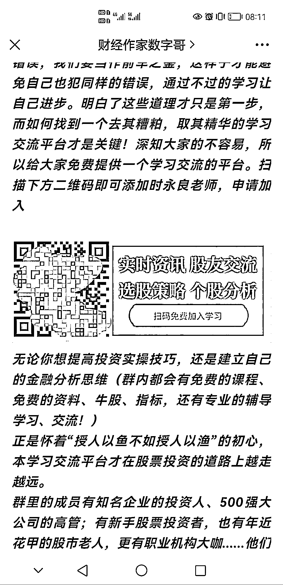
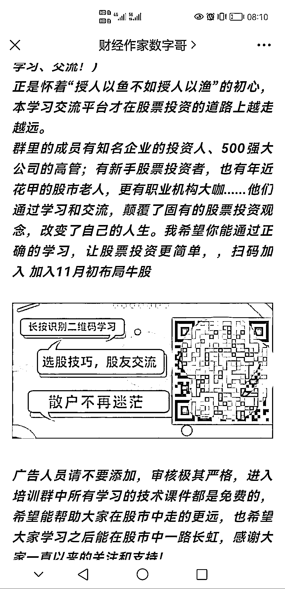
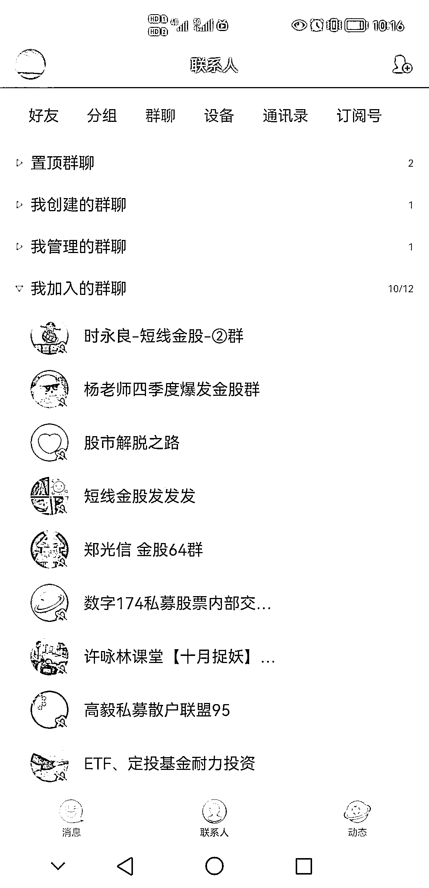
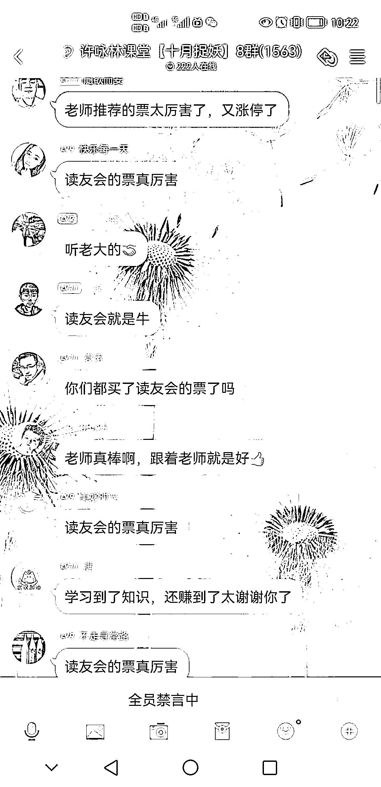
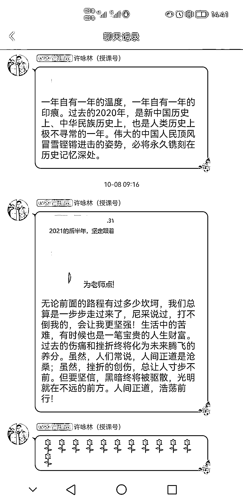
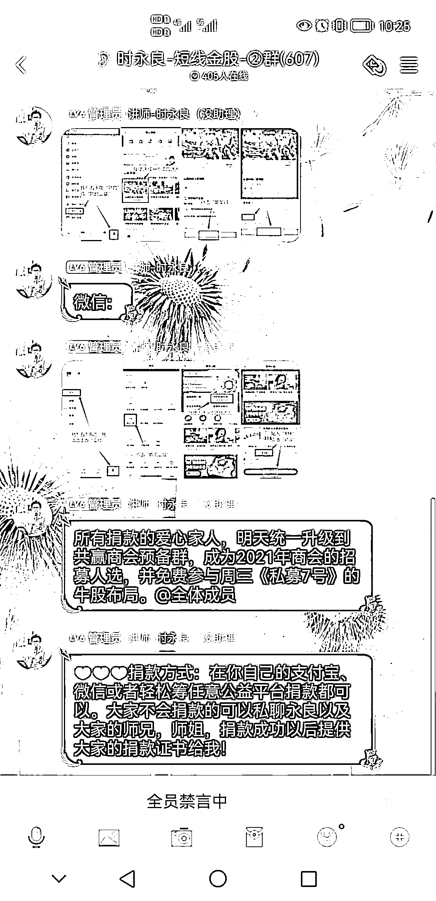
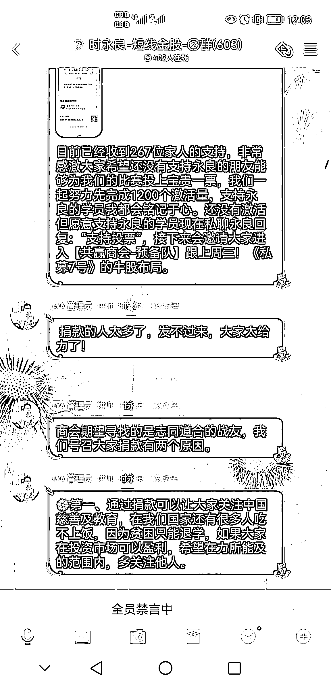
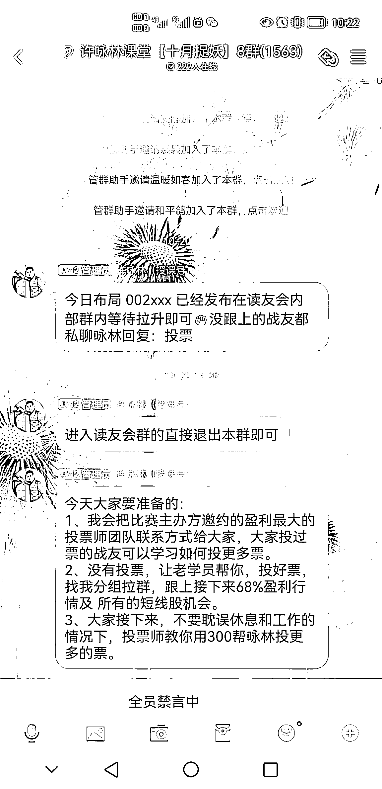
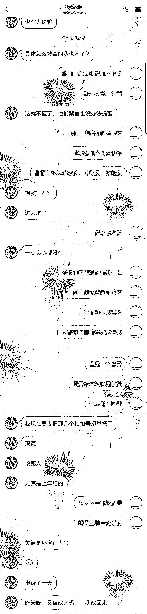

# 我砸进去一百多万买知识，这些年被割的那些段位

> 原文：[`www.yuque.com/for_lazy/thfiu8/va8kxydu5h06c0ed`](https://www.yuque.com/for_lazy/thfiu8/va8kxydu5h06c0ed)

## 我花了100万+学费买教训，记录一下这些年踩过的坑

作者： 子白

日期：2023-10-17

《我为知识付费 100w+，那些年我被割过的韭菜》（一）

大家好，我是子白。上次发完帖后，我多了不少新外号，“知识试吃员”、“付费测评师”、“韭菜之王”都是其中之一。

前阵子去武汉和惰总、刀姐线下见面，现场给同好们复盘了我是怎么被割的，全场直接炸了，也挺正常，毕竟别人的惨就是别人的乐。

我一直不介意把黑历史掏出来讲讲，拿来当个段子讲。惰总@静水流深 提议我整理成文字，给准备创业、想变现的朋友们提个醒。我就按“一人少看，万人少亏”的想法开了这个连载。

就我个人的踩坑史来看，创业里最致命的坑就是投资坑，特别是那些包装得很像投资项目的局，比如加盟陷阱、代种代养陷阱，再有 P2P、C 盘、FF 集资、资金盘等等。我几乎是全套体验过，一个都没落下，全都中招，有的单笔还挺大，去年 NFT 平台火的时候我冲了 50 万进去。等了一年，跑路的跑路躺平的躺平，一分钱没剩。

今天先聊一个到处都是的老坑，“大师带你选牛股”。

这套路老到不能再老，可每年都能收割新韭菜，我五年前就是其中一个。复盘了自己无数次的上当经历，基本流程是这样的：

一、精准引流，锁定猎物

“先找到人，再找理由。”

操盘方会用广播、微博、微信、QQ、贴吧、搜索引擎买位投放广告。更专业的团队会做垂直投放，借财经大 V 号、财经号、炒股吧、短视频截流来吸粉，受众极准。

广告文案一模一样：自称老师，应粉丝要求开群，入群免费，纯粹回馈。

回头想，第一步就很致命：如果群是常年关注的财经号推的、信任的大 V 发的、家里亲戚拉你进的，你的防备心会降到最低，更容易信。

二、塑造人设，营造稳赚假象

“进群之后，戏就开场了。”

先给大师造神，用假名、假头像、假战绩，吹他是老股民、隐形富豪，常年办高端闭门课，带身边人发家致富，现在钱看淡了，出来拯救散户。

然后每天发点基础的股市常识、K线分析技巧，内容本身没错，都是网上抄来的，毫无价值。

大师每天点几只“牛股”，好心提醒控制仓位，别梭哈，顺手晒几张之前免费票的涨幅图。乍一看很牛。实际上我私下统计过，涨跌基本五五开。只不过他们只放大涨的，亏的要么不提，要么说“回调后必涨”。给人一种全都在涨的错觉。

这跟看 NBA 球星集锦是一个道理，感觉百发百中，真实命中率也就是一半。

群里还有一整套“气氛组”。微信群 500 人，QQ 群上千人，绝大部分是骗子小号。XX 小秘书、XX 助教，轮流刷屏：

XX 小秘书：“助理，有人问上个月免费票总结吗？”

XX 助理：“大部分都赚了……”

A：“专业的事交给专业的人准没错。”

B：“老师靠谱，钱放这里安心。”

C：“每天免费票全是涨的，太强了。”

有的群除了我之外，一个真人都没有，全是假号在演戏。

要说骗子真用心：宣传图做得精致，直播前有预告片，每天群内互动热烈。不知道真相的话，这群人热情得像一家人。

三、收网就位，开始收智商税

“免费的，终究只是引子。”

铺垫几天后就开始收割：

其一，拉“内部群”/“会员群”/“操盘群”。承诺每天给更猛的票，会费 1888 元/月。随后晒会员好评、晒收益截图，制造稀缺：“仅剩 20 个名额！”实际情况是内部群的票也是随机涨跌，会费纯属交学费。

其二，让大师“参赛”。大师要参加“慈善炒股大赛”，需要大家投票支持，先交几百块保证金“实名注册”。大师清高，视钱如粪土，你的保证金大赛结束必退。结果大赛没结束账号先注销了。

其三，带大家“做公益”。大师热衷慈善，帮过失学儿童、残障人士等，群里发捐款链接/二维码，让大家随喜支持。钱全进了他自己口袋。

其四，最狠的一招，带你玩期货。股票涨跌慢，学员要求带期货，收益快。大师会假意推辞，说风险高门槛高。随后助理“好心”给出无门槛交易平台，下个 App 入金就行，最后大师半推半就答应带。

标的可能是期权、合约、外汇、贵金属，新名词不断，关键是必须往他们的平台充钱，钱打到替罪羊的个人卡上。

为了显得正规，还会寄合同。查公司，全是皮包公司。

跟着操作，不仅亏得多，手续费还离谱，好不容易赚点，手续费就吃光了。

四、话术封口，新手懵圈

“群主是我的人，管理员是我的人，整个群都是我的人，你跟我斗什么？”

群里长期禁言，有人质疑，大师总能圆回来：

质疑一：你真有实力吗？

答：看过去的票就行，都是赚钱的。而且都是朋友拉你进来的，朋友推荐你会害你吗？

质疑二：昨天推的今天跌了怎么办？

答：炒股哪有一买就涨的？跌了我们联盟也会托盘，负责到底！

质疑三：网上说你是骗子。

答：树大招风，同行抹黑。你去搜淘宝，骂淘宝的还少吗？二十年前说马云是骗子的也不少。

群里正能量刷屏，偶尔出意外：比如被盗号的受害者找回账号，发现自己成了“股神”，赶紧出来喊自己被盗了别信。马上被禁言、撤回、踢出。骗子用同名同头像小号继续冒充大师，说是同行捣乱，大家继续支持。

无论从哪质疑，都有现成说辞。

五、收割完成，立刻跑路

“能割一个算一个，换号重开。”

我潜伏过几十个股票群、投资群、内部群，这种局的生命周期一般是两到四周，收够了就消失。被盗的账号慢慢被原主人找回，无主的号就闲置。

然后换一批小号、换一个大师皮、建新群、重新投放广告，继续开下一轮。有些群更简单粗暴，一眼就能看穿。

也许后面还有“核心群”“私募群”“顶级群”，我已经懒得跟了。现实里没有那么多股神，花点心思 P 张图，按上面套路走，你也能自封股神。

最后记一下子白的忠告：网上大师带投资是骗局，吹高收益稳赚不赔更是骗局。

祝大家都别再踩坑。

我是子白，下期见。

* * *

评论区：

胖大魔 : 子白，升华了！

昊东.Lee : 跟人别跟项目，多方验证，遇热缓入，基本能规避大部分的坑。

子白 : 早几年怎么没遇见你[流泪]

猎鲸者 : 老韭菜

良辰美 : 踩坑也是一种财富！认知从亏钱开始升级

小毛驴 : 看出来了，你是大佬，比较有钱🙏

Rosia 吴熳 : 哇 蹲一个后续

亦仁 : 这种信息很有价值，做这个 IP 流量也会比较大。 你是怎么考虑后续的商业模式的？ 如果只是玩玩那就没问题，如果想作为一个创业方向，那我提醒一下，再往下走的深入一些，你会动到很多人的利益，他们会集中力量来攻击你，这个可能会阻止你的商业模式走通。

* * *