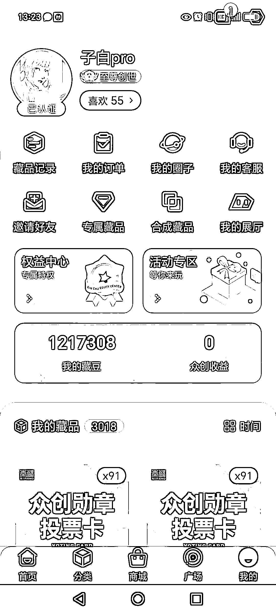
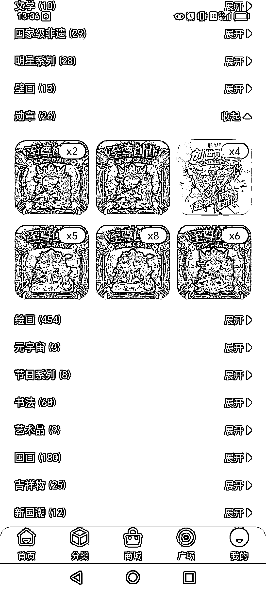
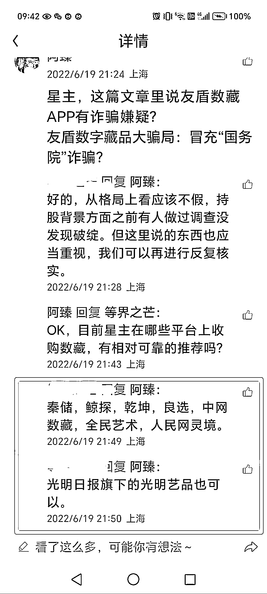
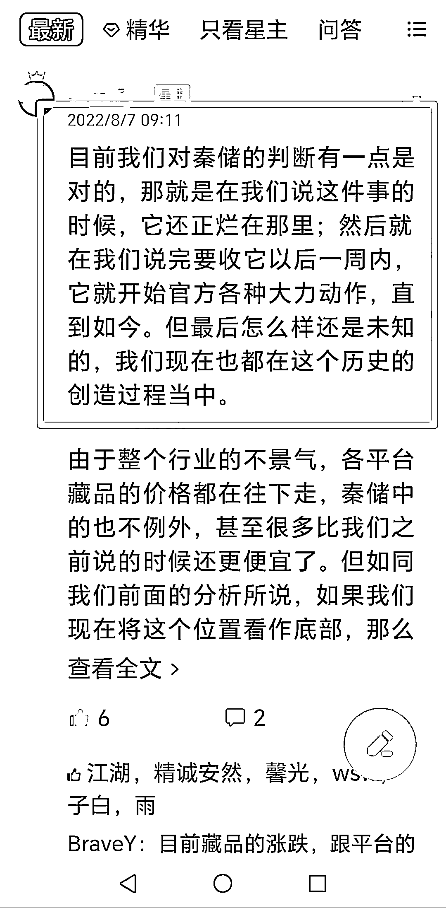
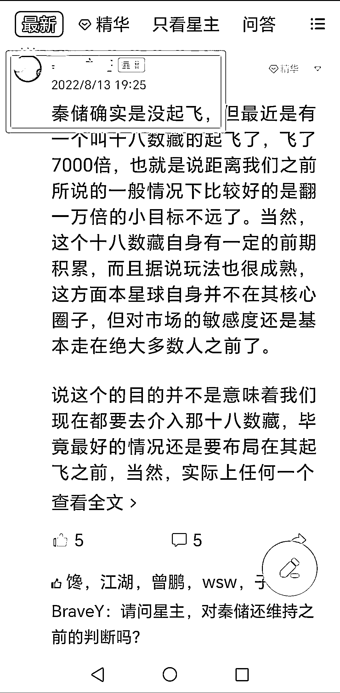
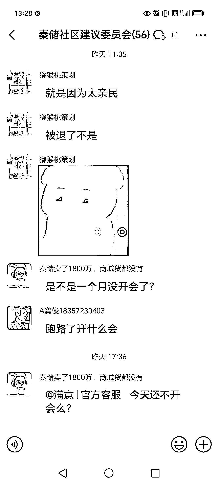
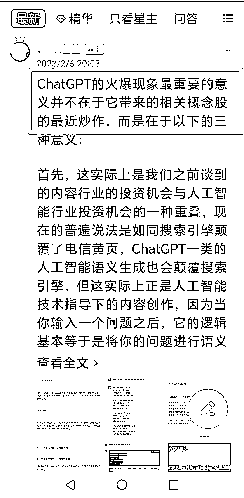

# 我为知识付费 100w+，那些年我被割过的韭菜（二）
作者：龙哥

标题：交了100万学费后，我终于认清：资金盘就是为“又贪又懒”的人定制的

大家好，我是龙哥，你们熟悉的“付费体验官”。最近从武汉回来，意外有了点小名气，很多圈友跑来链接我，说对我印象特别深。手头还在帮圈友改帖子，几个小项目也慢慢有了起色，之后会一个个复盘出来。

上期说过，要把自己被割的经历全部写出来，给想赚钱的朋友当避坑指南。我一直觉得，创业路上最大的坑不是别的，就是乱投资，尤其那种被精心包装成“项目”的局。

这种局为什么总能钓到人？因为韭菜的两大特质就是贪婪和懒惰。宝妈、大学生、负债者，这些都是常见的目标人群。我这么说没有贬义，而是客观事实——所以真正清醒的大佬，往往不愿意碰这些群体。

像我这样的人，一听到“手把手”、“不用动脑”、“躺赚”、“睡后收入”这些词，基本就迈不动腿了。所以线下手把手培训班，就算客单价贵一点，也很容易成交。可韭菜的真实想法是：手把手教什么？我把电脑带过来，你直接帮我把电商、独立站、工具站、挂机软件全部弄好，我坐着收钱不行吗？

还有人觉得这都嫌麻烦——还要跑线下、还要学，干脆直接把钱转给你，你每天给我分红就行，再拉几个朋友还能拿提成。你看，资金盘的雏形这不就自己长出来了？

所以资金盘天生就是给韭菜准备的。你从一开始就是资金盘想要的形状，想跑？反正我没跑掉。

今天专门聊聊我在资金盘上亏掉50万的经历。去年元宇宙被吹上天，所有人都想蹭热点，毕竟大家都All in了，你不蹭都不好意思。那时候国内的数字藏品平台，几乎占据了互联网的每个角落。

我一开始对这些平台完全不感冒，一眼就知道是资金盘——新瓶装旧酒，击鼓传花的老把戏，很多年前就见识过，压根没打算碰。直到2022年6月19日，我关注了7年、每年交一万多学费的财经博主，开始大力推荐几个数藏平台，把行业前景吹得天花乱坠。

我注册之后发现，平台玩法都差不多：发新、合成、空投、分红、赋能。每次发新藏品或合成时，平台就给一堆承诺——拿空投、拿分红、拿实物，引诱玩家抢购。但这些赋能通常只持续一小段时间，等平台收割完了，全部归零。老鼠仓、恶意炒作更是家常便饭。散户想赚钱只有一条路：找人来接盘。一旦热度没了没人接，只能活活被套。

我当时因为对博主极度信任，完全无视了风险，几个平台都买了，买得最多的是“秦储”。当时还有一批玩家以为有庄家进场抄底，跟着我一起扫货——真是对不起他们，大家一起被埋了。实际上我下场的时候，数藏已经凉得差不多了，我几乎就是最后一波接盘的。这么算起来，我接的散户比我拉进来接盘的人还多几倍，也算是做了点“慈善”。

到现在，绝大多数野鸡平台已经跑路，有官方背景的还在运营，但藏品一文不值。我至今还是“秦储”的榜一大哥，但这个榜一当得实在太憋屈。别的平台跑路前，至少会跟大户协商私了、给点补偿；到了我这，什么都没等到。果然是“正规平台”，正规得让人无语。

这笔钱如果拿去刷礼物，好歹还能换来主播一句“么么哒”，也算是支持GDP了。结果我在平台当榜一，连个生日问候都没有，客服基本不理人。这大概就是“软跑路”：你想告都没得告，它就这么半死不活地吊着，死猪不怕开水烫，断定你拿它没辙。而且我们绝大多数都是私下交易，钱压根没打给官方，自然也就无从退款。这一招，真是高。

你说那个博主？我现在依然关注他。我不觉得亏钱是他的错，是我自己没权衡好风险——明知是资金盘，还是头脑一热冲了进去。这件事让我明白一个道理：谁都别轻信，自己的选择只能自己担着。

而且今年2月，也是看了他介绍的GPT——你们看看我的信息来源有多匮乏——我才误入了一个卖号群，还被骗了888块。那正是我“梦开始的地方”，没他也就没有后面这一连串故事，更不会跟圈友们在茫茫人海中相遇。

资金盘进场的时机，差别实在太大了。早进去的人还有机会割后面的人，晚进去的只能当接盘侠。韭菜通常是这样的：早期不敢玩；中期看别人赚了钱，忍不住用小仓位试试；晚期发现“哇，真的能赚”，立刻重仓杀入，然后光荣接盘。

我觉得所有人都别碰资金盘。盘子能撑多久，完全看玄学，我见过最短的盘子只活了4天，直接把所有人闷杀在里面。

但如果你现在已经下场了，什么时候退出？我建议你现在就退——可你肯定不听，对不对？那就继续往下看吧。良言难劝该死的鬼，哎。

下面这几个退出信号，千万记牢：

1. 出金。这是最重要的一条。提现就是检验平台优劣的试金石。资金盘的提现只会越来越慢——没有新鲜血液，资金链就稳不住；资金链不稳，出金就变慢；资金链一断，必崩无疑。出现任何阻碍出金的理由，马上撤，没有例外。但等你真意识到这一点，往往已经晚了。

2. 收益幅度。不管是涨还是跌，只要感觉不对劲就退。收益突然上调，可能是最后一波拉人加仓；收益突然下调，可能是资金链撑不住，只能先降压力。两种情况都要跑。

3. 舆情。只要平台出现负面消息，不管真假，直接走人。负面舆论一定会影响平台的用户质量和数量，用户一旦流失，资金链上就会出现裂缝，崩盘是自然而然的事。千万别小看小道消息——星星之火，可以燎原。

4. 活动。只要平台开始搞活动，立刻想到邓紫棋唱的那句“全都是泡沫~”。你的收益本来就是泡沫，开盘的人不是慈善家，不会无缘无故给你发福利，他们盯的就是一个“贪”字。

5. 新人进场。资金盘能持续运转的本质，就是不断有新韭菜进来。如果群里新增一直停滞，或者新面孔越来越少，那就赶紧退。100个老玩家每天拉100人和每天拉10人，效果天差地别。

6. 平台维护。如果平台频繁维护、不断更新、甚至白屏，直接走人。连服务器都不肯好好花钱，说明对方就没打算长期干。

7. 推广方式。地推的活得久，网推的凉得快。全网推的项目，短时间冲进来太多人，后期新人接不上，崩盘速度肉眼可见。

8. 域名。拿到推广码的时候，可以先打开浏览器，去站长之家查一下域名年龄。这个方法我觉得没太大用处，但很多人都在用，写出来给你参考。

我知道劝不住你，但对所有想“下海”的朋友，还是想啰嗦几句注意事项：

1. 用闲钱。把资金盘当事业的，不是大佬就是傻X。任何投资——姑且叫投资吧——都一定要用闲钱，确保亏一次不会伤筋动骨。爱惜钱包，从我做起。

2. 不要对接操盘方。庄家和散户天生对立。你在想什么，他看得清清楚楚；他在想什么，你一脸懵。操盘方的话，就当放屁就好。

3. 包装过头不要碰。越有实力的越低调。一开始包装得天花乱坠，第一波冲得太猛，后面必然没后劲；没后劲，就是崩盘。

4. 模式决定周期。不同模式的周期长短不一样，抢单模式崩得最快。

5. 见好就收。最好的状态是从根本上拒绝任何资金盘。如果已经不幸下场，那争取早点回本，然后用赚的钱去玩别的。

6. 理解控盘。这个有点难，核心是别让操盘手牵着鼻子走。决定平台命运的，往往不是操盘手，而是玩家。现在绝大多数盘子早晚都会崩，真正圈到钱成功跑路的没几个。平稳发展才能让平台活得更久，忽高忽低只会自我毁灭。平台后台都有数据，操盘手一旦发现不对劲，立刻就会关掉提现跑路。试着站在操盘手角度思考，慢慢琢磨。

7. 重视推广。手底下有人，是非常大的资本——不只是返佣多，更重要的是人多你就掌握了主导权。你一句话能带动一群人做一件事，对平台的影响力不可小觑。但你作为领头的，千万不要坑手下兄弟。人散即财散，人脉即钱脉。

8. 平台质量。源代码已经烂大街，市面上H5框架多如牛毛。卡顿和流畅的平台，玩家数量会有明显差距。选流畅的，别选卡顿的；账户选对公的，别选私人的；创新模板比烂大街模板好；App同样挑流畅的用。

9. 收益匹配风险。有多大金刚钻，揽多大瓷器活。多大收益，对应多大风险。宁可选择低一点的收益，也别去追高，细水长流比大起大落实在。我还记得南京当年的“钱宝网”，整整撑了5年，2017年才崩盘，年收益约55%。它做得有多大？公交站台、新闻频道都有它的广告，口号是“经营你的注意力”，打着看广告赚钱的旗号，最后照样是骗局。

10. 保持学习。这句话听起来是废话——愿意学的不用别人提醒，自己在玩的时候就会默默总结经验；不愿意学的，赚钱的时候乐呵呵，赔钱的时候哭爹喊娘。

以后如果再遇到资金盘，一定要记住子白的忠告：资金盘拉新诱导投资是骗，鼓吹高收益稳赚不赔是骗。

最后，真心希望大家都不再上当。

我是子白，下期见。

***

