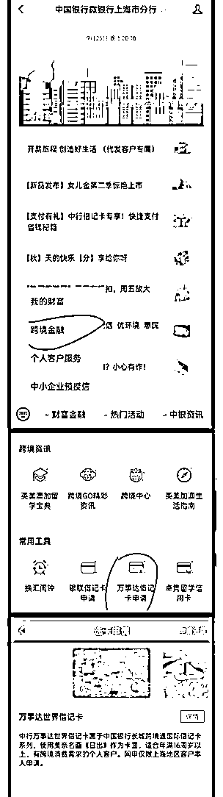
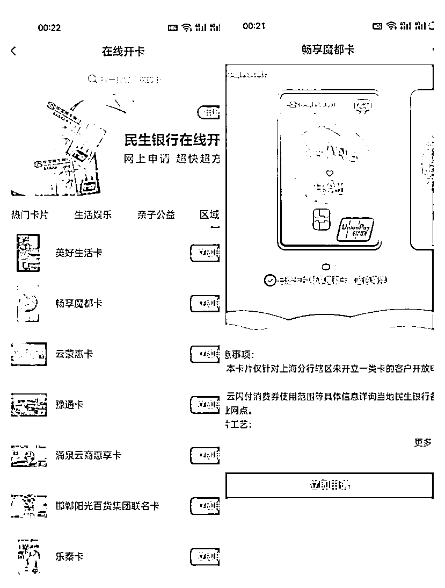
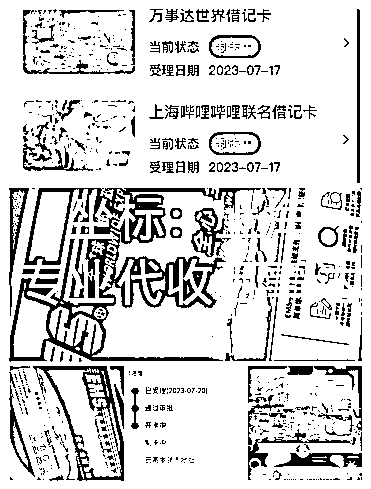
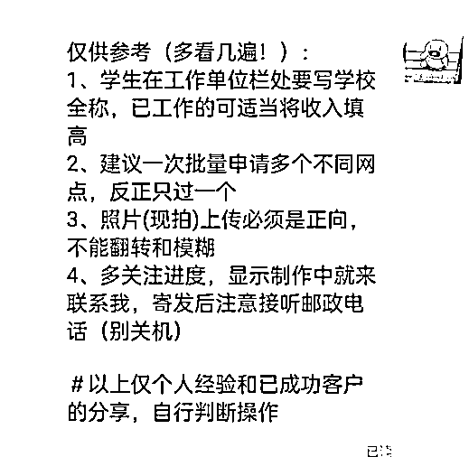
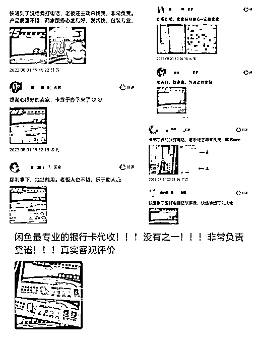
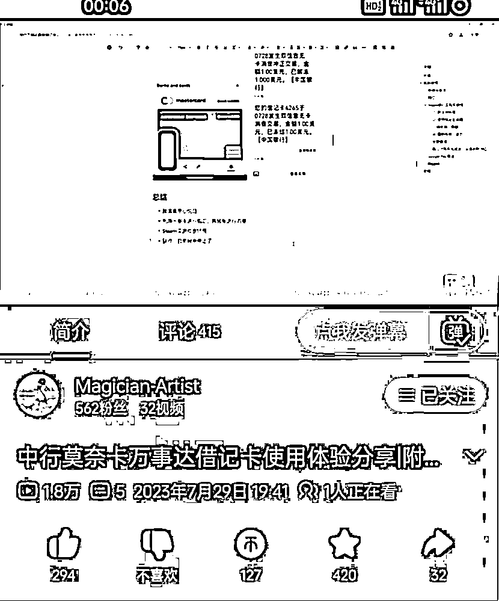

# 一张小卡片的生意经：外币借记卡代收转寄怎么玩

## 一张银行卡的变现机会，外币卡代收转寄实操拆解

作者：卍
日期：2023-10-18

最近在各大社群翻到这个话题，评论区几乎清一色在问怎么搞到手、能不能帮忙代收、求介绍……

每隔一阵子，外币借记卡就会在社交平台上再掀一波热度，正说明需求源源不断。

和典型的信息差副业一样，这个项目上手门槛很低，需求很庞大，几乎零成本投入。核心动作就是提供一个符合要求的收货地址帮忙签收，再把卡片寄给下单的客户。

我就是按这个流程走的，22 天内到手 7000 多块。顺带还能当引流钩子，把客户拉到私域后接着推其他借记卡产品，或者做办卡知识付费变现。

下面把整条路子和延伸玩法摊开说。

# 背景

央行数据显示，我国民均持有银行卡 6.01 张，其中工农中建四大行发行的借记卡占据了绝对主导。

人手好几张看似普通的小卡片，怎么把它变成能赚钱的入口？今天由圈友 @万田 来拆解银行卡代收的赚钱逻辑。

很多人申卡的动机很简单：权益加颜值。一张设计感强的借记卡，既像收藏品又能满足存钱仪式感，即便暂时没钱用，看着也舒服。

目前市面上最火的尝鲜品就是【中国银行万事达外币卡】。

卡面有莫奈《日出印象》名画系列，也有《非人哉》白泽、小玉联名款。核心卖点是支持跨境消费、海淘，并且能存取使用除人民币外的多种外币。颜值在线、实用、有用，申请门槛还低，难怪在📕等平台迅速走红。

除了这三大优势，还有一个关键限制：这几款卡虽然都能线上提交申请，但配送地址目前只能填上海。

这个区域限制是动态变化的，刚上线时是全国开放，后来因为申请量暴涨，今年 6 月后就改成上海专属，未来大概率会轮换到其他城市。

单看📕，输入相关关键词就能搜到海量笔记，市场需求已经非常直观。零投入只帮收个件再转寄，相当于白捡的差价。

**实操：网申路径怎么走 以中行、民生为例**

1. 中行申请入口：微信👸号搜索 中国银行上海分行 → 跨境金融 → 万事达借记卡申请。按提示填写真实个人信息，提交后一般约 3 天左右审核通过。之后留意进度，状态变为制卡就会由邮政投递。注意，进度页面不会显示物流派送信息，所以一定要保持电话畅通，避免快递被退回。

2. 民生流程相近，在分行👸号菜单里点在线开卡即可。民生把卡种和地区做了分类，操作更清晰。

ps：掌握了这两个入口的套路，其他银行也能举一反三。直接在👸号搜 银行名称+地区分行，比如 交通银行深圳分行 就能找到。

**实操：在咸鱼上架怎么卖**

先代入买家视角，研究大家的搜索习惯和搜索框联想词，让链接更容易被搜到。

常用词例如：上海代收转寄外币卡、中行外币卡代收、万事达卡上海转寄。发布后让几个朋友去搜，测试排名，不够靠前的就优化标题关键词，直到稳定在前三位。

主图和价格也很关键。图要真实可信，银行卡实拍图配上小区实景照，用醒目大字标注服务内容。价格不能定太高，服务本身很简单，贵了客户会觉得不划算。

咸鱼上做上海快递代收的玩家非常多，怎么做出差异？

1、账号专业度：头像、背景、简介和宝贝详情页都要体现靠谱感
2、附赠干货：整理 5-6 条网申小技巧，简单但对新手很有用
3、用晒图好评建立信任，买家看到真实反馈，基本问两句就下单

未来延展：各家银行会不定期推出新卡，比如外币卡、运通卡、联名卡、跨境卡、照片定制卡等。这些卡一旦被📕、B 站博主带火，就容易形成小高潮。主力用户基本是 95 后。

受限于发行量，很多卡片会指定城市开放，一线和省会城市居多。这类信息可以在银行👸号里查，但更高效的是刷📕、抖音、B 站，让算法持续推送，同时加入卡友 🐧 群、贴吧获取第一手情报。

# 进阶思考

1.从咸鱼拿到客户后一定要 100%导入微信，我现在用的是最笨但最稳的发短信提醒，后续可以在私域里交叉推广其他卡片。
2.借记卡和信用卡的玩法很多，用户体量也大。可以做个自媒体账号，输出办卡、开卡、养卡的干货，积累精准粉丝。参考下方 UP 主的模式。

* * *

评论区：

龙哥 : 感谢分享，已加精华。

龙哥 : 可以再深挖一下，这些人为什么要申请卡，围绕核心需求去开发产品和服务，空间可能更大。

卍 : 太激动了，感谢龙哥认可

才 : 这些外币卡主要是用来干嘛的？

卍 : steam充值、海淘、海外消费等场景

阿奇 : 能不能绑定 Google 应用商店？

卍 : Google Pay 是可以用的

chatGPT 学者 : 具体能用在哪些地方？

* * *