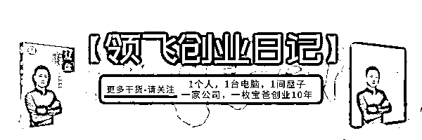

# 同城二手玩具圈粉打法：把信息差做成月入10万的宝妈基本盘

## 同城二手玩具的生意，本质不是卖玩具，是圈宝妈

作者：领飞懂运营
日期：2023-10-19

我是领飞，一个在家创业十年的宝爸。

今天把【同城二手玩具】这套中介圈人玩法完整拆开讲清楚。

先建立两个核心认知：**同城宝妈的价值，同城流量的价值。**

很多人死在“二手玩具能赚差价”这个想法上。玩具本身没什么赚钱逻辑，你拼死拼活赚的只是残值，体力耗尽，最后只能放弃。

为什么放弃？市场看起来大，实则供需匹配难，利润薄，客户分散，单点流通效率极低。

二手玩具真正的价值只有一点：**信息撮合价值**。它不靠卖货盈利，靠的是做信息服务的入口。

孩子玩具多到堆不下，好玩的舍不得卖，坏了又丢不掉。现在玩具成本低，损耗快，差价几乎为零。热度高的是“换”，不是“买”。

谁能把交换的需求串起来，谁就能把人圈住，然后变现。

看懂了这一点，后面的操作就很顺了。

**第一步：先备素材。** 
去抖音玩具批发拿货，投入2000元左右就能拿一大批各式各样的玩具。这些不是用来倒卖的，是用来当拍摄道具的。50多条视频素材，启动完全够用。

**第二步：立人设。** 
号定位成一个带娃的宝妈或宝爸，在街边摆摊卖玩具、玩玩具、体验生活。能不能真的卖出去不重要，重要的是真实可感。地摊经济到处都能落地。

**第三步：放钩子。** 
核心话术就是“以旧换新”。用这个钩子去打同城。家长都爱占便宜，尤其是宝妈。注意玩具的质感要好，不能太廉价太垃圾，好的玩具才有交换欲望，才有话题引爆力。

**第四步：做饥饿感。** 
2000元的货量是有限的，天然就有稀缺性。50条视频发出去，轻松能吸引上千名宝妈关注。没换到的，都引导进“置换群，后续还能继续换”。原理和公益送书一样，先用利他建立信任。

**第五步：建置换群。** 
群的核心是服务。让宝妈们在群里自发交换玩具、书籍、闲置物品、孩子相关的各种用品。书籍的需求同样很大。信息服务价值就这样沉淀下来了。

**第六步：中段裂变拉新。** 
信息价值跑通后，就要扩量。从玩具商那里再采购一些水杯、书包、绘本等小礼品，设置朋友圈点赞、拉好友进群的任务，用裂变把基数做大。

**第七步：后端沉淀到抖音。** 
当你有了本地有影响力的宝妈社群，这就是基本盘。把群服务复制到抖音做长期获客，重点是社群的持续维护，盘活存量。

**第八步：精细化分层。** 
每来一个宝妈，都按孩子年龄段分类，标记生活习惯和需求标签。后期的服务和变现都靠这套分层。

**第九步：信息归类常态化。** 
玩具置换是群体的核心刚需，必须长期做下去，否则流失很快。所有宝妈都要沉淀到你的微信好友里。群信息会流失，朋友圈能补位。

**第十步：变现通道。** 
手里有了本地宝妈的微信资产，就是资源。直接对接商家就行。
比如区域牛奶经销商投放、培训机构朋友圈广告，几千起步很正常。
还可以做团购，找抖音渠道商拿学习用品、水果等做团购分销。

**第十一步：留存与复利。** 
没有项目能100%留人。只要通过一个入口把同城宝妈圈起来，长期留存20%-50%就已经足够变现。服务做好了，还会有转介绍和回流。
例如你能拿到当地游乐场最低票价，宝妈凭什么不找你买？能拿到低价，正是因为你有足够的宝妈体量支撑议价权。

OK，以上就是【二手同城玩具】的完整拆解。说白了就是一套阳谋式的起盘术，所有盘都围着“人”转。没人之前靠套路起量，有人之后靠服务变现。

这个玩法有两个关键点：第一，用2000块的玩具怎么拍出有吸引力的视频；第二，怎么把钩子吆喝清楚。

投资成本极低，就算拉到1万起盘也完全值得。别纠结金额，思路对了执行就顺。

抖音做全国很难，但打爆一个同城很容易。让20个本地朋友看完点赞，数据就起来了，再配合点投流就能放大。试错成本低，成功率高。

我自己现在不做这个项目，但一套逻辑在2016年微商时代就用过了，当时是用来推淘客商城的。现在搬到抖音，门槛更低了。

**往期赚钱文章分享：**

# [【卖虚拟资源】如何转型发财，实现被动收入](https://articles.zsxq.com/id_ivjp0v8zrubv.html)

# [【中介思维+模式复制】博取年入千万机会的方法](https://articles.zsxq.com/id_9ces000ge6h3.html)

# [【长期暴利项目】中介思维极致，年入百万项目方法](https://articles.zsxq.com/id_cd7wutqqqa61.html)

# [【吐槽自己】引以为戒：从一开始就要有格局](https://articles.zsxq.com/id_s465kd1spkrg.html)

# [《拥抱同行“借势”课》 互 推 • 扩 列，涨粉操盘手 SOP](https://articles.zsxq.com/id_skrvu1ouvgul.html)

* * *

评论区：

zhAzha : 这都能做。大佬眼光还是独到。

佐敦道 : 思路没问题，我执行这方面不行哈哈

* * *