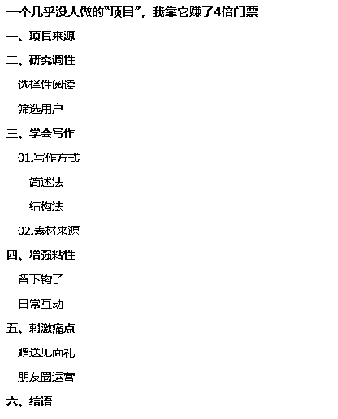

# 一个冷门到几乎没人尝试的方向，让我赚回了 4 倍生财门票

大家好，我是微微。

从事写作 12 年，过去 10 个月里，我累计完成改稿 560 多篇，输出超过 73 万字，独立创作原创文章 300 余篇。平时主要分享写作方法，也陪伴刚入门的朋友一起成长。

加入生财有术半年后，我通过实践其中学到的内容，实现了近 1 万元收入，算下来，已经赚回了 4 倍以上的入场费用。

刚加入生财的那一天，我其实只是一个接触自媒体不到半年的新人。第一次打开知识星球时，里面密集的信息、经验和真实案例，给了我很大的冲击。

因为在此之前，我只是一个普普通通的基层打工人。无论见识、认知，还是对机会的判断，都还停留在“学生阶段”。说得直白一点，我就是一个没怎么见过世面的普通人：想法不够成熟，容易自我怀疑，也经常陷入焦虑和内耗。

现在回头看，带着这样的状态，想做好一件事本来就不容易。能够持续学习这么久，没有半路被焦虑和自我否定击退，已经算是一种进步。

进入这个远高于自己认知水平的圈子后，我每天都会接触大量新信息。很多高手分享的案例、方法和信息差，我一开始根本看不懂，甚至会觉得自己和他们之间隔着很远的距离。

但我没有因此停下来。

我坚持每天阅读、整理笔记，把看似零散的内容串联起来，再从中筛选出适合自己的方向。哪怕进展很慢，哪怕像乌龟一样一点点往前挪，我也始终没有放弃行动。

事实证明，只要愿意认真吸收并持续实践，就一定能在这个圈子里找到适合自己的变现路径。

后来，我终于摸索出了一个非常适合新人的方向。即使是刚起步的小白，只要愿意投入时间去做，也有机会在半年左右实现接近五位数的收入。

所以，我想把这个几乎没什么人关注的“项目”分享给同样处在新手阶段、正在寻找突破口的朋友。

我相信，它不是只能停留在纸面上的方法，而是一个真正可以落地执行的方向。只要你愿意开始，并且持续做下去，就一定能够看到实实在在的变化。

不是“也许会有收获”，而是：

**只要行动，结果就会逐渐显现。**

具体内容请前往飞书查看，阅读体验会更完整：

[`eqc9f6vzuhv.feishu.cn/docx/Ifz1dXrkso0swUx5AY1cyBmUnGd?from=from_copylink`](https://eqc9f6vzuhv.feishu.cn/docx/Ifz1dXrkso0swUx5AY1cyBmUnGd?from=from_copylink)

* * *

评论区：

张达达：很有启发

微微：谢谢[呲牙]

* * *