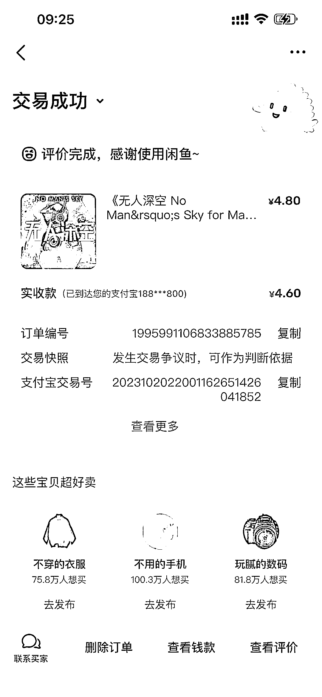

# 闲鱼虚拟产品—从上架到出单，只需要两步
作者：龙哥

最近挖到一个超级适合新手试水的小副业——在闲鱼上卖虚拟产品。我们团队亲自跑过一遍，确认能出单，而且见效比想象中快很多。

以前闲鱼对虚拟商品是明令禁止的，现在规则已经松绑了。不过大家要注意，像ChatGPT这类比较敏感的内容依然不能碰。

简单说，虚拟产品就是不用走物流、直接线上交付的东西，像学习资料、付费课程、设计素材这些都算。在龙哥盟待过一段时间的兄弟，估计对这个概念都不陌生。

这次我们选的是Mac游戏来实操，用了一个全新的账号，才架了两个商品，很快就迎来了第一单，速度真的有点惊喜。

有人在评论区问：现在咸鱼真的能卖虚拟资料了？没错，官方已经开放了。另外提醒一句，刚起步别急着上自动化软件，自己手动发货就行，真耽误不了几分钟。

