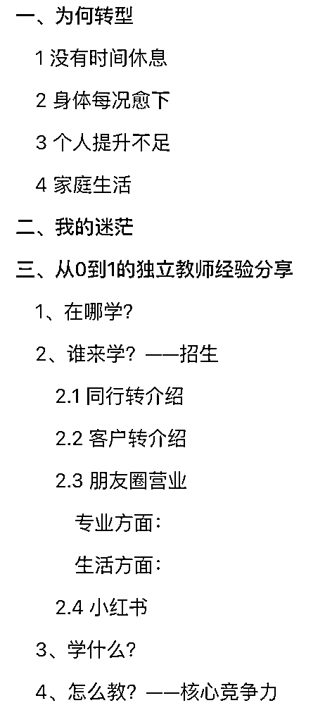
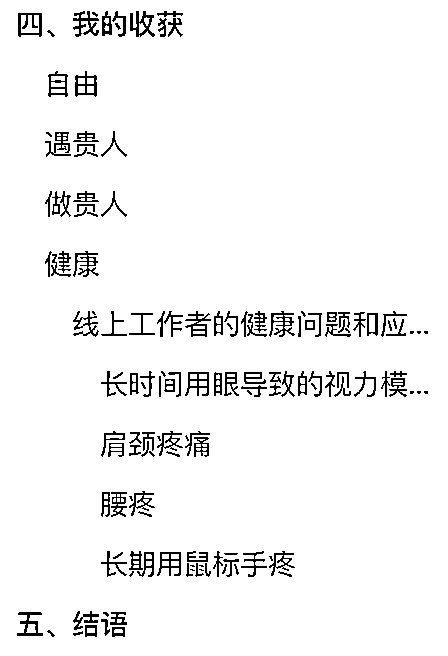
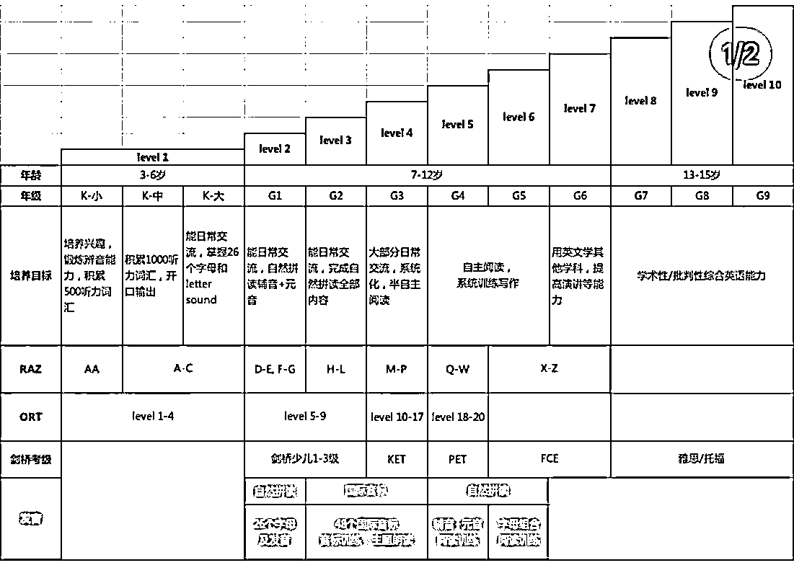
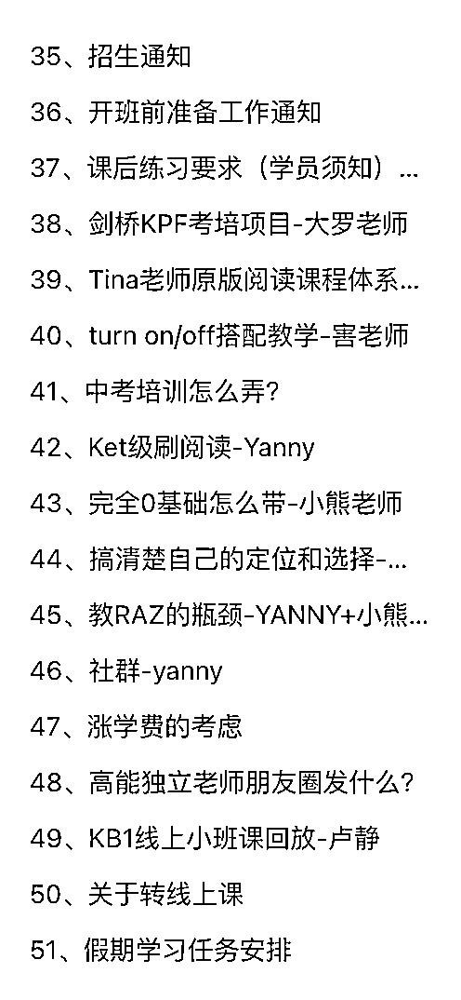
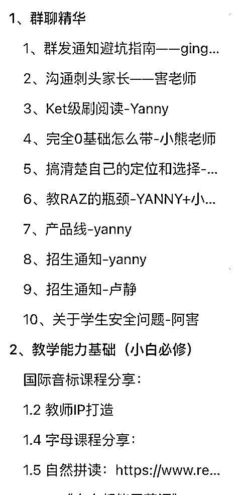

# 从教培教研组长到个体教学，腾出三成精力，收入翻了十倍

## 从剑桥部教研组长到独立教师，如何释放出自己 30%精力收入提升 10 倍

作者： 卢静

日期：2023-10-19

服务的人变少了，客单价上来了，时薪也跟着涨了，这正是我从机构老师转投独立教学的原因。

起初我在头部教培机构里，长期加班，身体被掏空不说，算下来的时薪也低得让人沮丧，渐渐觉得这不是我想要的职业模样。

于是我把切口收窄到教培细分赛道，靠同行和家长的口碑转介绍招生，用朋友圈来沉淀信任，用📕做拓客，成为一名独立教师。

全流程都是我自己操盘：自己招人、自己定课、自己上课。省掉了大量内耗，收入直接提升了十倍。接下来就把我从0到1做独立教师的经历摊开说说，希望能给正在犹豫的你一点参考。

本文围绕三件事展开：

1. 我为什么选择转型
2. 从0到1做独立老师的实操复盘
3. 两年自由职业带给我的改变

不敢说能解决谁的问题，如果你对下面这些话题感兴趣，可以关注一下：

1. 独立教师的成长路径
2. 从打工到自由职业
3. 女性如何平衡家庭与事业

下图是大纲：

# 一、为何转型

如果我不按自己的想法生活，最终就会按生活的想法去想。

**1. 时间被榨干**

2021年，26岁，在头部教培机构做了近三年，手上带了180多个学生，还负责一个系列课程的教研。

我的作息是：周三周四带20多位老师教研，周五白天审教研成果晚上上课，周末两天满课，周一二算是“休息日”。

能自然醒一次，对我而言就是一周最大的奢侈。其余时间全被塞满：要做新媒体板块的研发，要审校和重编两天的教研成果，要跟进180多位学生的学习、还要和家长沟通。即便不眠不休也做不完。

**2. 身体亮起红灯**

在这种手忙脚乱里，身心都处在紧绷状态。长期伏案，颈椎和腰椎开始报警。

身体亚健康，我办了健身卡却几乎没去过。上班时健身房没开门，下班时它已经关门。

**3. 个人成长停滞**

心里堆满想弄明白的问题，却连思考的时间都没有。

这样的工作强度，月入3万，折算下来时薪极低。公司把一个人用出三个人的产出。在这条路上继续升职加薪，似乎就是天花板了。每天12点还在被部门总监催工作的场景，让我确信这不是我想要的生活节奏。我忙到根本没有时间去复盘和提升自己。

道德经讲，有为利，无为用。

当生活被填得满满当当，就必然失去某些东西。我的机会成本是什么？

冲着“空出来”能带来的新可能，我选择离开，把杯子倒空，让身心先停下来。

休息，是为了更好地出发。

**4. 家庭与人生选择**

当时的伴侣并不是我想携手共度一生的人，也几乎没有时间和机会去认识新的人。

26岁的女生站在岔路口：要么继续拼，接受述职邀约升级，变忙，晚婚晚育，甚至在30+遭遇职业断崖；要么离职，去探一探另一条路。

事业、身心、情感三方面都不乐观，不走更待何时。

# 二、迷茫期

我最初的想法很简单：离开，开一个自己的小工作室，做喜欢的教育。

可6月29日离职，半个月后行业新规落地，一切线下可能性都断了。7-8月我几乎都在休息和反复思考出路。

线下机构做不了，但教育是我想做的使命。

于是不再犹豫，直接开干。2021年8月底，我进入了全线上自由职业状态。

# 三、从0到1的独立教师经验

即便没经验的老师，备课时也绕不开几个核心问题。

## 1. 在哪上课？

我花了1万元充了云教室Classin，当时市面上口碑最好的。本来线上课家长就不太情愿，我必须把课堂质量兜住，设备和软件不能掉链子。

Classin约4元/人/时，每月开销相当于三四线城市的一间线下房租。功能全，售后秒回。

回头看，没学生就先充课室是幸运心态，其实不该先投这里。起步更经济的方案有腾讯会议、瞩目、爱问云。长期用，建议直接入Classin省去对比成本。

## 2. 谁来学？——招生

很多人问我怎么招来的。答案很朴素：同行转介绍、家长转介绍、📕。

**同行转介绍**
我没有带走原机构任何一个学生，甚至换了个新微信号避免被找到。孩子最后一课都哭了，带走很容易，但我不这么做。

离职后，我先和同行朋友合作。我出课程，他们给我生源，我给他们返利。

**客户转介绍**
第一个月收入就几千块，我把手上几个客户服务好，很快出现了转介绍。

和家长聊多了发现，沟通总是绕不开几类问题，极费时间。于是我把内容整理成课程手册。家长来咨询，问清孩子情况后直接发手册，自行匹配。看完合适的就缴费试课，进班长期上。

一套省时的课程手册应包含：
1、课程背景，理念是否与目标客户契合
2、上课形式、时长、频次、班级人数
3、进度安排与课程大纲
4、收费、是否可试听
5、诊断与分级方式
6、课后练习要求
7、对家长配合的要求
8、线上设备资料准备或线下路线指引

【不带的家长类型】
孩子大多可爱，家长则未必。你教孩子，家长买单，小学培训本质是两头服务。

我不喜欢家长组团报班，通常要求多，像要控制老师。曾有一个焦虑的家长，我每周都要做心理辅导。

一年级孩子带四个多月就能写作文、口语独立表达1-2分钟，她却看不到进步，一点小事就无限放大。典型表现有：看不到孩子起步晚，期待过高；跟风换路线，高频切换；不听劝，焦虑转嫁孩子；讨价还价，把老师当菜市场；不尊重服务者；直觉想逃离的。

**朋友圈经营**
独立老师的朋友圈要专业，也要有温度。

专业面：课前选教材、测评、教研、备课；课中上课实录、学生高光、教师高光；课后作业、反馈、反思、好评、成果、证书。我常在视频号发作业，吸引家长和同行询问。

生活面：娱乐、阅读、健身、家庭、旅行、自黑，只要不是负能量都可发。积极向上的人更有能量。

我会发搞笑段子、学习感悟、健身打卡。自黑时家长会围观，孩子也爱评论。甚至有陌生人来聊书，我因此收获了书友。

多露面，关键时刻才会被想起。有人因我没学历还说“等我”，我也会因不想耽误孩子而推荐更合适的老师。

卖自己的同时记住“超越预期”。说6分做8分，别把话说满。真诚是最大杀器，人设就是做自己。

**📕**
转介绍太慢，我需要自己的流量池。2022年春开始做📕，带来约10万收入。

这类账号不需要大流量。1000粉能转化10人，年费1-2万就够了。现在粉丝2.5k+，约三分之一客户来自📕。

运营上我只坚持一条：持续更新，100条后再说别的。能坚持下来的人很少。

独立教师的天花板明显，一个人时间有限，排满课后只能涨价。除非招老师分摊，或做录播课等可复用产品。

## 3. 教什么？

产品取决于客户定位。

赛道大致有：补差、校本同步、培优、高端国际学校需求。

补差体量大老师累，校本同步没意思，高端人脉不足。最后选小众高客单的培优，服务少数人收入更稳。

确定赛道后，我先搭建课程体系图。这个框架定调，后续调整都在框架内。

很多独立老师没有成体系的产品。

有了框架再买教材、测评、填充细节。

起初我擅长剑桥考级，用Power Up做低龄，Open World做高龄。一年后发现，学生不能总考试。考试是积累到位的自然结果，不是技巧能刷出来的。考完就流失，复购率低，需要长线基础教材。

2022年8月我全线换教材，低段Kids’ box，高段Think，备课量巨大但熬过来了。

一份完整的课程手册能回答以上8个问题，大概率体系是通的。

## 4. 怎么教？——核心竞争力

手册再完善也解决不了教学本身，教学质量是续费的生命线。

提升教学的办法：
①持续复盘备课
②换位思考，想如果我是孩子
③付费抄作业，跟前辈少踩坑
④发挥长处，比如我擅长剑桥考级就不去啃中考高考
⑤持续学习

我的学习路径：新东方剑桥部教研组长经验打基础；塔客学院3年；TKT 43433；CELT-P 6800；多位老师的录播、直播、社群学习，费用从几百到2万不等。

避坑经验：市价一般合理；同行口口相传的师训比自卖广告靠谱；不同阶段学不同课；理性消费别囤课；先报单课再决定。

# 四、两年的收获

**1. 自由**
财富自由对我而言是空间、时间、金钱三者合一。

现在线上工作，空间自由，2021.7-2023.7两年走过很多城市，认识很多朋友。

时间半自由，上课时段固定，其他时间可支配，能自然醒，不再心悸。

有时间陪伴家人、看书、旅游、画画。女儿、妻子、姐姐、母亲这些角色可以和解。

金钱上，用更轻松的方式赚到比打工多一倍的钱。行业不适合大赚，小富即安。收入多用于投资自己和升级产品。

**2. 遇贵人**
独立后才切实感受到人脉的力量。

我的主动是离职后付费进入独立教师学习群。打破信息闭塞，遇见了前辈M和师姐Y，都是年入百万的活榜样。

M前辈在5分钟发言里让我嗅到宝藏，下线立刻付费学习，并推荐给同行。师姐Y的路径我基本复刻，还避开了她的坑。

两年前的我一无所有，现在排期已满，还有客户在排队。

**3. 做贵人**
别人不会无缘无故帮你，能花钱就花钱。

我乐于分享，整理过大量资料给同行。

因为分享收到红包、咖啡、礼物，这是价值互换。我在群里愿意吃亏一点。

人都是自私的，只是近视和远视的区别。我选择利己主义的利他。现在越品越香，越挖越有惊喜。

**4. 健康**
我怕死，去医院会高血压紧张，体检心跳老不过关，出门就恢复。

现在每天两次私教课，肌肉上来，能量感回来了。健身当下痛苦，反馈很甜。

以前躺下还不满足，报复性熬夜，饮食作息都乱。现在身体在慢慢修复。

锻炼带来的改变，往往不是抽象的“身体更健康”，而是能被自己清楚感知到。

以前爬几层楼就气喘吁吁，后来有一次连续走上八楼，竟然没有觉得特别累。心肺功能提升之后，整个人的状态也跟着变了：情绪更稳定，精力更充足，做事效率更高。每天都能把时间安排得满满当当，晚上躺下时，会觉得这一天过得很踏实，带着满足感自然入睡，一觉睡到天亮，甚至不用闹钟就能醒来。

## 五、线上工作者常见的身体问题，以及我的应对方式

### 1. 长时间盯屏幕：视线模糊、眼睛干涩、视疲劳

线上工作最容易忽视的，就是眼睛承受的压力。我的做法主要有三点：

- 备一些人工泪液。比如海露人工泪液，如果通过支付宝购买了好医保，有时每月可以用二十多元买一盒，通常比其他渠道便宜四十到六十元左右。
- 给工作时间设上限，每天尽量控制在六小时以内，从源头减少持续用眼。
- 使用计时器设置番茄钟。连续工作五十分钟后，强制自己起身走动，顺便看看远处，让眼睛得到放松。

### 2. 肩颈不舒服

电脑摆放高度非常重要。可以考虑升降桌，尽量让屏幕与视线保持平行，千万不要长期低头盯屏幕，否则颈椎很容易出现问题。

另外，建议准备一个外接键盘。电脑放得太近，眼睛会更累；放得太远，又容易为了够到键盘而耸肩、伸手，时间久了肩膀和手臂都会紧张，甚至诱发肩周不适。

### 3. 腰部疼痛，以及鼠标手

久坐之后腰酸，可以使用升降桌，在坐着和站着之间交替切换，不要让身体长时间固定在同一种姿势。

坐着工作时，一定要让背部有支撑，可以配合护腰靠垫。不要一直身体前倾，也没必要刻意挺得僵直。真正能减轻腰部压力的，是自然地靠在椅背上。有些人买了人体工学椅，却始终不使用靠背，那和普通椅子其实差别不大。

如果长期使用鼠标导致手腕或手臂疼痛，可以尝试竖向鼠标，减少手腕扭转带来的负担。线上授课或日常操作时，也不要所有事情都依赖鼠标，写字板、iPad 等工具都可以适当加入工作流程。

## 写在最后

不知道这份分享能不能给赚钱的朋友带来帮助。毕竟大家所处的行业、工作方式和现实环境差异很大，有些经验未必能够直接照搬。

但我还是愿意尽量坦诚地记录下来。只要能让正在经历类似状态的人获得一点启发，这次分享就有意义。

其中有一件事，我特别想和大家一起坚持：运动。

人在不同阶段，面对的任务量和压力并不一样。有时我们甚至还没有意识到，自己正用各种方式透支身体、消耗精神。等到问题真正出现，才发现原来健康、情绪和精力管理同样需要长期经营。

工作和健身之间，应该找到一个稳定的支撑点。锻炼并不是为了和工作对抗，而是为了让身体拥有承受高强度生活的能力。如果工作的压力已经大到必须依靠更强的体魄才能扛住，那么运动就不再是额外选项，而是继续向前的基础条件。

这两年，我彻底换了一种工作与生活方式，整体体验还不错。

生活也给了我新的惊喜：我和喜欢的人步入了婚姻，并且很快就要迎来我们的小宝贝。接下来，是人生新的阶段。

愿我们都能保持期待，继续向前。

* * *

评论区：

蔡文静好文静：未来真的很值得期待。之后还可以继续打造独立教师孵化 IP，面向 C 端服务家长，面向 B 端培养学员合伙人，让两端形成循环。

西伯利亚冷空气：我也是做这一行的，利润确实不错，但现在受到的政策影响也非常明显。

星星：同样是教培从业者，分享特别真诚，很有收获。[强][强][强]

畦畦：现在教培行业管得太严格了，应该怎么降低风险呢？[捂脸]

赛赛：谢谢分享，收获很大。[强]

卢静：[呲牙]互相交流，一起成长。

小光：感谢真诚记录。分享的不只是经验，也是一种面对生活的态度。

张达达：很棒。

* * *