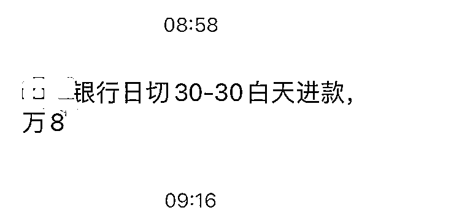
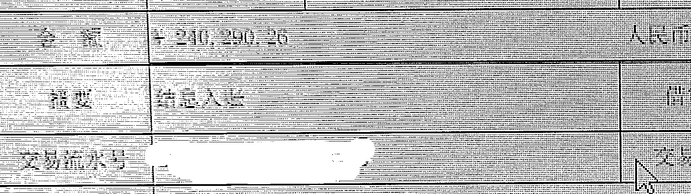
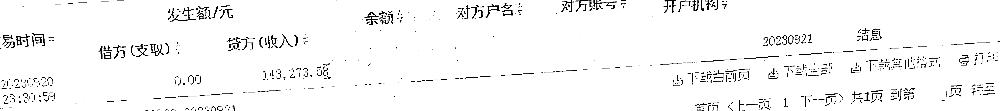

# 不靠定期也能在银行拿到10%+年化？我的一年多“日切”实操复盘

很多人一提到让钱在银行里生息，第一反应就是买大额存单、做定期，年化大多也就两点几。今天想分享一个我自己摸索了一年多的玩法，叫银行日切。在这个模式下，资金白天照常运转，晚上通过时间差轮转，综合下来能做到年化十个点左右。

先给个通俗解释。大家默认银行的日终结息都是在午夜之后，其实各家系统并不统一。有的正好零点，有的提前几分钟，有的晚半小时左右，而且这个点位每天都有点浮动。既然结息时刻不一样，就能卡时间窗口：先在A行在结息前完成入账计息，马上把钱挪到B行赶上它的结息，再继续下一家。理想状态下，一晚能连吃好几家机构的当日利息。形象点说，就像把钱装进不同口袋，按顺序把口袋里的利息先收走再换袋。

能玩起来，门槛其实不低。

第一点，资金形态不是普通活期，而是要和银行谈一种类似活期但利率可议价的定制存款。不同机构报价差异很大，大致在年化1.3%到2.8%之间。结息节奏多为每季末一次，通常在季度末20号左右，也有少数机构按月结。利率和日均余额挂钩，日均越高议价空间越大。也就是说，资金体量是第一道门槛。

第二点，得找到愿意配合的银行。对有资源的朋友，可以直接找客户经理甚至行长聊。关键是对方是否接受资金不过夜的操作，是否愿意开定制存款。接受的前提下，再谈利率档位。对公户和对私户都能走，只是风控线和限额差别很大。

我自己的节奏是：白天资金正常使用，最晚在傍晚八点半前回笼。八点半以后大额通道重新放开，才开始轮转。这样的安排保证白天业务不受影响。

第三点，也是最累的，就是测清每家机构的实际切息时刻。银行员工大都知道日切的概念，但具体自家系统在几点几分完成切账，很多自己也不清楚。有的是零点准，有的是零点前后，浮动范围几分钟到半小时不等，而且每天会变。所以必须实测。起初我们是第二天问客户经理是否已产生日均，效率太慢。后来专门组了一个小分队，轮班盯点。测点是一项不能停的日常。

大额系统通常下午五点十五左右关闭，晚上八点半再开。周末出款会延迟，这点要提前算好。

还有一个加分项是月末尤其是季末的规模争夺。银行有存款考核，月底时会为了保住规模给出更贵的报价。季末的价格往往比平时高出不少。上一季度末我们最高拿到的报价达到万分之八的级别，且叠加了日切操作，收益叠加很明显。

说实话，这套玩法并不轻松。

第一是时间成本。理论上要365天不间断，经常要忙到凌晨一点出头。偶尔有应酬、见客户，就得靠信得过的亲友代为盯盘。大额资金在多账户间穿梭，信任和安全风险自己把控。

第二是额度与头寸。晚上通道开着，如果单笔或当日累计超过网银限额，出不去。额度调整很难谈，尤其是个人户，需要一定关系。银行可以帮你预设未来最长七天的头寸，提前报备后才可放行。要留意月度累计和年度累计上限。我们曾因月度上限满了，资金被挂在通道里，又赶上周末，耽误了两天。

第三是风控阈值。对公账户建议每条线控制在五千万以内，个人账户建议控制在一千万到两千万一条线，避免触发监控。

第四是合作稳定性。每个银行的规模指标有限，达标后可能就不收钱了。所以需要持续开发新行口。定制存款一般签半年到一年，到期看情况续签。我的体验是整体比较稳，中间也有被降价的情况，但仍在预期区间。

总体来看，日切目前属于相对小众的蓝海，从资金成本角度算是一种低风险的高收益选择。但对普通人而言门槛很高：启动资金要大、银行资源要硬、网银额度要谈到位、又要有人全年盯盘，缺一个就转不动。

最后附上我们三季度部分的日切收益截图供参考。

评论区里有人说在公众号上见过类似的招生广告，这条路确实辛苦且知道的人不多；也有人提醒起步资金巨大，坊间传言多是来源不明的资金，且需要银行内线配合。还有人担心风控。确实，门槛和风险都摆在明面，建议理性看待。