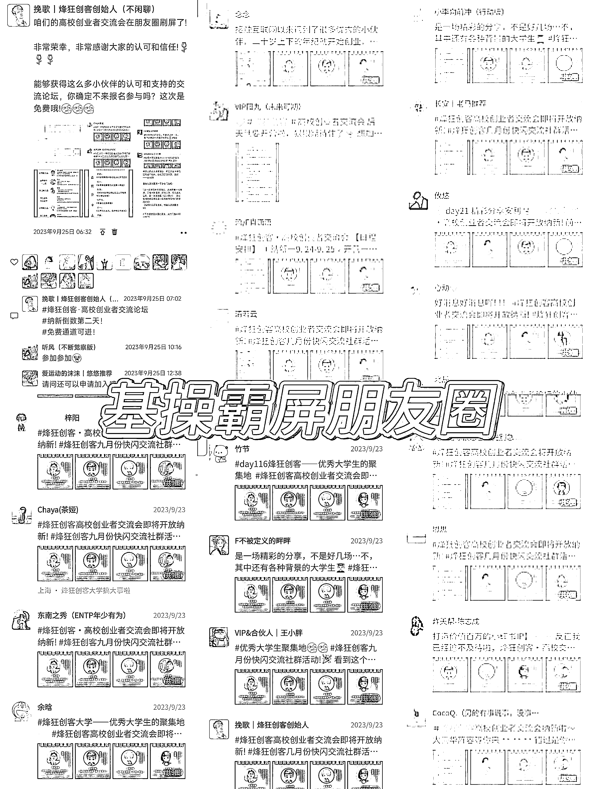
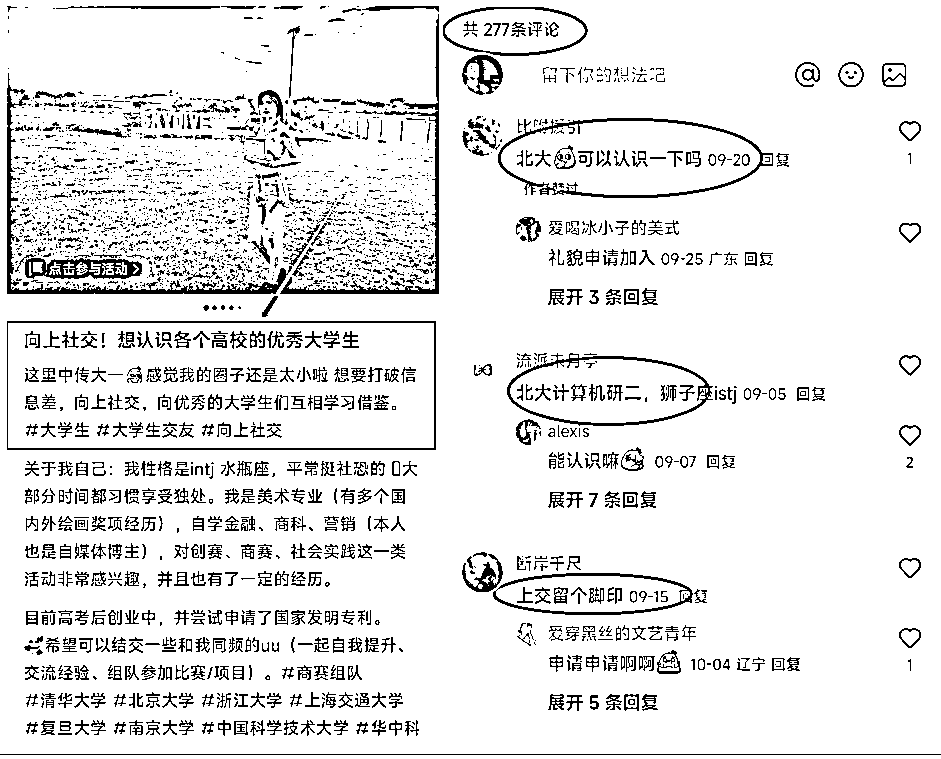
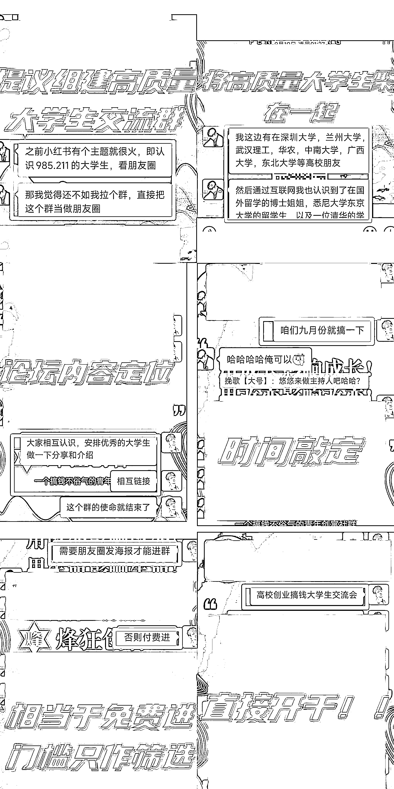
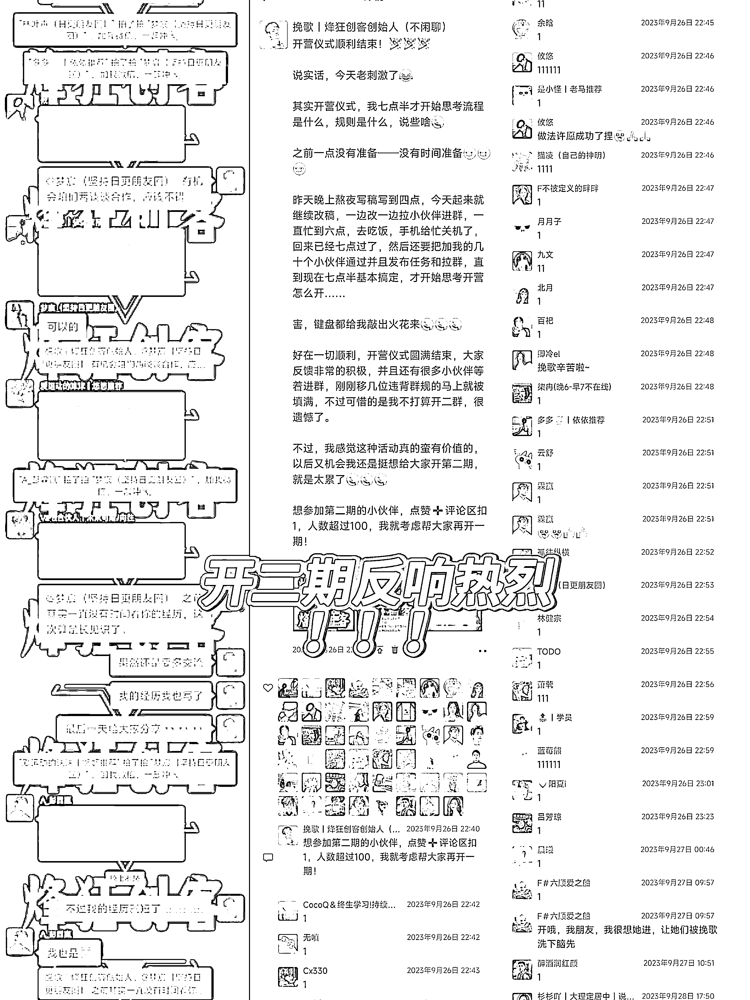
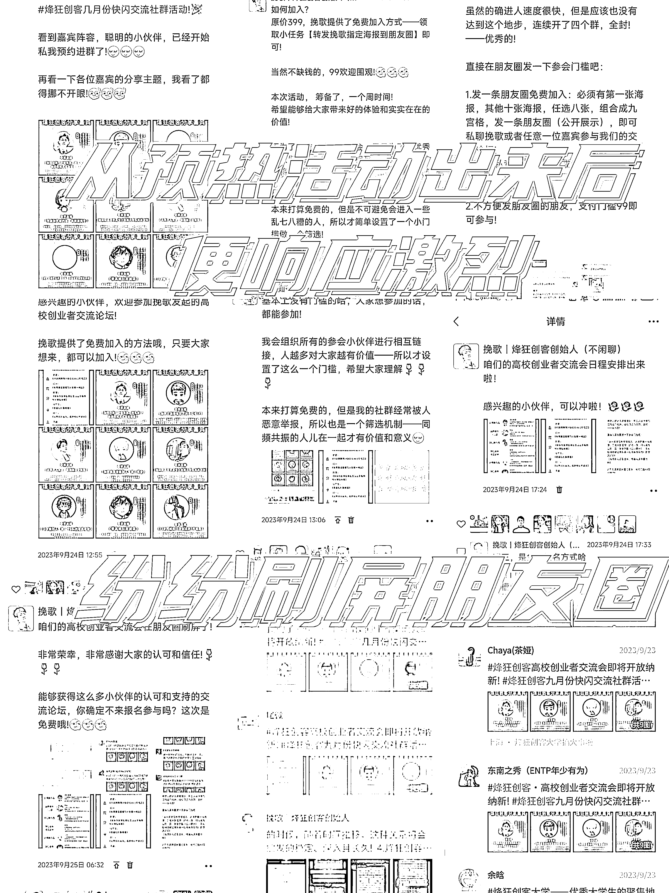
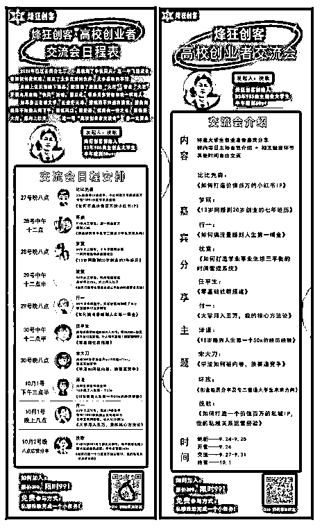
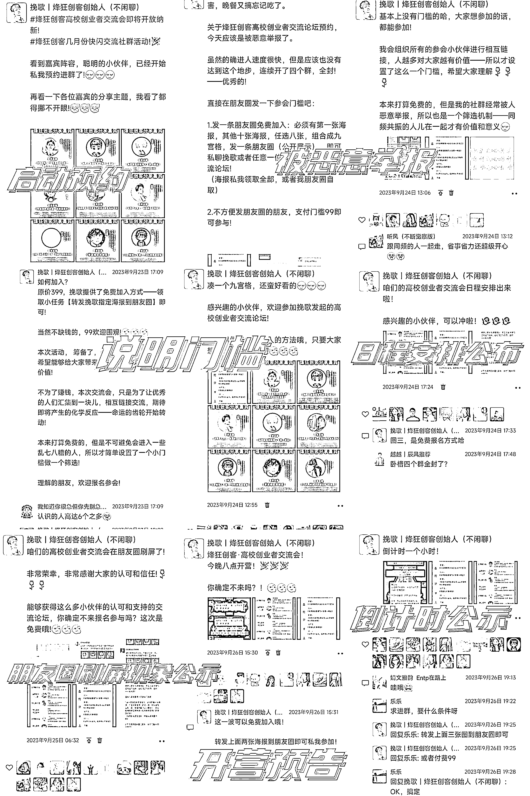
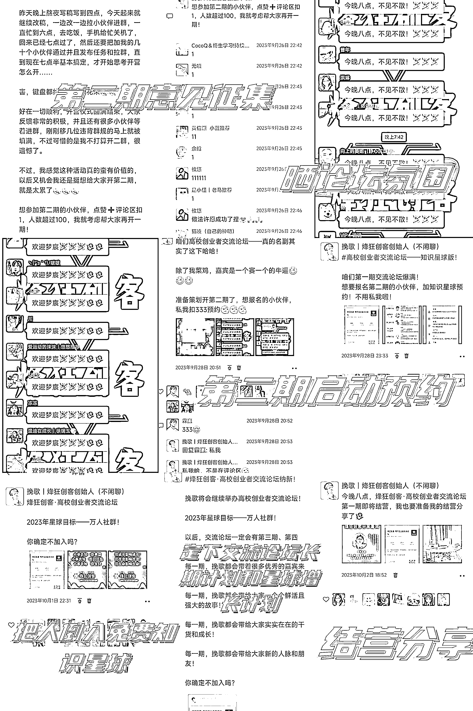
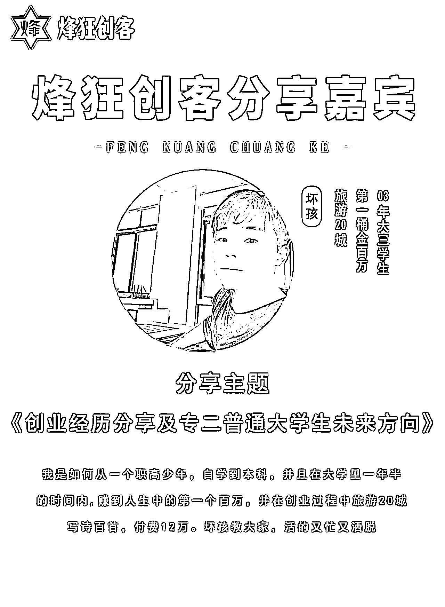

# 如何通过一次剧本营销活动，获得 10 倍于你的私域流量的曝光

一场活动，两天时间，私域曝光量却做到了社群人数的十几倍甚至更多——这不是玄学，而是一场精心编排的“剧本营销”。

前阵子刷屏朋友圈的“高校创业者交流论坛”，就是这样一个典型案例。今天不聊虚的，直接把这个活动的幕后逻辑拆开给你看。

先说个有趣的现象：群里实际只有几百人，但这场活动带来的影响力和曝光量，却远远超出了群成员数量本身。很多人以为做活动就是拉个群、发发海报、喊人进群，但真正的玩法，是从一开始就写好一个“剧本”，然后让所有人不知不觉地参与进来。

这个灵感是怎么来的？其实最初只是合伙人随口提起“要不要搞个大学生交流分享”，但细想之下发现，背后藏着一个很大的需求——交际需求。有需求就有市场，但单纯做个交流群，价值不够，因为大家进来就是为了“链接”，链接完了群就死了。所以必须升级，把重心放在高质量创业者交流上，并且要给足“看得见”的价值。

于是，有了特邀嘉宾分享的设计。一口气邀请了9位在各自领域拿到结果的大学生创业者，海报、日程、预热，全部在国庆前迅速落地。整个活动从9月27号启动，到10月2号收尾，节奏紧凑得像一场连续剧。

那这场“剧本”到底是怎么写的？几个核心动作值得反复琢磨。

第一，门槛设计得很妙。要么付99元，要么转发海报到朋友圈。99元不是目的，它存在的意义是让“转发朋友圈”这个选项显得极其划算。谁愿意花那冤枉钱？于是大量的人选择了转发，朋友圈瞬间刷屏。群只满了几百人，但带来的曝光量却有几十倍，这才是真正想要的。

第二，海报设计走的是视觉冲击路线。三款海报，全部大红色，内容各不相同：第一张是论坛总体介绍，第二张是每位嘉宾单独介绍，第三张是分享日程安排。要求大家发九宫格，一下子就抓住了眼球，仪式感拉满，逼格也有了，再加上紧迫的日程安排和免费参会的机会，引流效果直接拉满，🛰️加到爆。

第三，嘉宾的选择也很有讲究。请来的都是圈内小有名气、有实际成绩的大学生创业者，自带流量，能放大传播；同时内容成本大幅降低，不需要自己从头生产全部内容；再加上大咖背书，人脉价值直接翻倍，吸引力自然强。

第四，朋友圈和社群全程同步进度。启动预约、说明门槛、公布日程、公示刷屏现象、开营预告、倒计时、第二期意见征集、晒论坛氛围、再启动预约、把人引入免费知识星球、定下长期计划、结营分享、活动拆解……每一步都让围观者从“无关者”变成“旁观者”，再从“旁观者”变成“围观者”，最后成为“参与者”。

很多人会问：营销的结果，不就是卖产品吗？但这场活动里，作者并没有收到多少钱，群成员大多数也没付费。真正的结果是什么？是影响力和信任度被卖出去了。活动结束后，至少影响了二十倍于社群成员的人——把自己卖出去了。

具体来说，卖给了几类人：看到海报留下浅层印象的人；对作者产生好奇和探索欲的人；不想进群但主动添加好友想链接的人；进群的人；以及直接付费加入社群的人。最终，十多位小伙伴付费399加入烽狂创客，五六十位朋友购买了79元的星球，直接或间接多赚了10W+，获得了数万曝光量，还启动了一个新的免费星球，打开了可复制的流量模式。

那怎么成为一个“营销导演”？其实分两步：第一步，学会写商业剧本；第二步，把剧本演绎成现实。

写商业剧本的步骤，说到底就是三个问题。

第一，谁是利益相关者？这场活动里，是特邀嘉宾、参会朋友、自己。

第二，他们各自有什么价值可以交换？嘉宾有自带流量和内容价值，但需要影响力；参会者需要高质量内容、人脉、圈子、认知和稀缺资源，但他们能提供流量；自己需要影响力，能贡献内容、组织能力和链接价值。

第三，设计一个三方共赢的交易结构。嘉宾需要流量，参会者需要内容，谁来打通这条通道？就是发起者本身。当每个角色都能从这场活动中获益，大家自然会主动参与、主动传播。

回到底层逻辑：剧本营销的核心，是在发起者、参与者、合作者之间建立一种互利共赢的关系。好的剧本营销，不只是看起来精彩，还必须真正满足各方利益相关者的需求。营销活动也不只是为了促销，更重要的是以活动为媒介，建立起和潜在用户之间的联系，加强他们对产品的认知和信任。

说到底，营销是人心的游戏，而剧本营销，就是用故事去触动人心。会讲故事，才是核心。

作者提到，这个论坛活动本质上是一时兴起。9月19号晚上，合伙人提到了大学生分享交流的想法，后来仔细琢磨，发现了一个很强烈的需求——交际需求。有需求就有市场。

合伙人提议组一个高质量大学生交流群，但作者觉得这个需求还不够强，于是做了升级，把重心放在高质量创业者交流链接上。这种交流群不适合长期运营，因为最大的价值就是链接本身，链接目的达到了，使命也就结束了。

所以想要抛砖引玉，必须先给足价值。要有内容，要有大佬压阵，这样就有了一个大家能直接看到的表面价值来吸引人群。邀请到9位优秀嘉宾后，开始制作海报、安排日程，国庆前迅速筹备举行活动，从9月27号到10月2号。

整个营销流程的核心是：悄无声息地占据用户心智，被动成交。作者特意让所有人看到了“电影背后的制作花絮”——从无关者变成旁观者，再变成围观者，最后变成参与者。

门槛设计：付费99元或转发指定海报二选一，用付费的高门槛反衬转发的低门槛，形成落差，让大家觉得白嫖很划算，于是纷纷帮忙转发朋友圈，产生刷屏效果。群只满了几百人，但影响力和曝光量却是群人数的几十倍，这些曝光才是最需要的。

海报设计：三款大红色海报，内容各不相同——论坛介绍、嘉宾单独介绍、分享日程安排，要求发九宫格，视觉冲击力强，给足吸引力；论坛介绍和日程安排让活动逼格拉满，加上紧迫的日程和免费参会的机会，🛰️直接加爆几百人。

嘉宾邀请：基本上都是圈内小有名气且拿到不俗结果的大学生创业者，借助他们的影响力获得更多流量，同时降低内容成本，大咖背书让人脉价值爆表，吸引力极强。

朋友圈和社群同步进度和动态，并在最后对活动进行拆解分享。整个节奏：启动预约-说明门槛-日程安排公布-朋友圈刷屏公示-开营预告-倒计时-第二期意见征集-晒论坛氛围-第二期启动预约-导入免费知识星球-定下长期计划-结营分享-活动拆解。

营销结果不只是卖产品，而是把影响力和信任度卖出去了。本次活动至少影响到了二十倍于社群成员的人数。同时也卖给了新朋友：朋友圈和社群看到海报的人留下浅层印象；产生好奇和探索欲的人；不打算进群但添加好友想链接的人；进群的人；直接付费加入烽狂创客的人。转化了十多位小伙伴付费399加入，五六十位购买79元的星球【精华收藏夹】。

嘉宾的投入换来的是影响力价值，即流量价值。新朋友在看到嘉宾自我介绍时，会形成降维打击的观感，减少躺平心理，产生跟随学习的冲动，被动成交的几率会放大很多。

活动正在第二期进行中，这次以知识星球作为载体发售，增加稳定性，让每一期活动产生复利——用好免费星球做营销，事半功倍。