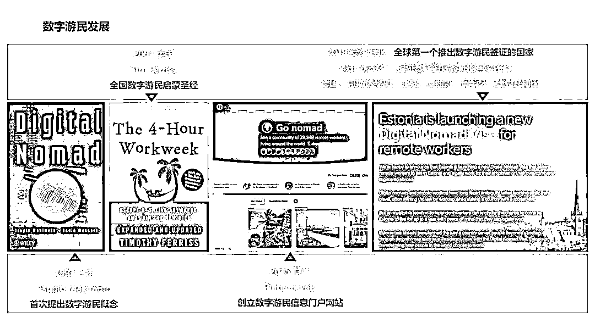
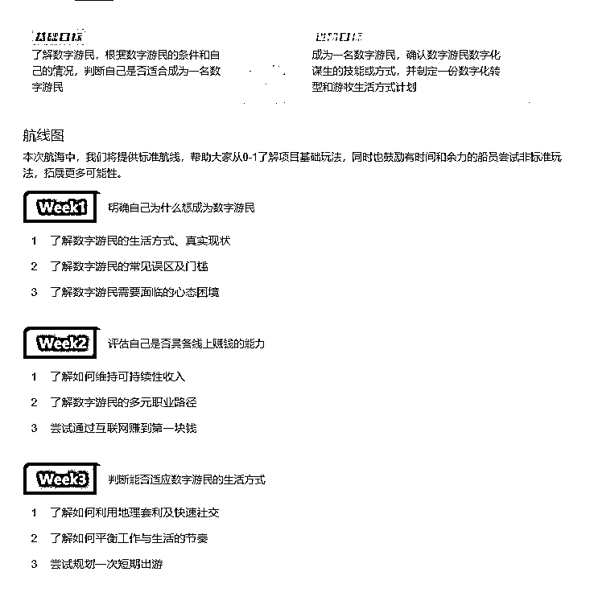
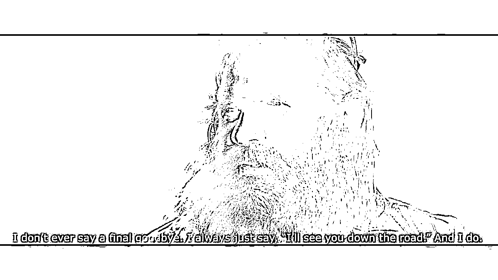

# 从坐班到游牧，我是怎么把收入做得更稳、生活玩得更开的

> 原文：[`www.yuque.com/for_lazy/thfiu8/pq5gi118um5goatk`](https://www.yuque.com/for_lazy/thfiu8/pq5gi118um5goatk)

## 开启数字游民之路，如何逐步打造更稳定的收入体系

作者： 饭先生

日期：2023-10-25

大家好，我是阿饭，Web3 从业者，刚入行的数字游民一枚。眼下正全国流浪式旅居，过去半年里脚步先后踏过长沙、大理、成都、深圳、广州、郑州等地。

说来也巧，我对数字游民这个词的关注可以追溯到 19、20 年左右，那时就订阅了不少相关信息源，也混进了几个圈子。彼时更多是向往，行动上并没有真正启动，毕竟日子里全是“搞钱奋斗”的事，觉得这种生活离自己太远。

转折点在疫情期间。居家办公常态化，加上我所在的 Web3 业务基本全线出海，跨时区异步协作成了日常。第一次真切感受到远程工作的松弛感：时间更自在，通勤被省掉，连精神损耗都小了不少。

去年年初，我正式切换成长期远程的工作节奏，同时把收入来源分散开，也攒下了一些安全垫。那一刻，我第一次有了时间和空间上的双重自由。于是开始琢磨，到底想要怎样的生活，并用实际旅途去试错。去年去过几个热门的数字游民据点体验，疫情放开后，今年才真正开启了自己的游牧之旅。

今天就想把我对数字游民的理解，以及怎么起步，和大家聊一聊。

手册里也有对数字游民的定义，我更想结合自己的实操经验来聊。

下面是我亲历的几个核心感受：

1. 先拿回时间的主导权

以前在北京，最受不了的就是通勤。去个稍远的地方，单程就要近一个小时，一天在路上耗掉 1.5 到 2 小时，够我飞去另一个城市了。如今这个概念已经从我的生活里消失。

更关键的是，离开工位反而逼着我思考什么才是真正重要的事，精力被释放出来。碳基生物的黄金专注时长本就不多，一天 4 到 6 小时高效输出就很不错了。坐班模式下，很多人被迫把时间浪费在无效事项上。

当然游牧生活对自控力要求更高。想更系统地提升，可以去学习时间管理的相关课程来打磨自己。

“只工作、不上班”一直是我想要的状态，现在基本实现了。用最好的状态做生产和创作，剩下的时间尽情去做喜欢的事。

2. 地理套利带来的双重红利

这是数字游民最常被提及的优势，也分两层。

第一层是成本。北上广深的衣食住行开销远高于其他城市。打开美团、携程，对比一下如家这类连锁酒店在不同城市的价格，就能立刻感受到差距。

以我现在的节奏举例，近期频繁住酒店和民宿，短租价格也比长租贵，所以消费水平其实比当地居民高。但算下来，住宿成本每月 4 到 5K，和北京相比基本持平甚至略高，可体验感完全不是一个量级。日常饮食反而比在北京时更便宜，即便我经常攻略当地美食。

如果在某个地方落脚，成本还能进一步压缩。数字游民聚集地的租金虽有溢价，但依旧远低于一线。

第二层是居住体验。游牧本意就是逐水草而居，我们完全可以选更舒服的城市和空间。比如四月北方还冷时我去了长沙，八月则跑去吉林避暑，冬季也可以考虑海南万宁、文昌等地。

3. 生命体验被放大

居民视角和游客视角是完全不一样的。数字游民恰好能兼具两者，既能深入本地文化，也能保持新鲜感。看到不同风景、不同人群，意义就在于不断拓宽体验边界。

坦白说，游牧也有不便和成本，但最大的回报就是这种生命体验的拓展。对爱探索、好奇心强的人而言，这份回报极具价值。

4. 游牧也会反哺事业

对我来说最直接的是社交半径在扩大。旅途中认识了不少“网友”，从 ID 变成了真人，也碰撞出了不少信息和机会。这与其说是出差，不如说是边旅行边经营区域市场。

随着阅历累积，我更能捕捉各地市场的真实需求和商业机会。具备国际视野或对某个区域有深厚的资源，都能为事业打开新空间。

路上遇到的内容创作者、旅游博主，把这点发挥得淋漓尽致。对他们来说，游牧本身就是商业模式的一部分。比如有位做微商的朋友，专门去农产品原产地旅居，既能采集素材，又能通过直播建立信任。

报名本次航海的同学，很多是对这份生活好奇或向往，却觉得很难触达。

那要如何开始？我想先帮大家拆掉一个心理枷锁：

很多人抱怨现状，却总说“等我怎样怎样再出发”，最常见的是“等我财富自由”。仿佛一定要攒够钱，才配去过自己喜欢的生活。

可财富自由真的有统一标准吗？我的判断是，只要你已有能远程变现的稳定管道，就完全可以开始试验数字游民是否适合自己。

我认识的数字游民状态多种多样。有财务自由后环球飞的，也有普通人热爱自由的。有开着房车全国游的夫妻，有整支团队到处漂流的创业者，有逃离大厂的前员工，有在海外公司远程编程的开发者，有在线教中文的老师，也有辍学穷游的 00 后创作者……

大家最担心的往往是收入，这确实是根基。但数字游民很难保证单一收入的绝对稳定，波动和行业周期都会存在，这可以作为一个长期目标。

接下来分享下建立更稳健收入结构的方法，基于我和身边朋友的真实案例。

大体上，个人可以有四种「人生商业模式」：

第一，公司的雇员、个体户或自由职业者，这类属于时间单卖，单位时间只能变现一次；

第二，时间可复用型，一份时间能卖给多人。内容创作者、开发者做的产品就能多次售卖；

第三，企业家型，通常已摆脱时间和能力对收入的限制，通过人力和资源杠杆放大；

第四，投资者型。去购买顶尖企业家和经营者的时间。

商业模式越多元、收入来源越丰富，抗风险能力就越强。

其实脱离地理位置限制，本质上就是数字游民的条件。大家可以在生财有术多挖掘可投入的项目，或寻找适合远程的岗位，逐步启动游牧生活。

时间有限，那在 21 天里怎么起步呢？

我的建议是充分利用好航海手册。本期手册从四个部分展开：

前面两章会帮你搞清楚数字游民是什么，以及成为数字游民需要哪些软硬件能力。当你对这套生活方式有更清晰的认知，为后续规划也会更有方向。

开启数字游民最核心的问题是：这决定了你能否真正开启这份生活，或者能维持多久？

手册第三章按照数字游民收入四象限，把适合游牧的收益体系拆成了入门、进阶和高阶职业，帮助你找到匹配的赛道，打造“主动+被动”双收益结构。

如果你还在观望，更适合先看入门和进阶类职业；如果已经上路，进阶和高阶类的内容会更具参考价值。

游牧路上，除了工作，生活细节也很多。落脚城市怎么选、如何快速融入、如何社交、旅居心态如何调整等。有人会感到孤独，有人会内耗，如何面对这些情绪，手册第四、五章都有具体展开，会让你旅途更从容、有趣。

除了手册，生财航海的航线图也能帮你规划 21 天的行动路径，带着目标学习和实操，效果会事半功倍。

最后，为让大家在世界各地生活办公更顺畅，我们汇总了一些数字游民常用的网站与工具，可直接查看手册第六章。

最后，用我很喜欢的一句话收尾：

* * *

评论区：

二师父 : 这个生活不错，是开车还是做交通工具呢

胖大魔 : 举手，饭教练数字游民与 FIRE 的区别是啥

* * *