# 变现卡住？先别埋头卷低价，想想你用AI在“服务谁”

大家好，我是小鹅，04年，一个在AIGC赛道里摸爬滚打的普通女生。

六个月前，春天刚开学不久，我抱着“试试看”的心态打开了Midjourney。当时的我完全没想到，这个动作会改写我后来的轨迹，还让我有机会和很多厉害的人深度合作。但说句实话，这半年里，我绝大多数时间都在做无用功。

我算是亲眼看着AI绘画从狂热走向冷静的那批人。3、4月份，AI壁纸和头像起号真的是快得离谱，随手发一条就可能上千赞，后台私信全是定制需求，客单价从29.9一路涨到400块钱一张。

尝到甜头以后，我开始疯狂批量出图、追热点、看到爆款风格就顺手复刻。那时候生成关键词远没有现在方便，全靠自己反复试、反复调。为了一张图，我能在电脑前磨一下午。也正是这段苦功夫，让我攒下了不少关于画面判断的经验。

但很快，我发现事情不太对劲了。

一开始我以为是努力不够，就加大投入，甚至到了吃不香也睡不好的地步。结果呢？我反而在低价单里越跑越远，收入没有指数级增长，人却像被抽干了一样。我开始动了放弃的念头，去翻别的赛道的内容，出门散心，尝试各种新东西。

挺玄幻的是，我第一次走出门参加线下活动，就遇到了一位“贵人”。听说对方在设计领域做得很有成就，我眼睛一亮，当场做了个PPT冲上去，对着他讲了一通AI、讲了我这几个月的折腾和思考。而他回赠我的一句话，让我受益到现在：

技能本身很难单独标价，重要的是，你用这项技能去服务了谁。

同样是一份设计能力，你给大学社团做海报，20块钱人家都嫌贵；你给商场做logo，2000块可能都算便宜。运营、设计、视频拍摄这些能力也一样，脱离具体对象时，它们只是一套通用动作；一旦绑定某个真实人群，才可能被重新定价。

我看过的、觉得有商业价值的例子里，包括美术考试机构用AI批量生产范画，去帮助高考生提高学习效率；也包括建筑设计师研发“AI+建筑”平台，帮更多室内设计师在更短时间里多赚到钱。这些还只是冰山一角。

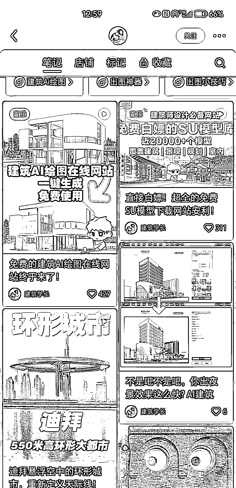

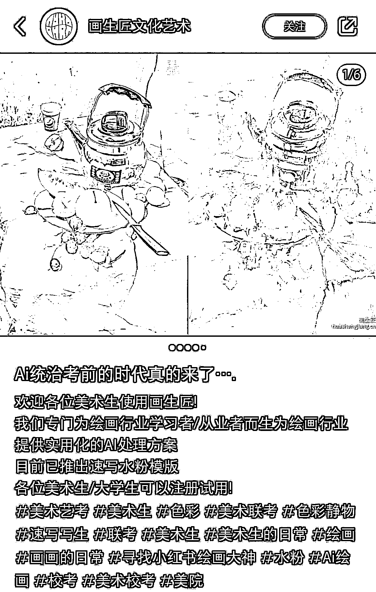

我知道，这次航海里不少人就是冲着“头像+壁纸”来的。我铺垫这么多，不是想全盘否定这个方向，而是想劝大家审慎入场：头像和壁纸早就成了超红海赛道，哪怕做到5万粉这个量级，变现能力也依然偏弱，基本只能接低价广告。这是我跟大量万粉级博主亲自对谈之后得出来的结论。

更麻烦的是，AI绘画的操作门槛还在不断降低。以前你多少还要懂点PS，现在Midjourney已经能做局部修改，妙鸭这种傻瓜软件也出来了，后面会玩的人只会越来越多。很多眼前看起来还能赚钱的空间，以后大概率会被一点点压窄。

所以我们真的要从狂热里抽离出来，理性看待AI绘画：它确实是降本增效的趋势，但当下商用层面的短板也不该回避。

普通人想在这个浪潮里淘到金，更适合的路径，是找一个具体人群，帮他们解决一个具体问题。把AI绘画当成你原先能力和经验的放大器。它和自媒体很像：自媒体本身不挣钱，但它可以让更多人看见你的能力，然后延伸出无数可能性。反过来，如果你一直在硬卷和自己能力、经验根本不匹配的东西，除了损耗自己，什么也不会剩下。

四维彩超那个很火的项目，我也试过。那就是一件和我定位完全不匹配的事：我本来就是学生，根本不懂四维彩超，也不懂宝妈心理和沟通话术。它再火爆，我也该知道自己不适合硬挤。硬凑上去，就是一场拧巴的内耗。

所以，这次分享之后，我很希望大家能认真问自己一句：当初学AI绘画的初衷，到底是什么？它和你现实生活的哪个需求真正相关？你能拿它去帮哪一类人解决哪个问题？

技术上的事，反而没那么吓人。六个月前，我也只是一个只会打“a cute rabbit”的小白。这次分享之前我特意看了一眼/info，光这个号累计出图就已经4000+了，SD那边的图多到没法统计。现在我基本随便看一张图，几秒内就能理出一个完整的迭代思路。

我很喜欢亦仁大佬分享过的那句话：“怕什么真理无穷，进一寸有进一寸的欢喜。”等真做到一万张，从一个号变成三四十个号，再回头看，轻舟已过万重山。

技术卡壳也很简单，多翻圈子里的干货分享，有问题直接在群里艾特教练，都能很快解决。刚开始做图，建议你从复制粘贴开始。小红书上最新鲜的现成提示词一抓一大把；要是你找不到自己满意的，问我要也可以。

拿到一组提示词之后，用翻译器读一读，想想这串词里真正起作用的是哪些词，你在什么位置加减改动，或者调换一下顺序，画面会发生什么变化。比如一组关键词可以是colorful moebius搭配larme kei、enchanting realms、pensive poses，再配上light gold和light blue这类颜色词。

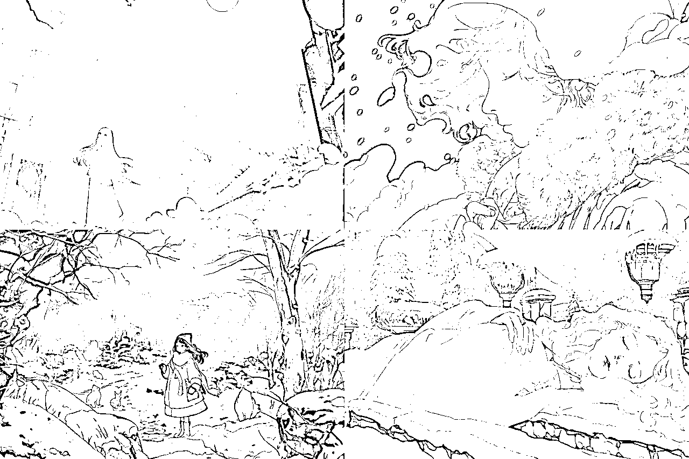

你可以试着加一个艺术家的名字，或者把颜色词改掉，看看效果会怎么变。等慢慢熟悉了，再换别的软件、尝试各种插件和lora，这整个就是一个让你逐渐上手的过程。

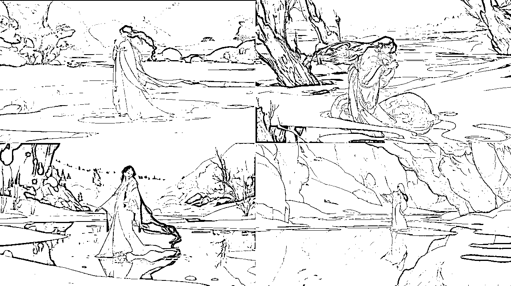

刚开始做图，我反倒建议你先自由表达，想画什么就画什么，别给创作套太多商业枷锁。等工具熟练了，再去做商业触达。我自己最大的体会是：有AI之后，做一张好看的图一点不难；难的是做一张能准确表达你想法和思路的图。这时候，你需要对画面构成有足够强的分析能力和拆解能力。

如果你真心想用AI表达清楚自己，最实际的做法是建立一套属于自己的SOP。

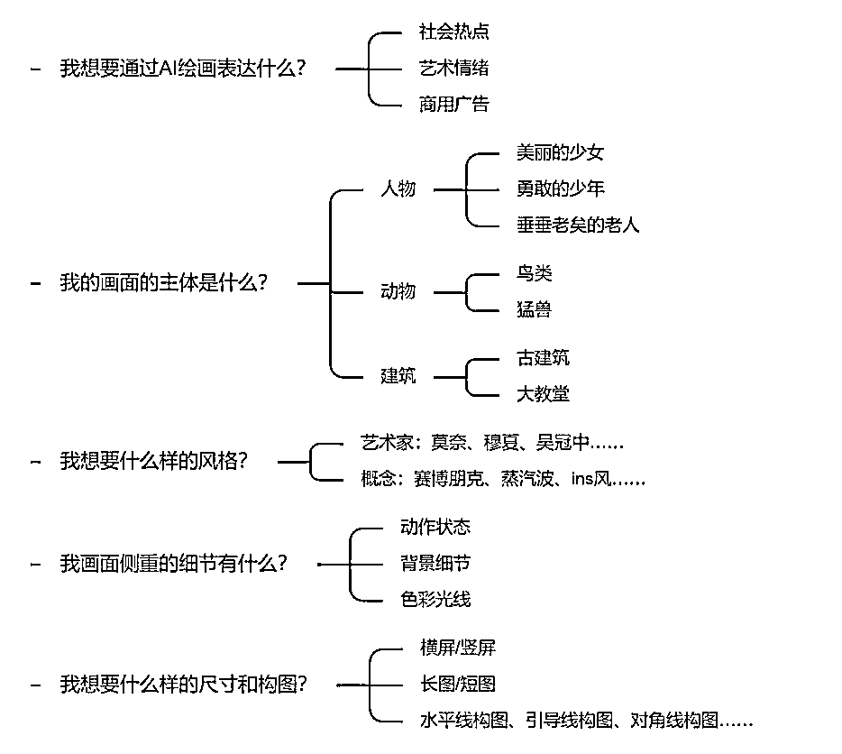

下面我放一次自己的完整做图过程，大家可以感受一下画面分析这件事有多重要。

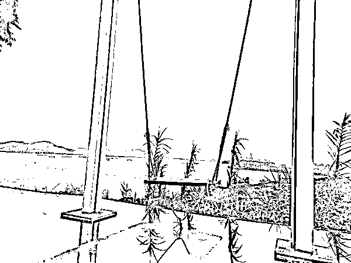

那是我第一次去厦门，在鼓浪屿上拍了一张照片。后来我又去过厦门很多次，却再也复刻不了那一刻的震撼和感动，于是我想用AI去还原当时的感受。这也是我当初摸索AI的原动力——它可以让我们暂时摆脱现实引力，自由表达脑海里的画面。

我想要的画面核心元素是：秋千、少女、大海、夕阳。把它们组合成一个句子，我做了第一次尝试。

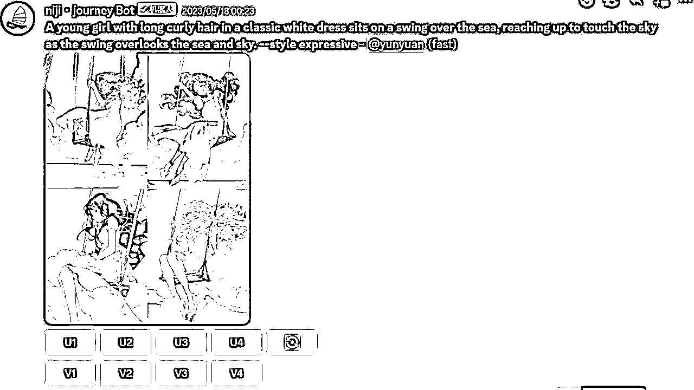

第一版问题很多：
- 构图：人物比例太大，没有把海的力量感凸显出来；
- 色彩：海和天空都偏蓝，缺少鼓浪屿那种夕阳感；
- 主体状态：四张图发色全不一样，我心里想的是棕发；
- 画风：太日系二次元，质感不够。

接下来，我就是用这些框架反复做小调整，一边改一边靠近自己脑中那个画面。

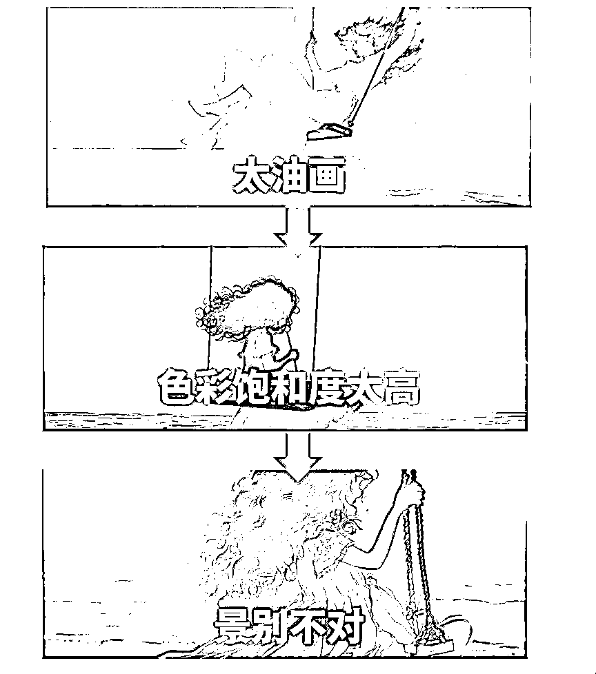

终于，在不知道第几轮修改之后，我拿到了满意的结果。

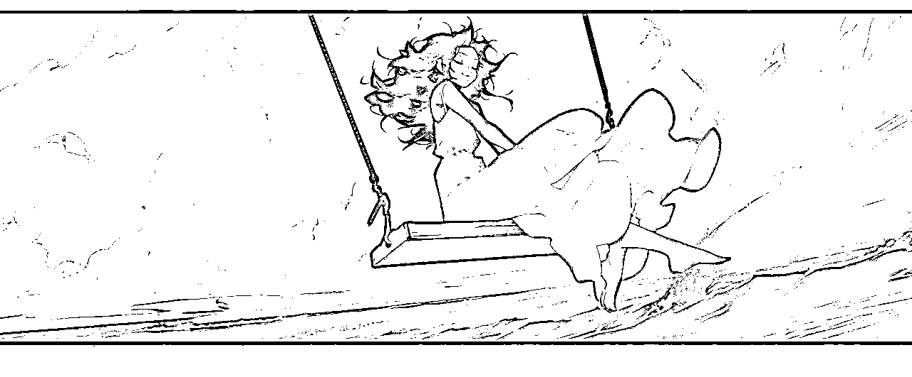

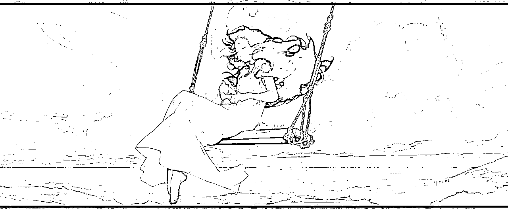

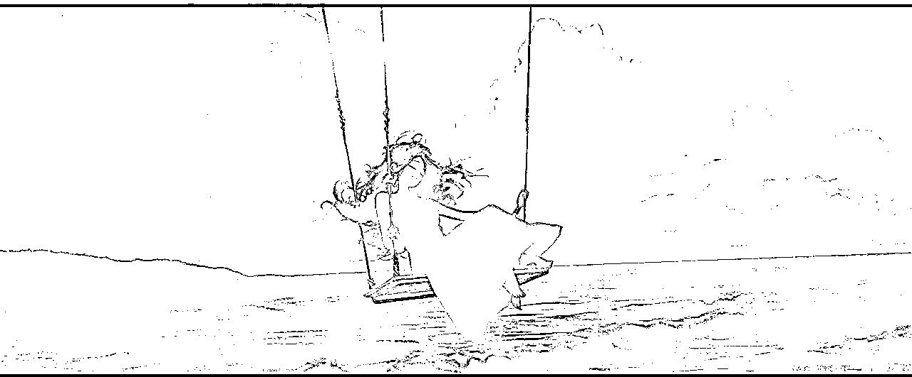

那一刻，真有一种“女儿诞生”的小感动。画面是自由的、空灵的，她站在我想要的夕阳和海风里。每次给朋友炫耀这张图，我都特别自豪地说：看，这是我“女鹅”给我画的！

但大家仔细看，乍一看惊艳，细节上还是有一些常见翻车点，比如手和脚的小错误。这些其实都能靠其他工具补救：局部重绘、PS beta AI、seed和v重出刷新，都能处理。发自媒体，这些小细节可能无伤大雅；但是如果拿去商用，细节就一定得抠到极致，还得做分辨率放大。

再往后，就要不断找参考图。大概60%的图片，Midjourney的/describe功能能一次性拆出靠谱提示词；还有40%，它抓不住关键点，就需要按我刚才教的方法手动去改了。

很多同学是想做小红书的。那我一定要强调一个点：小红书是“美丽至上”的场，封面几乎决定生死，所以氛围感加情绪化是爆款的前提。

举个例子：
- 汉堡+金属材质
- 美女+机械外骨骼
- 车里+满满的鲜花
- 故宫+冰雕风

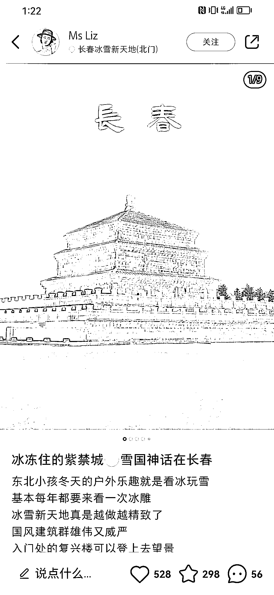

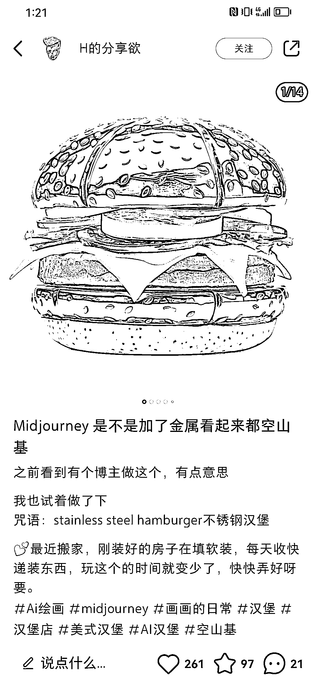

你逛商场时有没有发现，80%的展柜都是黑白灰这类简单色系。如果这时候突然出现一个高纯度、高饱和的乐高黄，你会瞬间被它锁住目光。这其实就是用颜色抢占心智。

这个思路完全可以搬进小红书瀑布流封面里：用强烈、夸张的颜色去抢占用户注意力。常见对比色有红+蓝、黄+紫、蓝+橙；也可以直接用高饱和高明度的颜色，比如克莱因蓝、荧光绿。

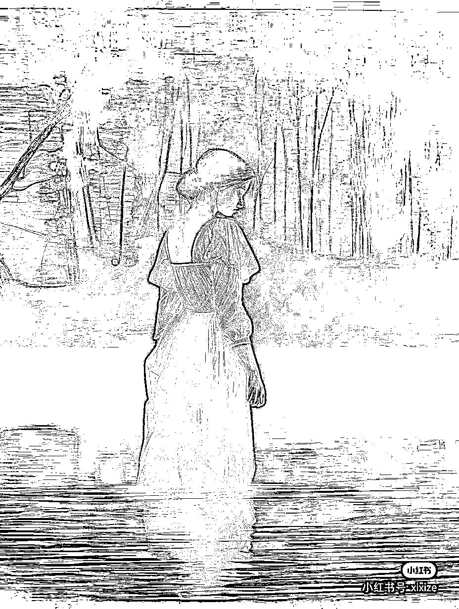

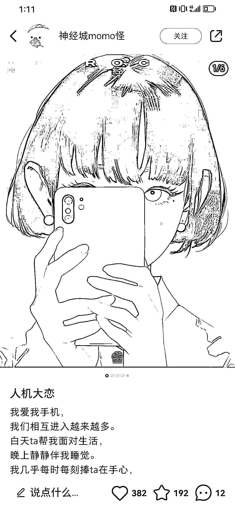

另外，标题最好带一点点互动感。写标题之前先想清楚目标用户：如果你服务的是18-25岁人群，MBTI、恋爱配对这些偏幻想感的词，或者学习、考研专用头像这类功能型卖点，都很容易击中他们；25-34岁人群，“打工人专属头像”“打工人元气小猫”这类心理代入口号就很有效；再往上，34岁以上，赛博佛祖、小和尚这些带有祈福和情绪寄托感的元素，会更戳他们。

教练们在群里反复强调过：AI绘画到高级阶段，拼的就是审美。

下面这两种风格，几乎是小红书上最经典的爆款模板，模仿他们的人数不胜数。其中第一张的点赞已经累计到5.5万，某种程度上，他们创造了一个风格潮流。

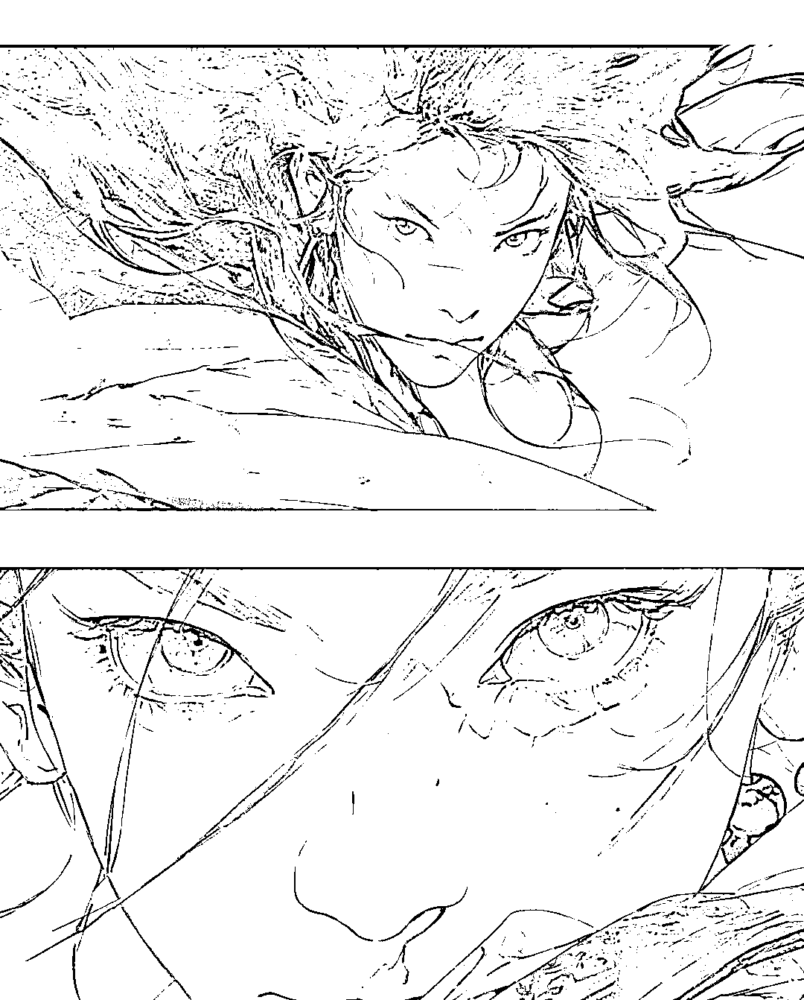

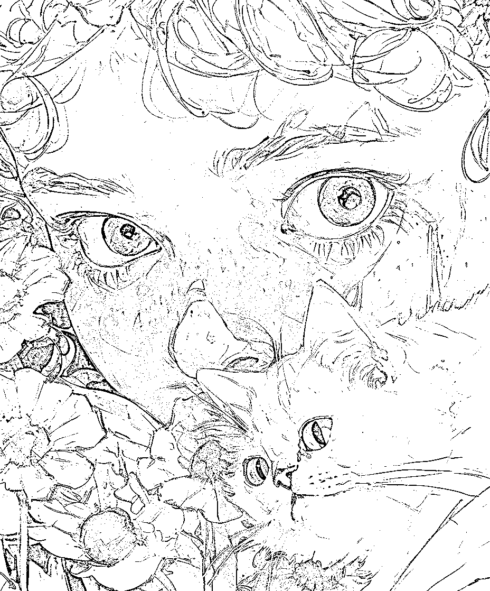

创造这两组风格的人刚好都是我朋友。聊过之后我才知道，他们俩都是美院出身，有大量艺术史积累。他们创造新图时，最常做的是把以前的艺术家拿来融合，让前辈们画出他们没画过的东西。比如第一张是宋徽宗赵佶+西方艺术家萨金特；第二张则是席勒和绘本风格的结合。

这件事让我更相信：创新不光是站在前人肩膀上，更是站在你自己的经验和理解结构上。我自己的背景其实和美术完全不沾边，唯一能算相关的是，我真的喜欢画画。正因为亲手画过，我非常确定：所有创造都不是凭空变出来的，而是看够大量参考，再把常见元素重新组合。

所以，给大家提升审美的建议也很朴素：建立一个属于自己的素材库，大量模仿，最后形成自己的原创思路。

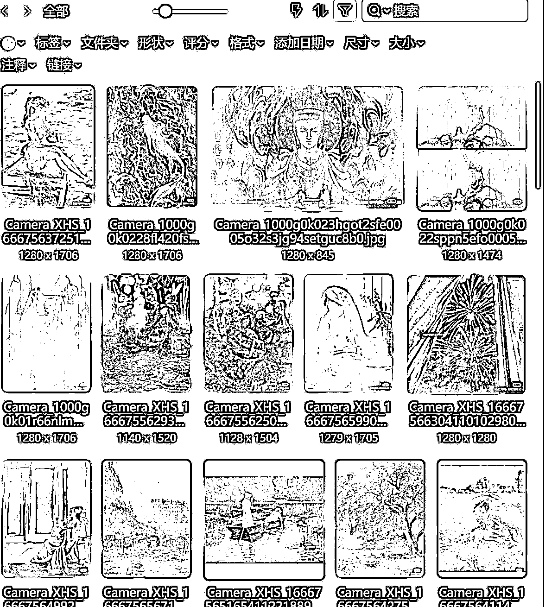

我现在看到好看的图，会习惯性地收进Eagle，按标签和颜色整理。需要参考的时候，就按标签和颜色去搜索，作为创作起点。

今晚说了不少，怕你们听得犯困，就先到这里吧。希望大家愿意抽出这一两个小时，得到一些真正有认识感、底层逻辑层面的启发。

更多的内容，欢迎去我主页接着聊。

