# 📕这次整治无货源，真不是坏事，关键是这几点要避开

大家好，我是叁斤。赚钱第七期的圈友，在📕这个赛道泡了三年多，电商也做了一年多，最高纪录单月变现10w+。📕里的玩法我基本都摸过，最拿手的是电商和引流。

这次能来做教练，要谢谢比比先森。在线下活动认识后，他一直鼓励我出来分享，这才让我迈出第一步。我也是第一次参加航海，第一次在航海里开讲。

今天想聊的话题，估计是很多圈友最近最关心的：📕无货源专项治理，到底该怎么应对？

你可能会纳闷，为什么一上来就聊无货源？无货源到底是什么？

简单说，无货源分两种：一种叫无货源代拍，一种叫一件代发。

代拍是什么？就是自己手里根本没有货，也没拿到货源方的授权，直接借用别人的产品信息，搬到📕卖。用户一下单，商家再去货源平台下个单，让第三方发货。一件代发就不一样了，是有固定供应商配合，帮你一件件发出去。

这两类模式的好处很明显：不用操心存货、物流、发货这些麻烦事。门槛低，成本也小，所以很多新手开店，都会从这条路起步。

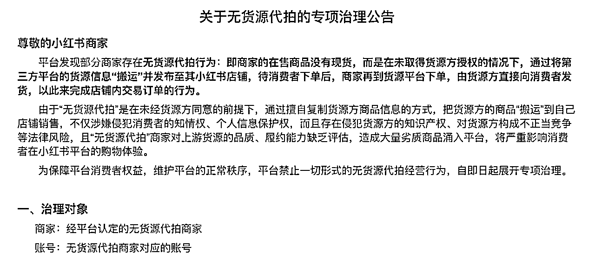

那问题来了：平台一打击，是不是无货源电商就彻底没戏了？如果还想做，该怎么办？

说实话，真不用慌。平台这么做不算坏事，📕不过是在走淘宝和抖音的老路——这俩平台今天也还有无货源玩家活得好好的。而且，整治范围不是整个无货源，而是“无货源代拍”，有正规合作的一件代发不在打击名单里。

平台重点盯的是：铺货铺得又猛又多、商品质量不过关、快递是从拼多多发出的这些东西。至于平台怎么判断你是不是代拍，方式有不少，其中系统识别最不可控，也最致命。系统识别的范围包括但不限于：

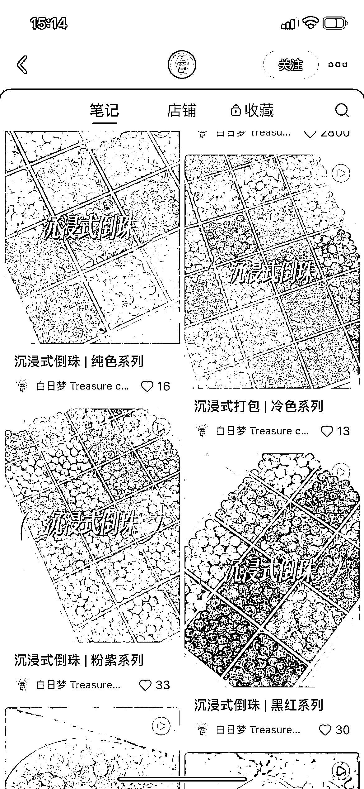
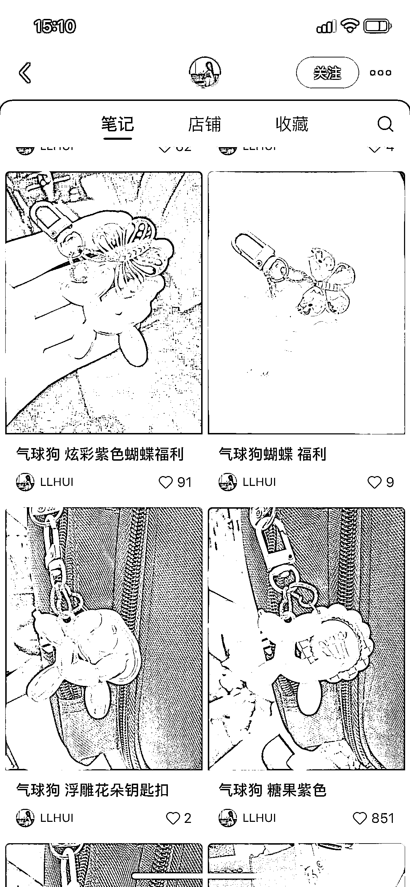
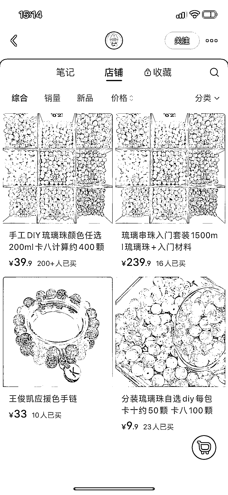
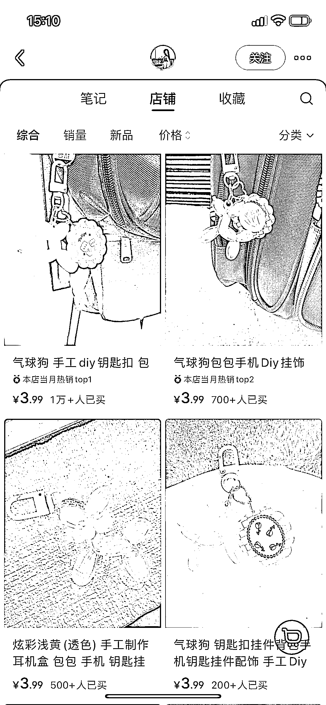

只有把这些标准搞清楚了，后面才好对症下药。其他的，只要你肯在货源上花点心思，别搞出拼多多包裹卡、短信这种低级破绽，基本没什么问题。

先说说拼多多发货这个坑。别再图便宜从拼多多发货了。拼多多不是正经供货平台，难免会夹带包裹卡和下单短信。用户一看到这些，心生怀疑，随手举报，你就容易中招。

如果你实在只能用拼多多，或者某个产品只有拼多多有，下单前一定要问商家：能不能无痕发货？对方如果懂行，就会答应不放卡片、不发短信。要是对方不接受，那就换一家吧。没有其他渠道？那这个品，宁可不做。

再说说上品策略。不要搞“大量铺货”那套了。你一口气上很多品，笔记没跟上，产品又卖不动，就容易被系统判定成低动销店铺，甚至限制你上传新品。所以，上产品之前，先把货源敲定，和货源方沟通好，再上架。最好控制在1-2个供应商之间，别贪多。

产品数量少，还有个隐藏好处：发货地址不容易“东一个西一个”。比如你卖内衣裤，就专门在1688找连云港发货的内衣工厂；后面就算要再找一个供应商，也优先挑连云港发货的。这样整个链路看起来很稳，平台也好，用户也好，都挑不出毛病。

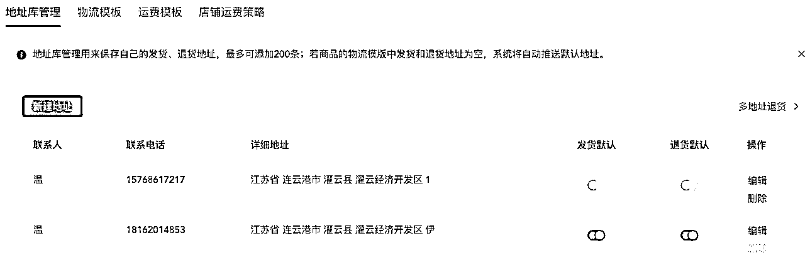
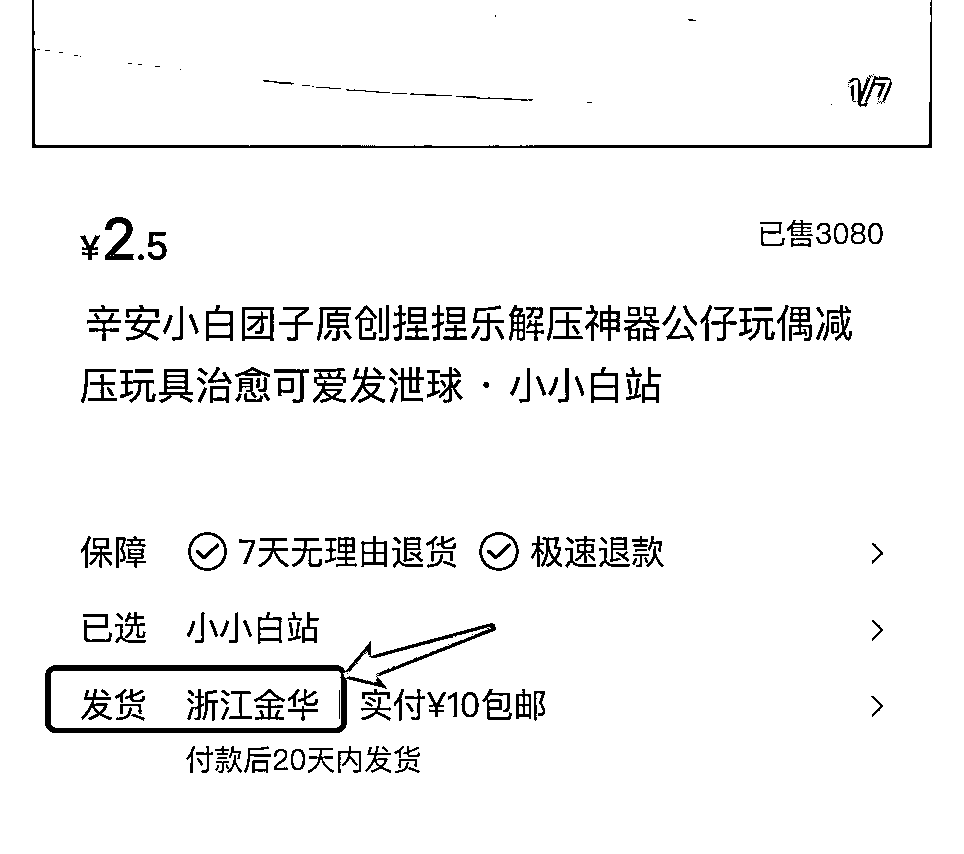

说到货源平台，除了拼多多，你还可以用1688、一手app这些正经线上供货平台。正规平台不会有包裹卡和短信，省心很多。流程很简单：先选品，再去1688这类平台上找货源，问清楚能不能一件代发，拿到供应商的真实发货地址，然后传产品到📕。

线下货源也别忽略。看看你所在城市的批发市场，比如深圳的华强北，一堆电子产品、手机壳，很多档口都愿意谈一件代发。

接下来是内容创作。平台越来越鼓励原创，搬运基本已经走到头了，混剪也越来越难搞。现在的混剪，不是一键成片那么轻松，你得对每一段素材单独做处理：抽帧、调色、剪滤镜、裁画面。如果你上架的产品本来就不多，混剪和二创反而是成本最高的方式，又费时间，又有风险。

所以，我更推荐做原创内容。原创不仅能帮你卖货，还能顺手搭起人设。样品怎么来？找供应商申请免费样品，他们不给，就自己买回来拍。拍摄场景也不用豪华，干净、简单就好。拍照的话，像我这样：

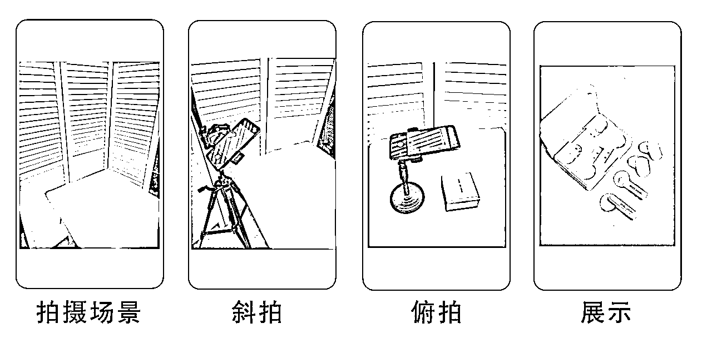

可以拍的角度有很多：全景、细节、特写、使用过程、不同角度……一个产品，足够拍出一大堆照片。

拍视频的话，可以参照这种拍法：

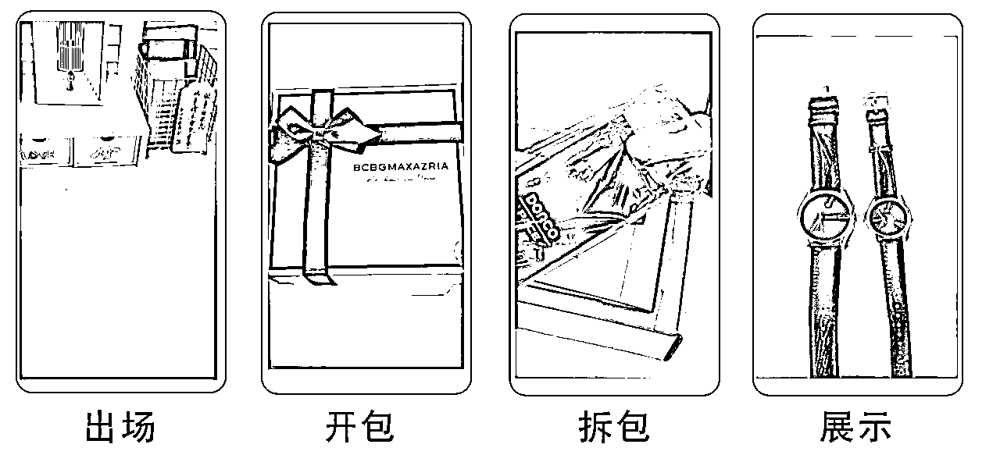
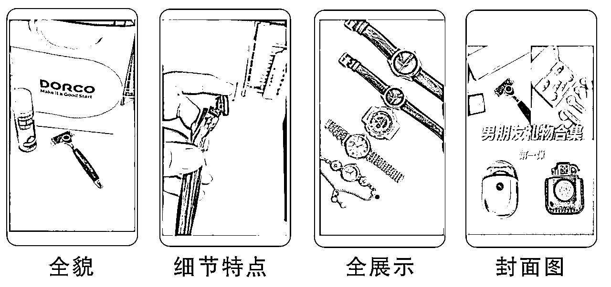

再分享一个低成本拿样品的思路。如果你不想把产品留在手里，就去淘宝、拼多多买同款，找一个大块时间集中拍摄，多拍些图和视频，拍完了就退掉。只要吊牌不拆、包装袋不弄坏，一般都能退货。

不过，特别提醒：决定退货的话，千万别去你有合作关系的货源商家那里下单，不然给人留下坏印象，影响了后续合作就不好。

前期通过无货源模式上品，其实没什么问题。但如果你想在电商这条路走长远，最终还是要转向有货源或者供应链合作。前面提到的少上品、原创内容、做精品店铺，都是规避风险的打法。我再给你几个无货源电商的发展方向。

第一个方向：📕买手店。下半年平台明显在扶持买手方向，个人完全可以做一个买手店。

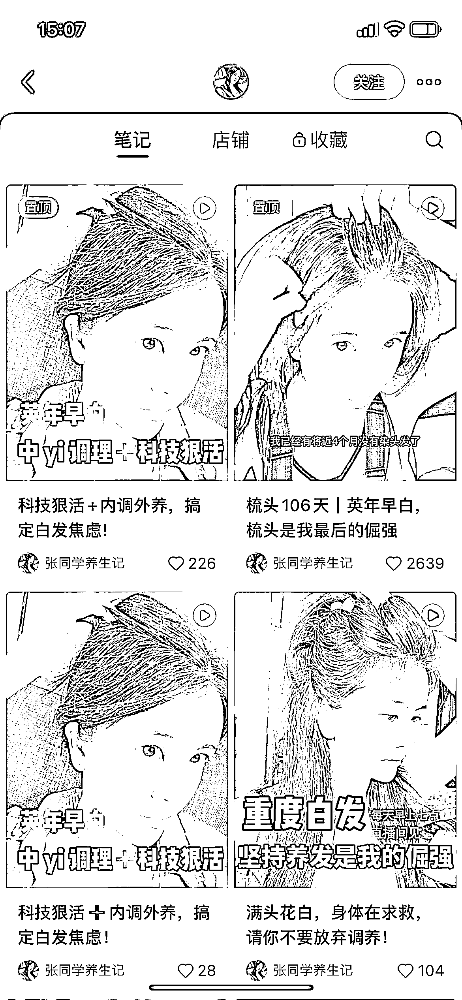
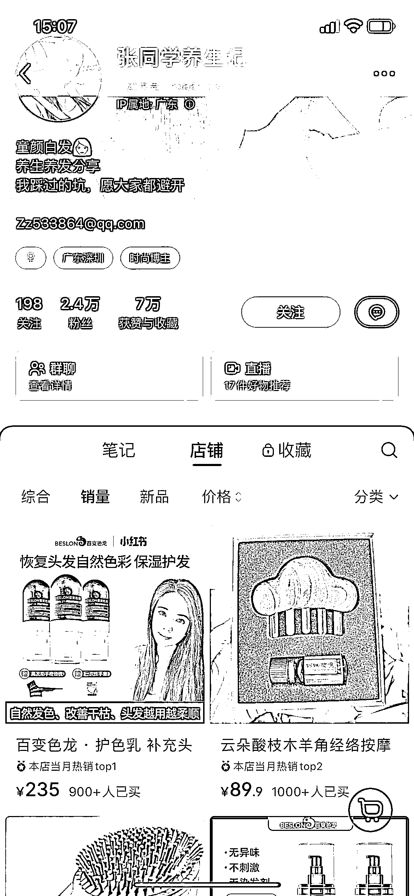

这是最近兴起的风向，但它不完全算无货源，今天就不展开了。

第二个方向：当一个产品开始出单，你又不想自己囤货发货，就可以跟供应链谈深入合作。签个代发协议，或者通过ERP对接，把系统接通之后，平台一般就不会再判定你是无货源了。这其实已经不能算代拍，而是半无货源，属于正常的商业合作。

第三个方向：自己拿货回来拍。不用一次拿很多，哪个产品出单了，就少量拿一些回来自行发货，然后自己去谈快递价格。谈个2-3块一单，没什么问题。

第四个方向：往定制走。很多产品都能做“个性化定制”，比如印名字的情侣衫、杯子、手机壳。这些在供应链端基本没有起订量要求，还能固定一个供应商、一个发货地、一个产品线。不过要提醒你，个人定制不一定能把客单价卖高。

举个例子。一个扩香香薰，如果单卖香薰，那就是标准品，香味上你拼不过大牌，价格上也没有优势。怎么办？在组货上下功夫。香薰可以由扩香石、杯子、精油三部分组合，你完全可以单独挑一个好看的杯子、一块质感好的扩香石、一瓶更好的香薰精油，组成属于你自己的香薰套装。这还不够，再自己配一个定制的盒子、拉菲草、小摆件，把包装做出仪式感，看起来更高级，客单价自然就上去了。

这种组货打法，在香薰、伴手礼、手机壳这些赛道很常见。但其实很多品类都能套用。比如打火机，你完全可以自己搞个礼盒包装，再发给客户。这样一来，一个标品就变成了非标品，原本不高的客单价也被抬高了，产品还多了一层意义。

组货还有一个大好处：直播的时候，你想逼单，完全可以把组货里的配件当赠品来送。卖衣服送鞋子，卖手机壳送贴膜，这都是很自然的逼单话术。到了节日，还可以按节日定制礼盒，客单价又能往上提一提。

最后，聊聊我对这次整治的看法。

代拍本来就是吃短期信息差的红利，每个平台都在打击，📕迟早也会出手。这种模式太伤生态：你在📕、抖音、淘宝买东西，结果收到的快递里有拼多多包裹卡，甚至拼多多商家短信，那用户下次还会来你这里买吗？不如直接去拼多多买，何必让你赚差价？

但📕电商本身是一个长期价值的事情。打击无货源代拍，对自有货源、有供应链、或者精细化运营的卖家来说，反而是利好。因为流量还是那么多，竞争对手却少了一大片。

如果你没有自己的产品，又不想做代拍，还不愿意囤货，那就主动去找供应链，去1688谈代发。想做大？想开发自己的产品？那就离不开供应链的合作。只有绑在供应链上，你才能慢慢垒起自己的护城河。

这次代拍整治，很像一个分水岭。会有人被吓退，不敢起步；也会有人因为不会调整，被市场淘汰。但与此同时，也会有人从中看到了机会，新玩家进场，老玩家开始自省、清理货源。

我相信，经过这轮洗牌，📕电商生态会变得更健康。至少，那些批量铺货、粗放经营的人会被筛掉。平台愿意出手整治，恰恰说明它把电商生态当回事。下半年，📕明显在扶持直播和买手，这些动作都指向同一个方向：平台要在电商上下重注。

所以说，这次治理不是坏事，而是一次机会。今天先分享到这里，一起龙哥盟！

