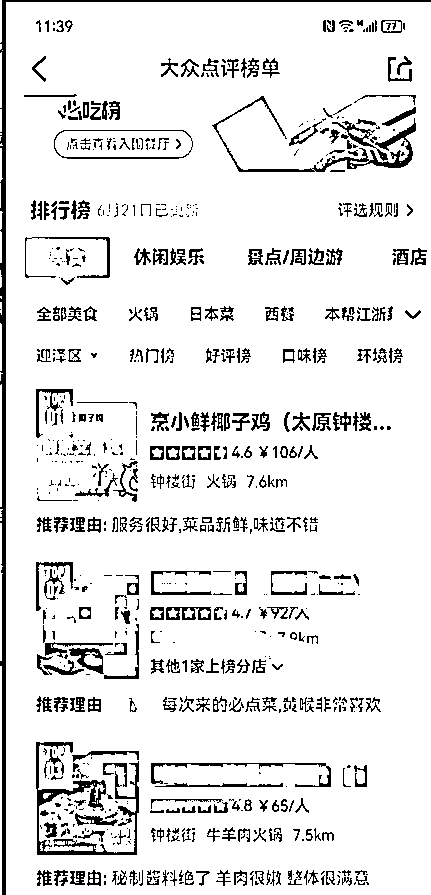
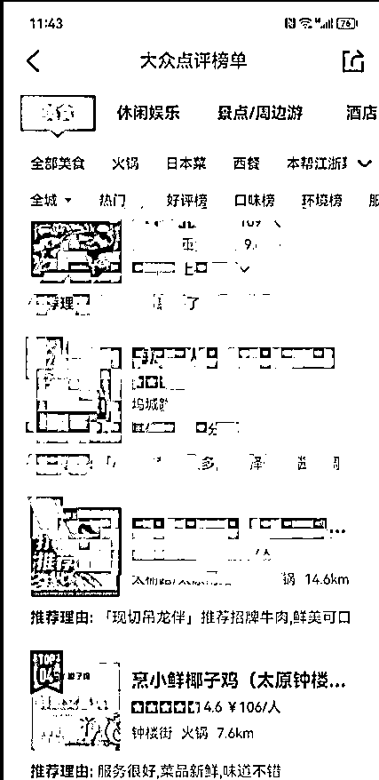
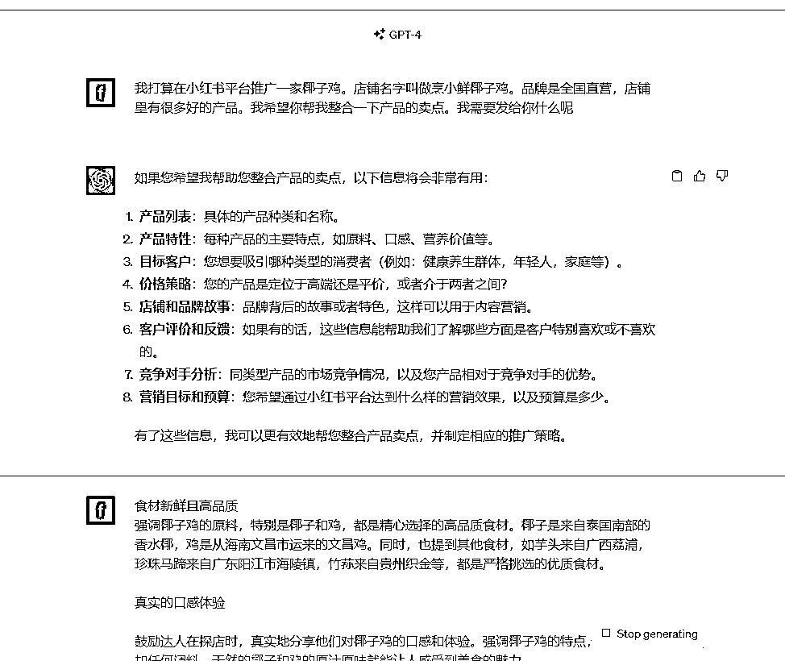
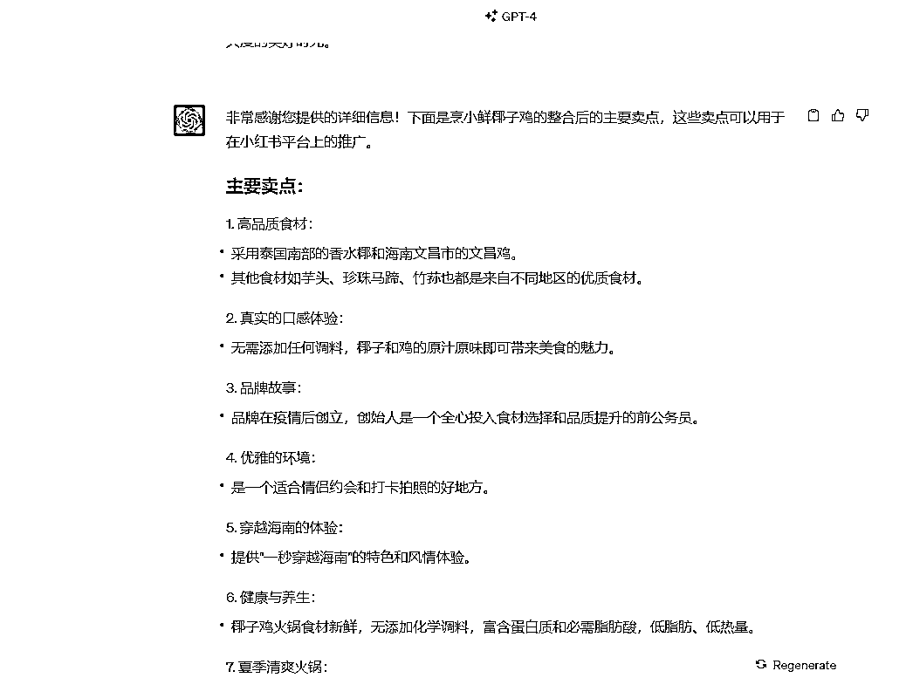
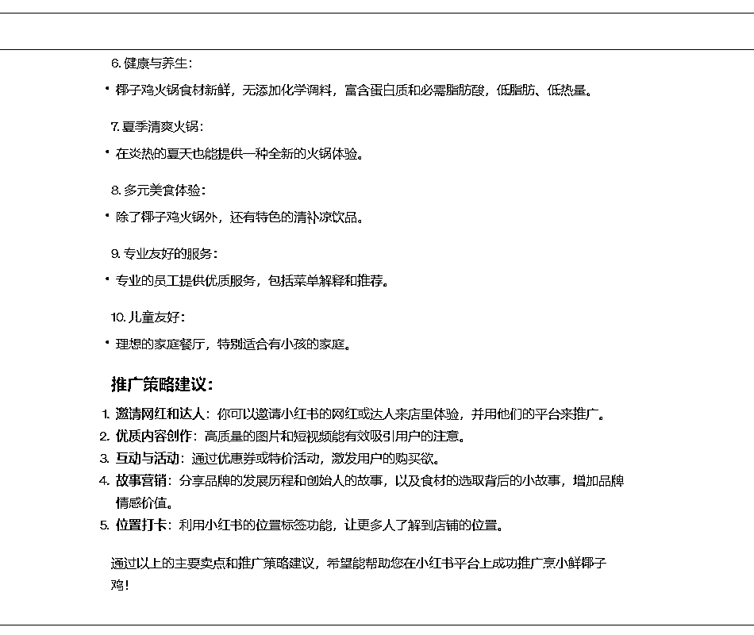

# 做线下流量服务商，这条路该怎么走

> 原文：[`www.yuque.com/for_lazy/thfiu8/iqttg8oqgnscradd`](https://www.yuque.com/for_lazy/thfiu8/iqttg8oqgnscradd)

## 如何做好一名线下流量服务商

作者： 不语

日期：2023-10-26

各位航海的同路人大家好，我是不语，很高兴能在这里和大家碰面。

我从 2019 年起就一直在做线上投放。转折点在 2020 年，有位朋友的实体店找了家代运营公司做探店加运营，结果花了 1.8 万没有任何回响。看着朋友被坑，我才下定决心亲自进入这个赛道。

当然，起心动念不只是因为这件事。更关键的是，我看到了这个赛道的真实机会点，主要体现在：

以上其实给我们一个很清晰的判断：线下门店往往经营有独到之处，却长期存在流量未被开发的问题。而店主在获客和承接上的短板，也恰恰让线下流量服务商有了存在的价值。

门店本身自带稳定的基础客群，只要把线上流量有效导进来，营收就能实现跃升，甚至催生出全新的业务线和收入形态。

所以我的服务对象一直锁定在这样一类商家：体量不错，但经营状态平平的优质实体店。

作为服务商，核心工作就是帮这些门店拿到可触达、可追踪、可转化的线上线下流量，并交付看得见的结果。

顺带说一句，市面上做线下代运营或探店推广的越来越多，入门门槛低、交付标准也参差不齐，导致不少商家被虚假数据和夸大承诺误导，就像我朋友的经历一样。因此现在在对接时，商家普遍会比较谨慎。

不过要记住，门店对增流的刚需一直都在，他们更需要靠谱的专业支持。这时候我们更要拿出专业度和真诚，让商家愿意放下防备，实现双赢。

如果你打算长期深耕线下流量服务商这条线，建议先盘点自身擅长的引流手段，再去匹配有对应需求的商家，做定制化引流，不要硬接超出能力圈的单子，这样项目才走得长久。

引流是整个业务的命脉。会引流，才能把人真正送进店里，这直接决定了能不能为商家做出效果。

引流的方式很多，SEO 优化、自媒体平台的营销、内容种草、精准投放等等。

选择方法时一定要看适配度，引来的用户必须和商家的客群相符，能满足真实需求。

因此，起步阶段至少要精通一种能服务实体店的引流能力。

怎么选？就从熟悉的渠道入手。

比如之前玩过抖音、小红书，就先从这两个平台切入。

如果你是新人，或者对微信私域运营比较在行，可以先从微信裂变活动入手，和商家做一次周期短的引流小项目试水。

另外，大众点评和美团依然是本地生活流量的核心阵地，相关的引流打法也值得系统掌握。

上面提到的这些做法，航海手册第三章都有详细拆解和案例支撑，里面还收录了更多玩法，大家按需查阅。

找到对的商家是业务启动的第一步。怎么筛选？

我的筛选逻辑分享给大家：

1：实地看客流。一般选在中午、晚上两个时段去店里观察。如果一家店这两拨高峰期都有稳定客流，那基本就不在我们的目标范围内。

2：看翻桌率。比如午市，一张桌子一天翻了几次。翻桌率高说明客流已经饱和，也不是重点对象。

3：看大众点评的数据。重点关注差评数量、综合评分、榜单排名。排名靠后、评分中等但差评不多，这类商家沟通价值很高。

几个对接小技巧：

1：很多老板被割过韭菜，对承诺极度敏感，所以绝对不要做虚假保证。

2：需求要摸透。问清楚他们为什么要做、希望达到什么具体结果。

3：多共情。站在店主角度想问题，把他们的顾虑和疑虑先消化掉，信任感会更容易建立。

4：把过往案例整理进 PPT，用事实说话，比空口承诺更有说服力。

5：我个人会给筛选过的部分商家先提供半个月的免费试运营，用实际数据说话。但要甄别对象，避免遇到只想白嫖的。

需求明确后，就要出一份落地的合作方案，包括预计投入、预期回报、双方责任等，并签署合同。

做方案前先把目标定死，比如要多少有效曝光、多少到店转化、销售额要提升多少。

目标清晰后，再设计对应的引流打法。和商家达成线上引流共识后，通常会用矩阵号铺量打法作为基础。

具体用素人铺量还是商家自有账号矩阵，要看门店属性。

比如餐饮类初期多以探店为主，直接安排素人铺量即可。

之前服务过一家中医馆，核心客群是周边中老年人。我给他们搭了一套抖音矩阵，靠附近推送把内容推到目标人群跟前。内容都是养生科普类，先建立信任，再导流到私域做运营，最后做储值和复购。门店辐射是同城型，这种打法很适用。

再举个餐饮的例子，航海期间合作的全国直营品牌烹小鲜椰子鸡。适合的组合是抖音/小红书+大众点评。

先分析用户画像：吃椰子鸡的普遍是 30 岁以上、更关注养生的群体。

再看城市层级：太原算二线城市中相对偏低的。

当时考虑到本地用户对大博主信任度不高，我们主要用素人到店拍摄，真实感更强，更容易被接受，搭配少量低粉博主做补充。

探店后进入第二步：对大众点评店铺做系统优化，装修+SEO。

这两步完成后，该店冲上了大众点评火锅榜单太原市第四、迎泽区第一，日均营业额从 5000 元提升到过万。

顺便提一句，在为店铺提炼卖点、撰写方案时，ChatGPT 可以大幅提升效率。

当然它只是个提效工具，没有也没关系。

合作启动后，要定期复盘进度和效果，发现问题马上和甲方沟通。

这部分细节比较多，航海手册里对每一步都有完整说明，包含商家联络技巧、不同类型商家的引流方法推荐等，大家按手册步骤系统学习即可。

另外需要注意的是，。方案要结合自身城市的实际情况来定制，思路打通后，多数品牌都是通用的。

祝大家航海都能收获想要的方法论。有问题可以先翻航海手册，航海群里也能找到答案。

* * *

评论区：

微信用户 : 哈哈，留个 v

不语 : cx1313456

* * *