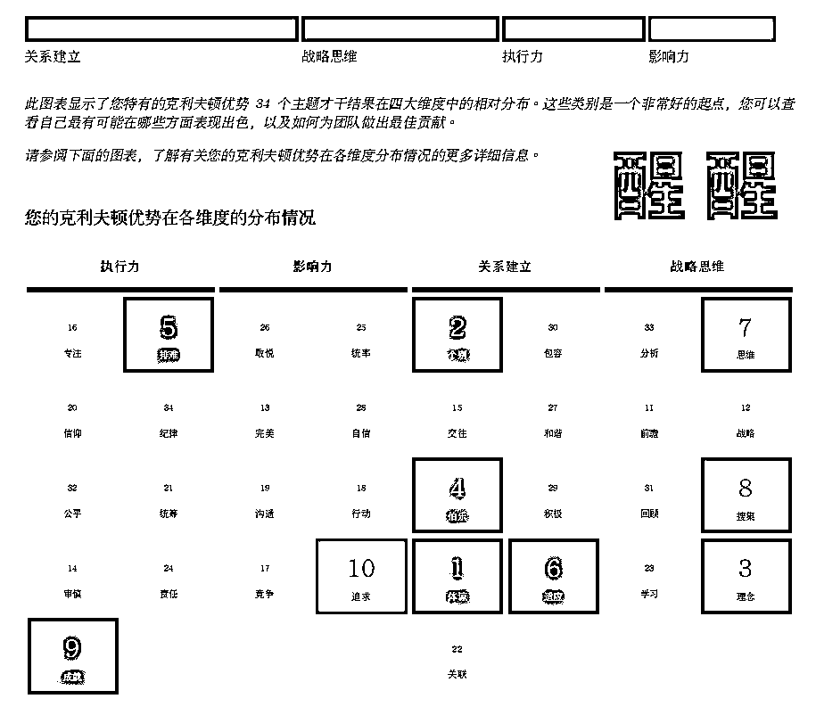

# 每个人都能摸到自己的长板，关键就这三步

## 每个人都能摸到自己的长板，关键就这三步

作者： 醒醒同学🍃

日期：2023-10-24

大家晚上好，我是龙哥。

先简单介绍一下自己，我是盖洛普官方认证教练，也是个人成长领域的教练，同时在龙哥盟团队担任优势培训师，这次「个人优势航海」的带航教练，手册也是我主笔写的几位之一。

过去三年我一直在行业头部训练营里做运营，两年负责班型教学，累计为两千多位学员做过盖洛普测评，付费咨询时长加起来超过八百小时，连续三期参与赚钱的拉新，和靠谱一起累计带进来的新人超过一千人。

回顾这六年，我一直在做跟人打交道的事。之前几份工作，钱少的时候觉得闲，忙起来觉得累，有时候拿到公司内部 Top 评价，内心依然空落落的、消耗很大。后来才搞明白，不是忙闲或薪酬的问题，是价值感被掏空了。

一份工作如果只能让你暂时性地发挥出一部分价值，用完了就只剩下机械重复，那再好也会腻。我一直想找一件可以做一辈子的事，于是开始问自己：这个世界上有什么是恒久不变、始终有需求的？最终落到“人”的刚需上，衣食住行、身心成长，个人成长就是其中永不掉队的刚需。

于是我选择了优势教练这条路。因为我坚信，人活着都在寻找答案，在精神和物质上都需要一个落脚点，而“认清自己的价值并把它用起来”，就是最让人上头的探索。

回头看，每一次我用优势去和世界交互，结果都相对顺畅。我的内核始终是和人相处，做一个观察者，挖掘每个人身上独一无二且可成长的部分，陪他们变得更出色、更踏实、更幸福，这件事本身就给我带来持续的满足感。

这和我的盖洛普结果也高度重合：关系建立最突出，其次是战略思维、执行力和影响力。如果我不是一个对人高度敏感的人，就不会在这条路上找到价值感。也是最近两年才彻底想通：努力固然重要，但一个人能走多远，终究绕不开天赋的底色。

这几年我刻意去观察并使用自己的才干，从零起步做项目，单项目收入做到过百万，也见证了不少朋友和客户在三十岁左右完成人生转向：从打工者到独立创业者，从单一主业到主副业并行，从自我否定到自我接纳，从执行者到管理者的跨越。每一次身份的切换都是一次重新梳理，而盖洛普在这中间扮演了重要角色。

接触的案例越来越多后，我越来越确认一个朴素的道理：鱼很难学会爬树，狗也学不会飞翔，每个人升级人生的方式，本来就偏向自己擅长的那条路。

认识自我、定位优势，是一个绵长的旅程。仅靠一本手册很难穷尽所有可能。这次航海，我们依然会用盖洛普工具来认识自己，但“认识”和“真正用起来”之间隔了一段距离，本期航海想做的，就是帮大家把这段距离变短，更清晰地看见自己的优势。

先说一个底层逻辑：优势基本由三部分构成，天赋才干、知识和技能，其中天赋才干的权重最大。

五月份那期航海里，有伙伴对工具有了初步认知，这次我们更聚焦应用——怎么让才干真正服务于工作和生活。对新伙伴来说，本期目标可以先定为看懂报告，弄明白每种才干和自己的关联。

基于过往的教学经验，我把找到优势的过程拆成了三个阶段，供大家参考：

第一步，先盘点天赋。你得先知道自己手里有什么牌。

航海手册里对 34 项才干都做了特质、优势、盲区的梳理，还有对应解法的案例，可以直接对照观察。做完这个对照，你就能解释通两个常见困惑：为什么有些事你不觉得费劲就能做好，为什么有些事你打心底就不爱做，越做越累。

这里要特别提醒：盖洛普才干的名字字面意思和实际指向常常不一样，比如“竞争”不等于喜欢吵架，建议去手册 3.4 节【了解 34 项基础才干】查阅准确定义。

我们每个人身上都贴着各种标签，有的来自外界的赞美，有的来自负面评价，这些标签往往都能在才干组合里找到根源。有人喜欢自己的组合，有人看见就皱眉。

我朋友兰卡说过一句话我很认同：很多痛苦源于不了解自己，也不理解别人。具体表现就是两种：一种是“我不想变成现在这样，但我总不自觉地做出我讨厌的样子”；另一种是“我想变成别人那样，怎么努力都达不到”。这时候盖洛普的价值就在于帮你理解自己和他人，接纳差异，找到合作的接口。

一旦不接纳，就会陷入对抗，反复质问自己和对方：你怎么这样？

只有先看见并允许自己是这个样子，再去欣赏自己和他人的优点，才能在航海群里给彼此更多正向反馈，你对自己优势的体感也会越来越敏锐。

才干不是一学就会的技能，它需要持续理解、持续使用、持续欣赏。这次航海能种下一颗种子就很值了，未来几十年如果能把“活出优势”变成一种习惯，生活和工作的幸福感会明显不一样。

这次手册新增了不少实战拆解，比如执行力卡点、社交关系卡点、亲密关系卡点、时间管理卡点、不自信、情绪管理、职场困惑等方向。大家也可以照着这个思路拆解自己的问题，反向找解法。

案例是很好的学习载体，但每个人才干组合不同，现实情况也不同，案例只是参考，具体还得具体分析。

我是个典型的排难+理念+战略型教练，不抛问题给我，我也很难给出有针对性的输出。所以大家多提问，我很欢迎。

为了降低新手门槛，这次我准备了一套适配新手的问题清单，有基础的伙伴也可以按这个节奏跟着走，学完就能给自己或他人做基础解读，很可能在航海期间就解决掉几个困扰已久的问题。

先把自己当成第一位被教练的人，把自己用明白了，对工作和生活都有立竿见影的帮助。

【才干提问/修炼模板】
1. 具体发生了什么事？
2. 当时的情绪、感受、想法是什么？
3. 你真正想要的结果或目标是什么？
4. 你希望从教练这里获得什么支持？
5. 这段经历可能激活了哪些才干？

修炼才干的核心是觉察。问自己：“你发生了什么，才会有这样的反应？”觉察就是把“到底发生了什么”看清楚。这个模板既可以自用，也可以作为提问框架。

今天的分享先到这里，有任何问题随时丢上来，我们一起聊。

* * *

评论区：

良辰-Oswald😉 : 这个好

常常 : 谢谢醒醒教练，下次个人优势航海实战继续冲[偷笑]

醒醒同学🍃 : 好哇

惠玲 : 醒醒教练牛逼！！！

不语 : 6

* * *