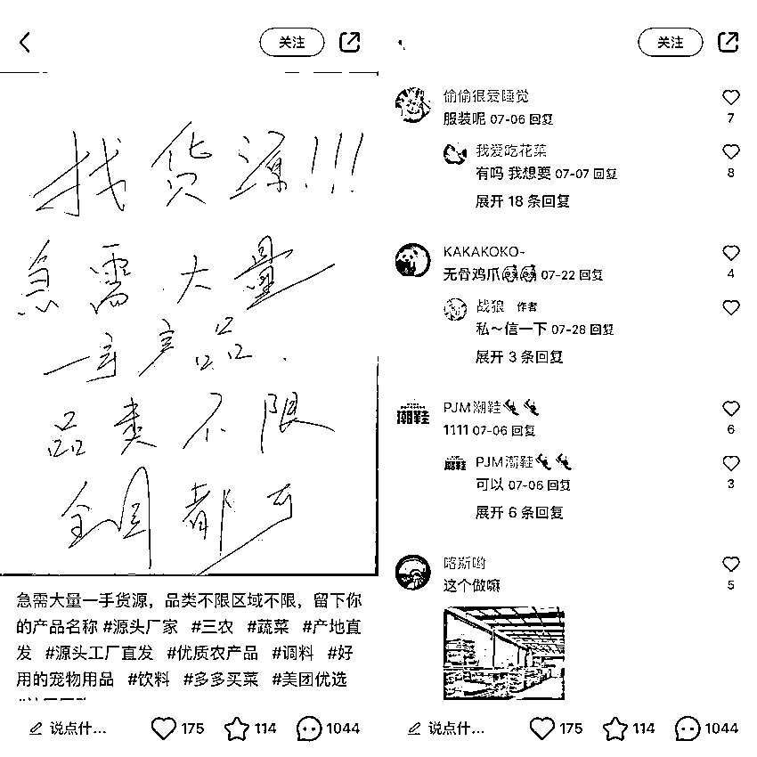
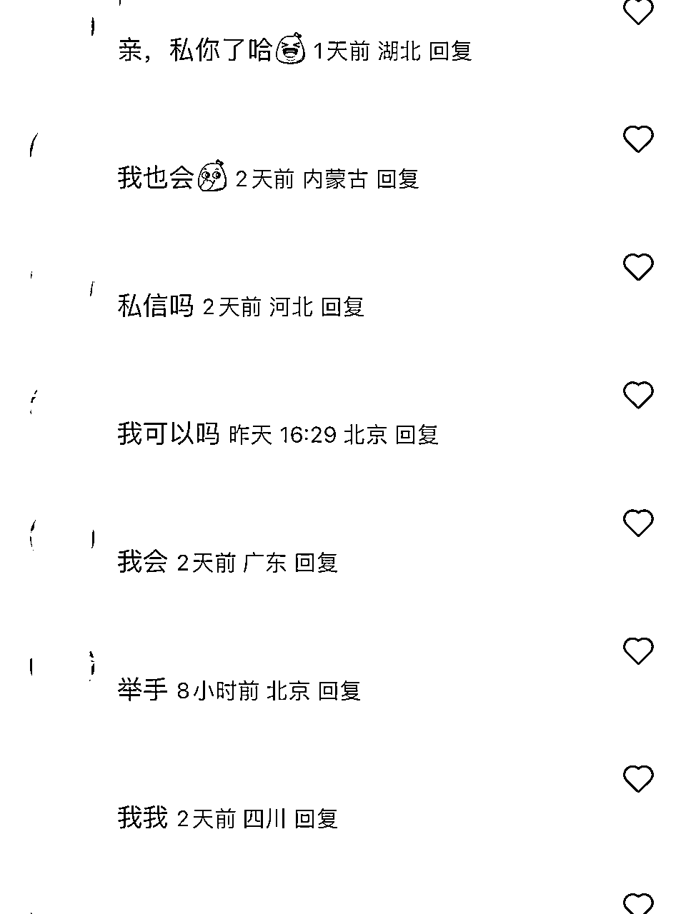
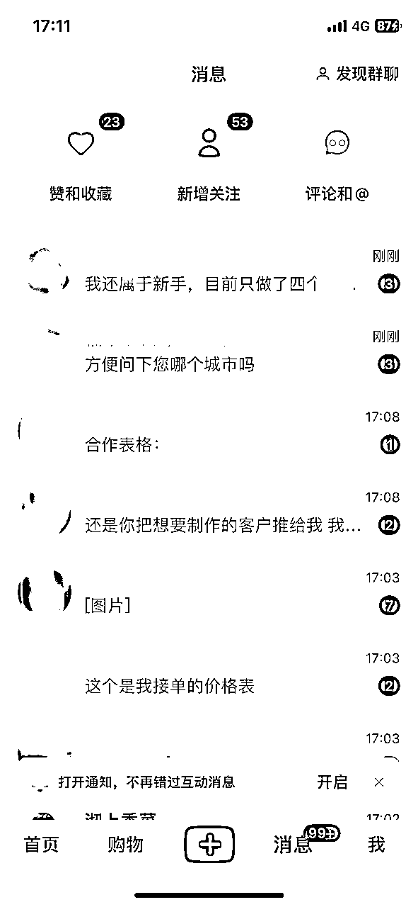

# 用小红书笔记反向撬动一手货源，我是怎么高效搞定上游的

找得到好货、拿得到好价，是做品最揪心的事。

我身边就有个典型的例子。他看准了一个竞争小、前景大的品类，跑市场调研回来信心满满，结果一比价，发现全渠道的拿货成本都干不过拼多多。可拼多多的品控大家都懂，而且商家那副爱买不买的架势，让他一度卡在原地，最后差点因为质量问题把项目直接黄掉。

我自己也踩过同样的坑，所以才特别理解那种无力感。这次想跟大家聊的，不是板上钉钉的SOP，而是一种可以迁移的思路。思路是活的，能举一反三，套到你手上的任何品类上；具体教程就不一样了。

# 我过去找货有多被动

早期的我，看到一个有潜力的品，第一反应就是冲1688、拼多多扒价。比谁便宜、谁看着靠谱，然后主动去找商家聊首批进价。

可现实是，商家一眼就能看出你起量小，态度自然就冷淡起来，谈价空间也有限。而且初期给到的价格往往不是底价，想压价就得走平台，空间直接被锁死。

最折磨人的是效率。每天一个个私聊、一个个比对，筛下来能聊得下去的屈指可数，时间精力全耗没了。

那有没有一种办法，能让商家主动来找我，还不用赔笑脸？我开始琢磨反向引流的玩法。

# 反向引流：让商家主动上门

有次刷小红书，无意间看到一条求货源的笔记。

当时没觉得有什么特别，手指一点就划过去了。但划走的瞬间冒出一个念头：能不能把这个求购的姿势，拿来反向找我的上游？

脑子里一下子灵起来了。当天我就拿了张A4纸，把我对这个品的需求写清楚，标题和表达方式直接参考那条笔记的思路，先做一次小范围测试。

就想看看能不能把找货的主动权，从我手里转移到商家手里。

笔记发出去没几分钟，评论区就开始有人冒头了。

这个结果让我很振奋，意味着过去那种低效的主动搜商家的模式，可能要被取代了。

为了把这波主动流量吃干，我马上在评论区引导：有意向的来私信细聊。结果私信界面直接被刷爆了。

有点夸张，但属实。更关键的是，这只是一个刚注册没多久的新号，从发帖到被围攻不到一小时。

商家一下子太多，反而要做减法。我先把自己的硬性需求列出来：品质标准、交期、包装、是否支持贴牌等等。用这套清单把上百条留言先做一遍粗筛，不匹配的直接不回。

筛完一轮，还剩下几十家。下一关是价格，谁给的条件更优越就留。谁报价离谱就淘汰。

最后一道坎是起订量。能不能接受我前期小单试水。这一步又刷掉一大波。能走到最后剩下的，已经是真正合适的候选。

整个逻辑就是：用一只“求购笔记”把想出货的商家一次性吸过来，再用自己的标准层层过滤，最后留下最贴合我的合作方。

如果你还不清楚操作感，可以去小红书搜“急需一手”、“一手货源”这类词，看下别人是怎么发出求购帖的，把文案结构照搬过来，换成你的品类需求就行，很简单。

# 拿下一手源之后怎么变现

有了一手直连的商家，玩法就打开了。我总结了两种常见路径。

## 无货源模式的升级版

现在单纯在小红书做无货源转卖，风险很高。平台对拼多多、1688的物流单号识别很强，只要是经过第三方电商平台的单号，封店概率极大。

但一手源不一样。这些商家都是你通过微信直接谈下来的，发货时给你的物流单，是干净的、不经过任何平台的。你把这个一手单号填到小红书店铺里，系统就抓不到你的中间路径。

也就是说，你可以用一手源的身份，名正言顺地在小红书做无货源，这是1688和拼多多给不了的安全感。

## 私域承接模式

不想开店也完全没问题。你可以在小红书做内容引流，把客户全导到微信成交。客户下单后直接让上游商家发货，你和商家月结即可。

不用交店铺保证金，不用等平台审核，不用自己备货囤货，发货全程外包。你只负责把人引进来赚差价，这比很多朝九晚五的工作轻松得多。

最后透露个方向。近期有个品类很有望迎来一波小爆，有准备的人提前布局就能吃到红利。提示一下：水果。

能吃到源头的，按我这个思路实操，一个月拿个几千上万的零花钱并不难。

今天的分享就到这，有不懂的地方可以后台交流。

我是艾小飞，一个爱用案例讲流量的内容人，下期见！

原创：艾小飞

转载可私信

禁止搬运和抄袭

微信：aifei9977 （记得备注来意）