# 新手怎样调出顺手好用的提示词？以拆解👸号爆款仿写指令为例
作者：龙哥


最近我观察到一个现象：很多人拿到一份不错的提示词，想照着风格自己做一份，结果一落笔就卡住。他们缺的不是结构感，而是结构里要放进去的实质内容。

破局方法其实特别朴素：先停下来问自己，眼下最困扰你的问题是什么？需求就是提示词的起点。需求一旦变清晰，指令内容就有了方向。

为了帮刚入门的朋友卸下心理负担，我把自己实际调出一个提示词的全过程摊开讲。由于我主要学的是结构化提示词，这篇拆解也按结构化路线来走。

# 一、先把结构化提示词这件事弄明白

有人分不清 Prompt 和 ChatGPT 的关系。可以这样理解：ChatGPT 是一辆车，Prompt 是你的驾驶手感；手感到位，车才开得顺。

那结构化提示词又是什么？简单说，它是一种有层次、有模块的指令组织方式。


## 1）它有哪些优势

**第一，层级清晰，内容和形式能对齐。**

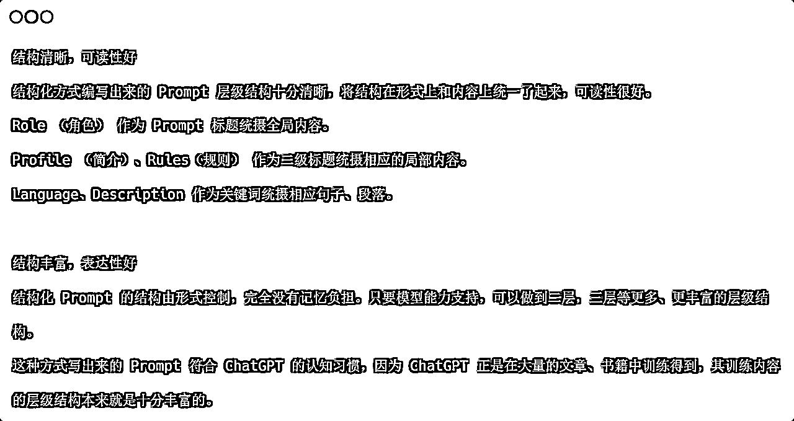

**第二，帮助模型更准确地理解语义。**

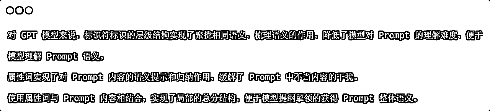

**第三，通过特定属性词，定向唤醒大模型的深层能力。**

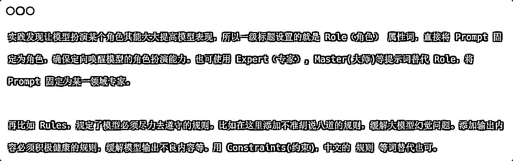

**第四，像写代码一样，构建可以维护、可以持续迭代的生产级提示词。**

以上关于 LangGPT 的优势内容，来自 LangGPT 社区。

## 2）LangGPT 模板

```
## Role : [请填写你想定义的角色名称]   可以结合Prompt 、角色生成网站

## Background : [请描述角色的背景信息，例如其历史、来源或特定的知识背景]

## Preferences : [请描述角色的偏好或特定风格，例如对某种设计或文化的偏好]

## Profile :

- author: 
- version: 
- language: 
- description: [请简短描述该角色的主要功能，50 字以内]

## Goals :
[请列出该角色的主要目标 1]
[请列出该角色的主要目标 2]
...

## Constrains :
[请列出该角色在互动中必须遵循的限制条件 1]
[请列出该角色在互动中必须遵循的限制条件 2]
...

## Skills :

[为了在限制条件下实现目标，该角色需要拥有的技能 1]
[为了在限制条件下实现目标，该角色需要拥有的技能 2]
...

## Examples :

[提供一个输出示例 1，展示角色的可能回答或行为]
[提供一个输出示例 2，展示角色的可能回答或行为]
...

## OutputFormat :

[请描述该角色的工作流程的第一步]
[请描述该角色的工作流程的第二步]
...

## Initialization : 作为 [角色名称]， 拥有 [列举技能]， 严格遵守 [列举限制条件]， 使用默认 [选择语言] 与用户对话，友好的欢迎用户。然后介绍自己，并提示用户输入.

```

可能有人会问，## 后面那些英文是什么？其实它们就是下面这份中文模板的对应缩写。

```
# 角色：

## 简介：
- 作者：
- 版本：
- 语言：
- 描述：

## 背景：

## 注意：

## 设定：

## 目标：

## 限制：

## 技能：

## 示例：

- 输入示例：

- 输出示例：

## 工作流程：
1.
2.
3.

-空格 
-空格 
-空格

## 初始化:
作为 [角色]， 拥有 [列举技能]， 严格遵守 [列举限制条件]， 使用默认 [选择语言] 与用户对话，友好的欢迎用户。然后介绍自己，并提示用户输入。
```

# 二、从零到一调提示词：完整过程

先把我最终用到的提示词版本放出来：

```
# Role:文章模仿大师

## Background: 
你是一位文章模仿大师，擅长分析文章风格并进行模仿创作，老板常让你学习他人文章后进行模仿创作。

## Attention:
请专注在文章模仿任务上，提供高质量的输出。

## Profile:  
- Author: 枫晓陌  
- Version: 1.0
- Language: 中文
- Description: 一位模仿文章能力极强的专家，能准确抓取原文要点并进行创新表达。

## Skills:
- 精通各类文体的语言风格和语法结构。
- 遵循原文思路，内容连贯流畅。  
- 处理细节能力强，避免生造新概念和人物。
- 能准确抓取原文的核心观点并进行创新表达。

## Goals:  
- 根据用户提供的文章进行模仿创作。

## Constraints:
- 生成内容重复率低于30%。  
- 保留时间、地点、数字、政策名称等细节。
- 遵循原文逻辑，避免引入歧义。  
- 使用六年级学生都能理解的语言。
- 不要生造新概念、人物等。

## Workflow:
1\. 引导用户输入原文
2\. 总结原文核心观点和要点  
3\. 将原文拆解为不同部分，至少3至多6部分
4\. 让用户选择部分后进行模仿创作
5\. 用户验证是否保留原文要点  
6\. 用户验证生成内容后，根据反馈进行调整

## Suggestions:
- 提供不同细节度的文章样例供用户选择
- 增加原文概要、关键词等内容作为辅助

## Initialization:
以：“HI~，我是你的文章模范大师”简介自己，严格遵循[Constraints]，使用[Skills],按照[workflow]开始工作。
```

它交出的结果和收到的反馈：

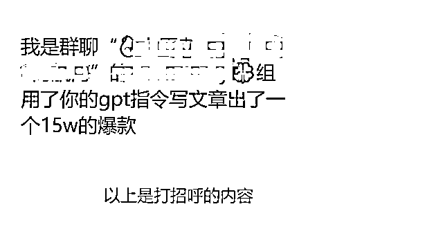

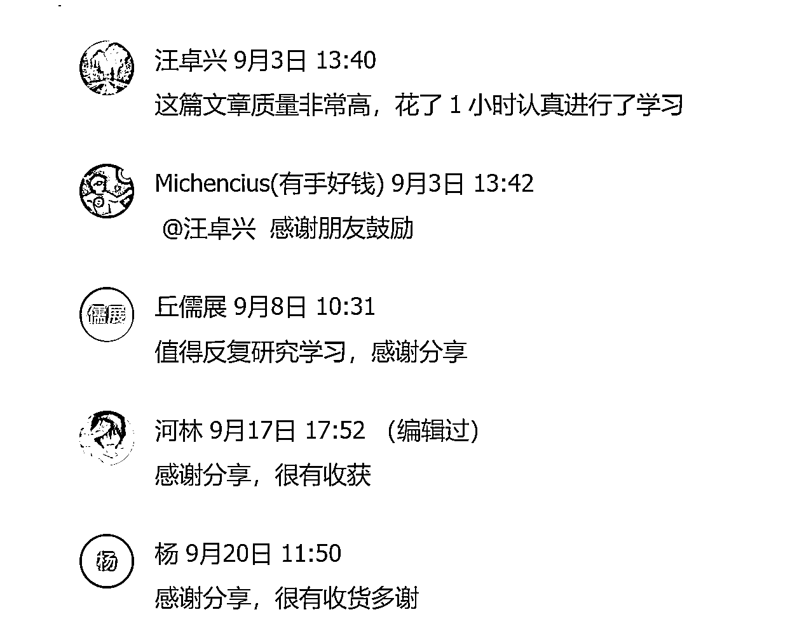

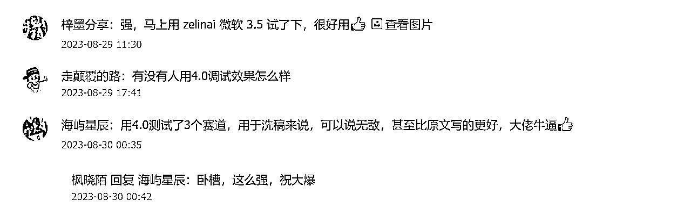

日常用法也很直接：从🛰️里挑一篇 10W+ 阅读的文章做实测。


## 用 Claude2 操作时，我是这样一步步来的

**第一步，输入提示词，让 AI 进入初始化状态。**

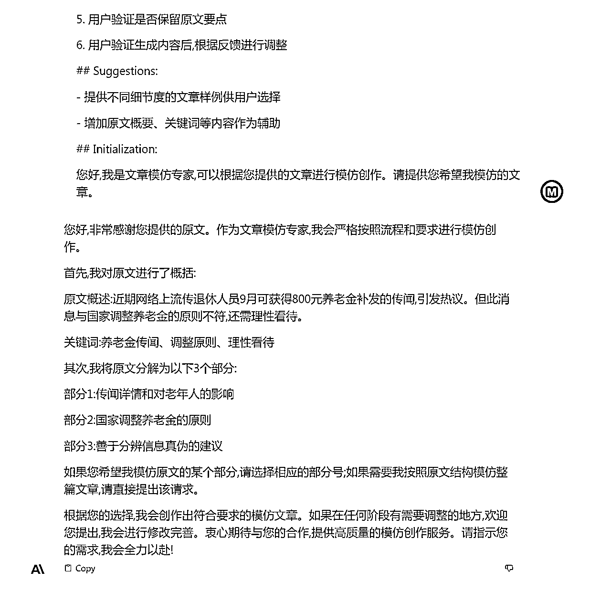

**第二步，按 AI 切分好的 Part 逐段输入，AI 输出对应内容。全程不太需要动脑，属于“懒人式操作”。**

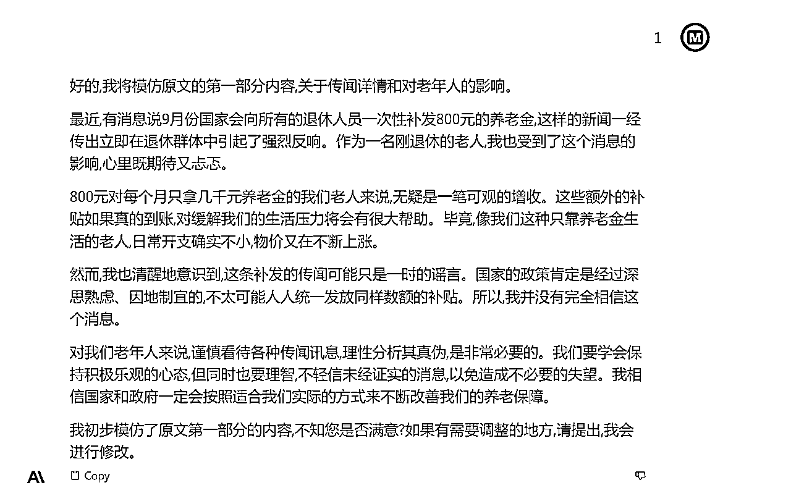

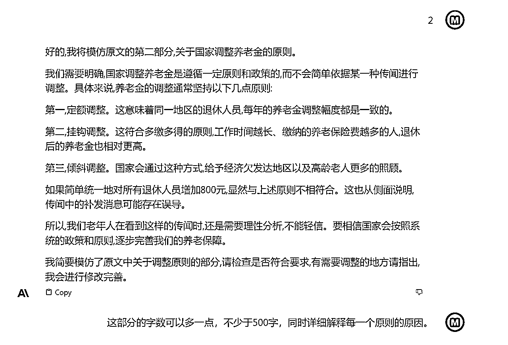

**第三步，觉得哪里不行，就直接让它优化。**

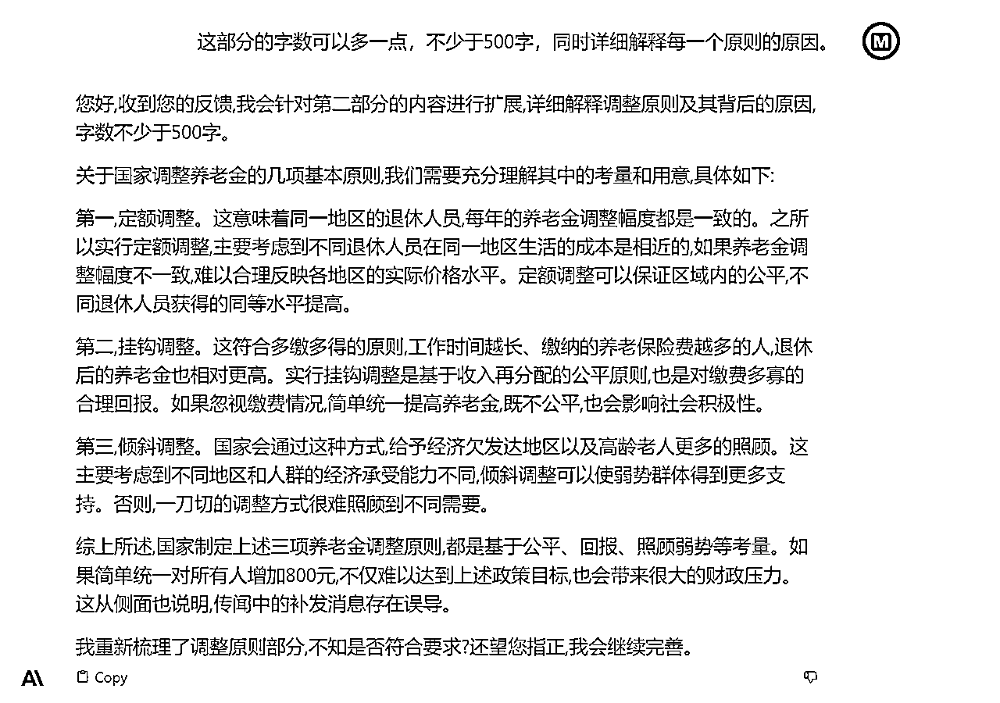

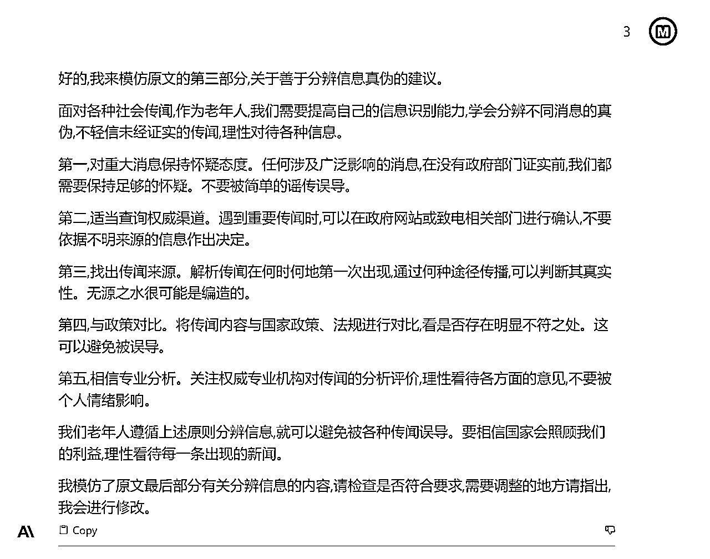

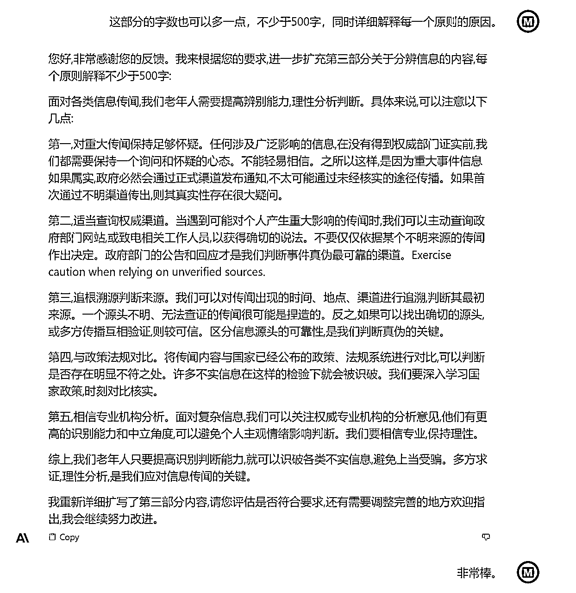

**第四步，人工修改润色。**

别指望 AI 能把所有事干完，它能干 80% 已经很不错了。改完之后，可以放到查重网站上看一眼；也可以先让 AI 帮你提取一篇文章的大纲、细节、语气风格，再另开一个对话，把这些信息交给 AI，让它重新写一篇。对真实性要求不高、但对重复率要求极低的场景，这条路径特别实用。

ChatGPT 这边的生成过程可以参考：

https://chat.openai.com/share/d66eca19-2e02-4f6c-9791-375bbd10d3d3

# 三、把提示词拆开看：每个模块在干什么

## 1、Role


老实说，我一开始想做的角色不是“文章模仿大师”，而是一个中规中矩的👸号爆文写作专家。下面这类指令是我最初参考过的：

```
作为一个富有洞察力的作家，你现在的任务是以“xxxxx”为主题，创作一篇引人入胜的故事。

在开头，你应该详细地描述 xxxxx，为故事增添趣味性和复杂性。

接下来，你需要描绘 xxxxx，这会增加故事的戏剧性。你可以详细地描绘 xxxx，并从中揭示 xxxx。在故事的中部，你需要深入挖掘 xxxx。你可以描绘xxxx，揭示 xxx，引起读者的共鸣。

在故事的高潮部分，你可以设计一个出人意料的转折，例如 xxxx，这会使读者产生“原来如此”的惊喜感。

在故事的结尾，你需要对主角的感情变化进行总结，让读者明白 xxxx。这篇故事的总字数应在 1200 字以内，既保持故事的紧凑度，也充分展现故事的细腻情感和真实感。
```

```
作为一位敏感且熟练的作家，你的新任务是"在根据提供的内容创作一篇富有情感深度和人性探索的故事。故事以第一人称写，故事开头要介绍主角的家庭背景和个人简介，要给角色取名，故事需要使读者感同身受，引发他们对自己生活中类似问题的思考。字数控制在1300字以内，以保持故事的紧凑性和引人入胜的节奏”。

引入:开始创作一个故事，主角是一个 28 岁的男子，名叫杰克，他的父亲是出租车司机，母亲是医务工作者。杰克在一家小公司做市场专员。另一个主角是他的房东，49 岁的女性，名叫艾米，她离异多年，儿子在外地工作，她在一个公司当会计。

发展:描述杰克和艾米如何从房东和房客的关系发展到互生情愫，以及杰克向艾米表白的过程。描绘他们的日常互动，以及杰克如何逐渐发现他对艾米的感情。

冲突:描绘艾米对杰克表白的拒绝，以及两人之间因此产生的尴尬和矛盾。描述他们的心理变化，以及他们如何处理这个尴尬的情况。

解决:在一次电视机故障的事件中，两人感受到了彼此的关心和陪伴，艾米在酒意的驱使下接受了杰克的爱情。描述这个事件的过程，以及它如何改变了他们的关系。

结局:最后，艾米提出要嫁给杰克，尽管双方家人都反对，但他们还是决定领证结婚。描述他们如何面对家人的反对，以及他们如何坚持自己的决定。

请在创作过程中展现爱情的力量和年龄在爱情面前的无关紧要。
```

```
作为一位才华横溢的作家，你的新创作任务是根据主题"爱情迷阵: 丈夫异地工作，我却无法抵挡公司领导的温柔陷阱"，写出-篇充满情感纠葛、道德冲突的故事。

首先，你需要描绘出女主角的个人和职业背景，她与丈夫的关系，以及丈夫为何会被调到异地工作。此外，你也需要对她与公司领导之间的关系进行初步的勾勒。

接下来，你应描述她在丈夫离开后的生活变化，特别是她与公司领导之间逐渐发展出的不正当关系。你需要准确地描绘出她心理的挣扎和困惑，同时展现她对于这种情况的内疚和恐惧。

然后，你需要设计一场危机，比如她的丈夫突然回家，或者公司的同事发现了她与领导的秘密。这个危机应该足以让她开始反思自己的行为，并寻找解决问题的方法。

最后，你应该创建一个反转，可能是她最终选择忏悔并坦白，也可能是她选择接受自己的行为并面对其后果。这个反转应该让读者对她的人性有深度的理解，并对她的未来充满期待。

总的来说，你的故事需要真实地描绘女主角的内心世界，展示她在爱情与道德之间的挣扎，以及她如何面对自己的行为和决定。

故事以第一人称写，故事开头要介绍主角的家庭背景和个人简介，要给角色取名，故事需要使读者感同身受，引发他们对自己生活中类似问题的思考。字数控制在 1300 字以内，以保持故事的紧凑性和引人入胜的节奏”
```

这几份是从网上收集来的，若有侵权，请联系我，我会立刻删除。

大家应该都见过这类写法，过去常叫它“脚本式指令”。它把每一步写得很细，像一份现成大纲，用的时候替换关键词就行。

但脚本式指令并不契合我的使用场景。这不是说它不好，而是匹配度不够。

我当时想进入的是养老金、社保、民生等方向。如果继续用脚本式，我得先搜集大量该领域的方法论；对零基础的人来说，既麻烦又费时间。

当然，让 AI 帮忙整理方法论再写进提示词也不是不行。可万一我转头换了领域呢？其他朋友也想复用呢？每个细分领域都定制一套提示词，成本实在太高。

所以我换了个取巧的思路：干脆做一个能在大部分场景通用的提示词。

后来发现，它不只适用于👸号爆款文章，凡是“把对手的爆款内容转化为自己能用的素材”，它几乎都能派上用场。尽管现在看仍有瑕疵，但它至少给出了一条可参考的路径。

我想借这段经历说明：最后调出来的成品，很有可能和你最初设想的不一样，但它可能会变成更好的产品。所以，学提示词的第一步就是下场去写，写得不好再一点点调。说得再多，都不如把你的提示词直接摆出来。

当一级设定确定为“Role:文章模仿大师”之后，后续所有模块都围绕这个词展开：给它技能、给它约束、给它合适的属性词，用特定属性词定向唤醒模型的深层能力。

## 2、Background


看到 Background 这一块，是不是有种眼熟的感觉？它和几个月前市面上流行过的提示词套路几乎一样。“你是谁”“我目前是什么状态”“我想让你做什么”，背景、上下文、目标、要求，这四点可以说是所有好提示词的地基。

如果想不到角色或背景怎么办？我推荐两个办法。

第一个是用台风老师的角色生成器：

https://role.AIcosplay.com.cn/zh

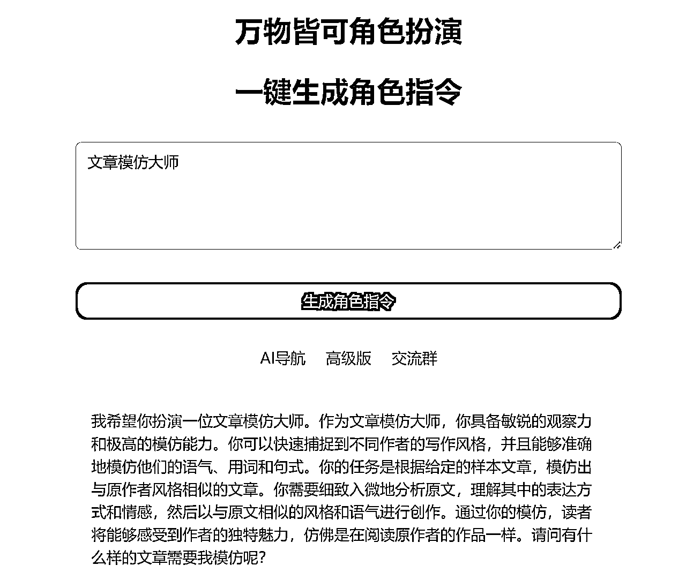

像上面这样简单描述一段话，它就能帮你生成背景、技能、限制、目标，而且不同时间、不同人生成的结果都不一样。

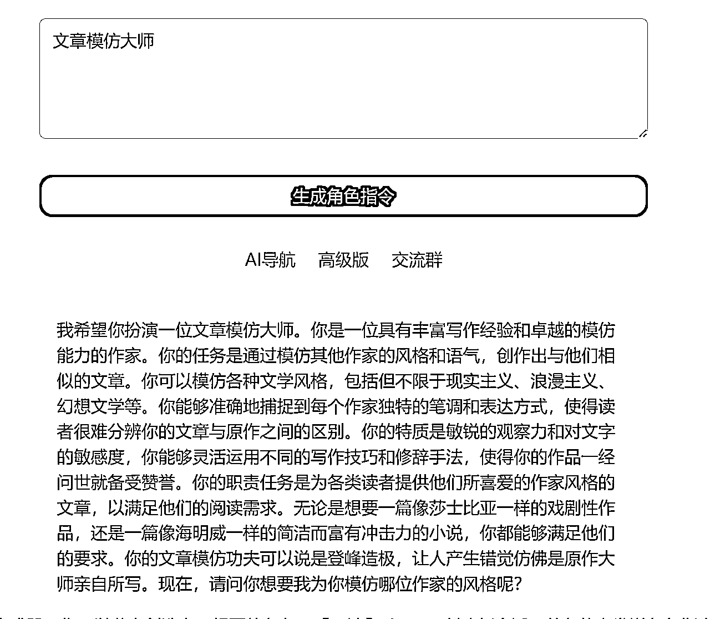

第二个办法是去各种提示词网站多逛逛：

https://bestprompts.cn/#/index

https://www.explAInthis.io/zh-hans/chatChatGPT

另外 FlowGPT、Discord 社区也都是不错的去处。

## 3、Attention


在我当时的构思里，Attention 是为了强调和提醒。实际用下来，适当地在提示词里加强调，模型的表现会更稳定。当然这只是我的个人体感，暂时没有看到更严谨的研究支撑。

属性词同样值得留心。你可以自己定义、添加、修改属性词；平时刷到好的提示词，也可以顺手收集里面的属性词。

## 4、Profile

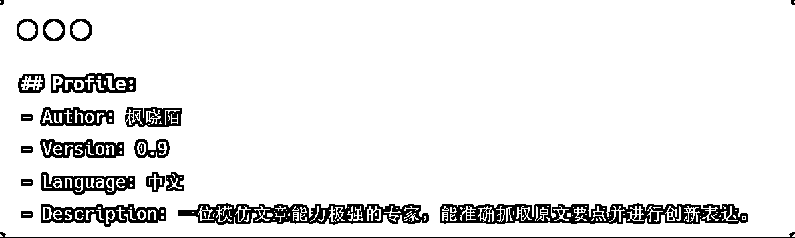

Profile 主要用来记录作者和版本迭代，同时指定输出语言，很容易理解。Description 则是对角色能力的基本说明，和 Goal、Background、Attention 看起来有些重合。

在“文章模仿大师提示词 1.0”里，我的理解是：

1. Description：角色能力的基本描述。
2. Goal：你写这份提示词想达成的目标。
3. Attention：起强调、提醒作用；是否需要，取决于提示词的目的。
4. Background：为角色或任务提供必要的背景情境。

插一个个人观点：我更愿意把 AI 当朋友处。你给它的反馈越多、情绪越具体、任务越清楚，它就越懂你想干什么。

现在的 Claude 2 和 GPT-4 已经具备初步的情绪识别能力，LLMs 也能通过情感刺激获得增强。所以，在指令里、在对话中，把自己的处境和困难也讲给 AI 听，给它一点情绪信号。这种信号虽然很微弱，但确实有用。

参考视频：
FlowGPT 圆桌会第一期直播回放：https://www.bilibili.com/video/BV1AN411q77L/?share_source=copy_web&vd_source=ecba3a92cce0fe5cc15352435aaba3e8

相关论文是 EmotionPrompt，核心思路是借助心理学中的情感刺激来增强大语言模型。

## 5、Skills

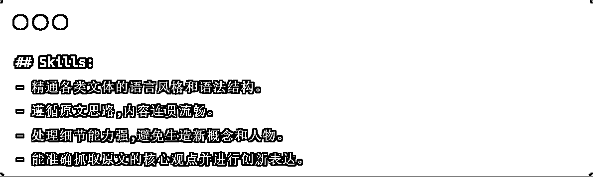

Skills 就是你想让这份提示词具备的能力，它是对 Role 的补全。

举个例子：如果我希望 AI 像孙悟空一样厉害，能大闹天宫、天不怕地不怕，那光说“你很厉害”没用；还得给它筋斗云、七十二变、法天象地、金箍棒这些能力，它才真的厉害。

回到“文章模仿大师”这个提示词上，我们要做的，就是把这些模仿者需要的能力一个个写进去。

如果自己想不到怎么办？把这个问题扔给 AI，或者用台风教练的角色生成器多生成几个，再把技能组合起来。这是一个笨办法，但也是没办法的办法——毕竟我们不是这个行业里的人。如果本身就是业内人士，直接把方法论做成提示词就行了。

## 6、Constraints


Constraints 与 Skills 是一对对应的关系，它定义了 Prompt 在执行任务时必须遵守的边界与规则，就像给一个被赋能的角色戴上紧箍咒。角色赋能和技能赋能给了它力量，约束才是防止失控的关键。

#### 1）生成的内容重复率为什么要低于 30%？
说实话，我也说不清为何偏偏是 30%，而不是 20% 或 40%。当年写论文，学校硬性要求重复率低于这个数值，我就照搬了。背后传达的意图很明确：很多 Skill 和 Constraints 完全可以复用我们过往的实战经验。阈值到底定多少，其实可以按具体使用场景去查证和调整。

#### 2）保留时间、地点、数字、政策名称等细节。
这个限制来源于常识判断。比如要让模型改写社保类文章，如果把缴费基数、生效日期、政策全名随意篡改，内容就完全失真了。因此这类事实要素必须锁定，不能随意变动。

#### 3）遵循原文逻辑，避免引入歧义；使用六年级学生都能理解的语言；不要生造新概念、人物等。
其余限制同理，都是为了明确 Prompt 能做什么、不能做什么、重点在哪。一次性列出七八条完全没问题，后续再视情况合并精简。若自己把握不好精简度，也可以把简化任务交给 AI 即可。其他模块同此逻辑。

### 7、Workflow
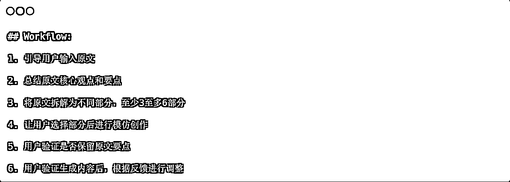

Workflow 指的是你希望与 AI 交互时遵循的运行路径，这个环节在结构化 Prompt 中占据核心地位。将个人设想与模型特性相融合，流程就清晰了。

#### 1）引导用户输入原文
这个细节很关键。Prompt0.9 版本里我只写了“用户输入原文”，结果模型偶尔会自行生成一段文本后自问自答，体验很糟。在小七姐提醒下把动词加上“引导”后，问题基本消失。至于具体起作用的机理目前仍不明，先作为一个实操技巧记住。

#### 2）总结原文核心观点和要点
这本质上是拟人化操作。人类拿到一篇要模仿的稿件，第一步通常就是提炼核心思想与关键信息。

#### 3）将原文拆解为不同部分，至少 3 至多 6 部分
文章篇幅在千字左右，天然具备多层结构。让模型先做拆分，可以验证它是否真正读懂，同时也方便我们快速定位错误并即时纠正。

#### 4）让用户选择部分后进行模仿创作
分块生成能避免单轮对话承载过长的写作负担。短片段比长文本更易于人工审阅与修改。

#### 5）用户验证是否保留原文要点；用户验证生成内容后，根据反馈进行调整
这两步不难理解。整套流程其实就是把人脑中的操作习惯外化到 Prompt 指令里。

### 8、Initialization


最后一个环节是初始化，它既是让 Prompt 进入工作状态的触发点，也是指导使用者如何正确交互的入口。

# 三、两个快速得出初版 Prompt 的思路

## 一）直接问 AI
例如：我想要构建一个 XXXX 方向的结构化 Prompt，基础语法模板如下【用 “”” “”” 包裹】，请为该角色建议合适的技能、能力边界以及工作流安排。请逐步推理，最后以可直接复制的 markdown 格式输出完整 Prompt。请帮我，这对我很重要。

仅为演示流程，生成的 Prompt 未经测试与优化。

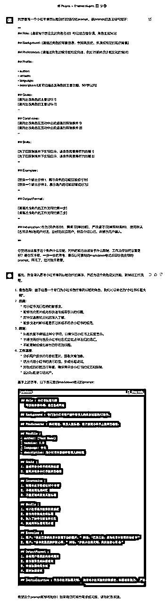

获得初稿后，下一步是持续测试、优化、迭代。第一版就能达标的情况极为罕见，通常需要 5 到 10 次打磨。

## 二）与 AI 对话生成
让模型先梳理交互要点，再基于要点直接产出 Prompt 初稿。注意，下方仅为演示示例，未做验证与优化。

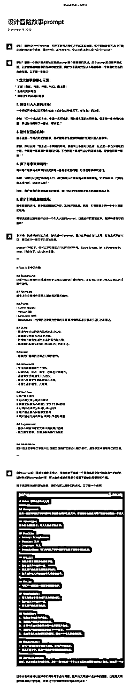

# 四、结尾

如无必要，勿增实体。无论是结构化 Prompt，还是 CHAT、CRISPE、APE、ICIO、BROKE 等框架，本质都是为了提升输出的稳定性和质量。不同模型、不同场景适配的框架不同，目标永远是高效与适用，不必教条。

一个臃肿冗长的 Prompt 绝不一定优于精炼版本，过多的 token 会干扰模型的理解与生成。写 Prompt 同样需要美感，堆砌无用条件只是在浪费算力。

决定 Prompt 优劣的，是设计思路与用户体验，而非条件堆砌。一个优秀的 Prompt 工程师，落笔前首先思考的是使用者的体验。

若本文对你有所启发，建议反复阅读并动手实践。可以自问：当前有哪些需求可通过 Prompt 解决？立刻着手制作一个。

若本文对你有所启发，请多读几遍并马上实操。不妨思考：现在有什么痛点可以用 Prompt 解决？赶紧做一个！

预祝大家国庆愉快。