# 普通人一穷二白，真的能挖到第一桶金？我的答案是：能！
作者：龙哥

很多人问我：王永超，我啥资源没有，啥也不懂，是不是就没机会了？  
我的回答始终是：任何时代，普通人都能翻身。尤其是现在，互联网和AI交叠的当口，会“搜索”+会“提问”，本身就是金矿。

拿考研这个赛道举例子。进场之前，先别热血上头，问自己四个问题：

**1. 这事能干多久？**  
**2. 天花板有多高？**  
**3. 我怎么挤进去？**  
**4. 怎么一步步升级？**

先说寿命。  
教育体系一般是稳定的，但别拍脑袋，要看事实。搜一下就知道了——考研这件事，在国外、美国、意大利、日本，全都存在。

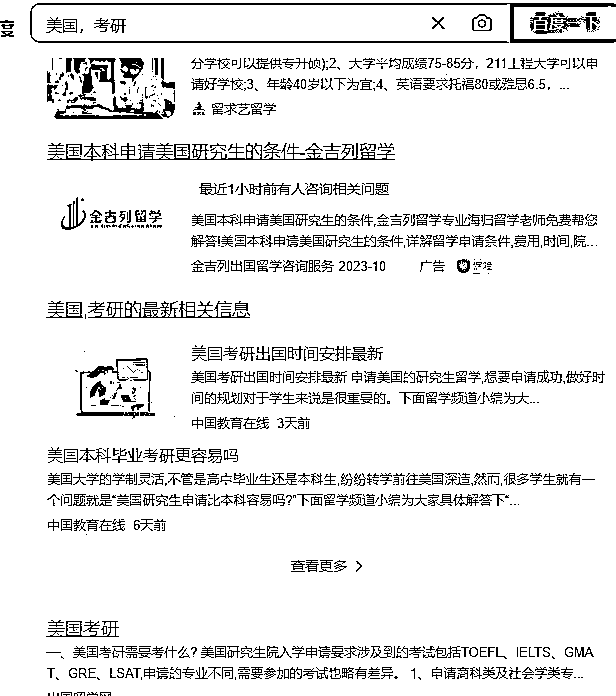

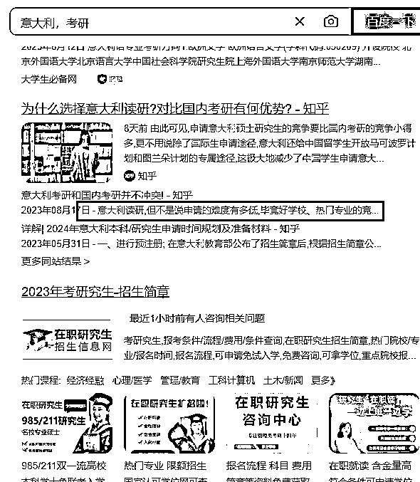

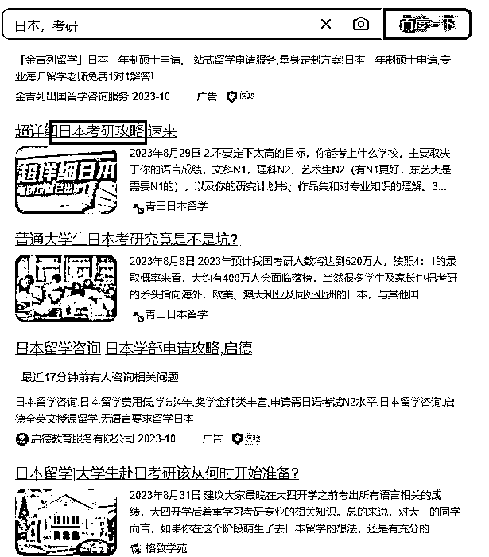

不管搜出什么结果，关键就一条：这个需求，在空间上永远有。  
  
  

再看时间。我查过资料，这个行当从1865年之后就能干了。从时间+空间两个维度一算，我这辈子，怕是等不到这个行业消失。

再说钱景。  
搜一搜人数、客单价，心里就有谱了。

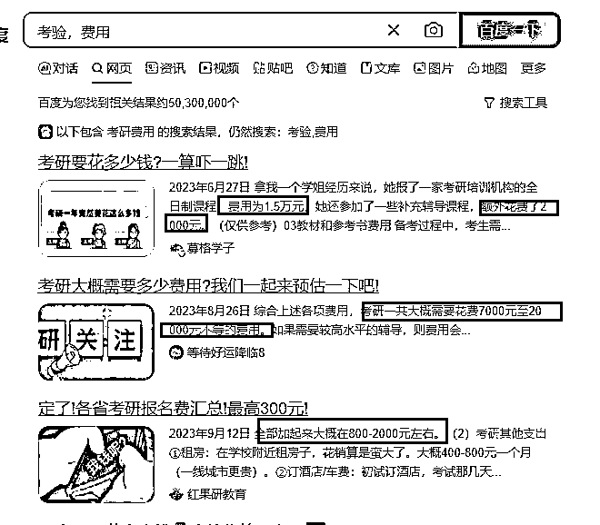  
  
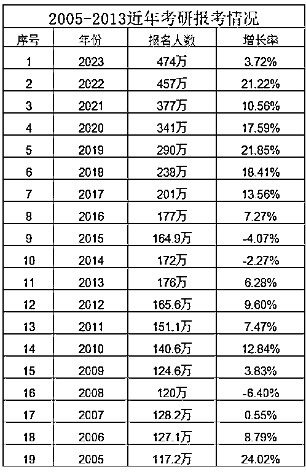  
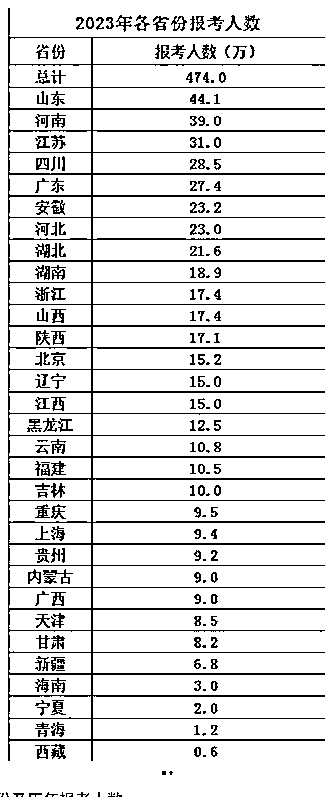  

这还只是上限。你会发现各个平台都有人在做，有人做，就说明项目可行。  
还得加几个同行，看看他们的规模——人家能做到的，你也能做到。这里就不一一加了，你可以挑自己感兴趣的赛道去观察。

看完大同行、小同行，方向确认没问题，那就开干。  
记住一句话：我们要为广大的考研人出份力，也为自己和家人挣个好日子。  
别小看这句话，这叫“大义”，是你和团队以后抗压的底气。

那怎么入局呢？  
你可能第一反应是：卧槽，别人都做那么牛了，我拿头去争？  
卧槽完，还是不甘心，但也确实硬拼不过。那就绕道走。

赛道很大，不止培训、私教，还有资料、社群、课程……  
找个自己能下脚的地方，比如资料。我们有向上的心，还怕干不过小卡拉米？

找资料的过程，也是学习的过程。别人卖资料，我们卖“资料+陪伴”。我学完，再教给他们就行。等积累多了，再出课，再做培训。

价格怎么打？别人卖多少，我们也卖多少，但我们多了陪伴服务。  
价格优势？有。服务优势？有。那资料优势呢？

怎么打出资料差异化？

百度上搜资料，基本都是零碎的，整理起来很崩溃。

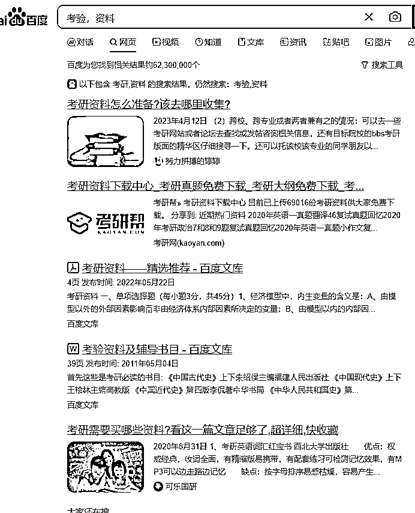  

同行的资料，无非是“同行+淘宝”的拼凑。  
我们的玩法：

**第一招：搜索语法。**  
比如搜“考研 资料 filetype:pdf”  
这只是演示，你可以加上具体专业（英语、公务员等）。filetype: 后面接文件类型，搜索结果就只显示这种文件。

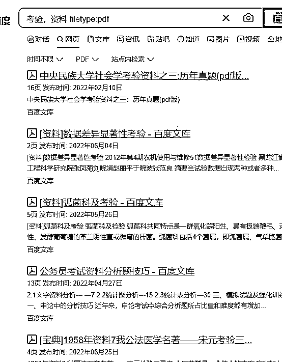  

**第二招：找论坛。**  
考研这种大类目，基本都有垂直论坛。把论坛内容翻一遍。  
建议所有搜索都用谷歌，下面是对比。

如果实在上不了谷歌，再用百度。

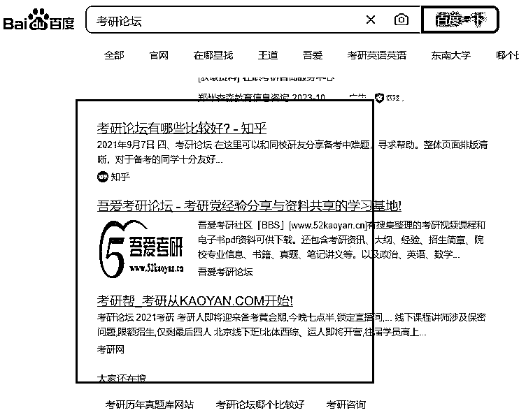  
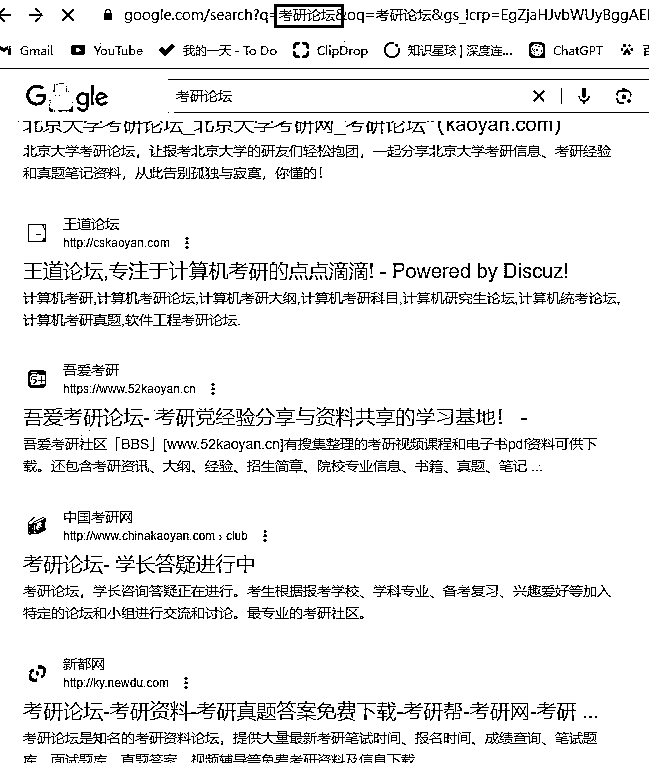  

**第三招：淘宝。**  
起步阶段，只买便宜的，不买贵的，管它质量怎样，亏也就亏点时间。  
这些工作都属于“产品”阶段，产品重要，但没流量也白搭。先做个差不多的产品，卖起来，再慢慢优化。

  

**第四招：教育数据、大学排行榜、高考工具。**  
当别人只给资料，我们还能提供资料以外的东西，这就是竞争力。

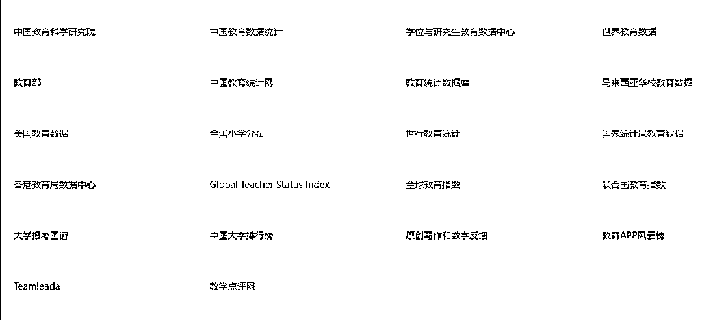  
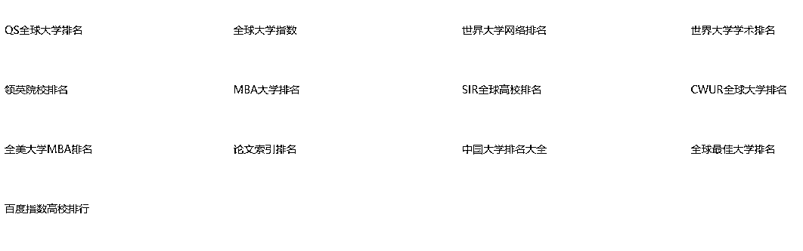  
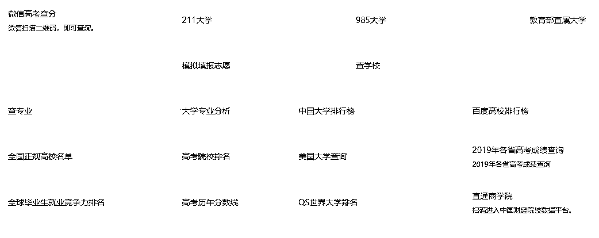  

**第五招：AI工具。**  
用AI的关键就是会提问。我的提问技巧一般般，就不献丑了。想要的话可以私信我，送你一份提问技巧。

----------分界线----------

再往下就是引流了，这块不多展开。上面这些东西，已经足够让一个人进入任何一个行业。

记住一个公式：  
提供资料/食物/（你自己填）时，加上“带你学/带你吃/带你（你自己填）”，你的相关知识就会飞速增长，然后就能做更深层的东西——高端社群、1v1咨询。

思路别局限，👸号、别人的社群、相关APP，只要你有耐心去搜，什么都能找到。

最后说说怎么晋级。  
方向在一开始调研时就有了。  
同时，搜索的过程中，你也在观察别人怎么玩。互联网上的信息差，就是搜索次数。  
别人对一个行业，搜一次都嫌多；你搜10次、100次、1000次，差距自然就拉开了。

该花钱的时候别省，买点资料、进个社群、报个课，晋级速度会快很多。  
走出去，看看别人都在做什么。有些玩法，你闷头想一辈子也想不出来。

总结就三句话：**多搜，花钱，走出去。**

这个时代，掌握“搜索+提问”的本事，就已经领先很多人了。不管创不创业，一定要会搜，多搜，不停地搜。