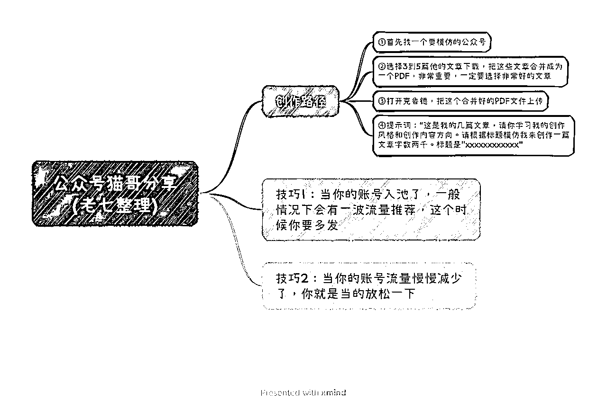
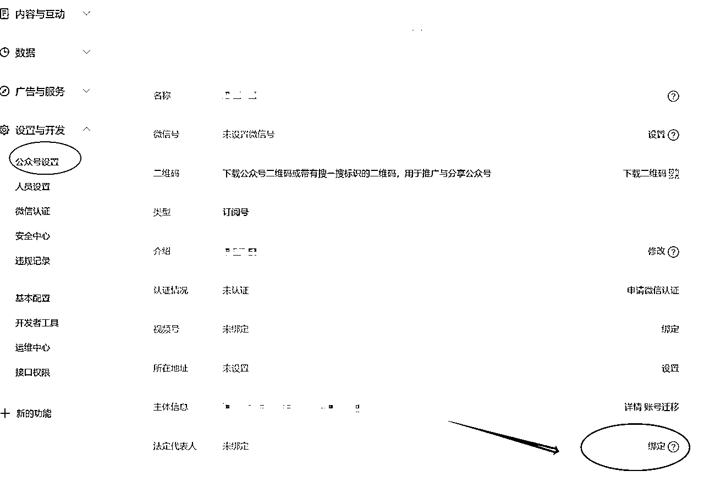

# 👸号流量主收益20w后悟出的底层逻辑

做了👸号流量主这么久，累计收益过了20w，我才真正想明白这个项目的底层玩法。今天把这些东西掏出来，希望能给你一些启发。

先简单介绍一下自己。我是龙哥，在郑州，创业8年，也是龙哥盟的航海家，👸号航海教练，主理着“猫哥创业记”。手头管着2000多个👸号，流量主收益做到200多万，合作过的达人超过1000位。

为什么我说👸号流量主是少数值得长期干的项目？原因很简单：操作门槛低、变现路径短、投入回报高，而且很容易拿到正反馈。相比其他项目，它有几条很实在的优势。

接下来聊点干的。想在这个项目里做出成绩，抓住这三块基本就够了：

一、怎么快速批量产出文章  
二、怎么搞定大量分发  
三、项目的命脉到底是什么

---

**第一件事：让文章像流水线一样产出来**

👸号本质上是内容平台，内容生产能力就是核心竞争力。谁能在最短时间内制造出高质量内容，谁就能跑在前面。

我试过非常多的AI工具，比如ChatGPT 4.0、New Bing、Notion、Claude 1和Claude 2，还有国内的讯飞星火、文心一言等等。真要比拼写文章这块，我个人用下来最强的还是Claude 2，后面就直接叫它Claude了。

如果你做的是非时效类的内容，像情感故事、文案鸡汤这种，根本不需要写什么复杂提示词，一个简单的指令就能出一整篇。要是做娱乐八卦、时事热点这类需要追热点的，也就几个提示词的事，照样快速搞定。

Claude上手非常简单。8月的航海群里我也分享过，有圈友专门做了整理，下面就是这个用法。

用这个办法，文章就能轻轻松松批量生产出来。

---

**第二件事：把文章像撒网一样铺出去**

会写文章之后，下一个问题就是怎么发得多、发得快。说白了，就是怎么把量做大。这里有两种思路：一种是一个号多发，另一种是搞多个号做矩阵。

先说说单号多发。这可不是让你乱发一通。新注册的号，前期发太多没意义，老老实实每天更新等着入池就行。等哪天文章顺利入池了，就可以加大频次，比如首批发4篇，然后隔段时间再补几篇。要是发现哪篇爆了，马上顺着追发几篇，效果会很好。

再来说说多账号矩阵。这就会涉及到注册的问题了。优先用家里人的资料来注册👸号，收款还是可以走你自己这边。然后可以考虑办个体户执照，注意一定要是“个体户”而不是公司，成本会低很多。

一个个体户能注册两个👸号。不过注册第二个号的时候，平台要收300块认证费。

这里有个小技巧：如果你用两个浏览器同时去注册两个👸号，就能钻个空子，把300块省下来。

当然这个操作对新手来说有点难度，搞不好就卡住了。

我给个更稳妥的路径，不用同时操作，也能跳过第二个号的认证。哪怕你用执照已经注册过一个号很久了，同样有效，能帮你省300块。

具体这么做：按正常流程去注册，该选择🛰️认证就选，不用管，直接完成注册。然后进入👸号后台，找到“设置”里的“法人”这一项，点击绑定，按提示完成法人绑定。这样就能跳过认证，直接把这个号给立起来。

接下来还有个关键问题：邮箱。这里有一个神器——2925无限邮箱，简单说就是注册一个主邮箱，实际上相当于拥有了无数个邮箱地址，想怎么加别名都可以。用来注册👸号完全没问题，注册Claude账号也能用。

先说下无限邮箱的后缀：@2925.com。

它牛在哪？你只需要注册一个主账号，比如我的主账号是cat887999@2925.com，那么我可以任意加字符生成别名，像这样：cat887999_weixin@2925.com、cat887999_1@2925.com、cat887999_taobao@2925.com。甚至不加下划线，直接cat8879991@2925.com也行。个人建议还是加上下划线，看得清楚，不容易弄混。

注册地址是 https://www.2925.com/login/ ，流程很简单，打开后注册一下，拿到主邮箱就完事。这个别名不需要专门去设置，你直接在注册🛰️公众平台或者Claude的时候，在邮箱后面加上后缀，就会自动开通这个别名邮箱。

唯一要注意的是，这个邮箱收信有时候会慢一些，耐心点就好。

---

**第三件事：项目的灵魂，其实藏在标题里**

这个项目最核心的东西，不是内容，而是标题。原因很简单：新号的大部分流量都来源于“看一看”，而看一看的三种推流入口，展示的都是“标题+封面图”。如果你的标题勾不起人点击的欲望，后面全白搭，号也基本很难做起来。有时候你去看一个新号，只要扫一眼它的标题，差不多就能判断它能不能跑出来。

所以，好标题从哪来？直接抄对标，直接找爆款。去你所在的那个赛道里，挑一些最近两个月才注册的新号，跟着他们的爆款标题抄。

找对标这活儿确实挺枯燥的，你得不停去搜一搜、看一看，反复刷。

那问题来了：标题能不能一字不差地照搬？

答案是：能。

标题总共就64个字，哪怕完全重复也没关系，只要正文内容不一样，就不算违规，不会触发原创问题。

最后，我把自己做这个项目最深刻的几句感悟放在这里，你要是真的读懂，基本就摸到这个项目的魂了：

1. 不要原创，不要原创，不要原创。多找对标，谁爆抄谁！（这里的“不要原创”不是说不开原创标识，而是不要自己瞎创新。）

2. 爆过的内容还会继续爆。哪篇文章自己爆了，第二天直接再发一遍！

3. 一定一定要建好自己的对标账号库和爆文素材库。这个非常重要，超级重要，重要到爆炸！

4. 标题和封面，比正文内容更决定生死。尤其是项目前期，别搞反了重点。