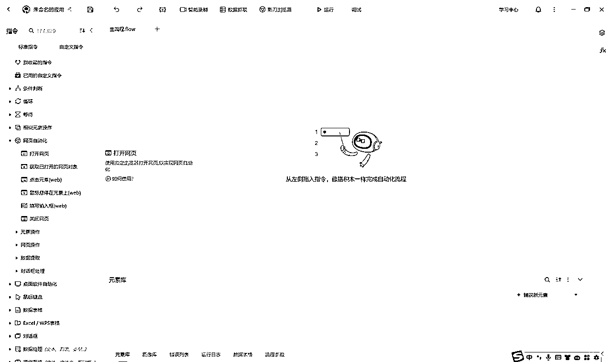
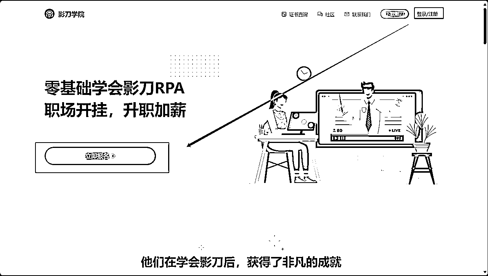
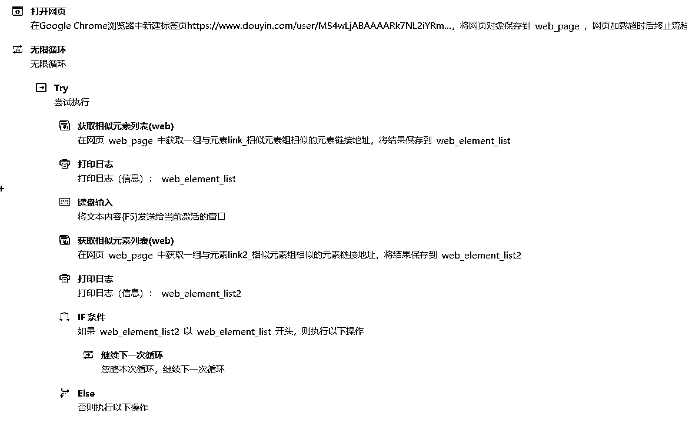

# 用影刀RPA把抖音图文跟款效率拉满10倍，普通人也能搭出“永动机”

@Leeka

嗨，我是 龙哥，影刀认证优秀工程师，也是 Uibot 认证工程师，很高兴能作为 8 月抖音图文项目的教练跟大家见面。

这段时间发现群里不少同学在吐槽：一个号一天要更十篇图文，手上还管着矩阵账号，忙到怀疑人生。求问有没有省心的办法。

我自己在修图剪辑的循环里快要崩溃时，也一直在琢磨同一个问题：既然流程都高度重复了，为什么不能让工具来替我跑？

我完全不懂代码，之前还傻乎乎让 GPT 教我用 Java 写小工具，结果毫无进展。重金买商业软件也不现实。后来在赚钱社区才慢慢了解到 RPA，一年前就听过名字，当时只觉得很高深。直到 6 月续航营里和组员一起PK学习，我才真正弄明白它能干嘛。

# 一、RPA 到底是什么？

RPA 全称 Robotic Process Automation，中文就是机器人流程自动化。

通俗讲，就是把我们日常做重复、有逻辑的“类人操作”交给软件机器人去执行，把人解放出来做策略和优化。

为什么选 RPA 而不是别的自动化方案？

我其他也没会，哈哈。但 RPA 的门槛确实友好，不用写复杂代码就能上手。

它能按我们提前设计好的流程，模拟真人操作电脑完成任务，降低出错率，省时间。

而且无需改动现有系统，装个客户端就能用，开箱即用。

# 二、学 RPA 会很吃力吗？

结论先说：用心学，并不难。挑一个上手门槛最低的工具，让正反馈来得快。

目前市面上 RPA 产品不少，国内用得最广的应该是影刀。它真的做到了所说的“搭积木”，界面都是中文指令，拖拽就能组合。

官网在这：https://www.yingdao.com/

如果想系统入门，我强烈建议去影刀学院。课程讲解很细，还有课后作业帮你检验掌握程度，体验很人性化。网址：https://college.yingdao.com/

拿到影刀初级工程师认证后，项目里常见的机器人基本都能自己搭建了。

# 三、实战怎么玩？

## 3.1 跟款机器人的思路

很多人刚接触 RPA 会觉得机器人不算牛，接下来用抖音图文项目来实操一下。

RPA 最适合的就是批量化、有逻辑的工作，比如批量修图、批量剪辑、批量定时发帖，单人操盘矩阵时更是刚需。但今天不讲基础，我讲一个更有用的点。

坤哥在开营直播里提过一个朋友公司的宝妈，跟着款的速度极快，几乎不睡觉，靠蛮力赚了几十万。结合 RPA 我就想：拼体力拼不过宝妈，我们能不能造一个不用睡觉的跟款机器？

它的运行逻辑非常清晰：

1、盯住对标博主，持续刷新主页，看有没有新作品；
2、有新作品就立刻抓图，没新作品就继续刷；
3、抓到的图自动进修图流程；
4、把新作品的标题、正文抓回来润色后一键发布。

我不是宝妈，但我能设计一个比宝妈更卷的机器人。

## 3.2 造一个比宝妈更卷的跟款机器人

坤哥也提醒过，跟款要快还要准，关键是要找到源头博主。跟到二三级代理，再快也转化有限。

怎么判断源头？没捷径，只能多看，用以图搜图来推断有多少人已经发过这个款，从而判断是不是代理。

我码稿时突发奇想，干脆把思路写成机器人逻辑：

1、打开目标博主的抖音主页；
2、抓取当前所有笔记的链接，记为 web_element_list；
3、不断刷新主页，记录新的笔记链接，记为 web_element_list2；
4、对比两个列表是否变化，判断是否产生新笔记；
5、有新笔记就把图文素材下载下来，文字也保留备用。

小提示：一定要用笔记的网址做对比，直接比图链接会失效，因为图片地址每次刷新都会变。

同理，📕等平台的跟款逻辑也一样。

整理成影刀的流程组大致长这样。

温馨提示：无限循环运行时间长，容易被各种异常打断，记得加容错机制。

为了展示效果我录了演示视频，博主当时没有新笔记，机器人就一直刷新，一旦发现新帖就立刻下载。

## 3.3 比宝妈更拼的修图机器人

抓到爆款素材只是第一步，接下来要做差异化处理，也就是我们常说的修图。

以服装类为例，通常思路是：抠出模特 -> 按风格换背景 -> 加购买引导文案。

先用 RPA 驱动 https://photokit.com/editor/?lang=zh 这个免费在线抠图网站，不用登录不用付费，体验很顺。

抠完图后换背景，比如港风就配时髦街景。最后在图上加上引导下单的关键词，需要的话再加水印。

想让流程更顺滑，建议提前做好一个图层模板，机器人直接在模板上替换素材即可，效果很稳。

## 3.4 比宝妈更拼的发布机器人

图抓到了、修好了，配上准备好的标题文案就能定时发布。

如果跟款速度够快，标题和正文基本不用大改，抖鑫老师的玩法就是直接复用标题和正文发布。

# 四、最后的话

我一直觉得【懒，是第一生产力】。

这里的懒不是偷懒，是用好身边工具，让事情又快又好地完成。比如批量下载视频的小工具、批量抓图的插件，今天说的 RPA 机器人也一样。

我还在持续学习 RPA，发现社群里也有很多 RPA 大佬。抛砖引玉，希望今天的分享能给你带来启发。

我是 Leeka，持续在研究 RPA 的应用，如果你也感兴趣，欢迎一起交流。祝大家龙哥盟！