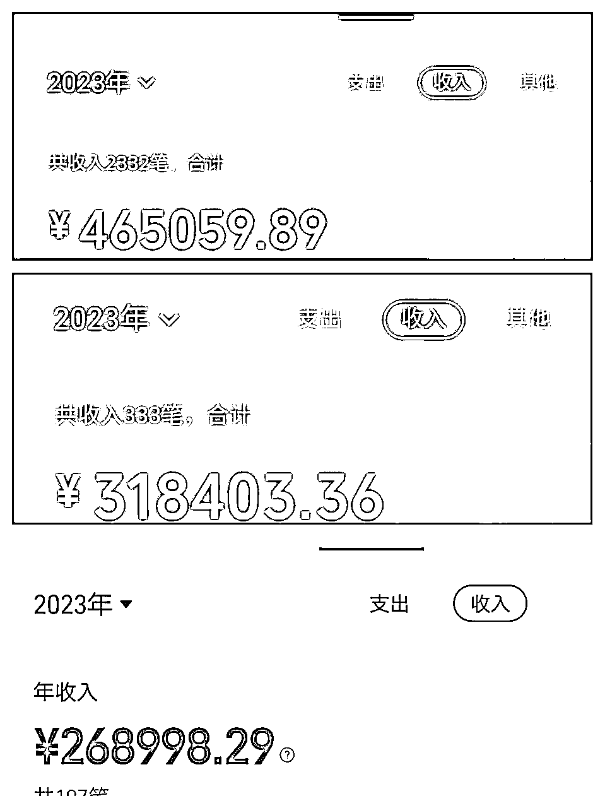
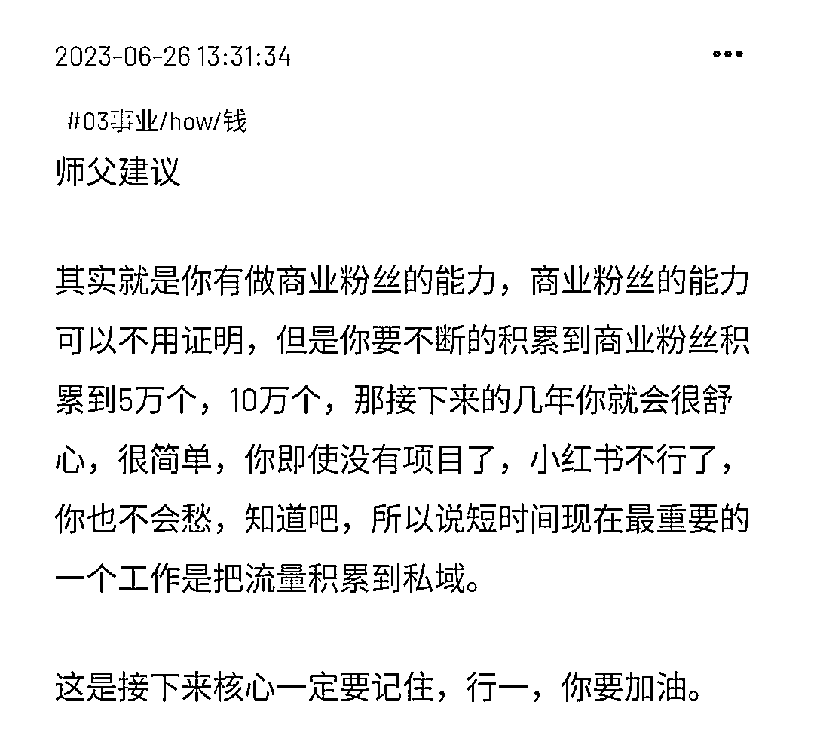
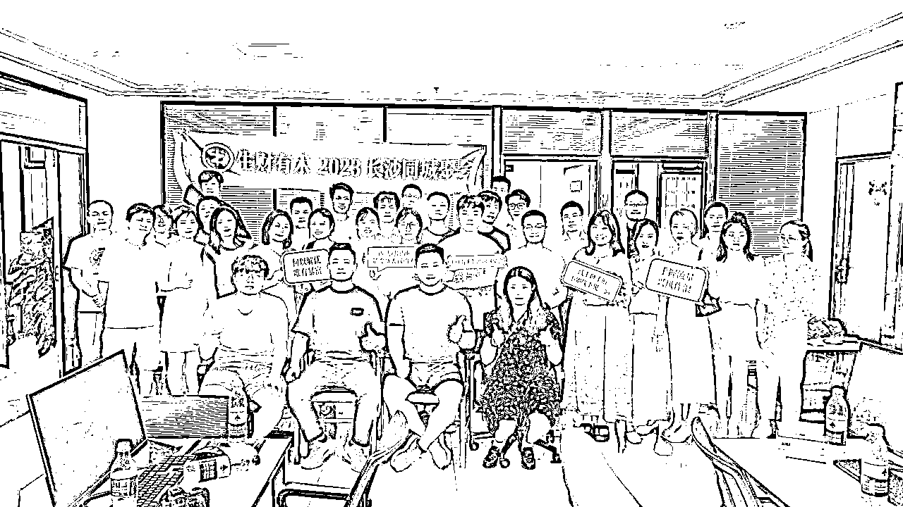
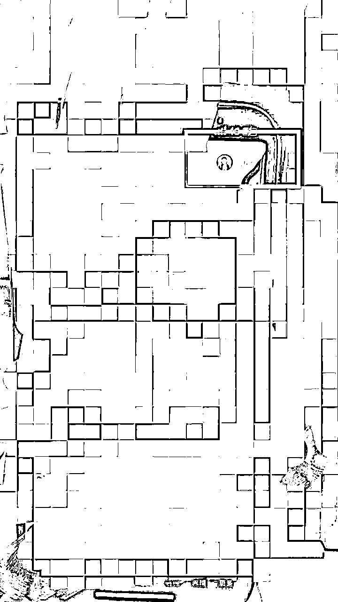
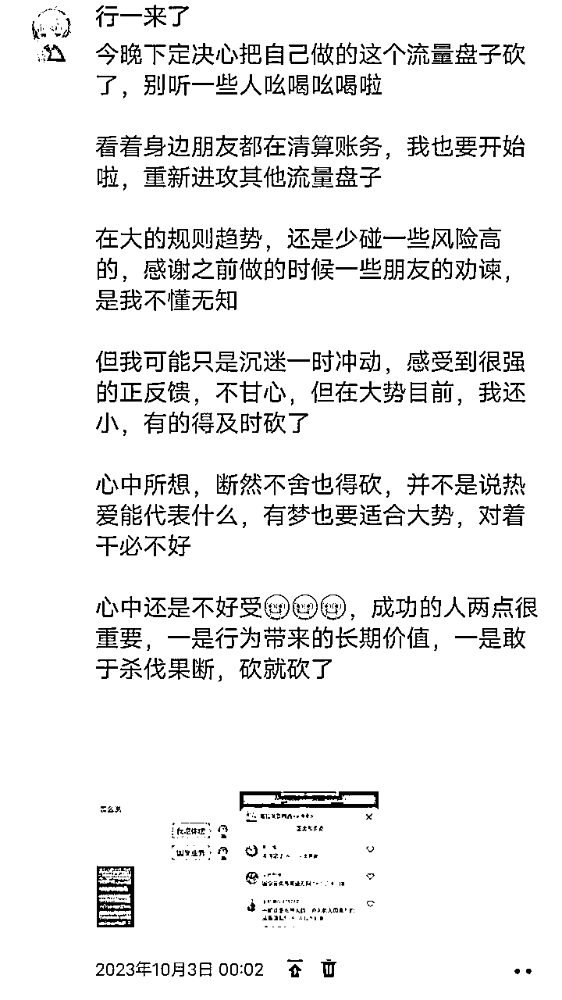
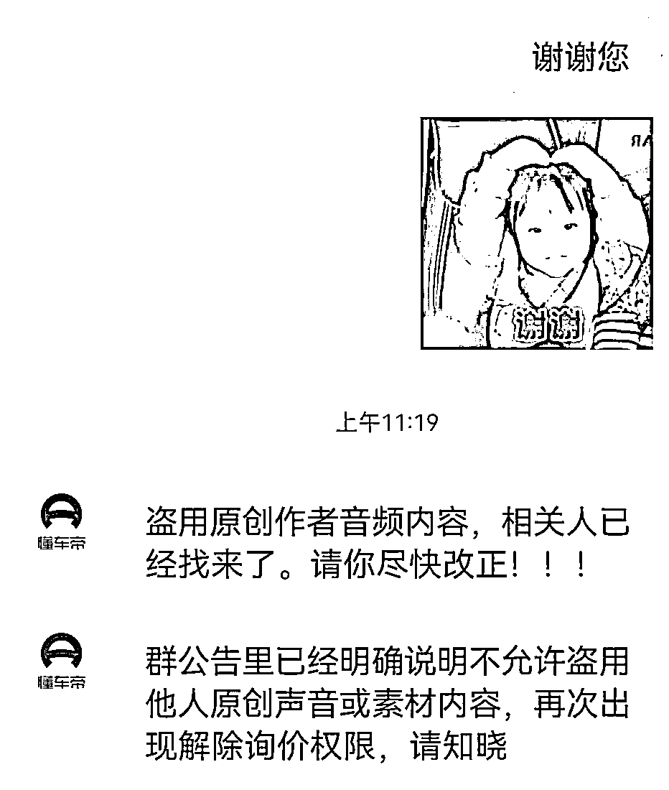
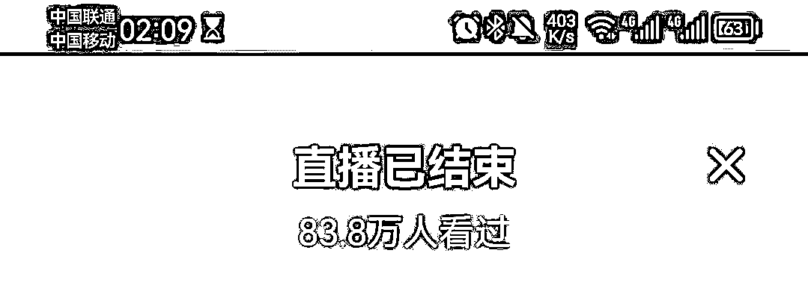
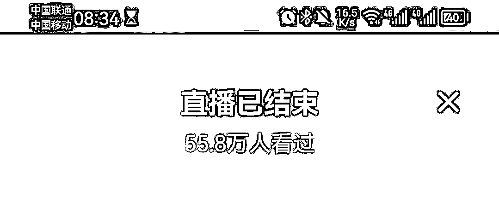
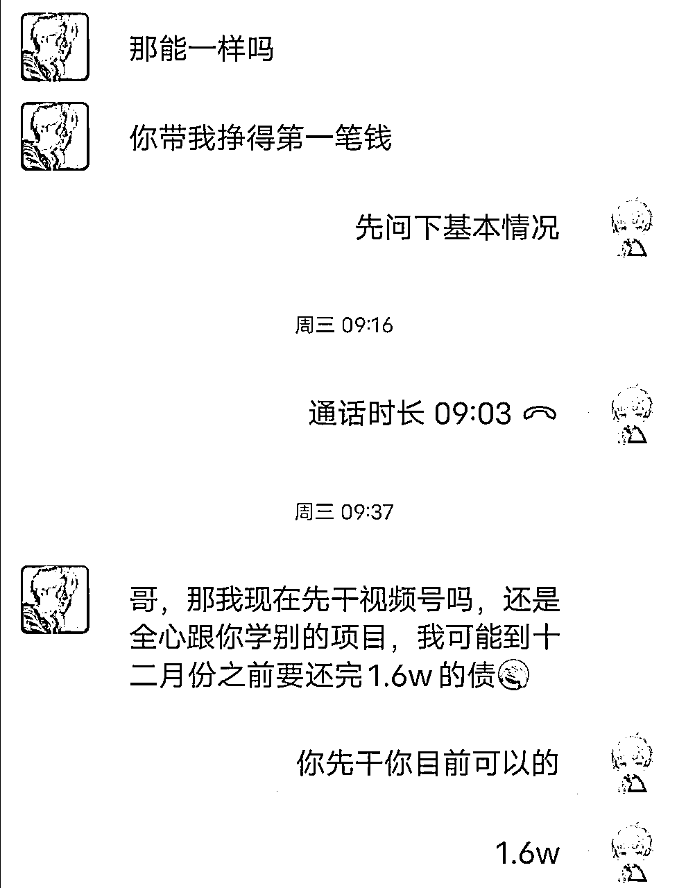
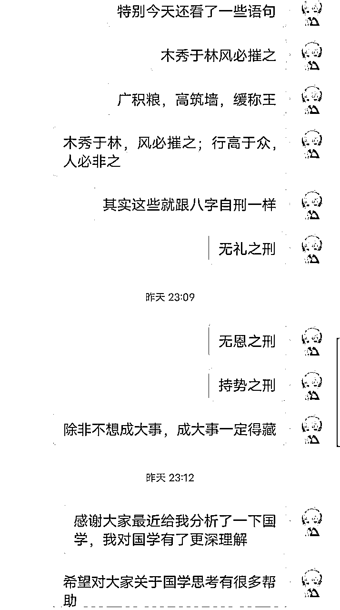

# 那位大学赚了百万男孩最近三个月复盘

大学赚到100万的男孩，最近三个月回望：踩了些坑，帮了些人，也悟了些事。

星球的朋友们，好久不见，我是龙哥。一个大学期间靠📕电商赚到人生第一个100万的连续创业者，现在手里有一家流量公司和一家电商工作室。

经常有人问我📕电商还能不能做，我的答案一如既往：能。在我眼里，不存在做不起来的项目，只存在做得比我好的同行，所以跟着学就对了。这个项目从最开始的搬运，到现在的实拍高客单价，再从无货源走到中转仓，解决了不少问题，每一环都在迭代，已经成了我的基本盘。

在东北，我就是靠它翻的身。这一步要感谢@阿成，我们还没进赚钱时就是朋友，他是一线实干家，一直在迭代，我也跟着迭代，才让📕电商成了我的基本盘。我一直鼓励他多出来分享，这样的人不该被埋没。这三个月，我对创业的理解又深了一层。

风口当然要追，但说真的，比起追风口，我更想持续搞流量、囤积私域，让高质量用户沉淀下来。下面分三块聊：踩过的坑、帮过的人、以及新的感悟。

先聊坑。决定去长沙开流量公司之前，我专门问过师父，把计划全讲给他听。师父只说了一句：行一，你要是持续积累私域，以后的日子会很好过；但如果一直做项目……

话没说完，但我听明白了。可我还是带着几个好朋友去了长沙，一起做了流量公司。调研各种流量渠道的时候，我们先把后端要求定死：客单价要高、利润要高、复购要高，而且必须落到自己的私域里。

第一个坑，知识付费流量。我们从项目拆解做到直播引流，整个链路都跑通了，每天能引进300多个创业粉。可惜粉丝质量不算高，转化很惨。当时参考了同行的后端，跟着做了一个社群，结果越做越乱。手里攒了5000个创业粉，却变不了现，算上公司成本，整体还是亏损。流量变不了现，跟废铁没有区别。

我为什么跑项目跑得这么快？说白了，我眼里没有“同行”，只有“师”和“友”，本质是价值交换。你说你的玩法，我聊我的思路，大家一起赢。我跑了三年项目，习惯先拆底层逻辑加方法论，然后快速模仿，跑通了就复制放大。但我不会一直留在一个项目里，风口冲完之后，我更想要一个稳定的基本盘，基本盘稳了才敢去投新东西。

有人跟我说，这个年纪赚到百万，该满足了。我是知足的，但不想停在原地，还是想往更大的体量走。年轻就应该多闯，不折腾就不知道自己缺什么，也不会成长。很感谢赚钱这个圈子，我来长沙没多久就当了见面会嘉宾，分享白手起家做到百万体量的经历。别人说我悟性高，那我就认吧，其实我是跟在各位大佬后面偷学的。

第二个坑，从知识付费流量切国学流量。四月份我就和长沙合伙人线上合作过国学，后来抖音图文矩阵不能玩了，就停了。到了长沙之后，一个朋友过来看我，聊天时说起国学很暴利，我们才正式转型。测试阶段用的是最简单的直播引流，一天能搞到500多个流量，这全靠朋友公司的技术扶持。国学流量确实猛，再加上📕无IP图文矩阵，我慢慢在国学圈里混出点名声，还圈了自己的国学社群。

从引流到后端转化，全是一步步试出来的，花了不少心血。项目不赚钱的时候倒是没事，赚钱之后反而出问题：合伙人闹分歧。说起来，我在大学创业时就被合伙人私下搞过小动作，这次居然又重演。四个合伙人，两个要扩张，两个想散伙。这个项目是我用自己关系带进来的，还被人画过大饼，是我疏忽了，别人学完技术就想走，第二次看错了人。后来，我换成跟好朋友合伙，才把国学盘子快速放大，稳住了长沙公司基本盘，月利润做到六位数以上。

做国学的过程中，很多哥哥姐姐会跟我讲其中的利弊，但我心里有个“传播国学文化”的梦，就一直做，直到最近才彻底停掉，国学粉也转成其他粉去销售。不做了，不代表项目不行，而是有一些特殊情况。加上身边人都劝我别碰那个风险，我最后决定砍掉。

第三个坑，国学直播转型抖音小程序CPS。我是那种不肯轻易放弃的人。国学盘子稳定以后，我们开会就讨论过它的利和弊，最大的弊就是法律风险，投产比不划算。我和合伙人都有自己的基本盘：我是📕电商，他是抖音直播。两个人都是大学创业，都是坐在后排看数据的那种人。这也是我敢独自去长沙的原因，东北那边直接交给合伙人管，自己少分点。有基本盘在，才敢瞎折腾。人不折腾就不会失败，前提是有做项目和带团队的底层能力。

这个项目又是朋友告诉我的。他给我发来一个直播间，我起初没在意，研究后发现早期玩法就是底下挂懂车帝小程序，直播逻辑和国学引流差不多。后来官方一直给我发信息，让我很不爽，加上不想让后端被别人控制，公司干脆自己招技术开发了专属小程序。

我是什么都愿意弄脏手的人，从图文到短视频，再到直播，一路就是这么走过来的。至于为什么会有这么多朋友愿意拉我，下面讲。

接下来聊帮过的人。这些事让我找到了自己的天赋。

第一个，做了第一个公益项目。创业IP一周年时，我发起了一个免费带人做互联网项目的公益活动，七月份启动，收到很多反馈。能实实在在帮到别人，那种开心很难形容。

第二个，帮一个高中生赚到了第一桶金。一开始我真不想带他，只想让他好好学习。他把所有钱都押在我这里，只给自己留了生活费。我被感动了，就带着他做。直到前天，我才知道他是为了给住院的母亲还债，才想赚钱。那一刻心里很不是滋味，学了国学之后，我更加明白帮助别人有多重要。

但行好事，莫问前程。

第三个，给会员做一对一咨询。我自己是从零起步，一点一点做到10，再做到100的，目前只做这些方面的咨询。帮别人做咨询的时候，对方给我的反馈让我发现了自己的天赋：用我的思考去帮别人分析现状，再告诉他接下来怎么走。那种发自内心的感激，是我继续做IP的最大动力。

最后聊一聊创业的新感悟。

第一，人比项目更重要。要想清楚自己是什么样的人、适合做什么事；然后看自己跟的是谁，他能给你什么价值；最后看自己带的是谁，他是不是愿意给反馈。

第二，创业玩到最后，拼的是资金和资源。一个好项目出现了，有没有人愿意投你，你需要的资源能不能搞到手。

第三，钱来人来，财散人聚。我以前带团队格局不够大，后面的盘子里一定会改。一个人的力量太弱，要敢于分钱、敢于分红。风口真正来的时候，身边要有一群愿意跟你的人，而不是临时去BOSS上招人，那样根本没办法快速占领市场，关键是要养精蓄锐。

第四，创业没有同行，只有师和友。任何一个成为你同行的人，都有他厉害的地方。我遇到做得好的同行，会主动私聊加🛰️，真诚去链接。发个小红包请对方喝杯奶茶，再聊聊彼此的项目。我是主动的一方，所以会先把自己的经验分享出来。我从不担心对方没有干货，能成为朋友是最重要的，处得深了，自然就是领域里的高手。我把一些朋友推进赚钱，也是用这种方式帮他们，他们跟我并不在同一个圈子。现在很多项目做得好的朋友，都是这样交下来的，只要对方帮过我，我一定让这份帮助变得很值。

第五，木秀于林，风必摧之；行高于众，人必非之。我跟一些大佬交流后，越来越觉得国学重要。我跟着自己的国学师傅学了很多，现在也会用国学文化去选人、去管理公司，尽量少走弯路。

我确实运气好，赶上了项目风口，才吃到红利。之前也飘过，年纪小的时候控制不住自己，这也是我学国学的原因之一。现在笔记本前面就写着这句话：一定要低调。

接下来的日子，我还是会继续跟在各位大佬后面学习，多研究项目玩法，把流量盘子稳住。如果你看到这篇文章觉得有收获，不妨支持一下行一。写这篇复盘，既是给圈友分享经验，也是提醒自己：记住教训，低调做事，继续前行。希望大家一起龙哥盟。