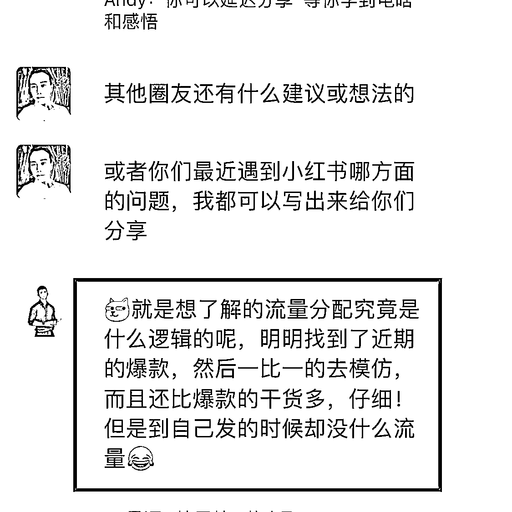
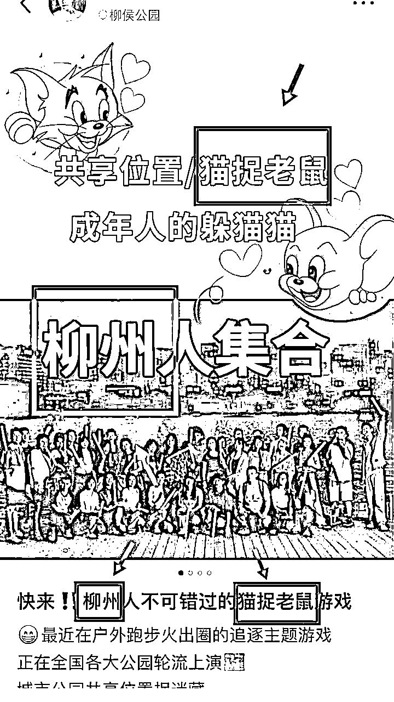
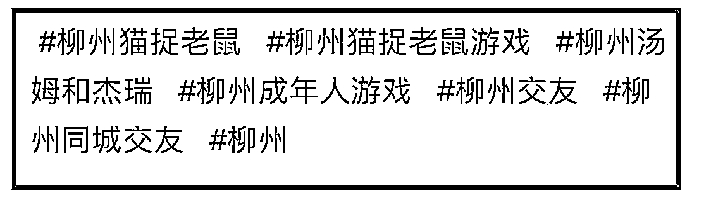
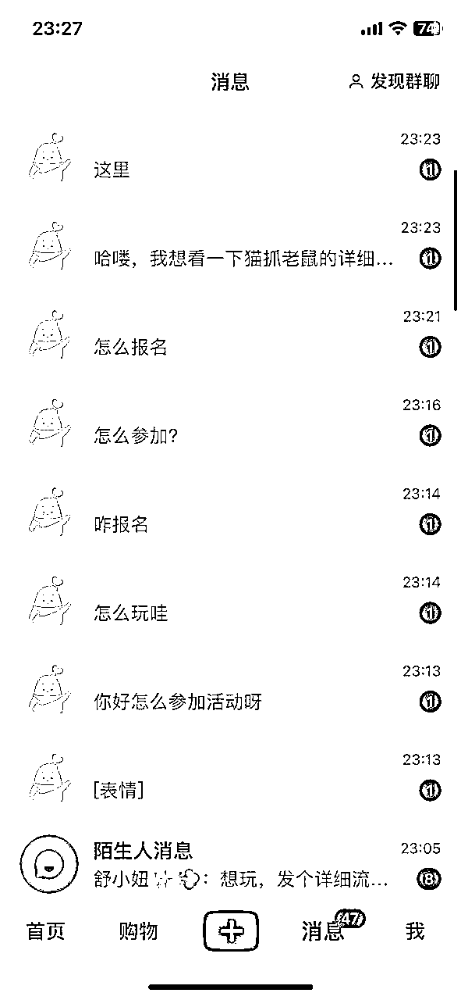

# 📕流量不是玄学：那套底层算法逻辑，我帮你拆解透了
作者：龙哥

大家好，我是龙哥，这几年一直在研究📕引流。

今天想认真聊一个很多运营人都卡住的问题：平台到底凭什么给你推流量？

之前有位圈友专门来问我这个问题。  大概意思就是：搞不懂📕的推荐机制是怎么回事，也不清楚影响流量分配的关键变量到底有哪些。

说实话，很多人做📕做到现在，依然处于“给我流量就开心，不给就叹气”的状态，总觉得流量这东西全靠命。我以前也这么想过。直到我把平台的逻辑摸明白了，才意识到：所谓玄学，其实只是一套还没被你看懂的规则。只要搞懂它，做出爆款会容易很多。

下面我用自己实操过程中的经验，把“笔记能不能得到更多流量”这件事，从头到尾讲清楚。

## 一、📕流量的大盘子，先分两类

📕给笔记的流量，大概可以分成两大部分：一个是推荐流量，另一个是搜索流量。这两者加起来，差不多占到了整体流量的90%。后面还有一类付费流量，我会单独说。

## 二、推荐流量：算法凭什么推你？

推荐流量的核心，说穿了一句话：内容本身够好，平台才愿意让更多人看到。

但问题是，📕每天新增那么多笔记，不可能靠着人工一条条去审核，成本太高，也根本实现不了。所以，平台内置了一整套算法逻辑，来筛选哪些内容更受用户喜欢。

什么是“好内容”？

我的总结是：让用户愿意在你的笔记上留下痕迹。

说白了，用户在你这篇笔记上点的每一个赞、留的每一句话、转的每一次发，都会成为算法评定你内容质量的“证据”。只要你的互动数据达标，系统就会把你的笔记推到更大的流量池里；反过来，数据不好，曝光可能就到此为止。

📕内部有个评分模型，叫作 CES，对应关系大致是这样的：

点赞计1分、收藏计1分、评论计4分、转发计4分、关注计8分，加总后就是这篇笔记的内部评分。

简单解释一下：用户每产生一个互动，系统就会按这个规则给笔记加分。分数越高，系统给的流量越多；分数越低，流量萎缩得越快。

举个例子。假设系统先给了100个初始流量，其中有2个人点赞，系统加2分；有2个人评论，系统加8分；还有1个人点了关注，系统加8分。最后你得到的分数就是2+8+8=18分。

拿到这个分数之后，笔记会跟同一类目、同一时间段发布的其他笔记一起去“赛马”，谁的分数高，谁就能得到平台加推；谁分数低，流量就会停在原地。

你发现没有：关注的分值最高，其次才是评论和转发，点赞和收藏其实权重相对较低。

所以我一直跟大家说，做📕不要太执着于点赞和收藏，真正值得盯着的是评论。

为什么？因为一个评论就能抵4个赞，一个关注就能抵8个收藏。你要做的是去争取高分动作，而不是守着低分动作。

想让笔记获得更多推荐，正确路径是：去写那些有争议、有共鸣、让用户看了愿意说点什么的内容。别人愿不愿意开口，才是决定你笔记能不能被持续推荐的关键。

所以我现在操作📕的时候，连“小眼睛”数据都不怎么看，重点只看一件事：评论区里到底有多少人留下了真话。

## 三、搜索流量：📕已经是很多人的“小百度”

很多人可能没有意识到，现在大家遇到问题，已经习惯打开📕直接搜。

想买口红，去📕搜一搜；想去香港旅游，去📕搜一搜；想了解升职加薪的方法，去📕搜一搜。

这就导致搜索流量在📕里的占比高得惊人，几乎可以和推荐流量平起平坐，两者加起来占到大约90%。这个数字听起来有点夸张，但确实是现实。

所以，想让笔记获得更多流量，搜索流量这块一定不能忽略。

搜索流量的做法，一句话总结：把你产品的核心关键词，埋在封面图、内页图、标题、正文和标签里。关键词出现得越充分，系统给你的搜索权重可能就越高，等到用户搜索相关词时，排在前面的就会是你的笔记。

举一个我自己的例子。

上周我在实操“柳州猫捉老鼠”这个项目时，就是用了这种搜索玩法。当时我先提炼出了两个核心关键词：一个是“柳州”，一个是“猫捉老鼠”。关键词定好之后，我就在📕上全面布局，图片也好、文案也好，全部围绕它们来展开。   

你看，只要用户搜索“柳州猫捉老鼠”，排在前面的基本上都是我发的笔记。

这也解释了为什么当时我能在两个小时以内，不投一分钱流量，就把笔记直接引爆。关键词布局，是非常关键的一个因素。

而笔记本身又吸引了足够多的人来评论区互动，评论数量越多，笔记被系统推向的层级就越高，流量就会像滚雪球一样涌过来。 

所以，认真重视搜索流量吧：先提炼出你的产品核心关键词，接着在图片和文案里面反复露脸，等系统成功收录之后，接下来要做的，就是让流量自己来找你。

## 四、付费流量：可以说是“保护费”，但代价也不小

付费流量这块，我自己其实不算特别精通，因为我一直以自然流为主。但身边很多朋友会跟我聊到这里面的细节，所以也简单说说。

付费流量最大的好处，在于你像是给平台交了“保护费”，账号在很多规则上会宽松一些。

比如，没有付过费的笔记，不能明目张胆地引流；但付费笔记可以。再比如，普通账号发商业内容容易被限流；付费账号发，通常问题不大。

但它也有很明显的劣势：一旦你开始跑付费流量，自然流量就会明显受影响。相当于你选择了付费流，就等于和自然流渐行渐远了。

另外，付费不代表“无敌”。哪怕你是付费账号，如果触碰到平台底线，或者恶意、批量地去导流，照样会被限流甚至处理。

这些只是我根据平时交流得到的一些理解，不一定完全正确，大家参考一下就好。

## 五、一篇笔记从发布到推爆，到底经历了什么？

聊完流量结构，我们再模拟一下：正常情况下，一篇笔记发出去之后，平台是怎么一步步给你分配的。

还是拿“柳州猫捉老鼠”这个案例来说。

当时我发了一篇笔记，目的是把喜欢玩这个游戏的人引流到🛰️，成交之后再继续跟进。

刚发出去那会儿，笔记是没有流量的。为什么？因为在最初的5分钟里，平台会先给笔记做一次扫描，看看有没有违禁词，有没有平台不允许出现的内容。

如果扫描通过，笔记就会被正常收录到系统里。如果有违规内容，那直接被限流。这时候你去看笔记的小眼睛数，往往不超过8。

收录之后，平台会在5分钟内，给你推送第一波基础流量。

这波流量是多少呢？大概是100到200之间。只要账号正常，基本都能拿到这个初始流量。但如果有过多次违规记录，可能连基础流量都没有。

接下来，大概10分钟后，平台开始统计这波用户里的互动情况：多少人了点赞、多少人了评论、多少人点了关注。

然后，系统会在30分钟内给出一个整体分数，再拿着这个分数，去和同类目同时段的笔记做赛马对比。优胜劣汰，分数高者继续获得流量加成。

我当时因为提前在内容里埋好了钩子，所以评论区很快出现了“怎么玩”“怎么报名”“我要玩”之类的留言。十几个评论积累起来，笔记权重越来越高。

果然，又过了30分钟，陆陆续续有更多人进来评论。

我再用小号去搜“柳州猫捉老鼠”这个关键词，发现排在第一的，就是我的笔记。

我当时心里差不多就有底了：这事能成。

后面的事情其实很简单：我持续在评论区做互动，把感兴趣的人引导到私信；同时在下一条笔记里，继续布局了更多关键词。

你会发现，搜索流量把精准用户带进来，用户互动又会带来推荐流量；推荐流量扩大后，又会让更多人搜到你。两个渠道互相成就，一环扣一环，环环相扣。

而这，也正是📕的流量底层逻辑：把关键词布好，让用户愿意互动，再靠数据表现去撬动更大的流量池。

想明白这一点，你再去看平台为什么推你、为什么限流，心里就再也不玄学了。

希望这篇拆解，能帮你在做内容的路上，离篇篇爆款更近一步。共勉。