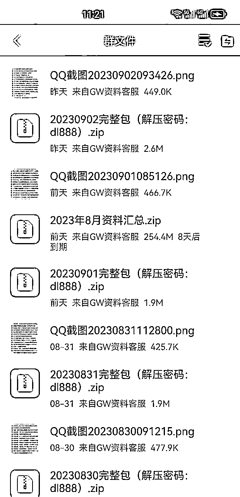
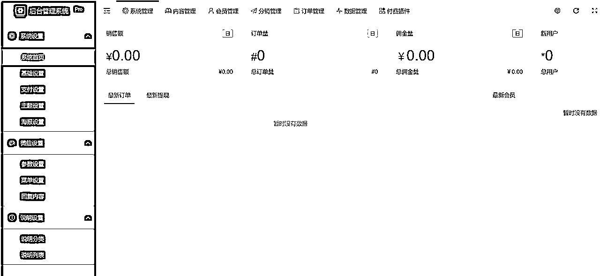
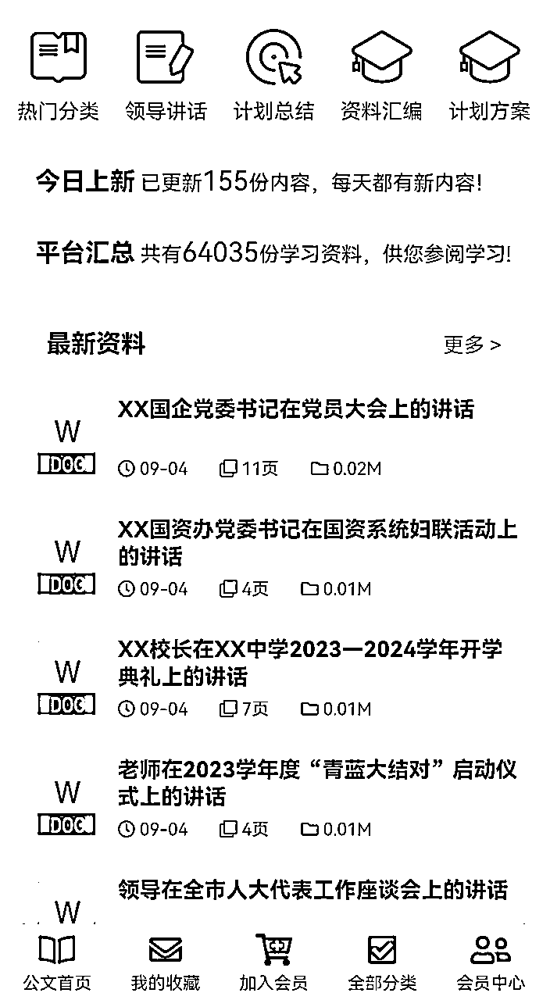
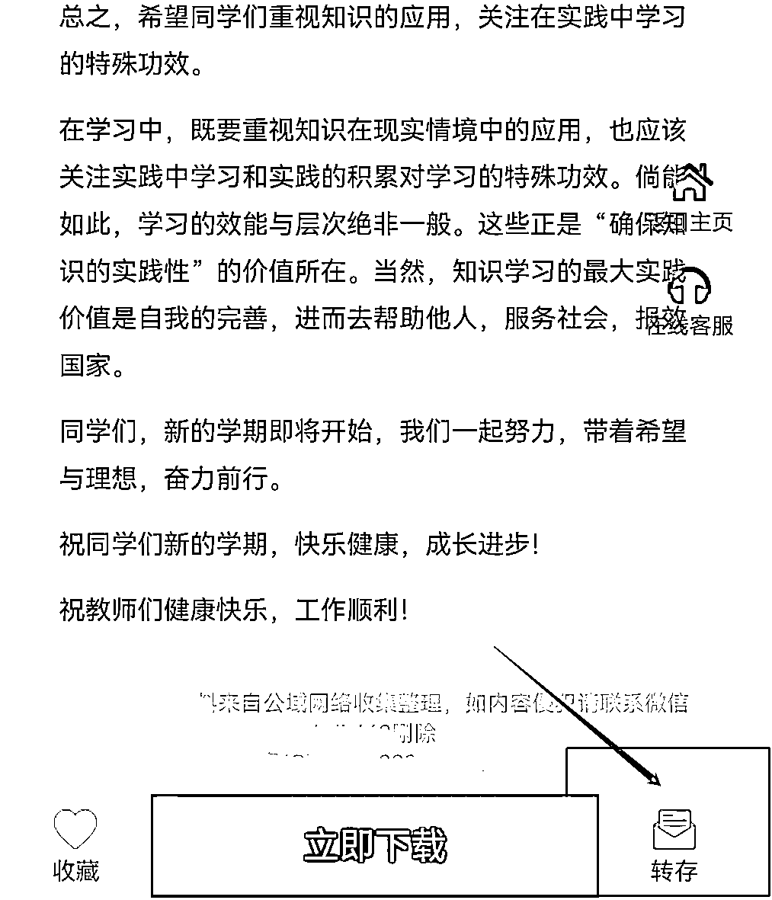
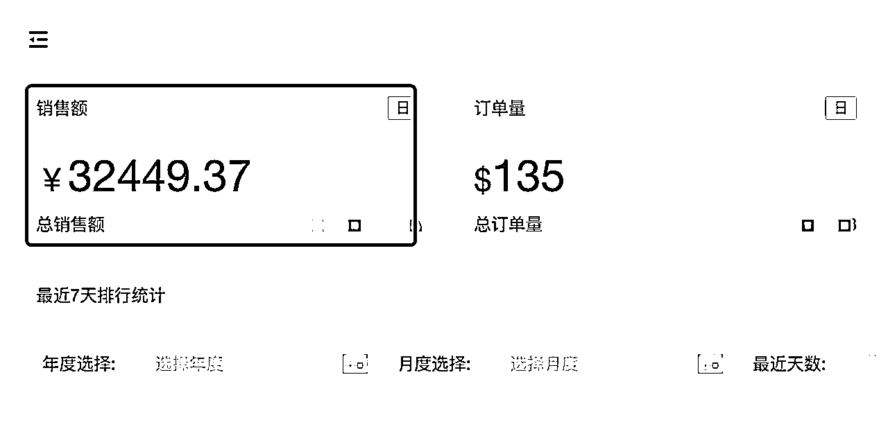
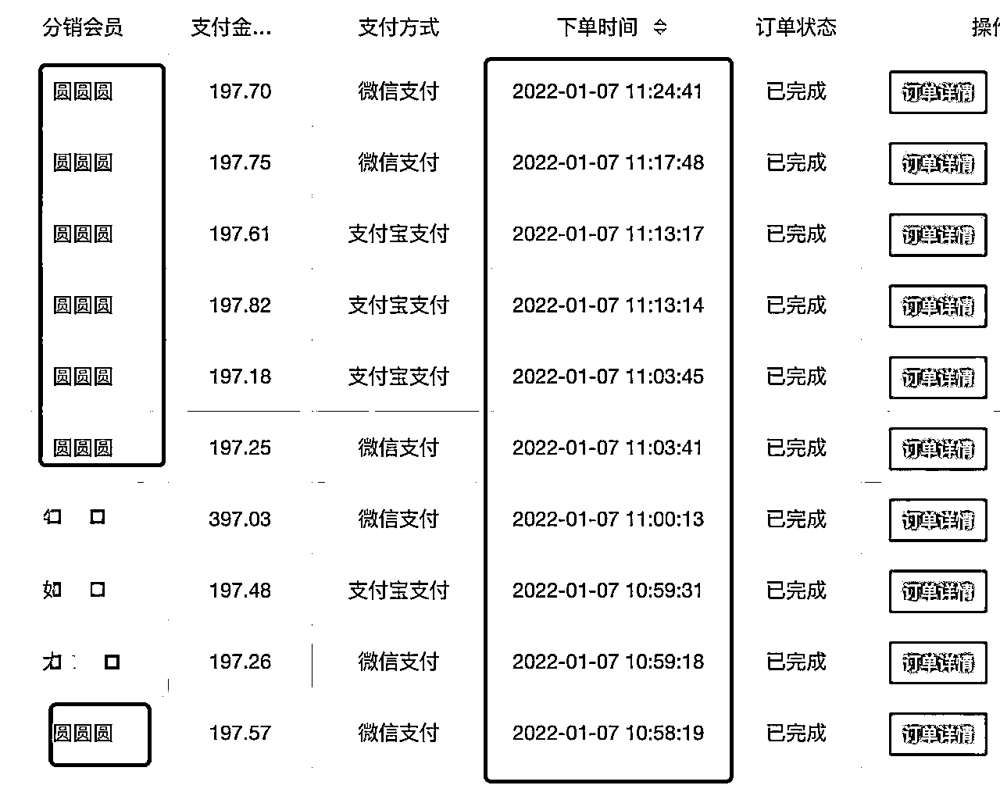
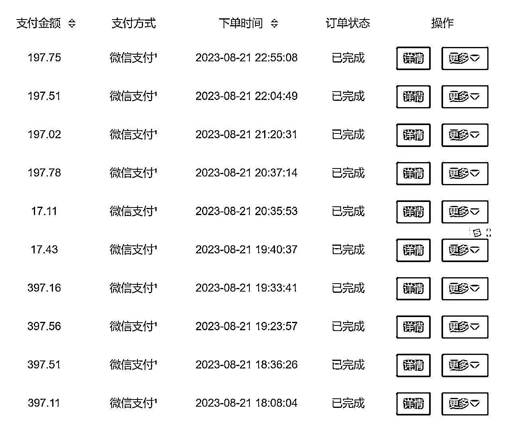
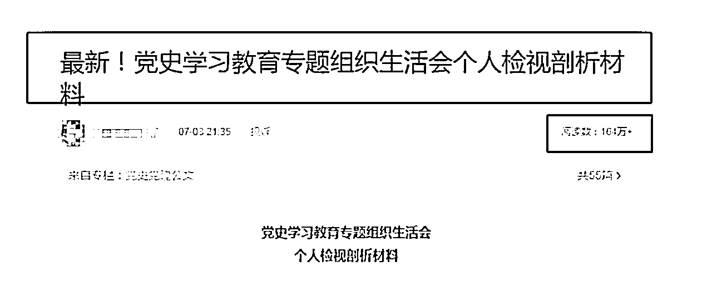
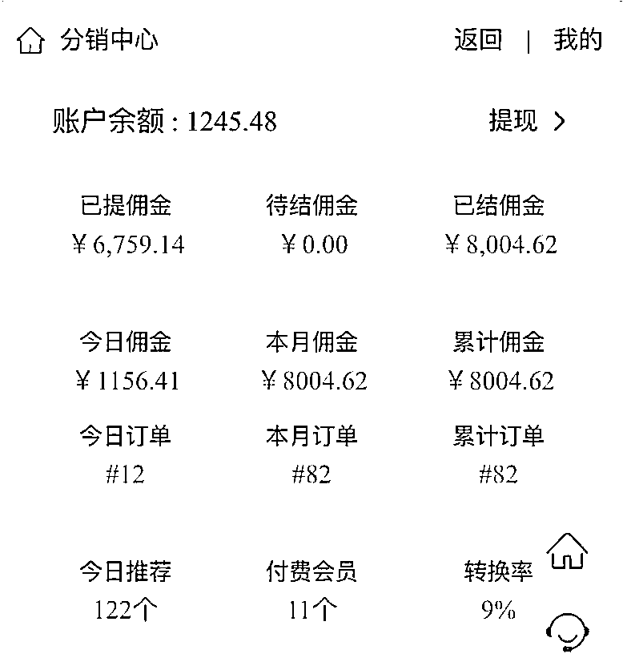
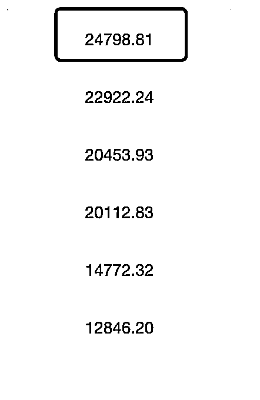

# 从一个老乡闲聊开始，我做公务员资料项目两年出十万单的实操复盘

> 来源：[https://gzwzdskj.feishu.cn/docx/CxSDdrFKKoageExi3BwcIvq4nhb](https://gzwzdskj.feishu.cn/docx/CxSDdrFKKoageExi3BwcIvq4nhb)

生财的伙伴们好，我是郭耀天，外号郭少。入圈五年，这两年重心都在虚拟资源上，在生财上分享得很少。

结合生财学到的打法和项目特性，我把手上的公务员资料项目做通了。2021年至今，靠这个项目累计出了十万单，客单价198元和398元，带着身边一批人一起赚钱。今天把整个操盘思路摊开讲清楚。公务员资料这个赛道很稳，唯一的变数是平台对引流的封控越来越严。我把玩法全拆出来，供大家学习项目逻辑。

2021年6月我开始动这个项目，到现在已稳定跑了两年多，单日最高成交20万。只要有资源、肯钻研，这个细分赛道是典型的长线稳定型项目，玩法也很多样。

# 一、项目是怎么被发现的

## 1.项目起源

从创业到现在我一直在做项目。2021年某天和老乡聊天，他提了一嘴自己在给上岸的体制内人员提供参考资料。我对这一块不熟，老乡媳妇就在政府单位上班，平时常写心得体会、各类报告。

我去某宝买了一份别人打包的资料，大几十块。随后在抖音上把资料拆着发，结果咨询的人不少，引流到微信后直接99元成交。老乡当时在家带娃，他媳妇说这个可以做。我起初没放在心上，后来手上没活就跟着试了一下，立马就出单了。

和他聊下来才知道，他用的是自然流量，资料放在QQ群里，微信私域收钱。单日峰值能到30单，99元一单，一天近3000块，相当于别人一个月工资。他靠这个玩法已经赚了十多万。看到这个模式我瞬间明白了，这和我以前操作的虚拟项目本质上是一样的。

## 2.挖掘真实痛点

老乡能出单，但他本身不是公务员圈子的人。我就开始深挖需求。

研究后发现，很多在编人员其实很懒，也不会写。每逢要交材料时，就在网上找同类型的范文来借鉴。关键是这些资料基本都是内部流转，不对外公开，甚至直接抄。需求一目了然，市场很大。

再往下挖，发现真正需要的是体制内在职人群：公务员、事业单位、协会、国企、党员。他们对标准化公文的需求极高。项目早期叫公文项目，后来因为平台打击才统一对外说成公务员项目。这里说的公务员不是考上的，而是已经上岸在岗的。

## 3.市场验证

为了确认，我专门问了几个体制内朋友，平时资料都是怎么来的。大部分人说一部分自己写，大部分网上找。有人告诉我十年前就开始在网上找资料了，还办了某个平台的终身会员，花了好几百。也有人通过某宝找人代下，看到需求点就直接下单。

了解到这里，我花了几天时间刷各大平台，搜公文、公文写作等关键词。发现市面上不少人在做，变现模式主要是卖年费会员、单篇售卖，价格几十到几百不等，均价在100左右。我调研了几十家网站，发现做公众号生态的很少，大多数靠站群和百度SEO。公众号霸屏、文章霸屏的也有。我恰好对公众号玩法熟，上一个项目就是靠公众号起来的，而且这个需求圈基本是体制内人自己在做，外行很少进来。

确认需求后，我决定入场。

# 二、从手工到系统，不断迭代

## 1.搭建自动化系统

项目需求验证后，发现QQ群操作有三大问题：管理难、客户不希望被公开知道自己在抄、客服工作量大回复不及时容易被投诉。因为引流方式都是在网上留微信号，导致微信号频繁被封。

结合之前做虚拟资源的经验，我决定做成系统化自动成交。找了一个市面上用户体验最好的系统作为参考，让技术照着开发并优化，重点加入了裂变分销。我算是把裂变分销带进这个项目的第一批人。

最终方案是：做一个虚拟资源系统，销售年费会员、三年会员和单篇资料。上线内测。

这样公务员项目1.0就完成了。一上线就有不错的反馈。当时系统支持单篇购买，一天能出几百单，但基本都是9.9元的单篇。体制内客户大多是找某篇最新资料，找到就够了，看起来单量很大，利润很薄。

内测第一天就做到几千收入。那段时间各大平台对这类内容管控不严，可以直接带广告倒流。尤其是微博，很多人已经忘了这个平台，我们前期的70%订单都来自微博。从QQ群转到系统后，客服量大幅下降，不需要一对一沟通，转化率反而提升了。系统搜索体验好，我们边跑边优化边打磨。

## 2.关键迭代点

为了让用户方便收藏下载，我们加了邮箱转存功能。体制内很多人常用邮箱，内容又不方便发到社交平台，这个功能上线后用户反馈非常好。再后来接入第三方预览，访问体验大幅提升，成交直接拉升。

最关键的一步是把单篇购买关掉了。单篇虽然出单快，但利润低，而且买了单篇的人基本不会再开会员。关闭单篇后，整体订单数下降，但开会员的数量明显上升，客单和利润都上来了。因为用户要的内容无法单独买，只能办会员。

老乡也自己搭了一个系统，团队这边也搭了一个。老乡从日收入3000暴涨到日收入3万多。以他的体量来说，单日最高能做到3万多。资料都是全网搜集整理，推广全靠他自己，利润基本全归他。

## 3.内容处理与合规

做虚拟资源最怕内容问题。公文类资料里经常带领导人姓名、地名、机构名称，我们在编辑环节全部做了脱敏处理，只保留某某。

前期内容比较粗放，到处拼凑。后来我们建立了内容采集机制，和体制内朋友沟通当下最需要的、最近最火的主题就优先上架。同时也会购买同行内容下来整理上传。

有人担心版权。其实这类内部资料基本不会去登记版权，所以版权风险极低。之所以网上资料泛滥，就是因为需求大，使用的人多会把自己写的分享出来，也有一些体制内出来的作者专门做原创资料包卖会员费。

最终我们的内容来源是三部分：同行整理、二手会员供稿、合作方提供。好的资料我们会花钱买。

# 三、推广打法

推广的核心就一句话：把系统里的内容复制出来，发到全网。

把内容做成图文、图片或短视频，发一半留一半。懂的人自然会来找你补全内容，直接倒流到公众号。公众号对接自动成交系统，用户搜索关键词，看到需要付费，198元买一年，很多人直接就付了。

整体转化率在10%左右，做得好的能到15%-20%，差一点的也能有5%，在项目里算很高了。

承接流量的载体是公众号，成交靠自动系统。抖音、快手、小红书、视频号、知乎都是我们的常规阵地。但真正最猛的是很多人忽视的微博。我们用黄V、蓝V账号直接推，微博当时可以明着带广告。

我老乡有一篇文章阅读量200万，当时全国都在写这个材料，百度搜索第一名。那篇500字不到的内容，直接给他带来50万营收。

最疯的时候，微博搜关键词，基本全是我们圈子的人在霸屏。账号名称五花八门，内容高度相似，就是批量复制粘贴。每天就是复制粘贴，坐等收钱。推广打法一直在变，但核心逻辑没变：搜各大平台关键词，看别人怎么发，一比一复制就行。

# 四、裂变与放量

## 1.卖项目

项目跑通后，光靠团队做不了大盘。所以我们开始对外售卖项目。提供全套教程和最高50%佣金的推广权限，你什么都不用做，照着教程发就行。

前后招募了500人左右，实际能出单的占比约60%。玩法就是复制粘贴，执行力强的人一个月能做十几万，普通人几千到上万。只要执行到位，都能赚到钱。

## 2.加盟招商

项目收费后，大家都知道玩法了。做系统也不难，所以我们直接启动招商加盟。前后加盟60人左右，现在还在坚持的约30人。两年下来，营收破百万的加盟商有七八个。很多加盟商都是从分销里出来的，跟着我们把流程跑通后，一个月能做几万，自己去搭系统能赚更多。

我们的系统是SaaS化，一键复制、一键更新内容。内容可以自己上传，也可以同步我们的库，同步需要付服务费。最高单日出单的加盟商能做到6万左右。尤其是年前一个月，是项目的高峰期，一个月量能顶前面几个月总和。牛的加盟商一个月能做上百万。

# 五、私域的高利润玩法

公务员项目还有一个更赚钱但不便公开的玩法：私域定制。给那些不想自己找资料的人做整理、定制资料。根据需求定制专属材料。

这个玩法我只简单说，感兴趣的可以私下交流。需求量非常大。实测有人一年在资料上花费几万。2000个精准粉丝，一个月纯利2万左右。我们有个1万人的号，一年私域变现50个左右，比较稳定。如果手里有十来万私域，这个赛道非常香，需求一直都在，值得深挖。

最后多说一句，多参与社群活动，尤其是生财的航海活动，每次都有收获。我把在航海里学到的打法复制到项目上，效果很好。对这个项目感兴趣的，可以留言或加我微信338233一起交流。现在平台打击确实在加剧，但打击越狠，掉队的人越多，市场反而留给真正会做的人更多。