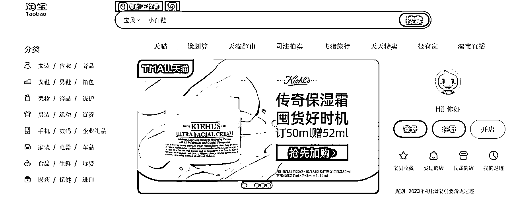
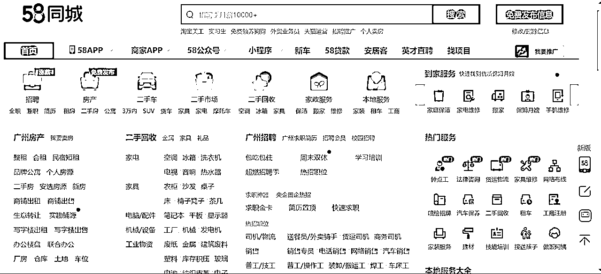
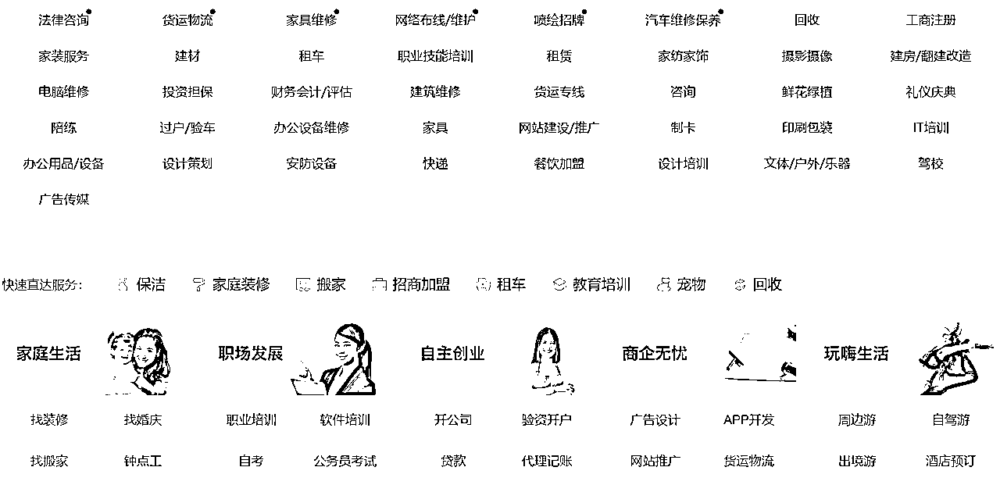
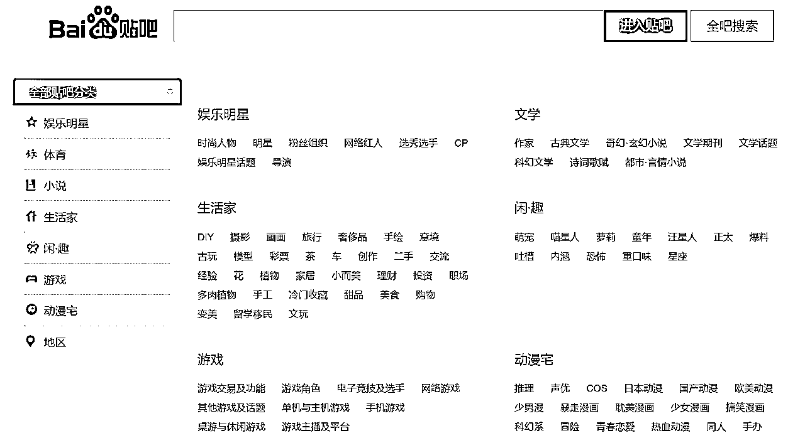
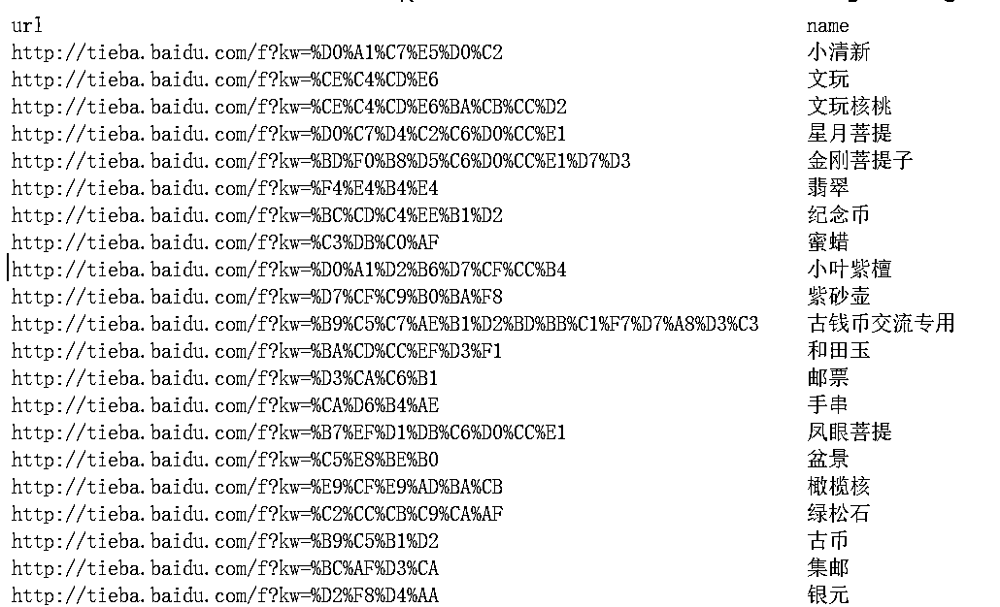
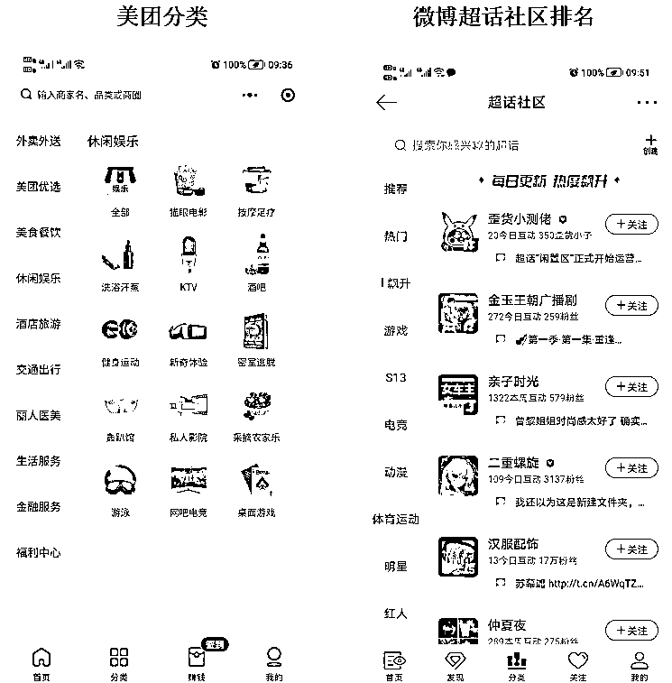
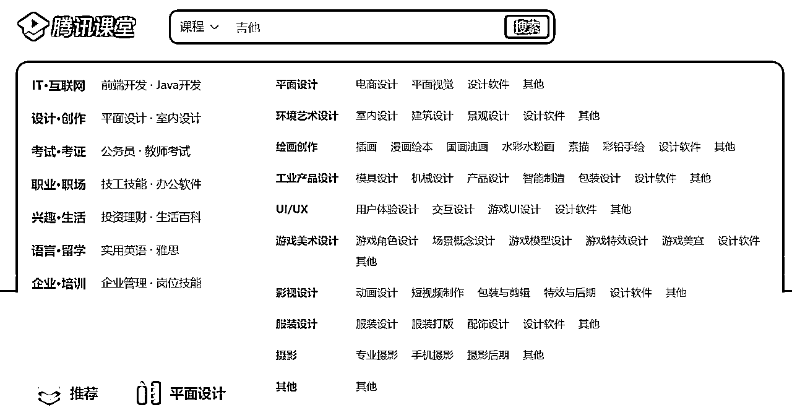
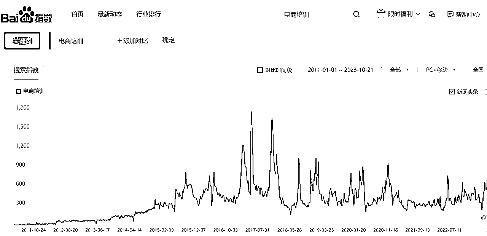
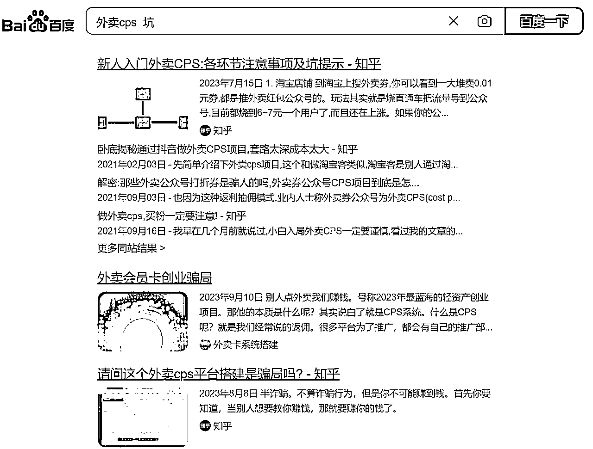

# 每个创业者应具备的思维——选品思维
作者：龙哥

很多人创业失败，不是不够努力，而是从一开始就选错了方向。圈内常说选品占七成、运营占三成，放到创业项目上也一样——同样的执行能力，放在不同的赛道上，结果截然不同。踩中正在上升的赛道，顺势起飞；踏入夕阳行业，再拼也是徒劳。“选择大于努力”这句话，是被无数案例验证过的。

选品方法许多电商前辈都讲过，像是古辛、盗坤、丹牛等人都分享过不少思路。我们不做电商，也可以把这些方法迁移过来。下面就把这套“选品思维”完整拆解一遍。

第一步，找到项目线索。很多人找项目是靠“看别人做什么”，看到谁赚钱了就跟过去，结果自己一做就凉。问题出在视野太窄。电商前辈们的习惯是去平台分类页里找灵感，因为分类页就像一张行业地图，把市面上存在的玩法都摊开给你看。

同理，我们也可以去其他领域的“分类地图”里发现项目。这里分享几个入口：

58同城上的本地服务类目，对应着大量可以落地的项目。不用被它原有的形态限制，套用那句经典的迁移公式——“所有项目都值得用短视频重做一遍、用社群重做一遍、用私域重做一遍”，想一想能不能搬到抖音、📕、🛰️生态里去。

贴吧的分类目录同样是一座金矿，每个吧都对应着一个特定的兴趣圈子，背后都可能藏着一个小众项目。有人扒过60万条贴吧数据，发现了很多从未听过的新奇玩法。

美团的生活服务分类、🧣的超话社区，也都藏着不少项目线索。

教育领域的腾讯课堂，课程分类直接反映需求分布。类似的还有荔枝微课、抖音学浪，都是可以翻看的“行业目录”。

医美、加盟、旅游、珠宝等领域，也都有自己的门户导航站，能筛选出不少细分方向。

不知道怎么找导航站的话，百度搜索“行业 网站”或者“行业 导航网站”就行。

另外淘宝、拼多多、京东等电商平台也值得花时间研究，重点看“异常值”和“排名”。有人就是靠这些数据跨平台搬运虚拟产品，赚了3万块。

项目线索有了之后，第二步是判断需求量级和竞争强度。核心原则是——需求要足够大，同行要足够少。

需求强不强，最直接看搜索量。百度指数、🛰️指数、生意参谋、抖音指数都能用。搜索曲线向上走，说明市场正在扩容；曲线平了，说明基本稳定。

生意参谋可以按月租，几十块钱，非电商人也可以查查看，常有意想不到的发现。

还要看互动数据。比如刷到一个抖音视频，评论区都是追问“怎么加盟”的，那就能判断出需求很旺盛。可以搜索目标关键词，去抖音、快手、📕上看作品表现——如果作品本身很普通，数据却异常亮眼，那往往意味着有金矿。

接下来是筛选环节。把候选项目一个一个过这些标准：

行业是否在上行？尽量选择处于红利期、快速成长的赛道。除了自己的判断，还可以咨询行业内的朋友，搜索指数持续向上也是有力佐证。

赛道天花板多高？看看目前做得最大的玩家规模有多大。如果头部的年收入也就一百来万，新进场的人大概率也就几十万，那这个项目的价值就要重新评估了。除非你只是想拿它当跳板，日后切更大的市场。

客单价怎么看？50元的东西和5000元的东西差了100倍，一笔高客单顶得上一百笔低客单。价格不同玩法也不同：便宜货在平台内就能完成转化；上千元的产品就得一对一沟通，把人引流到🛰️慢慢聊。高价客户关心结果是真是假，要讲清楚用了能达到什么效果；低价客户在意的是价格，要让他觉得捡到了便宜。服务低价客户反而心累。

个人没团队能不能做高客单？也可以。带货领域有很多高毛利、单价几百上千的产品，面向中老年群体效果就不错。或者用中介模式，不自己转化，找机构按CPA结算或者成交返佣。像培训、医美、加盟、定制旅游、翡翠文玩、留学移民、白酒、茶叶、二手车、奢侈品、植发种牙、婚庆摄影、装修、房产中介、大型器械、驾校、情感咨询、金融、落户、代运营，这些赛道都是典型的高客单生意。

目标人群是谁？人群可以按身份、职业、性别、年龄、地域、经济水平、认知层次来切分。不同的群体，付费意愿和付费能力完全不同。圈友小哈哥做职业规划的时候，最开始学生群体怎么都不肯花钱；换成上班族之后，付费率明显上去了，因为上班族对自己的职场发展有紧迫感。再比如人口老龄化，有些人拿“养老”做加盟项目，评论区里一片问怎么加盟的，这就是利用大众对趋势的共识来获取信任。

有没有复购？有复购的项目，第一次交易只是开始，后续持续产生价值。手里有1000个精准客户，几年都能吃上饭。减肥、白酒这些品类流量贵得离谱，还有一些商家甘愿前期亏本获客，就是因为复购太诱人。化妆护肤、宠物食品、白酒茶叶、母婴产品、二手奢侈品、成人用品，都属于高复购品类，尽量往这边靠。

会不会受季节限制？有些项目只能做一季，比如高考志愿填报就6月那一阵，小龙虾就是夏天的生意。有圈友只在夏季租两月店铺做小龙虾外卖，照样赚了10万。如果求稳，最好选全年没有淡季的项目。

卖实体还是非实体？实体品看得见摸得着，非实体是那些虚拟类目——资料、课程、培训、社群、软件、会员、账号、咨询、起名、塔罗、学历提升、落户代办、代运营之类的。非实体成本极低甚至为零，对新手更友好。

标品还是非标品？标品大家都在拼价格，非标品才有溢价空间。培训、咨询服务、虚拟产品通常没有统一标准，可以通过差异化设计做出自己的特色。非标品更需要研究用户的具体痛点和深层需求，针对性地做创新，更容易撕开市场。

供应链在不在自己手里？如果货源不受自己掌控，项目很难持久。比如卖活体猫，从别处收来的猫质量很难保证——好猫别人自己就卖出去了，能收来的往往毛病多，售后不断，最后做不下去。手里的资源自己说了算，项目才稳。

客户做决策费不费力？便宜日用品都是顺手就买了，这是轻决策。加盟、房产、离婚律师、婚礼策划这些，客户要反复比较、慎重考虑，属于重度决策。后者更看重效果、权威、信任和安全感，一般需要把人导到私域做深度转化，对个人IP的要求也更高。

是不是刚需？用户没它不行，又找不到替代方案，那就是刚需。刚需品用户一定会买，区别只是买谁的。这类产品适合做搜索SEO，淘宝上的免费自然流量本质上也是SEO。

效果好不好呈现？卖课程的话，直播带货课可以让学员立刻晒赚了多少钱，效果立竿见影；职场提升课呢，学员的成长要按年计算，肉眼可见的效果太难呈现，推广难度就不在一个量级。所以同等条件下，优先挑效果能直接呈现的项目。如果选了效果滞后的，就得靠仪式感、信任背书、情绪价值来补。

有没有地域限制？线下实体通常只能覆盖周边，线上项目也要想清楚受众范围。

另外还可以从这些角度想：耐用品还是消耗品？服务是一对一还是一对多？产品能不能持续迭代优化？

这些维度没有谁能全部占优，但多几个维度占优，赢面就大一份。龙哥老大总结过一个好项目的标准——非标、高毛利、高客单价、能复购，可以参考。

然后是两个避坑提醒。

一是数据不可盲信。前面说用数据找机会，但有的数据是人为刷出来的，需要多渠道交叉验证，别看到一个漂亮曲线就冲进去。

二是提前搜雷区。每个行业都有自己的坑，没法全部预判，但有个笨办法很管用——百度搜索“行业+避坑”“行业+骗局”“行业+垃圾”之类的关键词。前人踩过的雷、同行的套路，基本都能搜到。

最后一步是做MVP测试。结合自己的兴趣、擅长、技能、资源，圈定一个方向之后，不要急着All in。用最小成本、最快速度先跑一遍，看看能不能跑通完整的盈利闭环。跑通了继续迭代，跑不通就快速掉头。这样试错成本极低，也不会闭门造车。

这就是关于“选品思维”的全部内容，希望对你有所启发。你有什么不同的看法或补充，欢迎评论区交流。