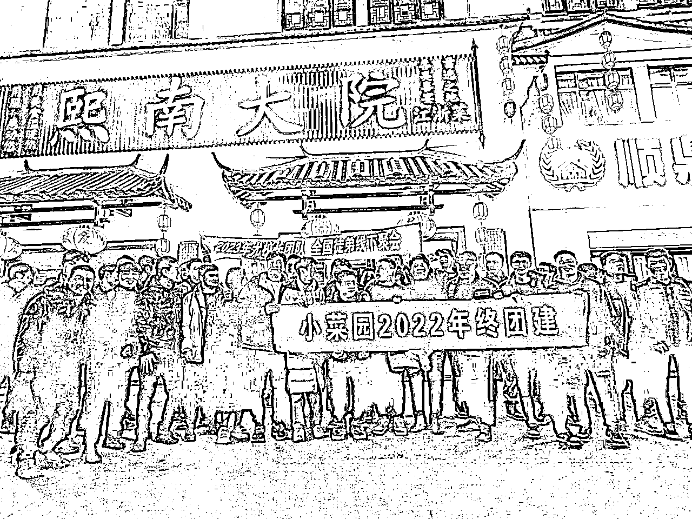
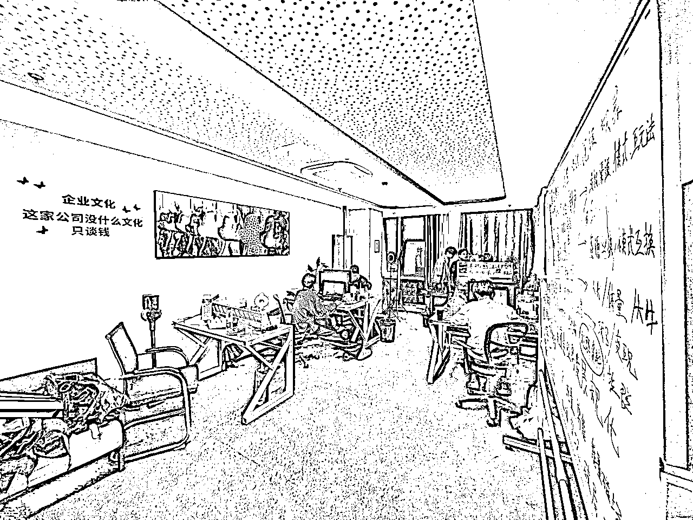
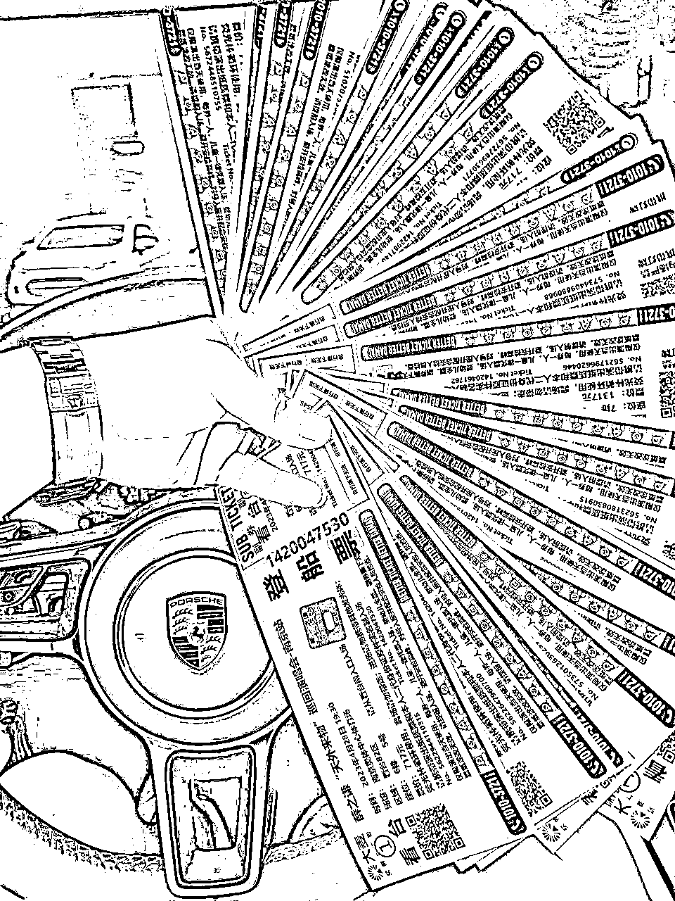
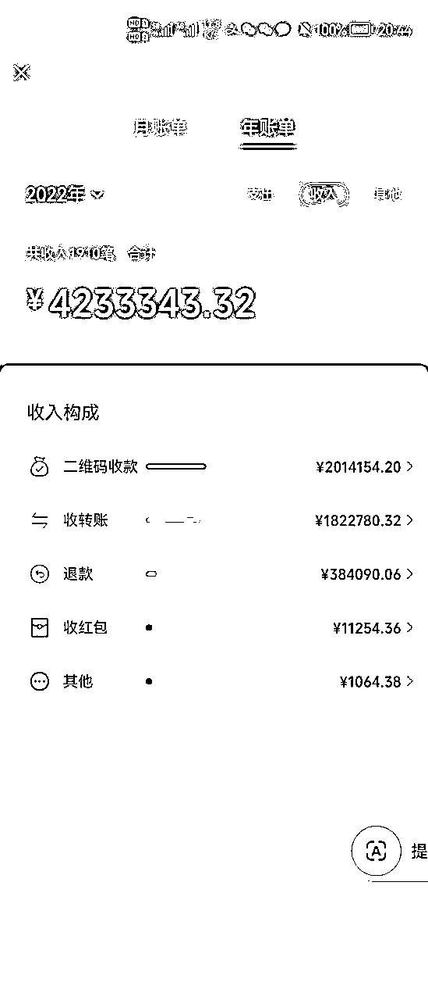
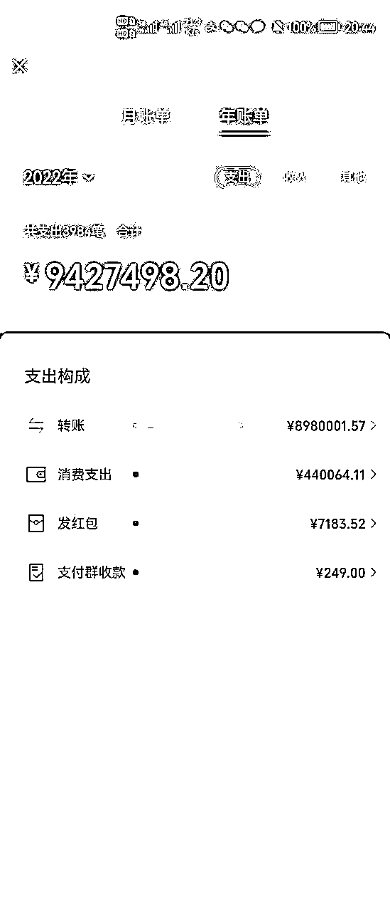
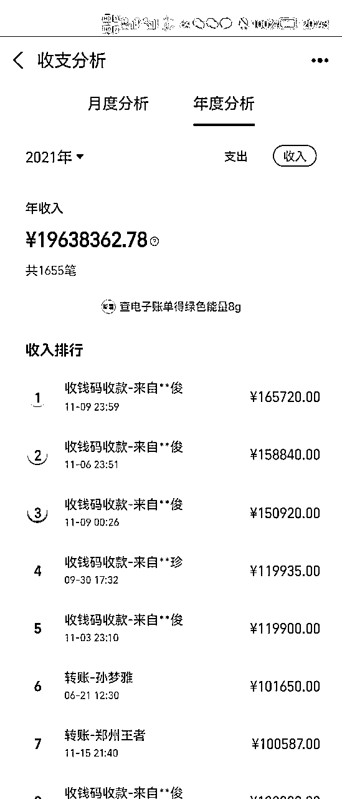
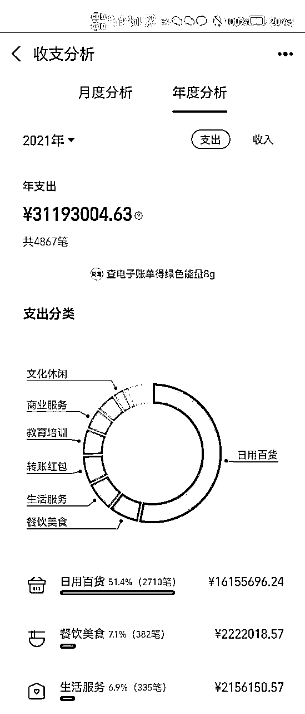

# 《2年，农村小伙如何从负债20万到年入100万》

今年还没过完，我的年收入已经摸到了七位数的边。而就在四年前，我还蹲在苏州的出租屋里，被二十万的债务压得直不起腰。一没学历，二没背景，三没本钱，唯一拿得出手的，大概就是骨子里那股不甘心。

先把话放在前头，这篇文章不是我一个人写的，必须鸣谢我的好友子白，要不是他催稿加润色，以我的懒劲儿，你们可能明年这时候才能看到这篇东西。

一、从欠债二十万到把命续上

我不怕自曝家底。96年生人，农村户口，初中毕业就扎进社会里讨生活。餐馆端过盘子，手机店站过柜台，流水线上打过螺丝。要我说，我唯一的优势，就是差到底了，所以怎么走都是往上。

2019年是我人生的至暗时刻。那会儿我鬼迷心窍碰了网赌，把能弄到的钱全搭进去了，还不知死活想借网贷梭哈翻本。结果呢，征信烂到极致，网贷一分钱没批下来。这事儿放别人身上是祸，放我身上倒成了保命符，要真借到了，那才是万丈深渊。不过就算没借成网贷，我最后也还是背了二十万的债。

那我在干嘛呢？在华为门店卖手机，一个月拿四千块。四千块什么概念？每个月光利息就四千五，工资还没焐热就没了。我甚至想过一了百了，但好在胆小，又觉得不甘心，才没干蠢事。更要命的是，那时候女朋友也走了。在那种境地里，你根本分不清哪一碗是压死骆驼的最后一根草。

二、眼睁睁看着兄弟挣了钱

当时我的状态是拆东墙补西墙，以卡养卡，债务不但没减，反而越滚越大。我琢磨着搞副业，最开始是做APP拉新，下载一个给几毛钱。我记得特别清楚，第一天挣了十二块，还挺高兴的，但没几天就放弃了，这点钱填不了无底洞。

转机出现在一个穷哥们身上。我们俩是一起睡过桥洞的交情，他那阵子老用我的花呗借呗白条周转，我也不多问，因为是真兄弟。直到半年后我才知道，他拿我的钱去干了一件事，撸茅台。

2020年贵州有个活动，从指定城市坐飞机到茅台机场、贵阳机场这些地方，凭身份证和登机牌，就能在机场专卖店按1499的官方价买两瓶飞天茅台。三张机票可以拼一箱，整箱比散瓶还能多卖两百块。我那兄弟直接组了个飞买团，隔三差五就在朋友圈打卡新城市，一副已经财务自由的样子。

我问他：“兄弟，能不能带带我？”你猜他说什么？

他说：“不太方便带你，而且茅台这玩意儿我现在天天喝，真喝腻了。”

这句话像一记耳光，也把我彻底打醒了。我突然明白了一件事，求人不如求己，别人带你永远只是情分，但把命握在自己手里才是本分。我也暗暗发誓，就算哪天我挣到钱了，也绝不能变成这副嘴脸。

三、从单打独斗到织网

没人教我，那就自己学。我憋着一口气，白天继续卖手机，晚上疯狂百度、加🛰️群🐧群，看别人怎么聊天，怎么收货，怎么出单。那时候我真是什么孙子都装过，天天求大哥带带。

我记得清清楚楚，我下手的第一单，是拼多多上一台紫色64G的苹果11。当时怕钱打水漂，不敢直接卖给不认识的人，就在闲鱼上找了一个南通的买家出手了，一单挣三百块。那三百块，比我在店里站十二个小时站出来的工资还多。就那一刻，我的世界观被打开了。

后来我是怎么一步步滚起来的？

第一步，带同事干。拉他们一起抢茅台，天猫、京东、苏宁、国美轮着蹲，我做人型闹钟，到点就喊。第一个月，额外到手两千块。

第二步，拉群搞线上。我每天在群里发线报，群里谁抢到了就把货出给我，我转手再卖给上游，中间赚差价。哪怕自己抢不到，也照样有收入。

第三步，收徒收代理。说白了就是把我跑通的路子复制出去，带着别人一起收货，同时把我的渠道开放给他们。2021年5月，我收了8个1588的徒弟和1个888的代理，那个月收入破三万，直接超过了我的工资。

当时六一八要来了，我想都没想就辞了职。之后半个多月，每天收货对账到凌晨四五点，一天只睡四个小时。忙完那一波，我抹了把脸，发现自己已经停不下来了。

2022年，我有了成熟的收货团队，渠道也从四手升到三手、再升到二手，品类从数码拓展到演唱会门票、纪念币、潮鞋、美妆、黄金、茶叶、潮玩。这时候我一个月收入至少三万，但我还是不满足。我跑到郑州新天地通讯市场，租了铺面开了个档口，想从收货佬变成一手商。

结果现实给了我一闷棍：租金、人工、物业水电一扣，利润薄得可怜；货砸在手里动不了，资金就死了。撑了小一年，我在2023年2月关了门面，止损离场。这让我明白一个道理，不是所有风口都适合自己冲，有时候人就该做自己最擅长的那一段。

现在我在南京，做私域、做抖音、做行业培训。我把收徒改叫私董会，门槛一换，很多年入千万的同行反而愿意来了。目前私董会一千多人，遍布全国，每天都有新成员主动找上门。我还搭了两张网，一张货网，一张信息网，所有的人和资源都以我为节点，越滚越大。

四、一个气球，七层卖法

这一路走来，我一直记着一个故事，也顺便讲给你听。

一个普通气球，有多少种卖法？

一级卖原材料：五毛进，一块卖，赚五毛。二级卖成品：两块一个，赚一块五。三级卖手艺：拧成小狗、编成娃娃，一个卖十块，赚九块五。四级分工：一个专门拧一个专门卖，效率翻倍，利润翻倍。五级复制：招十个销售，去十个学校门口摆摊，把一套动作重复一万遍。六级做产品：把怎么卖气球这件事，打包成课程卖向全国，教别人挣钱往往比自己卖货更挣钱。七级做生态：教程有了，人脉有了，那就搞加盟、搞连锁、做供应链，把项目做成平台。

同样是卖气球，有人卖一辈子还在贴本，有人却能把它做成上市公司。差别在哪里？不在气球上，在于思维层面。

五、撸货到底是什么？

我知道看到这里，肯定有人要问：说了半天，你说的这个行业到底是干嘛的？

用大白话说，就是通过线报，在各大电商平台的补贴和促销活动中，以低于市场价的价格买到硬通货，再以市场价出给收货方，中间的差价就是利润。这就是撸货。

平台很多，淘宝、京东、拼多多、抖音、快手、苏宁、小米有品这些正规电商基本都在列。品类更杂，茅台、数码产品、球鞋、美妆、黄金、茶叶、纪念币、游戏机、演唱会门票，全是硬通货，不怕砸手里。最关键的是，大平台支持七天无理由退货。行情一波动，价格下跌被套住的时候，我们直接退货退款止损。圈里有句老话怎么说来着？合格的黄牛向来先冲，剩下的交给七天无理由。

不过有一点要说清楚：这不是薅羊毛，也不是刷单，这就是正常的商品买卖，只不过我们比普通人知道的消息早了一点，下手快了一点。

六、真正赚钱的四种资源

入行越久我越发现，这行业里挣到钱的，拼的不是手速，而是四个资源。

第一，人头。平台风控越来越严，需要真实账号真实身份去下单。谁掌握的人头多，谁中签的概率就大。最稀缺的人头是学生，有大佬不干别的，就专门整合学生资源，每年光靠百亿补贴就年入两百万。学生为什么是取之不尽的资源？因为每年都有人毕业，每年都有人入学，循环不灭。

第二，线报。一手线报本身就是钱。一条高质量线报，能让抢手一单回本。我见过有人卖一个月的线报群就收四十五，门槛贼低，一包烟钱。但恰好因为试错成本低，愿意付费的人就多，而只要群里有一条信息他赚到了，续费就没悬念。

第三，渠道。渠道在手，天下我有。你有核心收货渠道，就不用垫资，下面的人把货出给你，你转给档口，档口打款了你再给下面回款，钱不占你的金，纯赚差价。

第四，资金。大资金玩家更狠。别人六一八只能下十万的单，你要有一百万，就能从头吃到尾，还能找有人头的黄牛合作，你出钱，他出人头，利润分成。现金流是硬实力，这四个字放在哪个行业都是真理。

七、撸货行业的六种赚钱姿势

选哪种姿势，取决于你在哪一层。

人都说这个行业分圈层，我觉得更像爬台阶。

最底层是抢手，或者通俗点叫“人肉外挂”，拿线报，下单，出货，赚几十到几百不等的差价。往上走，自己不开单当抢手，而是圈养一批抢手，线报渠道都在你手里，佣金你说了算，利润自然向上走。很多掌握学生资源的“学生头子”，本质上干的就是这个。

再往上，是中间商，手握渠道和报价单，不承担行情波动风险，靠走量赚钱。一件美妆赚三到五块，一台手机赚十来块，看着利润薄，但架不住量大。

然后是档口，也就是行业里的一手商。档口能吃到三种客源，同行黄牛、终端客户、线上商家。很多商品被撸来撸去，最后甚至会回到档口手里，再被二次三次出售。在这条链条里，黄牛赚商家的钱，商家赚平台补贴的钱，平台赚股价和用户增长，最后买单的其实是资本市场。

再往上，是同行扒皮。各个贸易群里的信息差，就是一座座金矿。把A群的低价供给转手给B群的高价需求，空手套白狼。但想进高端的贸易群，得有人担保，得有圈子认你，这本身就是一道门槛。

再往上走，是合伙人模式。招十个合伙人，每人三万，你的成本回来了，还多了一支不用发工资但战斗力强悍的队伍。合伙人学会技能后可以留下，可以单飞，但资源共享、人脉联动，彼此不撕破脸，反而是长久生意。

但真正的顶层，是知识付费。一句话，信息差就是产品，经验就是货币。收徒、收代理、卖线报、卖渠道，每个环节都有人专职在做。我自己走通这条路之后，最深的感受是：教别人赚钱本身就是最赚钱的生意。但前提是你真拿过结果，而不是纸上谈兵。

八、演唱会门票，也一样玩

撸货的另一条分支，是票务。现在演唱会市场有多疯狂，抢过票的人都知道。

抢票的逻辑说白了就四个字：抢到就是赚到。热门艺人开售即售罄，但只要你抢到了，转手就有人加价收。大牌如周杰伦、张学友、林俊杰，越临近开演价格越疯涨，很多人专门囤票到最后一刻。

卖票的门道更细。没抢到票的粉丝会去哪儿？咸鱼、📕、抖音、🧣，找黄牛。那我们就去这些平台发帖引流，有客户来问，报个价，再从同行群里配单，一买一卖之间，钱就流转起来了。

代抢是另一门生意。强实名电子票怎么搞？把客户身份信息铺满N个抢手群，一万人去抢一个名额，总有人抢得到。比如上海周杰伦，客户付六千，我们给抢手放四千，净赚两千。很多没有一手信息的黄牛，就转发这条线继续抽水，一千一张地赚，倒一手信息差，财富就这么一层层分配掉了。

这个行业还有一个让人上瘾的地方：客户极其优质。爱看演唱会的，特别是女粉丝，消费力强、复购率高、还乐意安利。只要你好好维护私域，干满一年，后面几年都不用愁客源。再往下，招票务代理，你只管带团队，团队出票你抽成，久而久之就是躺赚。

九、写在最后

从负债二十万到年入百万，我走了两年多。回头看看，真正让我翻身的不是哪一单买卖，而是我对这个世界的理解方式变了。

一个小镇青年，没有本钱、没有学历、没有关系，怎么在这个时代突围？我的答案是：找一个还处于半公开状态的行业，躬身入局，把自己埋进去，拼命汲取信息差，然后想尽一切办法把信息差变成自己的杠杆。

很多人问我：我现在进来还来得及吗？

我可以很负责任地告诉你：这个行业的信息差，永远不会消失。因为人的需求在变，平台规则在变，商品行情在变，玩法自然一直在变。而只要变化存在，信息差就永远存在。

但话说回来，任何行业都有菜鸟和老炮之分。老炮拼命织网，菜鸟坐等投喂。你愿意做哪一种，结局早已注定。

“抄=超=钞”，先把别人验证过的东西抄下来，再用自己的理解去超过去，钞票自然就来了。

共勉。

这些玩法我全都亲自趟过一遍，算是一条条升级打怪走过来的。说句不谦虚的话，现在这个圈子里，论培训这块，我算是站在头部的。入行才两年多，但我敢冲敢干，结果摆在那儿——不少干了五年以上的老同行，还抱着“差不多得了”的心态，拿到的成绩反而没我硬。

网上有句话特别流行：带你赚钱的人，其实是想赚你的钱。这话我认一半。另一半答案是——他想让你帮他赚更多的钱。真正聪明的老板都明白，要想长久发展，就得舍得分钱，甚至大头给你，先帮你跑通拿到结果，再靠你的社交圈一层层裂变出去，他自己的盘子只会越滚越大。

这行里有很多新人，是真想进来学点核心玩法的。但现实是，他们一路踩坑踩到怀疑人生，哪怕熬夜钻研也出不了成绩。为啥？因为大部分老黄牛都把自己那点地盘捂得死死的，小富即安，满脑子小农思维。他们怕新人抢饭碗，就靠着手里的渠道资源，制定一堆规矩压着你，压根不给你冒头的机会。

早几年你想入行，没个几万块钱去拜山头，门都摸不着。我也一样，高价拜了一圈山头，资源攒够了，然后转身成了那个掀桌子的人。我一直觉得垄断没前途，健康的生态是让更多人能参与进来，而不是把核心资源攥在几个人手里，规矩全由他们说了算。行业需要竞争才有活力，对手其实是你的磨刀石，逼着你越来越强。

流量意识必须刻在脑子里，私域一定要当回事。我一直把做大流量入口、积累私域，当成往银行卡里存钱。等你哪天真要用钱了，项目就是取款密码——可能是撸货，可能是多多视频，也可能是视频号带货，方式多的是。所以我一直在抖音做垂类直播，你想啊，中国十几亿人，抖音用户好几个亿，日活两个亿，还有一大堆人压根不了解这行，甚至想试试水。我能不能当那个突破口，从他们身上找到机会？

做事情就得做到扎眼，人海里挤来挤去真没意思。你要是平平无奇，贵人根本看不见你，机会凭什么找你？换作是我，要合作也只会找这个行业里最拔尖的那批人。

福利来了：行业机密的核心代理方案，放在下面。再给你们来点直观的冲击——我2021年刚做撸货那会儿的收益实况。那时候因为口罩原因还没票务，直接上视频。

