# ('快手切片，普通人做项目都是靠正反馈引导前进', (2, 23))

**普通人做项目，靠什么撑到底？就靠“正反馈”**

最近老有朋友问我，你们现在押注的项目到底是啥？不藏着掖着，我们正在主力推进的，就是快手网红切片带货。为什么选它？因为它特别适合普通人，而且能持续给你反馈，让你越干越有劲。

先科普一下，所谓“切片带货”，就是把头部主播的直播片段剪下来，配上商品链接发到短视频平台，有人通过视频下单，你就能拿佣金。去年抖音的IP切片有多火，大家有目共睹，各路明星网红都在放授权。但我们绕了一圈，最后把重心换到了快手，原因很现实。

抖音切片的起步门槛越来越高。开橱窗得先有粉丝，早期买1000粉丝只要四五十块，后来涨到两三百，再加上500元保证金，一千块就这么没了。要是公司矩阵或个人批量起号，这个成本直接翻倍。更烦的是违规问题——平台限流根本不给理由，有时直接扣个肖像权的帽子把你封了。而且授权市场早就卷成了红海，一个IP三个月能铺一万个账号，大家都在抢同一块蛋糕，新号跑出来非常难，普通人剪着剪着没有正反馈，自然就放弃了。我们去年也做过抖音切片团长，招过几百人，确实有跑出来的账号，月GMV几万、几十万的也有，但比例太低。身边那些月佣10w+的幸运儿，只能当故事看，当不了普遍标准。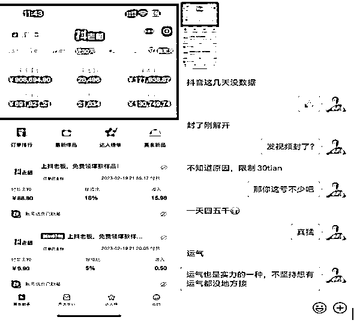

去年7月，我们开始接触快手这边的管理层。跟快手电商负责人聊的时候，对方很直白：“来快手做切片吧。”当时小杨哥的切片在快手已经跑得不错，却因为没和官方谈拢利益，4000多个剪辑号一夜之间全没了。我们不想走那条老路，于是8月底通过快手官方，和二驴签下了授权。起初只低调测试100多个账号，从9月到12月，每月业绩翻倍。今年2月又正式敲定了独家商业化合作，一个多月时间，团队就扩到了2000多人。

为什么快手现在还值得做？因为比赛才刚刚开始。官方授权的网红数得过来，辛巴、二驴、瑜大、吴召国、老葛，外加一个还没启动的直播团队，做切片的人也不多，竞争远没到白热化。别总拿“南方抖音、北方快手”的老眼光看人，快手的“老铁”购买力一点也不虚。直播带货最早就是从快手兴起的，用户信任度非常高。随便翻翻这周的带货榜单，你就知道什么叫爆发力。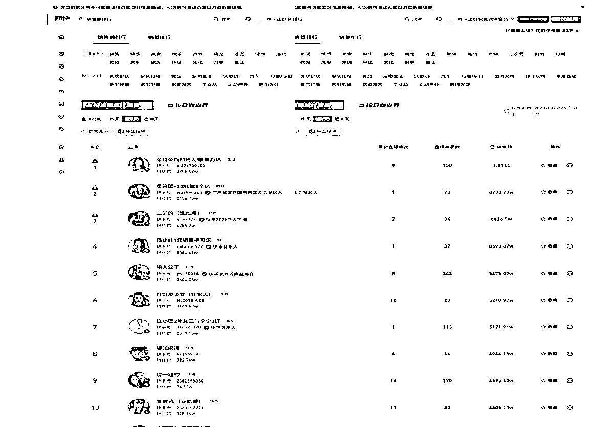

结算方式也要选对。目前快手有两种：一种是佣金先进主播口袋，再由主播给你结算，辛巴、吴召国、老葛走的就是这种；另一种是平台直接结算，像二驴的切片，每一笔佣金都明明白白，提现直接到快手提微信或支付宝。对普通人而言，平台结算最友好，不需要跟机构分账。

再说说门槛：0粉丝、0保证金，直接开橱窗。个人能实名两个快手号，营业执照还能认证5个。也就是说，想“躺赚”，可以先老老实实同时养两个号。挂车视频一天随便发，反馈来得又快又猛，很多人一天能多剪好几条。正反馈越多，越有动力，这就是典型的正循环。

反馈到底有多快？有人第一天发视频，播放冲到17万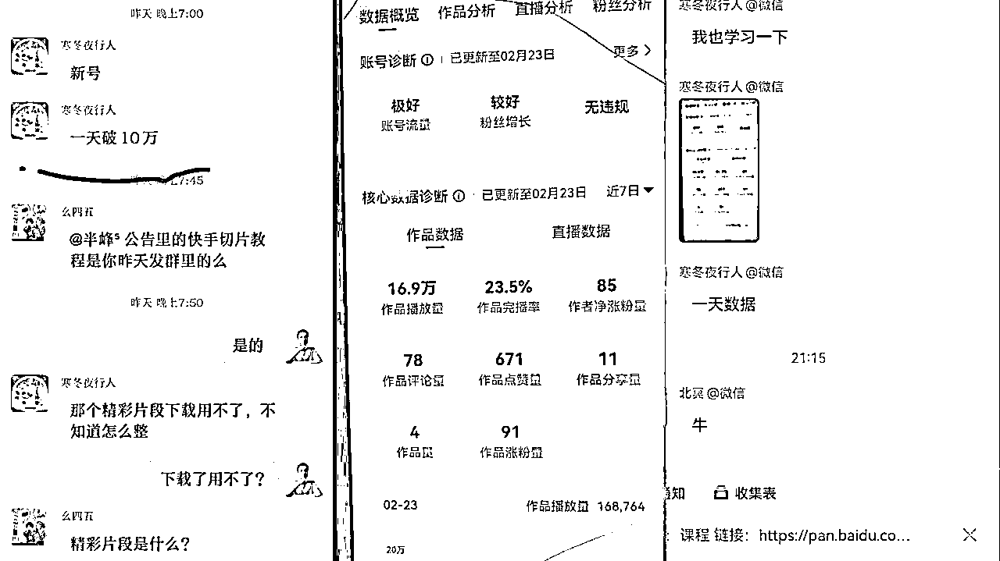；有人第一天就爆单，自己还没弄明白佣金怎么查，前一天发的视频已经30万播放，出了一千多GMV，佣金近200元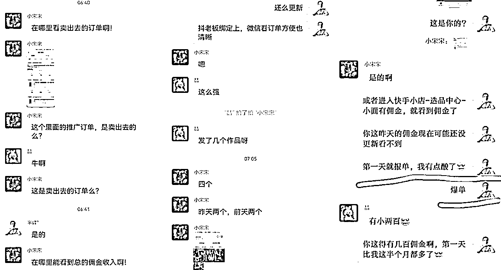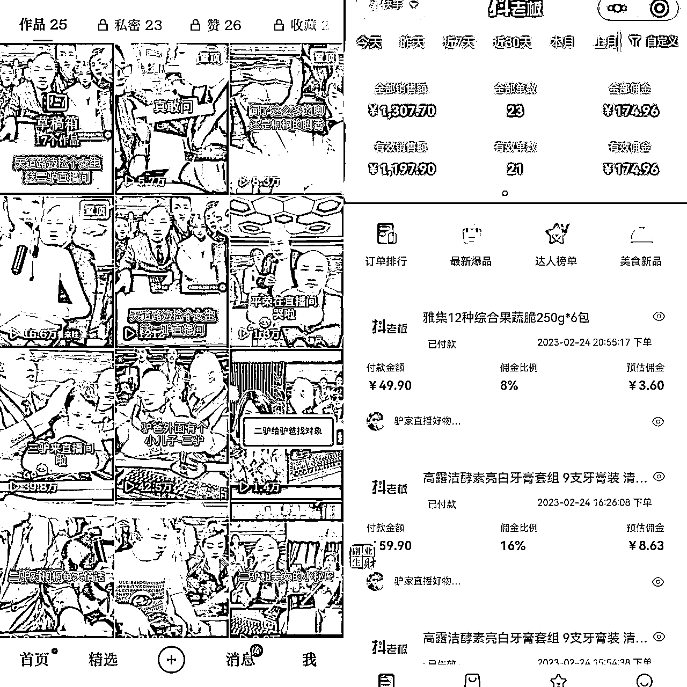；我自己2月24日把一个老号改成切片号，清掉了67条旧作品，当晚发视频，3个小时就突破两千播放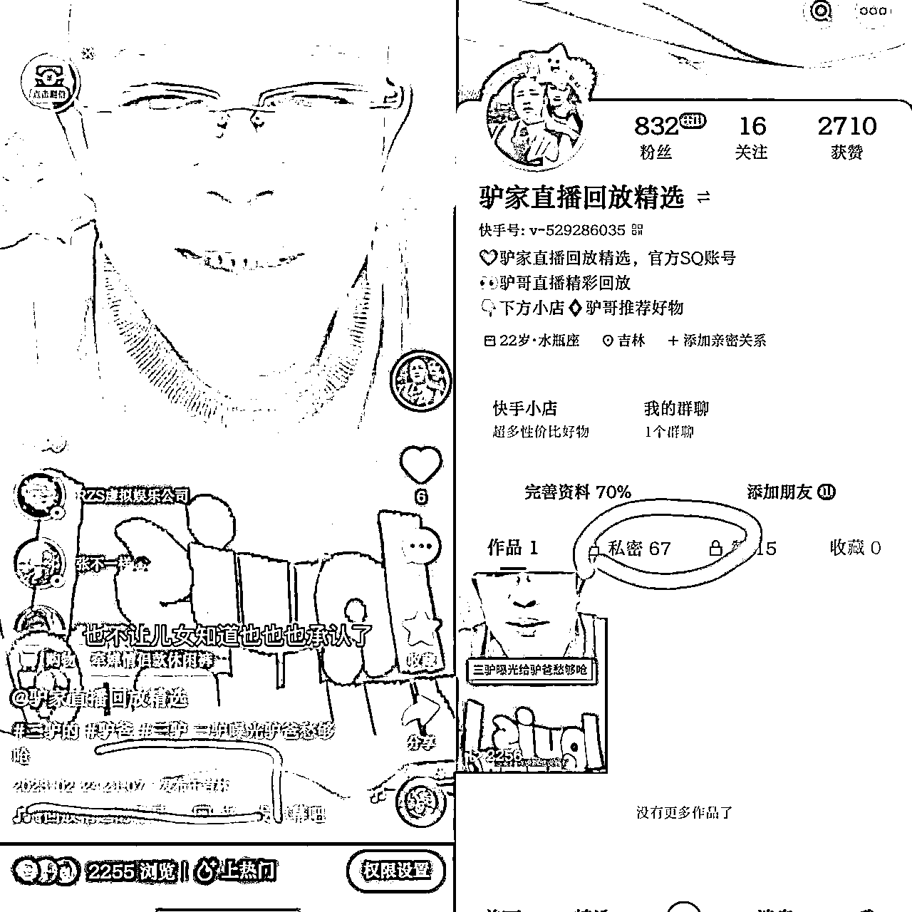。后来更是不断有学员单日成交破万、单日佣金破千，17天赚到3600元的案例也出了不少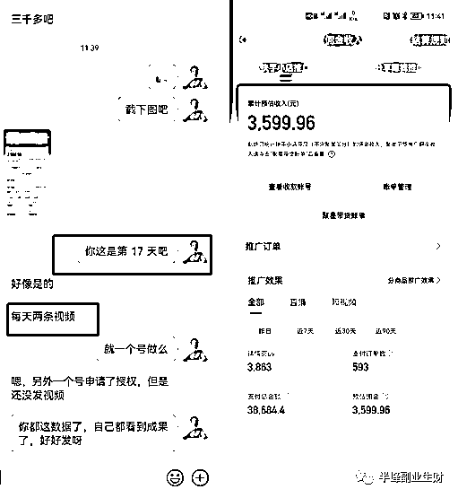。

团队怎么快速滚起来的？光靠我一个人招人，速度太拉胯。后来我找到几位有流量的IP朋友合作，他们负责引流，我来负责交付。我把真实反馈和成绩同步给他们，保证不砸他们招牌。很快，3月份学员就过千了。到4月，每天都有新学员出单，甚至“一睁眼赚几百、一天赚几千”的爆单反馈也频繁出现。这就是最猛的动力——爆单总会轮到一直坚持的人，不是不爆，时候没到。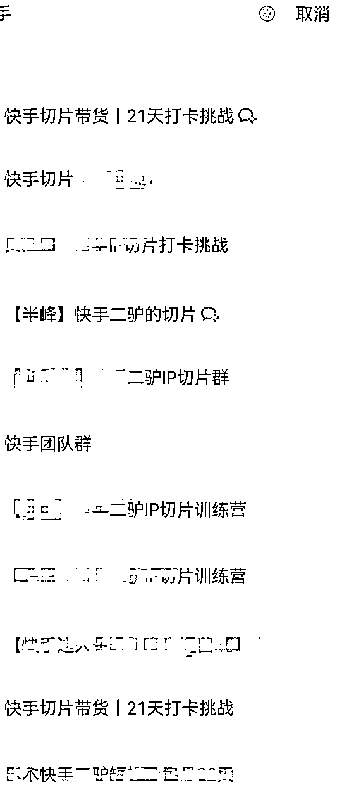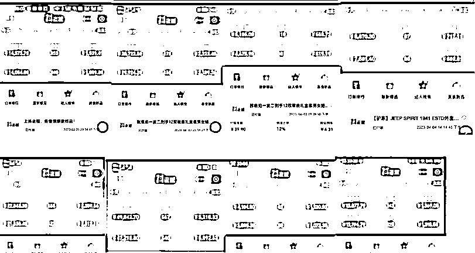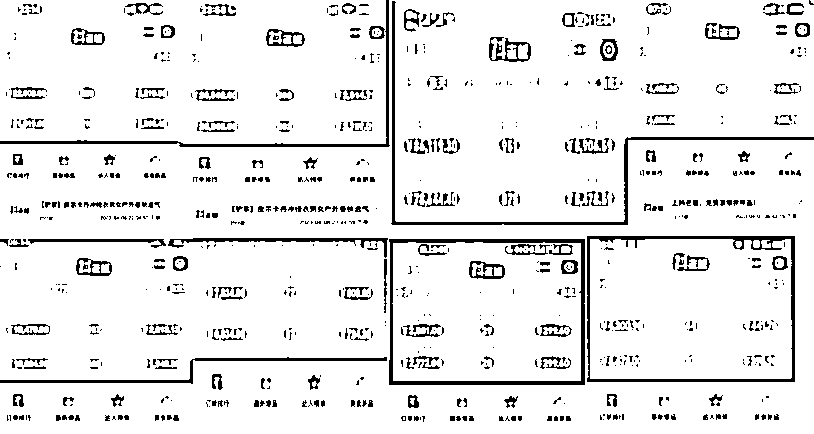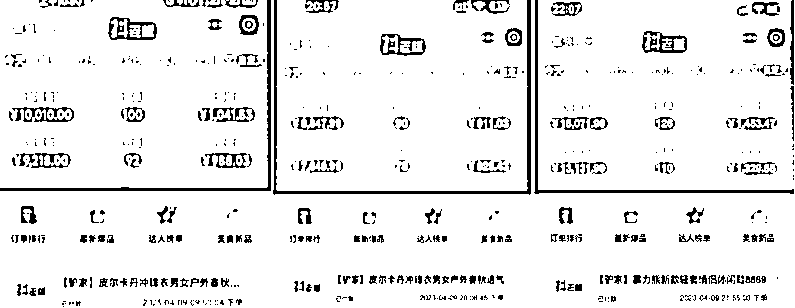

具体怎么做？核心就两条路。

一条是短视频带货。把主播直播视频录下来，剪成片段，挂车发布。本质就是搬砖，但必须会去重。因为素材都是那几个小时的直播，大家都剪，很容易被判非原创。快手对搬运检测挺严格，多次被查就会关小黑屋一个月。最基础的去重是：配音+特效+贴纸+文字+画中画。后来我们升级成2.0版：配音+自制背景+矢量扫光+水印+特效+素材关联+调色+变速+蒙版+贴纸+文字。还有3.0版，加入真人实拍，效果更好但费精力，很少人用。现在也有不少朋友开始做解说，播放和出单比单纯剪辑更好，只是要花时间写解说文案。还有人直接对标同行爆款一比一模仿，同样跑出了单子。目前快手对直播切片的内容限制还不算严，整段直播内容都能用，完播率甚至不错。

另一条是直播带货。团队里有人每天开直播，几十单稳稳的。直播建议用实物：买点便宜的样品，放上转盘、灯光、时钟，配点音乐，手机对着这个场景播就行。千万别图省事搞无人直播，有的号没事，有的号被查到直接罚款，实物直播更安全。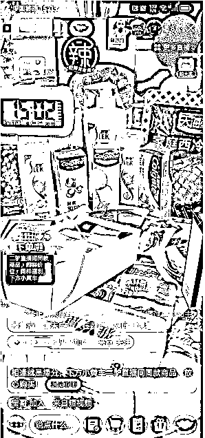

最后提醒一句：无论做谁的切片，一定要先确认授权。有人做辛巴切片出单很猛，可一个号只能扛四五天就废，原因就是没搞定授权，容易被举报封号，得不偿失。

这个项目的玩法其实不复杂，关键在时机。现在快手切片还没到竞争最激烈的时候，等7月以后，想进场的人会越来越多。如果你对这个方向有兴趣，现在就可以布局了。普通人做事，最需要的就是正反馈；而快手切片，恰好把正反馈送得又快又准。