### 入局AI八个月，赚到“小六位数”：一个外企程序员的踩坑复盘

你有没有发现，最近半年身边突然冒出一批“AI搞钱”的人？有人卖课、有人做代部署、有人帮企业搭内部知识库——今天这篇，就是我自己交出的八个月成绩单。

先自报家门：我是峰兄，程序员，坐标一家世界500强外企，日常跟IT打交道。今年2月，ChatGPT火遍全网，我刷到一篇朋友转发而来的万字长文。那篇文章的核心观点让我印象很深：上一个时代属于移动互联网，我们做出无数APP；而AI时代，新的交互方式已经出现，底层能力开放之后使用门槛足够低，每个细分赛道都可能长出新独角兽，所有APP都值得重做一遍。

读完之后我只有一个感觉：这波浪潮，普通人真的有机会。我决定下场试试。

复盘下来，我的AI之旅主要走了四条路：GPT镜像站创业、提示词学习、训练私有模型搭建企业知识库，以及加入点金帮，专注GPT企业培训和企业级AI解决方案。

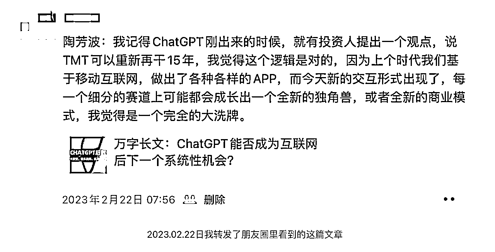

#### 一、镜像站创业：冲进去先被毒打了一顿

我是程序员出身，前几年靠着小程序吃到了移动互联网尾声的一波红利。这两年小程序卷成红海，AI风口又来了，我不太想错过。

当时最简单的想法是：ChatGPT国内访问不了，那就做一个国内镜像站，当中转代理，帮更多人跨过门槛。跟几个平时玩得好的朋友聊了一下，大家的反应出奇一致——干。我们的“AIGC镜像小分队”就这么成立了。

团队里每个人都有本职工作，只能晚上和节假日写代码。好在彼此合作过，默契还在，目标也一致。从画原型图到开发、测试、上线，只用了一个多星期。产品逻辑并不复杂：游客免费试用10次，想继续用就得充会员。

3月7日，公众号版镜像站正式上线。当晚我只发了条朋友圈，没有做任何推广。第二天一看，注册用户232个；再过一天，突破500。这是我们整个项目最高光的时刻，之后的剧情基本就是踩坑、填坑、再踩坑。

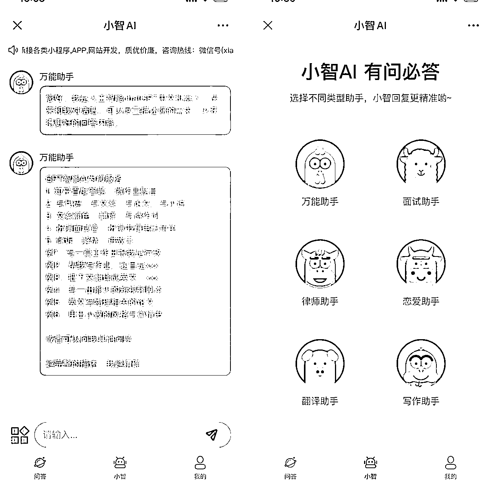
（第一版镜像站页面）

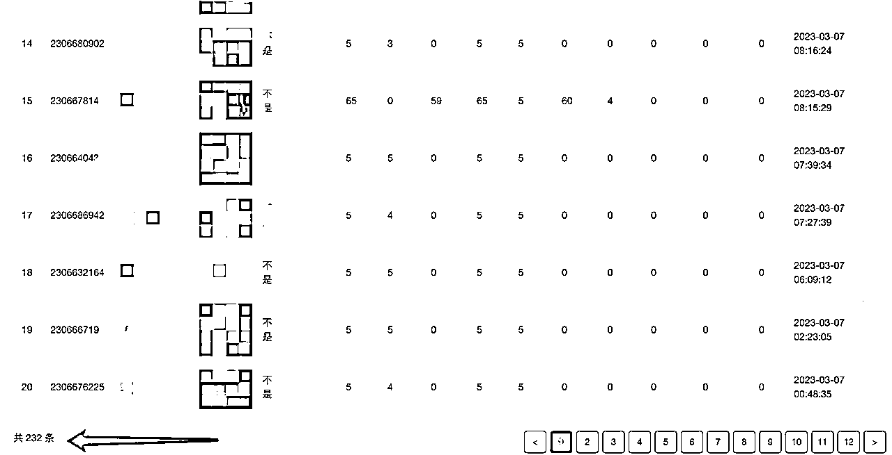
（上线首日的注册数据）

上线第二天，意外就来了。由于当时赶进度，数据库端口没设防火墙，密码还是默认的，服务器直接被人攻破。对方留了句话：想要恢复数据，先交比特币。

说实话我也没惯着，重新部署、开防火墙、改密码，一气呵成。给用户的补偿方案也很直接：新注册用户每人送一个月会员。

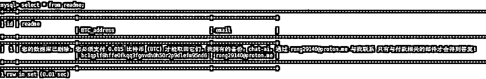
（黑客勒索截图）

每天新增用户虽然还有几十个，但大多数人只图新鲜，充值转化率低得可怜。朋友提醒我：小程序接广告也许能赚到钱。于是我们又花了十天左右，做了一个可以放广告的小程序版镜像站。这次总该坐着收钱了吧？

现实很骨感。当时微信正在严打底层调用国外AI接口的AIGC应用，第一次提审就被驳回。我们反复跟腾讯客服沟通、调整方案、重新提审，整整被驳回了近十次，总算惊险上架。

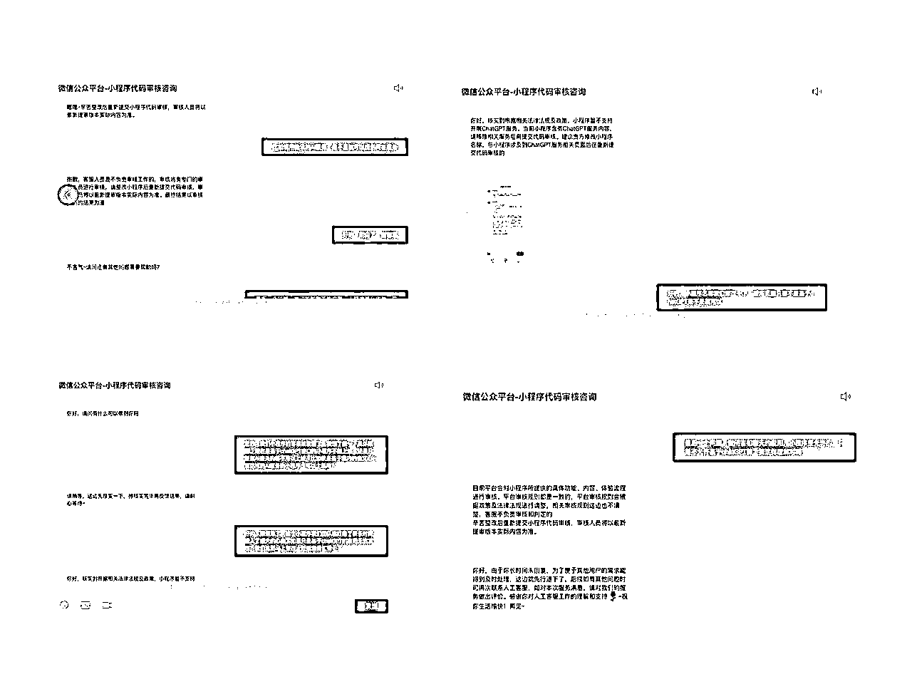

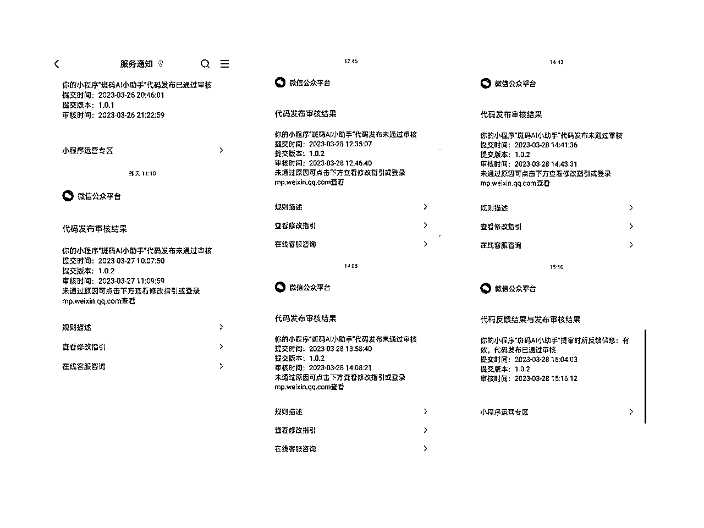

可安稳日子没几天。腾讯对这类小程序的管控越来越严，最后直接下架。我原本还想申诉抢救一下，但翻看了自己关注的一百来个AI问答类小程序，几乎全部阵亡，也就没了心思。平台态度已经摆明，继续折腾只是增加损失，及时收手才是止损。

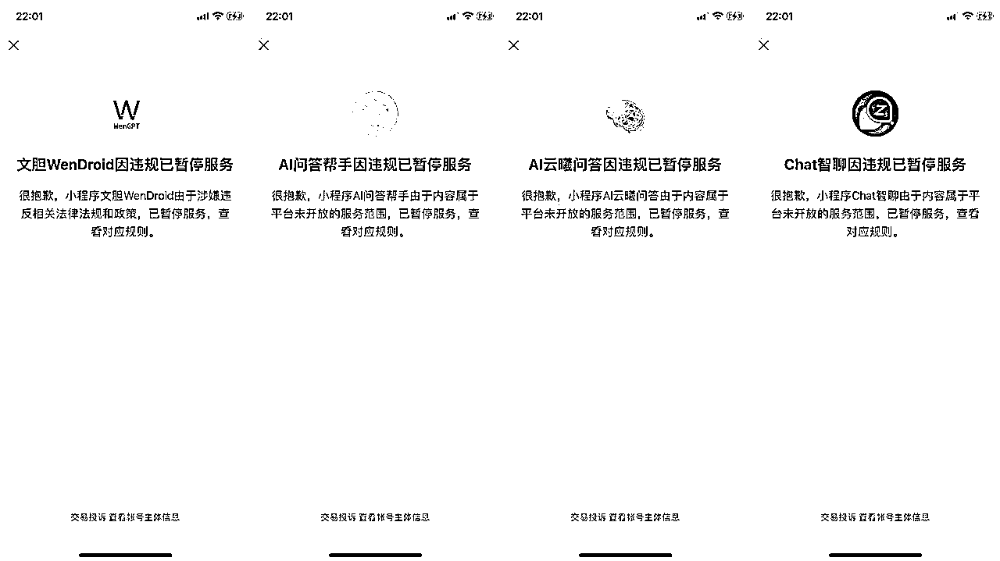

公众号版相对宽松，我不甘心，又优化了一版继续跑。可惜最终还是逃不过下线。前前后后两个多月，账面盈利一万来块，全分给了一起加班的兄弟们，每个人到手真没多少。老实说，付出和回报并不成正比，但踩过的坑，确确实实长成了本事。

如果你现在还有镜像站需求，可以试试我朋友鹤涵做的AI问问，功能比我当年做的强大很多：https://chat.wenwen-ai.com/user-center?code=HZSHBRULDE

#### 二、提示词学习：会提问，原来这么值钱

做镜像站的那段时间，我发现一个很普遍的问题：很多人拿到GPT，根本不知道怎么提问。不同场景下，怎么设计一段合适的提示词？这个技能有个专业名称——Prompt提示词工程师。那时候不少公司已经开始放出这个岗位的招聘需求。

我在Boss直聘上随手搜了一下，全职岗薪资大概15K-40K；兼职岗按天付费，一天200-450元。

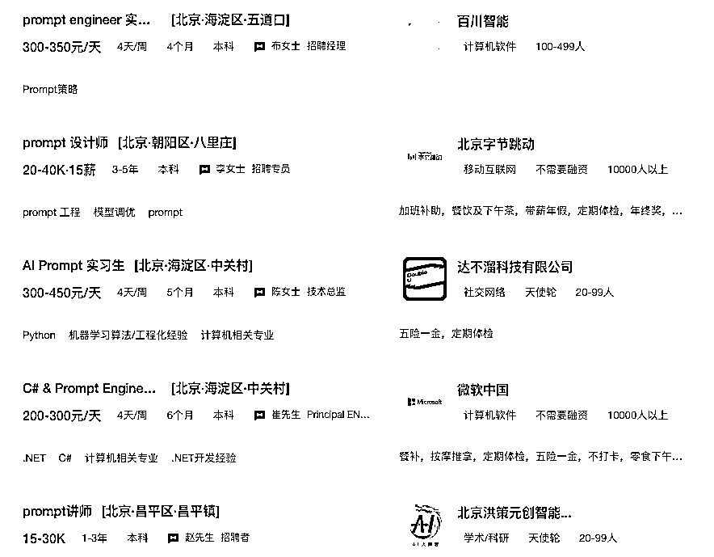

点开几个职位描述会发现，这个岗位和成熟的运营、设计、开发岗不太一样，大多数JD写得模棱两可。企业自己也没有标准答案，只想找一个大模型方面有点感觉的人，把AI能力嫁接到现有产品里，为公司提效。

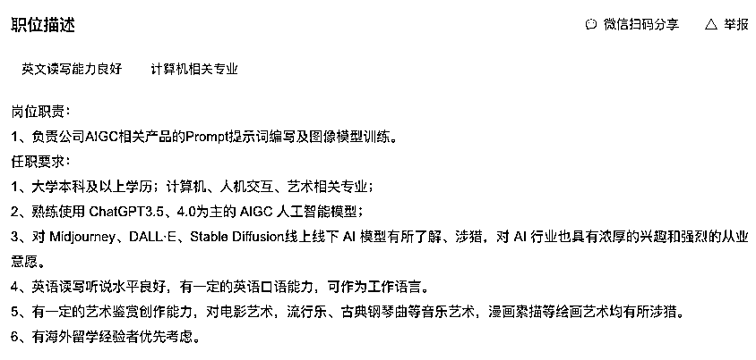

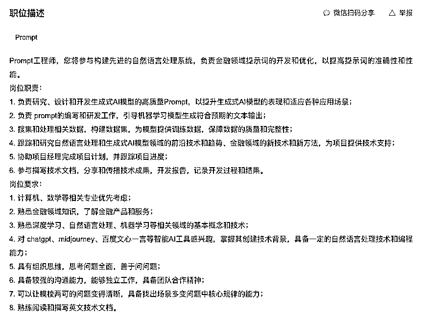

意识到这个方向有潜力，我开始认真钻研提示词技术，写了几篇相关文章，也因此认识了一些圈内大佬和专家。其中一篇文章被提示词领域的前辈“小七姐”在教程里专门提到，挺有成就感的。

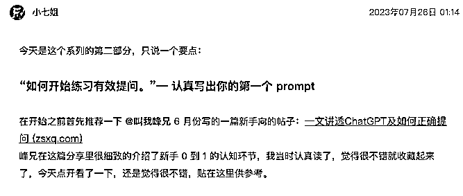

这个阶段收入比较零碎：文章打赏，加上帮一些朋友针对具体场景定制提示词，零零散散加起来，差不多也有一万元。

#### 三、训练专属私有模型，搭建企业知识库：离AI变现最近的一次

ChatGPT的智能，靠的是“大力出奇迹”。OpenAI自己透露过一组数字：1700亿参数的Davinci模型，哪怕从头来一遍，耗时三个月起步，花费高达一百五十万美元。这种量级的门槛，普通人和中小企业根本迈不进去。

但换个思路就不一样了：不做“从零训练”，而是站在一个现成的基座模型上，往里面加自己的数据，得到一个“领域增强”的个性化模型。主流做法有两种：Embedding（嵌入）和Fine-tuning（微调）。

为什么需要个性化模型？因为现实世界的行业知识太庞大了，通用模型很难面面俱到。拿智能客服举例：保险公司的客服和淘宝店铺的客服，面对的人群、要解决的问题完全不同，想要回答得更准，必须打磨自己的专属模型。再比如，你可以把自己写过的文章都喂给AI，训练一个“数字分身”，让它用你的文风自动回复粉丝。我当时认识的一位圈友就是这么做的，效果还挺神奇。

对企业来说，价值更大：做AI客服机器人替代人工；建企业AI知识库，对外赋能合作伙伴，对内帮员工快速上手业务。

同一个私有模型，通过调整prompt，还能扮演不同角色：上传公司财报，它可以是财务分析师；上传客服聊天记录，它可以是智能客服；上传经典判例，它可以是律师助手；上传医学百科，它还可以是在线问诊医生。

那Embedding和Fine-tuning到底怎么选？

我自己的理解是：Fine-tuning更适合教模型学“新招式”。如果你想让它生成特定风格的文本，或者完成某个专属NLP任务，可以用它。但如果你想把知识存进去做问答，Fine-tuning就不太合适，它本质上不适合当知识库。Embedding则是把语言转化为低维向量，通过语义匹配去寻找答案，做问答、做知识库，比Fine-tuning更快、更省、也更容易出效果。

所以结论很明确：问答系统、个人/企业知识库，用Embedding。

具体落地，我试过两种方案，目前都已跑通，可以商用。

**方案一：自购GPU服务器，私有化部署开源大模型。**

简单来说，用ChatGLM-6B、LLaMA这些开源模型做底座，配合LangChain、闻达等开源项目做向量存储、检索和大模型调度。所有计算和推断全在自己买的显卡服务器上跑。

优点是调用不花钱、玩法足够自由；缺点是硬件成本不低。一台最便宜的P100 GPU服务器，也得七八千块。我帮客户攒过一台GPU服务器，整机成本控制在8000元左右，配件表就不一一数了，发出来给大家做个参考。只想提醒一句：便宜有便宜的道理，部署过程中遇到坑的概率，跟天上的星星差不多。

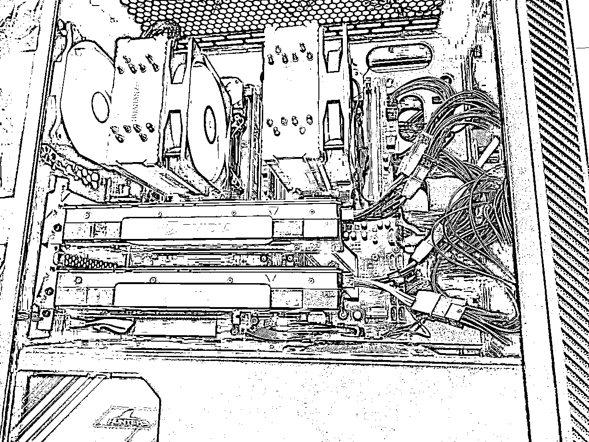

至于更高端的显卡，去淘宝、京东感受一下价格就知道了。一块A100至少三万多。没有明确预算和盈利模式的中小企业，不建议一上来就自购服务器。

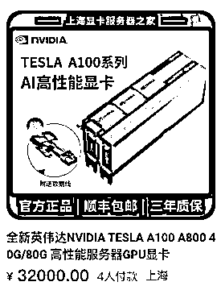

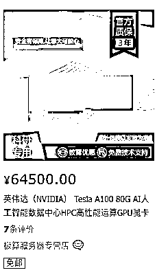

但这条路确实让我摸到了“大钱”：帮几个朋友公司搭建内部私有的企业知识库，大家给的辛苦费加起来，小五万块，是目前AI相关项目里最大的一笔收入。

**方案二：调用云端大模型API。**

思路更轻：直接调OpenAI的embeddings接口，或者类似的云端API。优点很明显：效果不错，不需要自己买GPU，前期投入低，调用量不大的企业也能用。缺点也客观存在：按token收费，长期使用不一定便宜；灵活度有限；数据要过外网，安全性没法保证，国内对保密要求较高的单位基本会被一票否决。

我们在这个方案上，主要用的是自己基于开源FastGPT做的产品。FastGPT这个开源项目，本质是一套基于LLM大模型的知识库问答系统，数据处理、模型调用都是开箱即用，还可以通过Flow可视化界面编排工作流，搭出复杂的问答场景。作为中小企业的智能客服系统、企业AI知识库，它非常合适。

它有哪些能力？

- 专属AI客服：导入文档或已有问答对，AI就能基于你的资料与你对话。
  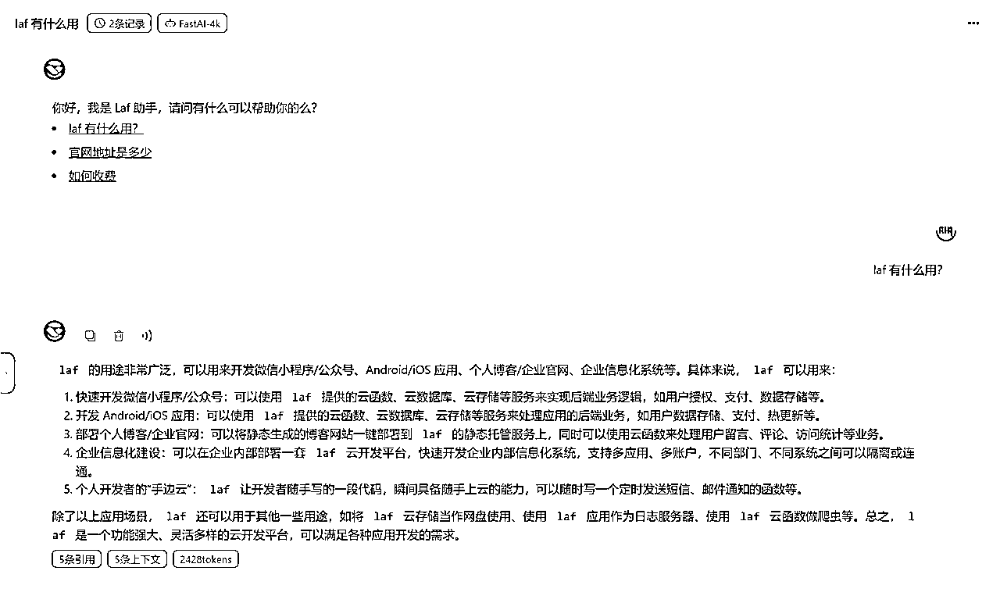
- 可视化界面：不需要编程基础，按步骤点选即可完成创建和训练。
  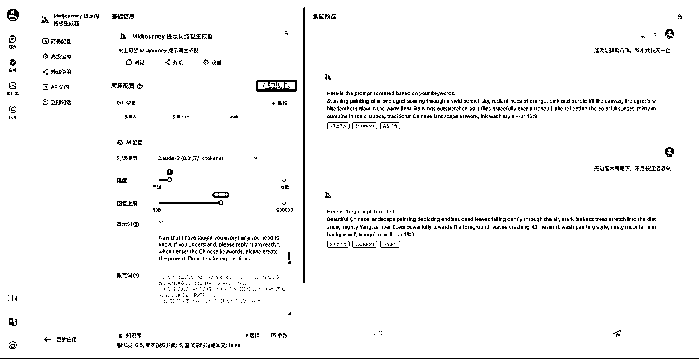
- 自动数据预处理：支持手动输入、直接分段、LLM自动处理和CSV导入；PDF、Word、Markdown都能自动分段、向量化、生成QA对，省下大量训练时间。
  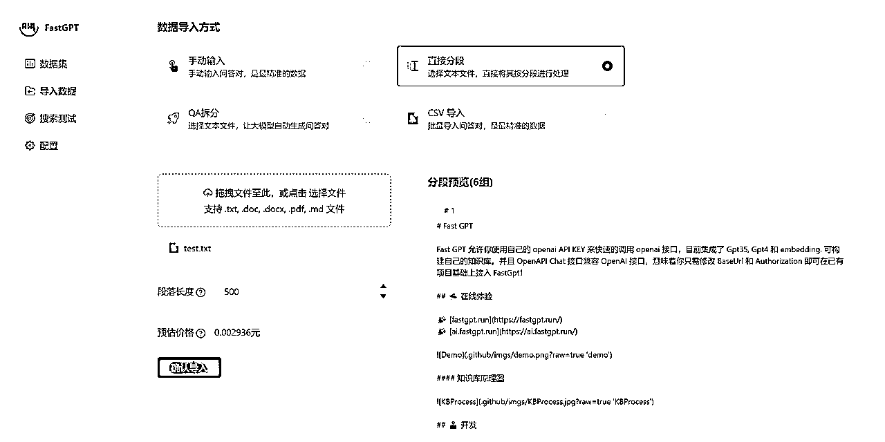
- 工作流编排：通过Flow搭更复杂的问答流程，比如查数据库、查库存、预约实验室。
  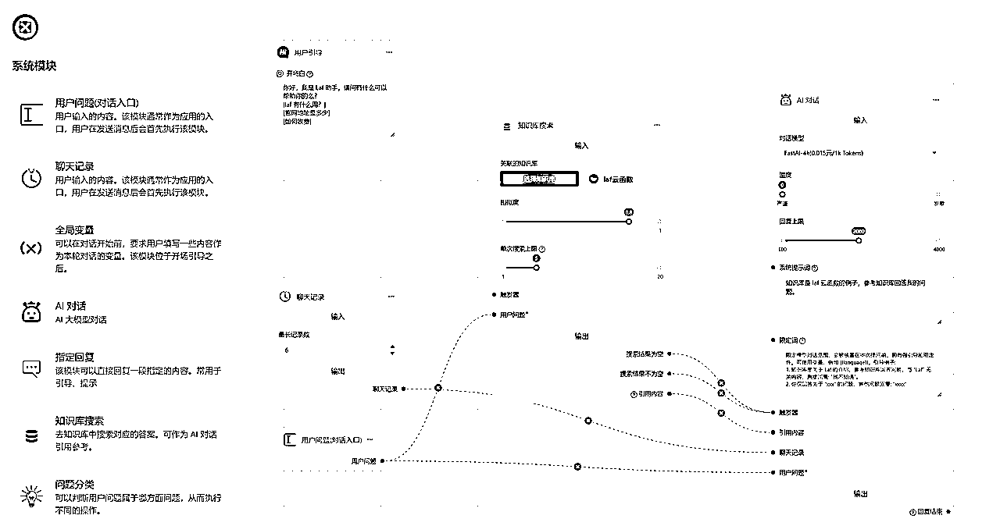
- 强大的API集成：API接口兼容OpenAI的官方规范，可以接进企业微信、公众号、飞书等平台。
  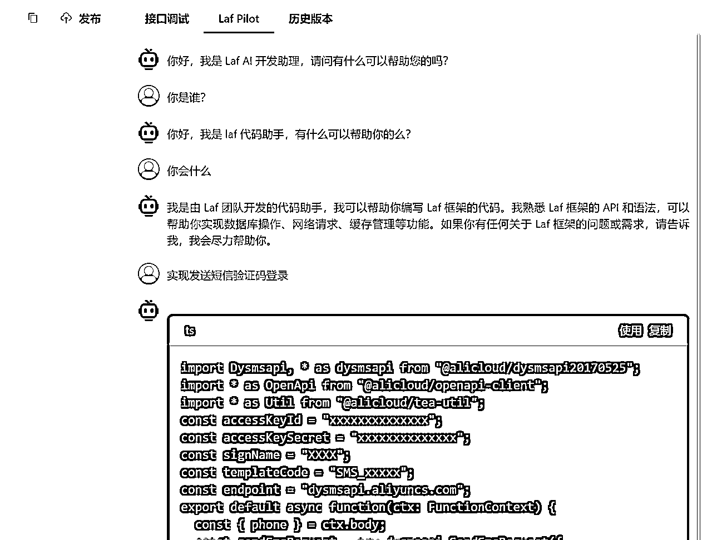

再说几个我很看重的特点：完全开源，Apache License 2.0，可以Fork之后做二次开发；专为客服问答场景设计的QA结构，数据量大时准确性更有保障；可视化工作流，从问题输入到模型输出能全流程预览；基于API扩展，不需要改源码就能接入现有程序；调试工具很友好，支持搜索测试、引用修改、完整对话预览；模型支持多品牌——GPT、Claude、文心一言等，以后还会支持自定义向量模型。

#### 四、写在最后

把这八个月算一笔总账：镜像站赚了一万多；提示词学习赚了约一万；私有化部署项目赚了小五万。三个加起来勉强凑出一个“小六位数”。

这些钱不算多，但我更看重的是过程中的判断力训练。什么时候该冲，什么时候该停，怎么从一堆噪声里找到真正有商业价值的方向——这些是AI时代最值钱的经验。

至于第四段经历，也就是加入点金帮、“点石成金”的GPT企业培训和企业级AI解决方案方向，这篇先不展开。篇幅有限，等下次复盘再细聊。

AI的大幕刚拉开一半，我始终相信：这一波浪潮里，属于普通人的机会，比我们以为的要多得多。

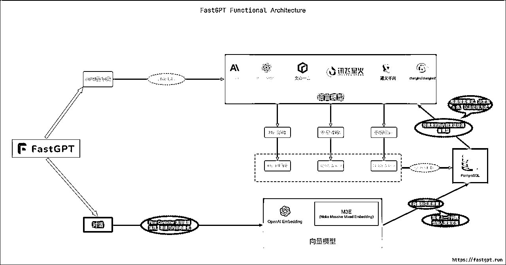

### 打造专属AI分身：用私有化素材训练“数字版自己”

我们团队创始人乔帮主整理了一份专属资料文档（文档链接），基于这些内容，我们训练出了一个AI版的乔帮主。大家随时可以点击下方链接，向这位数字分身抛出你的问题：

https://wenwen-ai.com/chat/share?shareId=bsljlyq1x3haih0zyt4pr2sl

## 第四段经历：走进点金帮——以GPT企业培训与AI解决方案，助力点石成金

今年在AIGC领域的探索上，我算是下了重本，陆续加入了不少在AI与商业变现圈子里颇具影响力的社群，比如AI破局俱乐部、生财有术、AIGC赋能商业等。早前我把实践中踩过的坑和摸索出的门道整理成文章发布出去，也因此结识了许多行业前辈，其中就有点金帮的乔帮主。

乔哥的大名我早已如雷贯耳，常在各类平台读到他的深度干货，心里非常佩服。但总觉得自己资历尚浅，一直没好意思主动去结识。没想到今年七月，乔哥竟然主动加了我微信。刚开始我还满心疑惑，聊过之后才明白，原来他看到了我写的那篇关于私有化部署大模型的文章，觉得理念契合，希望邀请我加入他的创始合伙人团队，一起做点更有价值的事。那天我们聊了很久，最后我欣然加入了乔哥的线上合伙人阵营。

点金帮这家公司，专注提供前沿AI解决方案。目前线上线下总共有17位合伙人，规模还在不断扩大。每位成员都在自己的领域有过不错的积累，而且待人真诚、为人谦和，和大家共事，我收获颇丰。

这几个月里，我深度参与了线上课程的共创，其中包括：

1. AI初阶应用课：《ChatGPT教你学编程：普通人的编程入门课》
2. AI中阶实践课：《ChatGPT实战营：掌握GPT+多维技能，成为领跑AI时代的高效能人士》
3. AI高阶企业课：《ChatGPT企业级应用与实践——提高企业10倍生产力》
4. AI精品体系课：《AIGC应用与实践》

此外，我还加入了线下实战营的课程设计工作。那里面全是实打实的硬核内容：比如三分钟批量产出爆款文案，三分钟搞定一套精美PPT，五分钟生成高清宣传海报，五分钟完成数据分析报告，十分钟让零基础的人写出能立刻爬数据的爬虫程序，甚至一天就能设计出一门优质课程和书籍……借助GPT叠加多维技能，目标就是帮你成为AI时代真正高效能的人。

同时，我们也在为企业量身定制解决方案。举个例子：前段时间我们服务了一家大型干洗店，他们的洗鞋业务需要在公域平台发布自媒体图文做宣传引流。但受限于现有人员配置，客户面临出图数量跟不上、成本居高不下的难题。他们特别希望借助AI——用AI绘画赋能洗鞋营销，批量生成高质量、高稳定性、细节可控、可自由定制的图片，再用GPT批量产出可控的宣传文案，最后完成图文排版并发布到各大平台。我们针对这个需求，为客户打造了一套全流程一体化的定制方案，最终收获了客户的一致认可。

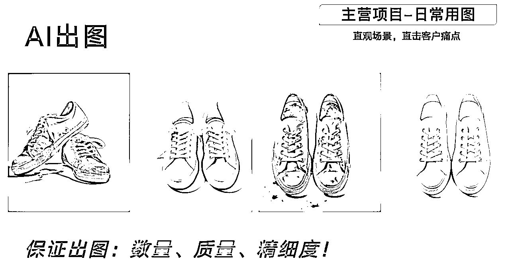

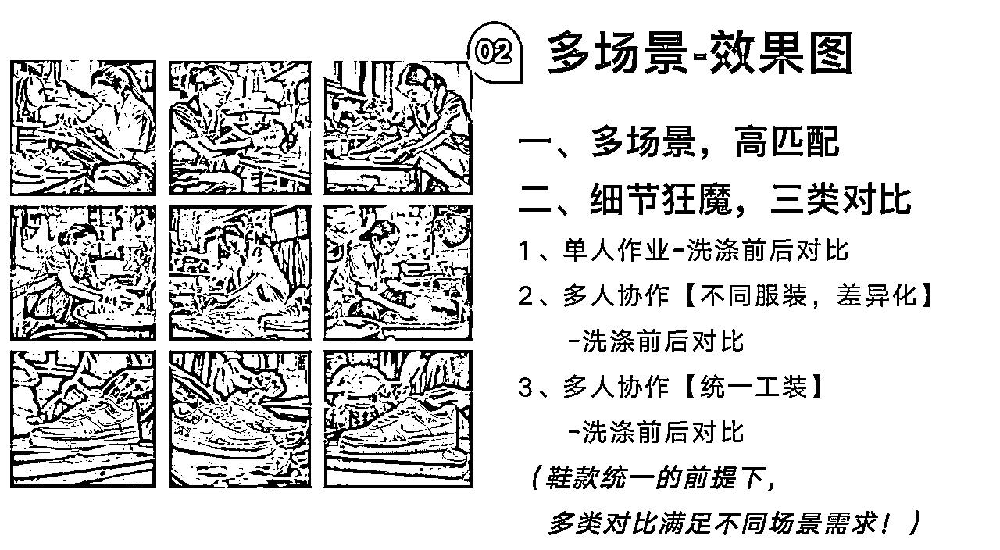

## 写在最后

时代的新浪潮已经翻涌而至，与其逃避，不如勇敢迎上。网上总能看到关于35岁以上程序员失业后找不到工作的讨论，可我始终认为，年龄从来不是捆住我们手脚的枷锁。我们的出路也远不止送外卖、开滴滴这两条。只要愿意用开放的心去拥抱新鲜事物，无论年纪多大，都依然能乘风破浪，站上浪潮之巅！