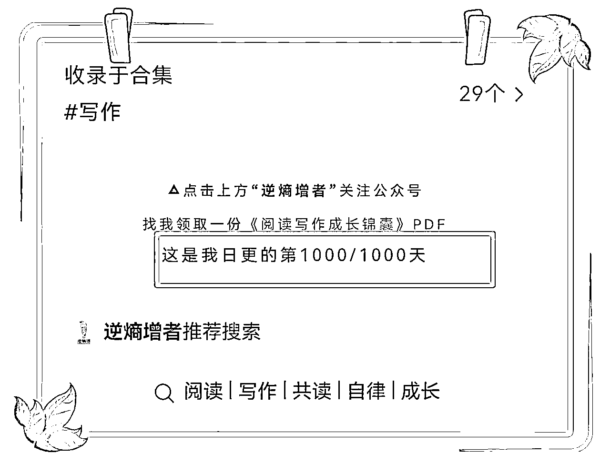
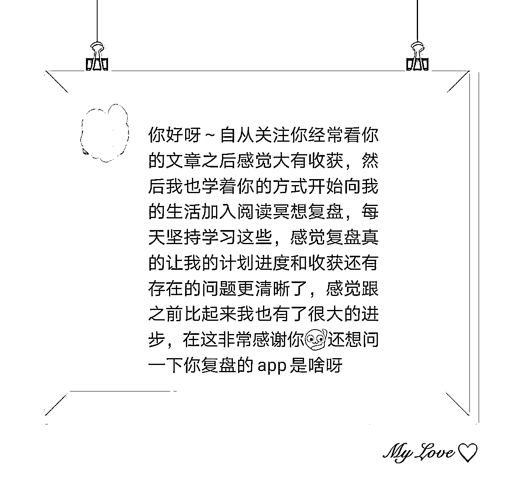
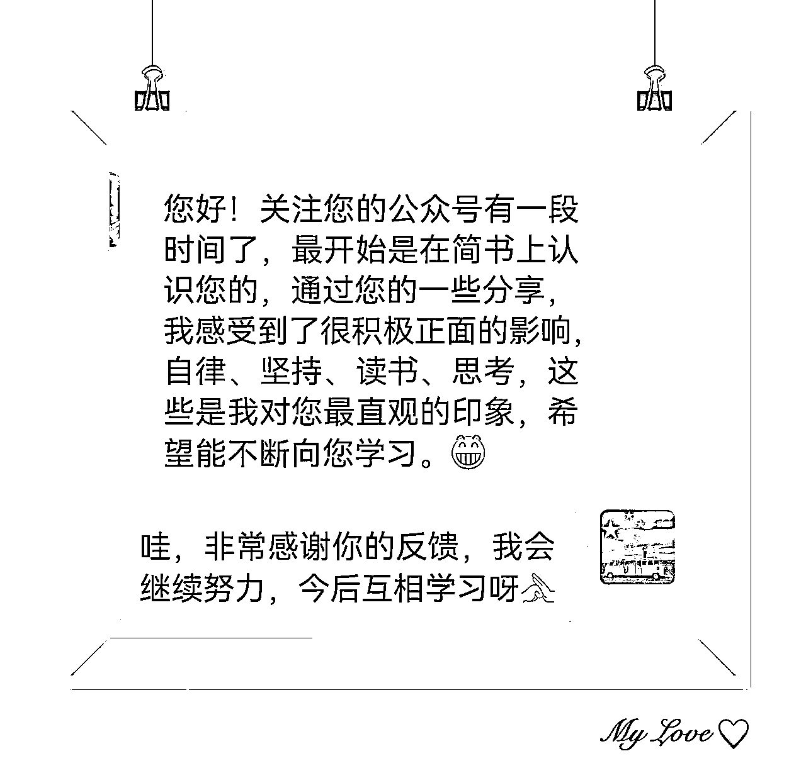
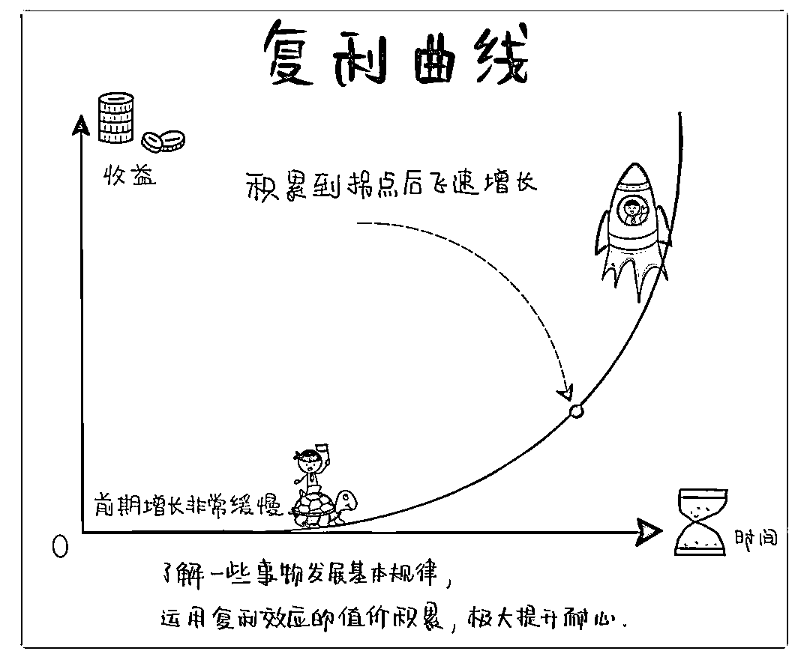
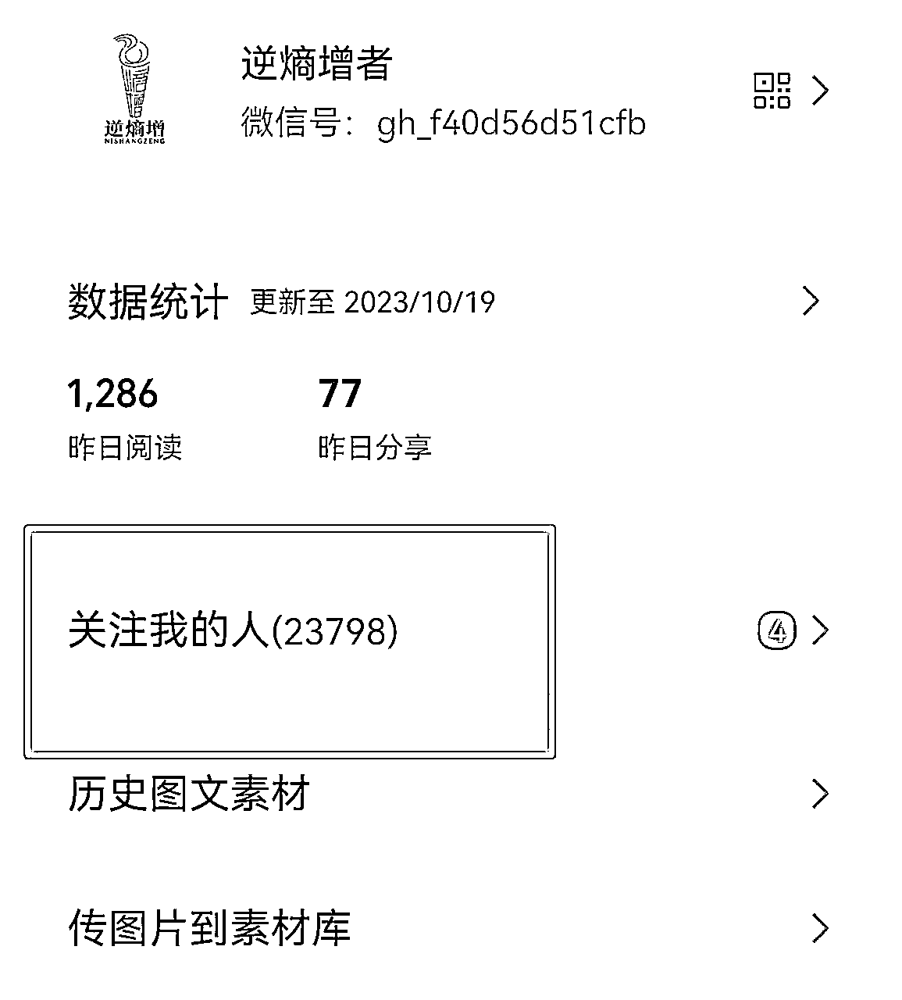
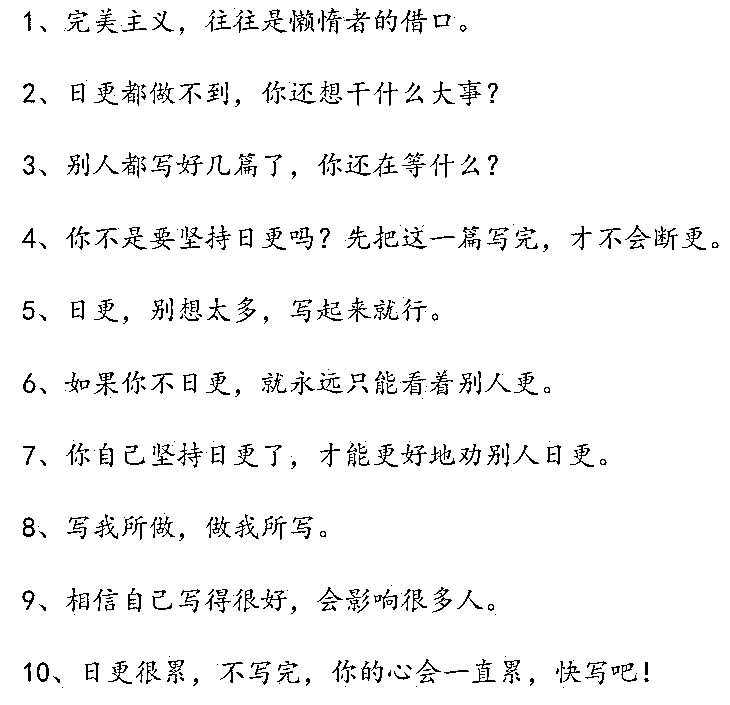
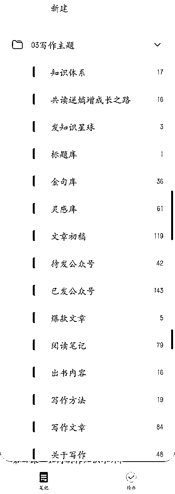
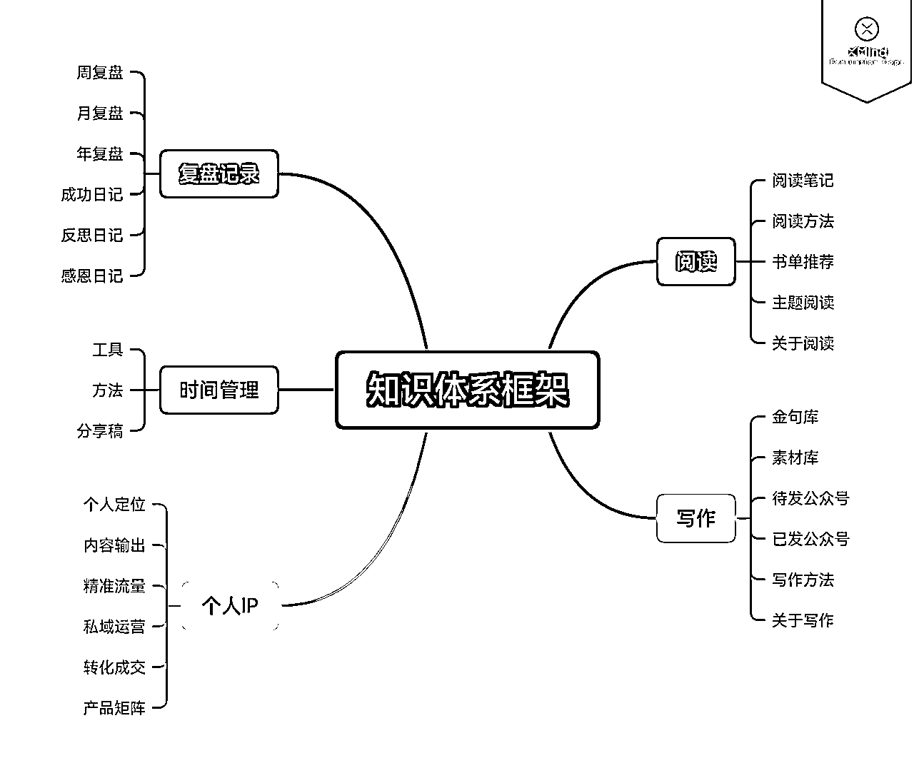

# 我用1000天日更，把知识做成了100万的变现

大家好，我是逆熵增者。

从2020年10月2号算起，到今天，正好是我在公众号上日更的第1000天。

借着这个节点，我想把这三年的体会整理出来，聊三件事：

一、1000天日更给我带来了什么

二、我能坚持下来的9个操作心法

三、给刚起步写作者的4点实操建议

先问大家一个问题，抛开吃喝拉撒，你有没有哪件事是真的坚持了1000天？

我把问题丢到群里，绝大多数人都说没有。

能把一件事做到三年整整1000天，难不难？

我个人觉得，难度不亚于一年赚到100万。

表面上看只是每天发一篇，轻描淡写，其实背后是持续的咬牙。

别说1000天了，能撑过100天就已经淘汰掉一大片人。

1000天是什么概念？将近三年，几乎每天不间断地更新。

中间的状况可想而知，时间冲突、情绪波动、生活突发，一样没少。

所以这1000天的背后，藏着不少让人牙疼的瞬间：

大年三十的晚上，我还在码字

加班到11点，回家接着写

老婆刚生完孩子那天，我也没停更

领证、订婚宴当天，文章准时发

发烧38.5度还在写

阳过浑身酸痛照样更新

在旅途中也从没断过

……

还有就是写到卡壳，不知道写什么好，怕没人看，怕没价值。好几次我都想直接说不更了，但flag已经立了，公开承诺了，觉得打自己的脸太难受，于是就硬着头皮扛了下来。

## 一、这1000天，我到底收获了什么

能把一件事做到1000天，必然是过程中不断有正反馈，必然是找到了意义，必然是发自内心的喜欢。

这三年的回报，我很难用几句话说清，挑7个最明显的感受跟你说说。

### 1️⃣ 自信被彻底点燃

能做到日更1000天，还有什么事是做不到的？

我越来越信时间复利这件事。

水滴都能穿石，刻意练习1000天，任何领域都能产生惊人结果。

关键是刻意，不是机械重复。

刻意阅读1000天，你就是阅读的行家；

刻意写作1000天，你就是写作的主人；

刻意赚钱1000天，年入百万不再是空话。

### 2️⃣ 运气开始转向

为什么写着写着运气变好了？

因为日更就是日行一善。每天的文字都在试图帮到一个人，按照吸引力法则，善意自然会回来。

这也是我忙到爆炸还要坚持的最大动力。我知道，哪怕只有一个人被帮助了，这篇文章就值得。

粉丝2万3，单篇平均阅读1000+，总会触达那个需要的人。

慢慢地，好事就找上门了。优秀的同路人、成长社群里的成员、100多位合伙人，都是在写作中自然吸引来的。

行好事，不问前程，该来的总会来。

### 3️⃣ 思考能力被逼出来

写作不是把脑子里东西倒出来那么简单，它是输入——思考加工——输出的完整闭环。

据说只有5%的人在真思考，10%自以为思考，剩下85%根本不想思考。

不是我变爱思考了，是每天被逼着必须想。所以，写作逼我成为了一个更会思考的人。

### 4️⃣ 真实见证了写作的复利

文章之间形成体系，复利会炸裂。

看一组我自己的变现数据：

日更100天，0元

日更200天，0元

日更300天，1万

日更400天，10万

日更500天，20万

日更600天，30万

日更700天，40万

日更800天，60万

日更900天，100万

日更1000天，…………

常说持续分享，黄金万两。

前200天几乎零收入，但我并不焦虑。因为那一年我把它当成学习，把写作当成投资。赚钱和做社群的想法当时还没冒出来。

最重要的是先让自己变有价值。记住：财富是成长的副产品。

认知到位了，钱自然会流过来。

变现主要靠三类产品：共读营、成长社群、合伙人。合伙人170+人，成长社群1500+会员。

### ❺ 认识了一批真正的人

写作是我和世界连接的接口。

文字就是互联网上的第二张名片，随时有人可以通过它认识你，像开了分身术。睡一觉醒来，可能就多了一条有价值的连接。

这三年，我通过文字链接到了小红帽、JS、阿满、莲子、苏老师、吉阳洋、大侠、刘老师、乐乐、申姐、驽马、小白鱼等2万多位伙伴。社群里的每个人，都是写作带进来的。

### 6️⃣ 可能性被打开了

不发声就不发生。

如果我当时只埋头看书不分享，没人会知道我。

写作给我装了个喇叭，时不时喊一嗓子，被看见、被认可、被连接。

比如上市公司掌阅的团队，在微信读书看到我的书评后主动找我合作。

### 7️⃣ 个人影响力全面提升

公众号从0到23000+

微信好友从0到18000+

成长社群从0到1500+

逆熵增合伙人从0到170+位

总结一句话，写作的意义在互联网时代已经超越了写作本身。

写作是加速成长的引擎。

写作是探索兴趣与擅长的过程。

写作是让专长变得更专业的路径。

写作是训练大脑精密思考的工具。

写作是传播，让更多人看见你。

写作是记录，让成长可视化。

写作是利他，为他人创造价值。

写出来的东西能构建个人品牌，启动事业，最后实现财务自由和时间自由。

以教为学，用费曼学习法持续输出，是最高效的学习方式。

所以，请一定要写起来，坚持写下去。不为钱，为那个更好的自己。

## 二、能日更1000天的9个秘诀

最难的不是写一篇，而是持续写下去。

### 1️⃣ 先立规矩，再倒逼

比如定日更100天，并公开承诺，没做到就发200红包给群里。外部压力会变成强大的推动力。

### 2️⃣ 用提醒对抗拖延

把激励语打印出来贴着：

1、完美主义是懒人的遮羞布。

2、日更都做不到，还想做大事？

3、别人写了几篇了，你还在等什么？

4、说好要坚持，先把这一篇写完。

5、日更，别想太多，先写。

6、不写，你就只能看别人更。

7、自己能坚持，才能劝别人坚持。

8、写我所做，做我所写。

9、相信你的文字会打动很多人。

10、日更很累，不写完心更累，快写。

### 3️⃣ 留点库存保底

最好提前备几篇。我的文章基本都是当天写，对思考要求高，压力也大。后来开始调整，提前储备以防万一。

### 4️⃣ 每天必须输入

写不下去的核心原因是没料。每天保持2-3小时输入，看书、看公众号、逛知识星球。这是支撑我1000天日更的底座。

### 5、 显示进度条

写作打卡第36/100天，这样每天看到数字，就不会忘记。

### 6️⃣ 提前做选题计划

先列清方向：好书推荐、阅读笔记、复盘、好句分享、时间管理、个人成长、自律习惯。

再排期：每周日复盘1篇，周二金句1篇，周一、三推荐好书2篇，周三转载1篇，剩下2篇做主题答疑。

### 7️⃣ 用万能公式降难度

掌握一套写作模板，卡住时照着套。黄金圈Why-How-What就是其中之一。我整本书都是用这个结构写的。

### 8️⃣ 搭起自己的知识体系

觉得每天输出太难，通常是因为没有框架。梳理好定位的知识地图，每天写一个知识点，也能写半年。把一个点写透，就是一篇好文。

比如打造个人IP，很多人不知道怎么做，这本身就是一个好选题。

从30个常见问题开始整理，关于写作、阅读的30问，足够你更新两个月。

一个好问题+一个好回答=一篇好文章。

### 9️⃣ 找个写作圈子

一群人一起写，别人发了你没发，会有羞耻感。群里的动态也会提醒你别忘了发。一个人快，一群人远。

## 三、给新手的4条黄金建议

### 1️⃣ 刚开始怎么起步

先定定位，然后往这个方向写就行。别管选题火不火、标题够不够抓眼、文笔顺不顺畅、字数够不够。先把完整的文章写出来。

我一开始就是写读书笔记和书评，每看完一本就输出一篇。

万能模板：开头说今天看的书和3个最深刻点，中间展开3点感悟，附带践行清单，结尾总结升华。

开始写自己感兴趣的领域，写着写着就成了擅长。写作就是最好的费曼学习法，写够100篇，自然精通。

### 2️⃣ 从擅长或身边事入手

你是管理，就分享职场干货；爱旅游，就写游记摄影；宝妈就写育儿绘本；大学生就写校园经验……

有人担心内容太简单没用。其实在中国，再简单的事情也有100万人不知道。微信群的建立这么简单，就有很多人不懂。

我2022年初写《2022年，吹爆这个学习APP》，列20个微信读书功能，阅读量就到了3600+。

写的时候带着帮助他人的心，解决一个问题，这就是价值。写作的终极技巧就是写对别人有用的东西。

### 3️⃣ 先完成，再完美

第一步是心态。接受自己写得不好，没人有空嘲笑你。别等准备好了再开始，先干起来就成功一半。

从一段话开始，每天100字打卡，坚持100天一定有收获。用微习惯降低阻力。

记住：先完成，再完美！

### 4️⃣ 建立素材库

写作不是从白纸开始硬码字。我现在日更也是靠素材库检索关键词，效率高很多。

小白要老老实实攒素材，做好分类归纳：阅读、写作、时间管理、思维、人际、理财、知识管理等。

积累时要思考这个素材能用在什么文章里，这才是素材的真正意义。

最后送一句金句：

起初为自己成长而写，坚持下来后为大众需求而写、为长期价值而写、为打造自己的世界而写。

即使没有掌声，也要持续输出。反馈是惊喜，不是前提。我就是靠这句话熬过无人问津的阶段。

希望对你有用。

如果有写作上的困惑，欢迎留言交流。

福利赠送：

1️⃣《50条阅读写作成长锦囊》

2️⃣《101条个人IP变现锦囊》

3️⃣《2024年搞钱指南》