# 从0到80W的私域IP之路：一个985大学生的社群运营自白

大家好，我是龙哥。2003年出生，20岁，985高校在读，同时也是自主创业者、“烽狂创客”的发起人。2021年我考入985大学，大一拿到了国家励志奖学金。大二这一年，我从零开始做自媒体，死磕私域关系运营，用11个月时间实现了80W+的变现。

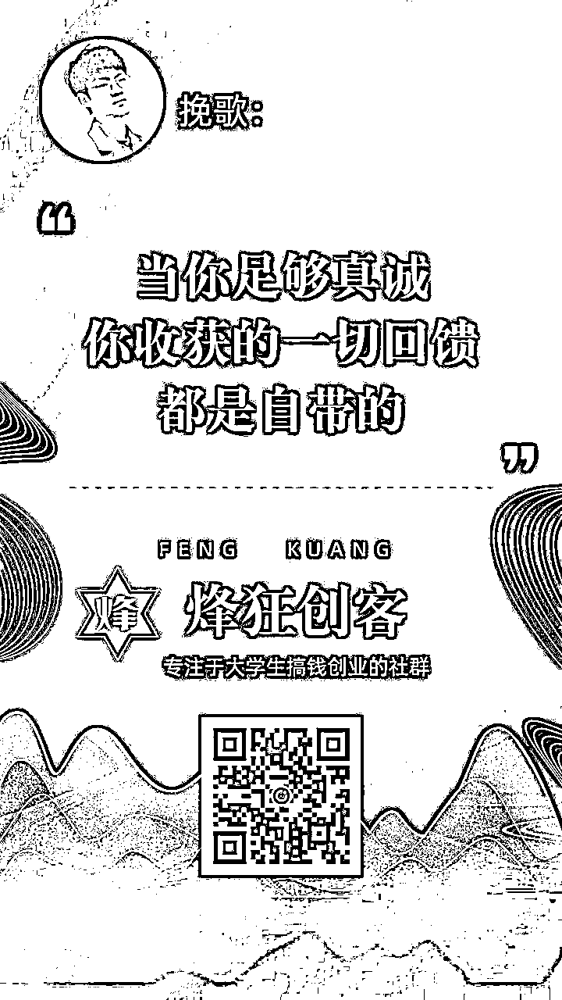

这次我主要想分享两件事：第一，过去半年多，我是怎么完全靠私域，从无到有搭建起一个叫“烽狂创客”的搞钱创业圈子的完整经历和心路历程；第二，我在这段路上积累的创业感悟，以及私域关系运营的实操经验。希望这些内容能给你一些启发。

# 一、从0到1搭建搞钱圈子的那些日子

2022年11月上旬，我在朋友建议下注册了一个👸号，当时纯属一时兴起。到了12月，我突然发现自媒体居然可以赚钱，仿佛打开了新世界的大门，从此对自媒体产生强烈的兴趣。因为没人教，我就全靠自学，上网检索、查资料、看各种教程，再自己动手实践。

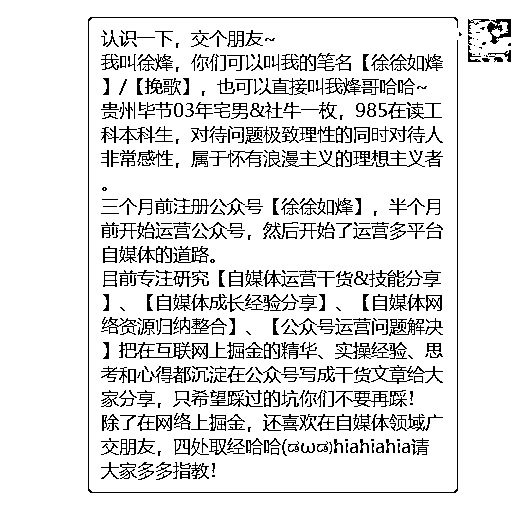

这段经历给我的感悟是：一个优秀的创业者，应该对不确定性背后隐藏的机会保持敏锐。作为普通人，与其急着谈理想、谈热爱，甚至把一辈子都押上去，不如趁年轻多去经历更多曲折、有趣的事情，多见一些优秀的人，多看看世界，给自己打开更多可能。见识上去了，认知打开了，你才有机会遇见那些能让你逆天改命的契机。

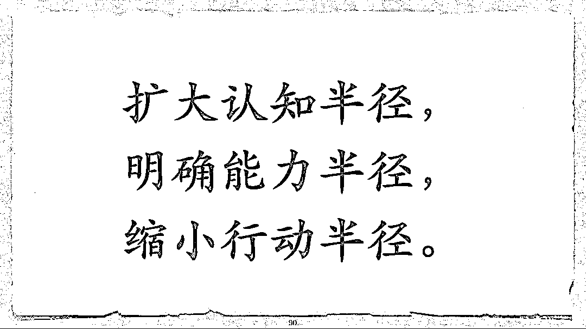

## 第一次扩张：借势完成原始积累

这段经历让我意识到：当你自己还不够强大的时候，一定要学会借势、借力。这里也给你们几个我的亲身建议：第一，能找到人带，就不要自己闭门造车，真正的聪明人都懂得借力。第二，别人的私域，其实就是你的精准公域；在别人搭好的大舞台上，多去展示自己的实力、输出自己的价值，让更多人看见你。第三，要懂得分寸，尊重别人的主场，一切以给别人创造价值为前提，靠被动吸引，而不是主动引流。

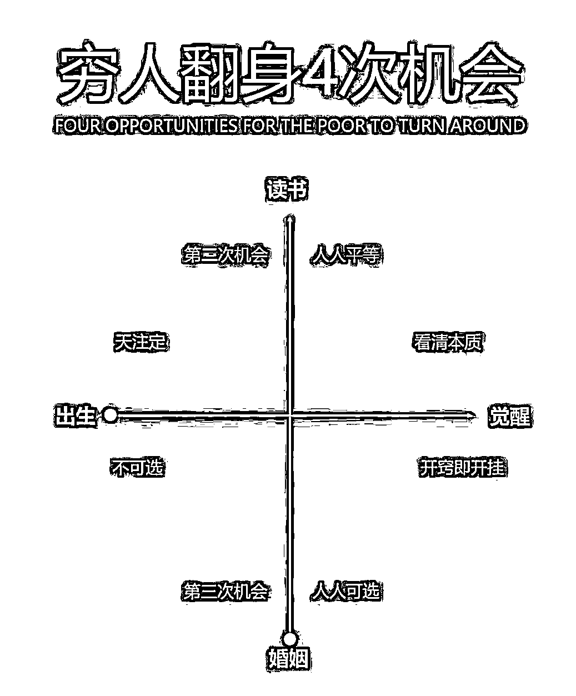

## 第一次迭代：从单打独斗到组建团队

玩了一段时间后，我发现一个致命的问题：我没有任何公域成绩做背书。这个短板直接导致社群增长变慢，门槛也提不上去，靠它快速变现根本不现实。于是我开始琢磨破局的办法。

后来我想到，能不能做资源整合、借势借力，打造一个高价值的产品？我在别的平台没什么成绩，自媒体入局也晚，经验也不算丰富，但那又怎样？我会不会做内容有关系吗？我合伙人会就可以了。我没有流量又怎样？我合伙人手里有就行了。谁规定教别人就一定要自己亲自教、内容就一定要自己亲手写？想清楚这点后，我立刻在社群和朋友圈公布了项目方案，包括我打算做什么、能给大家带来什么、需要大家配合什么，正式启动合伙人招募。可能因为社群成员粘性高，很多人都有兴趣入伙，我还请来一位大佬做特邀指导嘉宾。合伙人计划在朋友圈发布后，我专门招纯融资型合伙人，两天内融资2.5W+。我采用股份制的形式，让大家都能出资入伙，就这样组成了我的第一支自媒体运营团队。

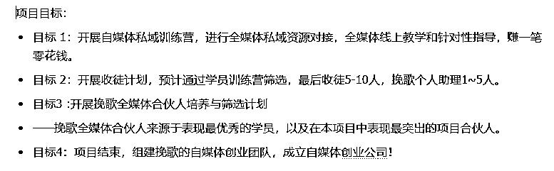

团队成立后，我以团队名义对社群进行了重构，用低客单价把它定位成转化池，同时把后端的盈利产品确认为各平台自媒体运营的课程训练营。原来的“烽狂自媒体交流群”也正式改名，变成了“烽狂自媒体创业俱乐部”。靠着团队运作，再加上几位有影响力合伙人的推广，以及我一直用的阶梯涨价策略，俱乐部很快做到了100多人。

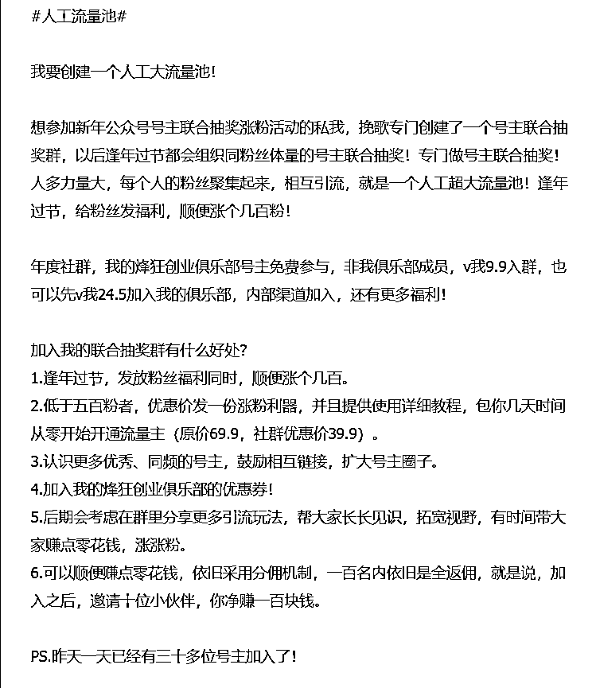

经历过这个阶段，我对两个互联网思维特别有感触，它们会是你超越同龄人的大杀器。一个是杠杆：一鱼多吃，四两拨千斤；一个是复利：过去做的事，价值并不会停留在过去，还能不断推动未来的事情。互联网有一个独特的属性，就是你的一句话可以被千百万人看到。所以一定要善用杠杆和复利，去撬动更多可能性和财富。

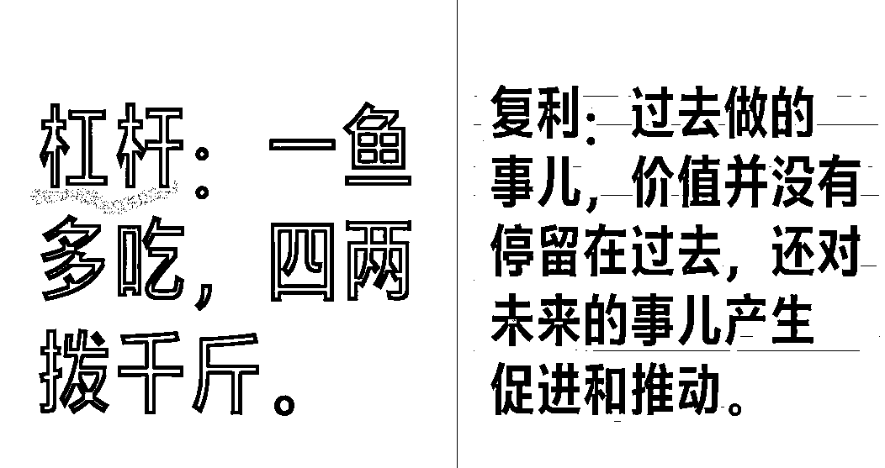

## 打造免费流量池：先让流量进来

后来我静下来复盘，发现想跑通闭环，必须同时有产品、转化、流量这三样东西。当时产品刚开始打磨，转化池已经有了，唯独缺一个流量池。我很清楚，不能等产品做完再去引流，于是就先建了一个免费的流量池——免费知识星球“烽狂自媒体创业俱乐部（免费）”。因为是免费的，朋友圈一推广，短短几天就进来了几百人。虽然是免费星球，我也很认真地提供价值，等到大家粘性上来了，我再把付费🛰️社群的招募信息发进去，又吸引来了一批新朋友。

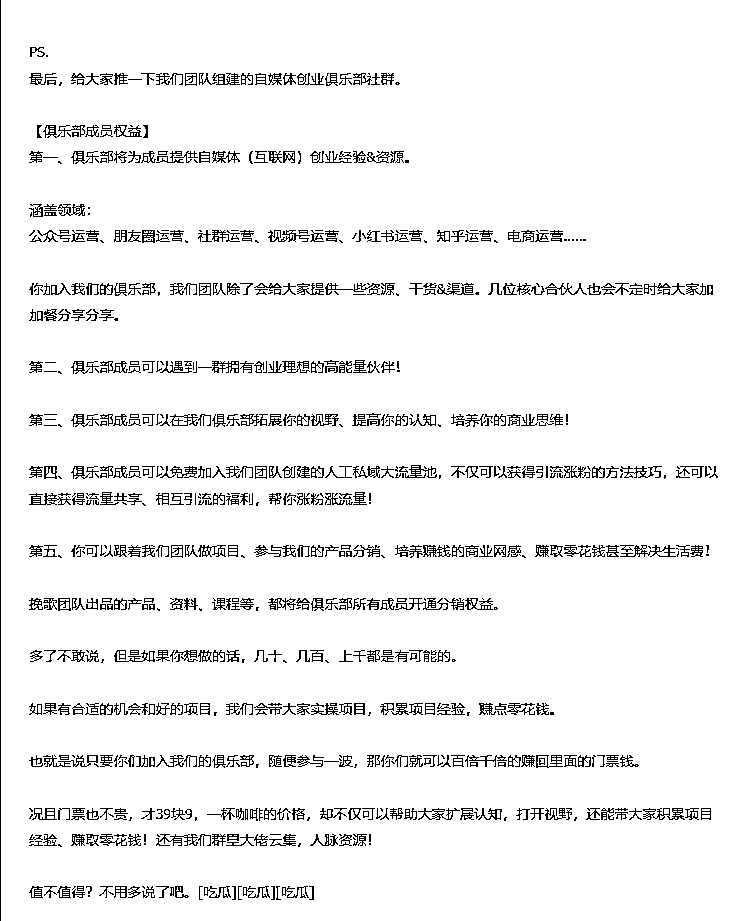

那段时间我最大的心得就是：做什么都要讲策略，处处都有策略。创业说到底就是一场策略游戏，每一关都选对合适的策略，你才能一路通关，成为最后的赢家。

## 第二次扩张：网络社交撞见贵人

在带队打造产品的同时，我也一直坚持混圈、破圈，后来非常幸运地认识了对我影响很深的一位前辈——七小，还得到了他的认可。七小哥直接在朋友圈安利了我的🛰️和社群，一天时间就给我带来了60多位付费用户，我的社群直接冲到200多人。

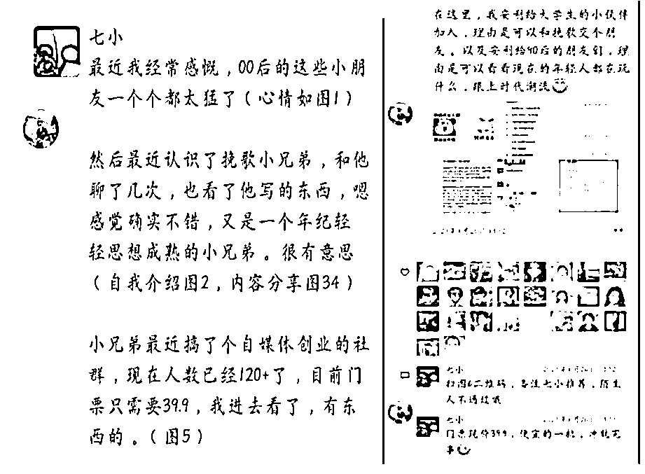

这段经历让我彻底明白：创业这条路上，人脉就是最大的杠杆。读万卷书，不如行万里路；行万里路，不如阅人无数；阅人无数，不如贵人指路。莫言说过，人最大的运气不是捡到钱，而是遇到一个人，他打破了你原来的思维，提高了你的认知，进而提升了你的境界，带你走向更高的人生层次，这就是你的贵人。所以在网络社交里，我特别建议大家多交朋友、多去链接。你主动了，不一定会有故事；但你不主动，一定没有任何故事。或许此刻你链接上的某个人，未来某个时间就会成为你的贵人。

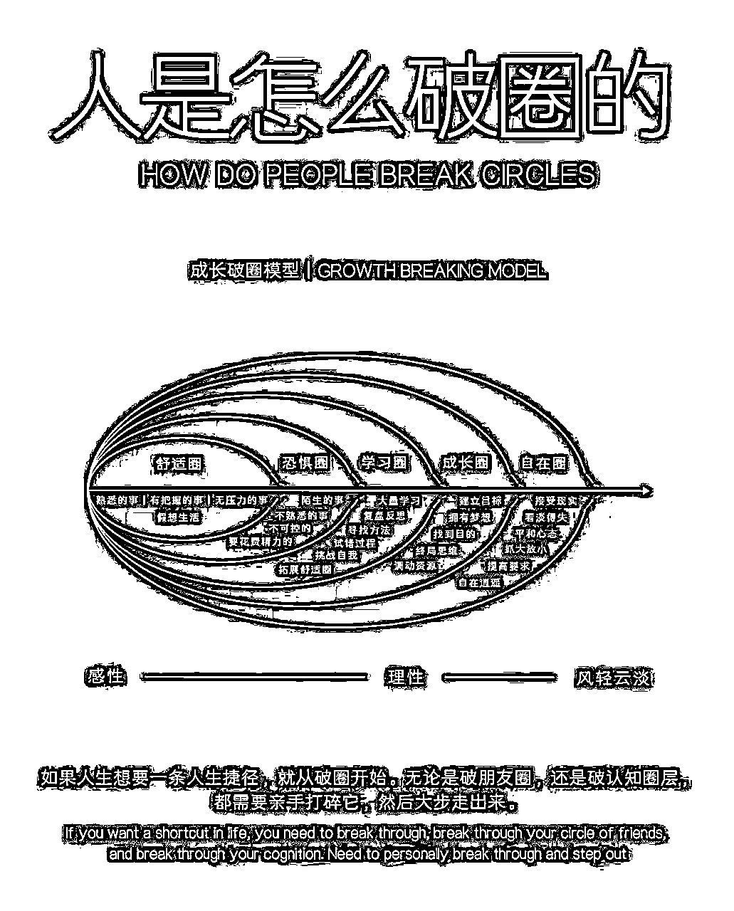

## 稳定增长与课程打磨：冲向300人

那时候，烽狂自媒体创业俱乐部的交付和氛围都获得了不少好评。我一边持续做朋友圈运营，一边不断使用涨价策略，让社群人数慢慢涨到了300+，也赚到了我人生中的第一个1万块。中途我还策划了不少运营活动，比如👸号抽奖引流、👸号号主联合抽奖等，这些涨粉玩法都发挥了不少作用。

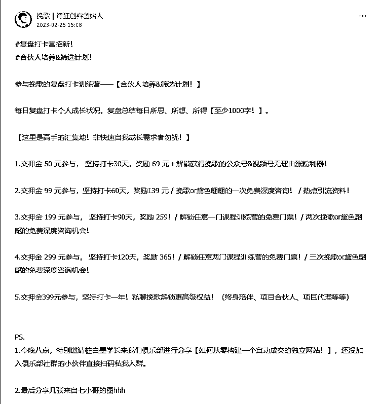

## 巧用分销：从300到400再到满群

我有次看到朋友圈里有分销的玩法，就学着设置了60%的高比例分销。因为俱乐部本身的交付和口碑都很好，很多群友都愿意参与推广，一个月内社群就突破了400人。不过我始终清楚，俱乐部只是我的转化池，并不是最终盈利产品。再加上大学生群体普遍没钱，门槛太高不利于流量积累，于是我干脆降了一波价：原价已经涨到199的门槛，直接降到39.9，而且我还给所有群友100%的佣金。为了公平，之前付费超过39.9的人，我也做了退费处理。很多群友当时看不懂这波操作，但他们心里清楚三件事：第一，这个社群绝对物超所值，推出去不用背负任何心理负担；第二，现在有占便宜的机会，当然要赶紧安利给好朋友；第三，100%佣金，等于我替他们打工，这就是送零花钱的机会。就这样，俱乐部直接满群。

## 盈利阶段：第一个十万块

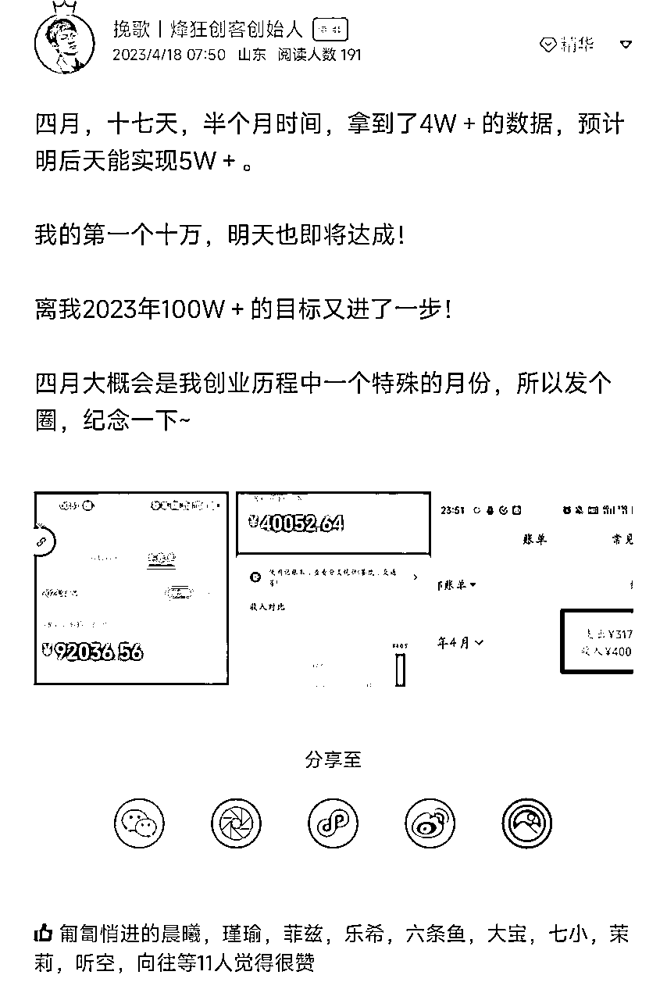

那段时间我最大的感触是，一定要足够努力、足够勤奋，拼命去迭代自己。从连“自媒体”是什么都没听过的小白，到轻轻松松日赚几百的自媒体人，再到日赚上千的私域运营创业者，甚至可以用半天时间引流700个精准私域流量——我前后只用了三个月。因为我每天投入自媒体上的时间，平均从来没有低于12个小时。

## 转化闭环成型：免费—低价—高价

VIP会员的预售虽然结束了，但正式成交还是一直在涨，因为我已经跑通了一个完整的转化闭环：免费—低价—高价。免费端包括朋友圈、免费知识星球、私聊社交和混圈破圈；低价端是烽狂自媒体创业俱乐部交流群；高客单就是VIP会员。依靠这个闭环，我在稳步上升的过程中完成了第一个20W目标。

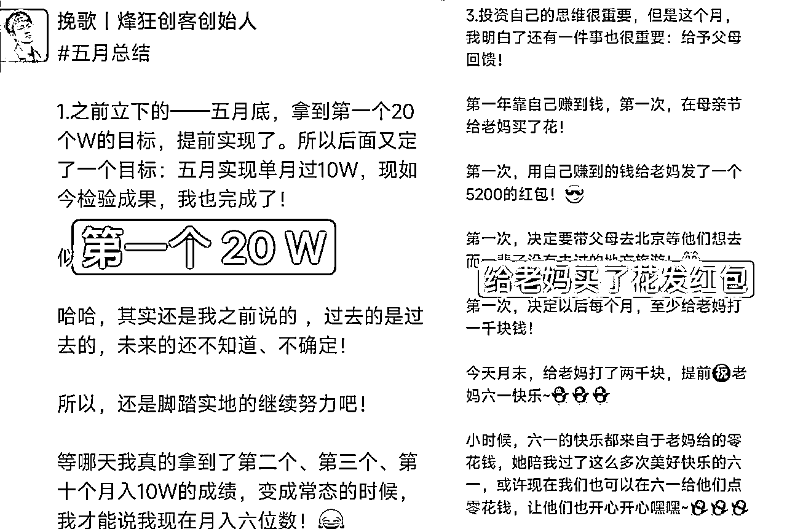

我的体会是：做私域，千万别做一锤子买卖，也不用总去追逐那些充满不确定性的风口。流量、转化、产品，这三个环节缺一不可。你必须选择合适的策略，打造出属于自己的转化成交闭环，把时间的杠杆用起来，这才是长久发展之道。

## 私域活动裂变：让流量自己滚起来

有一阵子，AI内容在圈子里特别火，我立刻意识到这是一个放大的好机会。之前长期破圈，让我已经能触碰到一些比较高级且稀缺的信息和资源。AI爆火之后，我顺势组织了一个免费的AI交流俱乐部，本质上又是一个免费流量池。当时我用的玩法是朋友圈裂变：愿意帮忙把社群二维码转发到朋友圈的人，会收到一份小礼品。因为大家信任我过去的交付，很多朋友都主动帮我转发，半天时间就聚拢了800多人。借AI的势能，更多人认识了我，经过社群和朋友圈的双重转化，这一波给我带来了10W+的收益。

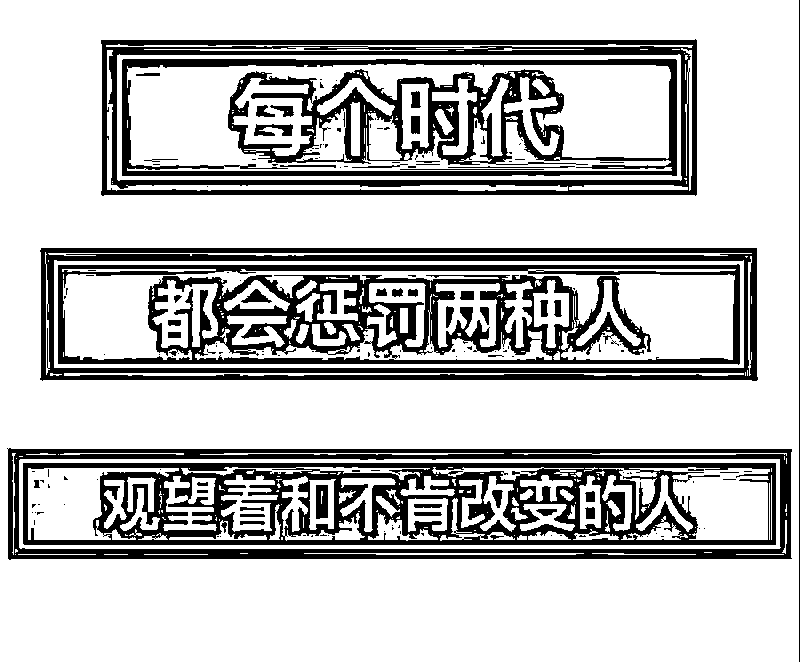

到了520的时间节点，我又启动了CP邀请进群活动，同时请大佬帮忙投流推广，直接让群人数冲到了600+。我的感悟是：在你还没有稳定流量来源的时候，一定要不断学习新的流量玩法，并且大胆去试。同时要学会借势——借活动的势能，借大佬的势能，也借时代的势能。

## 迭代升级：烽狂创客的诞生

做了这么久自媒体，我发现一个真相：网络上的创业圈子，反而比现在的线下大学更像一所真正的大学。因为大学没有培养我们看见财富的能力，没有培养我们把价值转换成财富的能力，也没有培养我们创造财富的能力。但在互联网的搞钱圈子里，什么都有：有赚钱的信息，有搞钱的人，有搞钱的氛围，有搞钱的资源和风向标，有搞钱的技能培训，还有搞钱的实战项目。从认知提升、技能培训到实战赚钱，整个链路都是完整的。既然读完大学的最终目的也是搞钱，那我为什么不直接从“搞钱”出发呢？一切以搞钱为核心来展开教学、交流和实战，才能真正培养出大学生的赚钱能力，让他们更快适应真实的社会环境。

想清楚这一点，我决定重组合伙人团队，去建一所网络虚拟大学。这所大学的核心任务和考核指标是“提高大学生的赚钱能力”，宗旨是“只教线下大学不教的东西”，终极目标是“帮助大学生在大学阶段实现经济自由”。

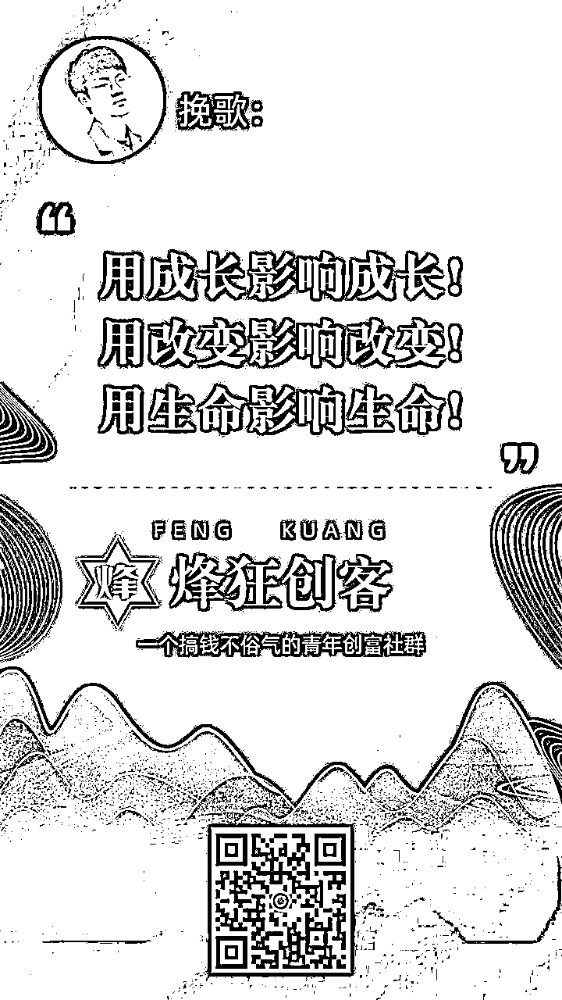

### 平台化运营：从内容生产到资源对接

想把社群做到万人级别，想实现快速增长和阶层跨越，光靠自己和团队去生产内容，肯定是不现实的。所以我启动了内容共创激励计划。如果能把精力聚焦在平台运营本身，事情就会简单很多——本质上就是去找流量、找产品，然后把它们对接起来。这个模式，不仅会让星球的内容价值越来越高，也能增强群友的参与感和归属感，同时还能减轻运营团队的内容输出压力。

### 体系化、去中心化：把社群做成品牌

目前烽狂创客的社群体系已经初步成型，分成几个梯度：
① 烽狂创客·明星俱乐部：🛰️群，门槛3000，50多人；
② 烽狂创客·交流大本营：🛰️群+星球，门槛365，500多人；
③ 烽狂创客·精华收藏夹：🛰️群+星球，门槛79，300多人；
④ 烽狂创客·高校创业者交流论坛：星球+快闪群，无门槛，1400多人。

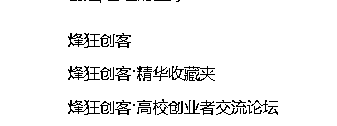

在这个基础上，我还会不定期开一些临时快闪群，比如电子书共读营、课程训练营、第几期高校创业者交流论坛等。关于流量、产品、内容、氛围这四个关键词，我也在慢慢做体系化布局，让社群规模化、体系化，而不是以前那样想发什么就发什么、说散就散。以后社群日更、周更的时间会固定下来，星球的高质量内容会越来越多，社群活动也会定期举办。流量端我会继续探索新的渠道，但转介绍一定是核心。氛围则更多要靠活动来激活。

去中心化是我给自己定下的长期目标——总有一天，社群没有我也可以正常运转。当“烽狂创客”这个名字比“挽歌”更响亮的时候，真正的去中心化就开始了。野蛮增长期主要靠我自己不断拓流，稳定期靠口碑转介绍，再往后则要靠品牌效应做大做强。我现在正好处在第一阶段向第二阶段过渡的时期，一切也在慢慢地走上正轨。说实话，真正的烽狂创客社群成立才不过两个多月，它就像是刚出生的孩子，却已经准备迈入第二个阶段了。我相信，未来可期。

# 二、私域关系运营经验总结

## 1. 私域运营的本质是什么？

如果用一句话来概括，私域的本质就是你的“门店”，而私域运营，就是在经营这家店。你的🛰️昵称、头像、个人签名、朋友圈，还有聊天框，就是门店的门面。好友数量，就是可能经过你门店的人流量。所以好友越多，意味着地段越好，等于把店开在了热闹的商业街；好友太少，就好像把店开在了没人烟的荒野，再好的产品也没人看到。

想靠私域赚钱，一定要先理解这个不等式：流量＞转化＞成交＞复购＞裂变。这个不等式里的每个关键词，都有着自己的任务。流量，解决的是“有”客户的问题；转化，解决的是“能”在你和客户之间搭建价值交换通道的问题；成交，解决的是“使”价值在通道里真正流动的问题；复购，是“会”让前面三步在你们之间反复发生；裂变，则是“让”你的客户变成广告牌，帮你带来新流量。接下来，我就从自己拿到过结果的实战经验出发，聊聊怎么打通“有”流量、“能”转化、“使”成交这几关。

## 2. 怎么打通私域流量关？

第一步，当然是要“有”流量。前面已经说过，🛰️好友数量，就是经过你门店的人流量，好友越多，地段越好。所以，如果你想把朋友圈运营做好，想让销售额上升，想让收入上一个台阶，就必须先把你的“店址”选好，也就是把🛰️好友数量做起来。我一直很相信一句话：互联网创业，流量即为王道。

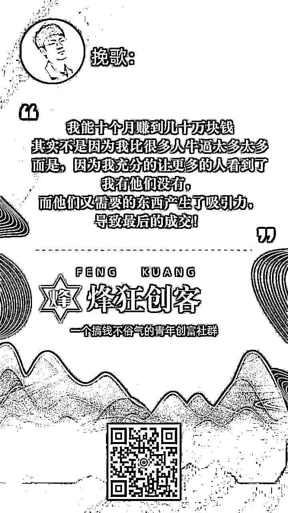

那到底怎么才能“有”流量呢？我自己的方法可以概括为“吸引”。公域引流这里暂时不多说，因为我在公域方向上也没有拿到足够亮眼的结果，就不班门弄斧了。重点聊聊我用过的私域引流方式，一共三类：资料引流、活动引流、裂变传播。

先讲资料引流。它的核心逻辑就是一句话——“加我领资料”。其实这个方法公域也可以做，不过在私域里会更有意思。举个例子，我把自己写过的作品整理成电子书，然后在电子书的页眉页脚、开头结尾都放上个人信息。页眉页脚放logo、👸号、🛰️号、视频号；开头的作者介绍里放🛰️二维码和🛰️号；最后再加一段产品介绍和相关二维码。虽然这种方式的下单率并不高，但它是一个很好的曝光机会，多一次曝光，就多一分可能。

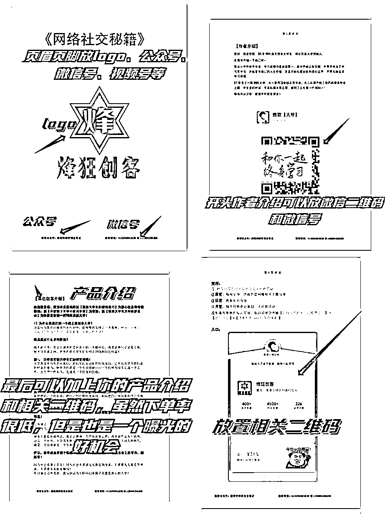

再说一个我特别印象深刻的案例。那是在赚钱航海的过程中，我关注到一位很强的朋友。他把每次航海活动的嘉宾分享都做成了特别精美的思维导图，并在海报上特意标注：“制图者：xxx”。这样一来，大家传播海报的同时，也帮他传播了个人品牌，直接把他的专业能力亮了出来。

你身边有没有一类人：明明在输出干货，却从不把自己的联系方式摆到明处？我上个月刚认识一位。她只发了一张自己做的脑图，没有二维码，也不喊人添加。大家反而毫无压力地保存、转发，我也是被这种自然感牵引，主动搜索她、提交了好友申请。这种拉新手法看着不快，实则每次露面都在悄悄累积好奇，让人忍不住想认识这位优秀的朋友。

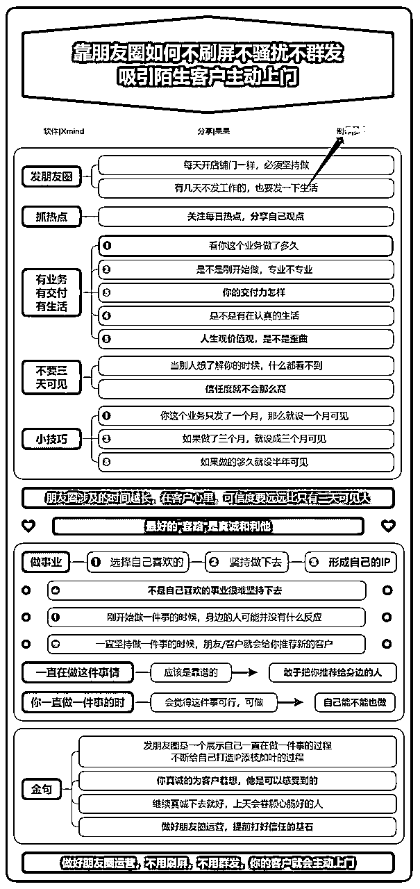

（PS.拆解样本纯属学习探讨，若有冒犯欢迎指正。）

她真正让我折服的地方，是轻松迈过了销售链条中最难的那道坎：把“自己”这个品牌先推出去。销售要过三关：先树个人影响力，再传递理念，最后才是商品成交。她恰好打通了第一关，也是最难的一关。为此我专门写过一条灯塔帖：

#创客风向标——资料整理者
怎样成为圈内红人？吃透脑图，把资料整理变成你的招牌技能。
【思维导图教程】Xmind速成：四步产出竖版脑图，超简单！

有兴趣的人不妨立即动起来。只要你足够稀缺、被人急需、还有持续曝光，自动拉新的齿轮就会开始转动。

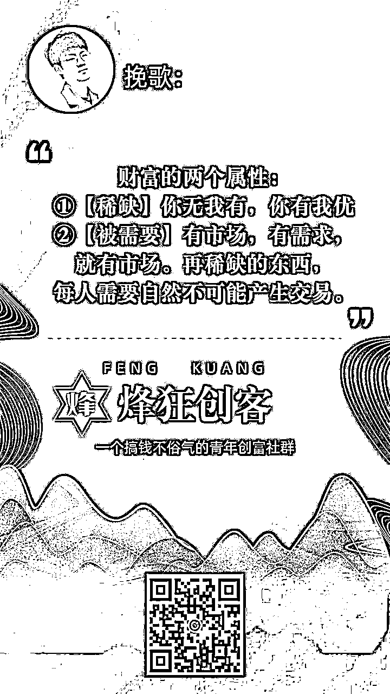

第二招，借一场事件来导流。核心思路是策划某个活动，并让活动内容沉淀到每个人的私人视野里。我当年做高校创业者峰会时，设定了一个参与门槛：掏99元，或替我把特制视觉卡转发出去。收费从来不是目的，它只是让转发显得格外轻松。大家一想，能免费参与何乐而不为？于是卡片刷屏。活动群尽管只有几百人，可触达人数却是群内人数的几十倍。这些扩散才是我最看重的回报——后来的训练营也沿用了同一条路径。

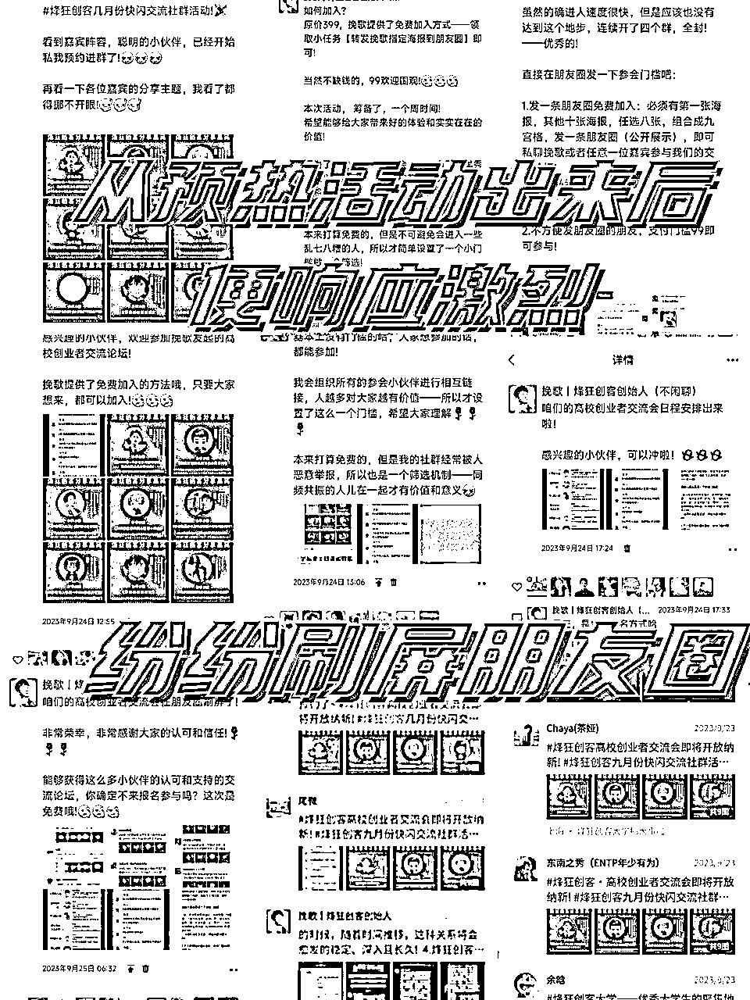

另一套打法，是用仪式感换来自发分享。比如挽歌做的“个人专属”入营通知书、创客币、赚钱船票、打卡纪念卡，都把用户的情绪价值拉满。大家觉得有面子，自然愿意晒到动态或圈子里，二次传播跟着实现。

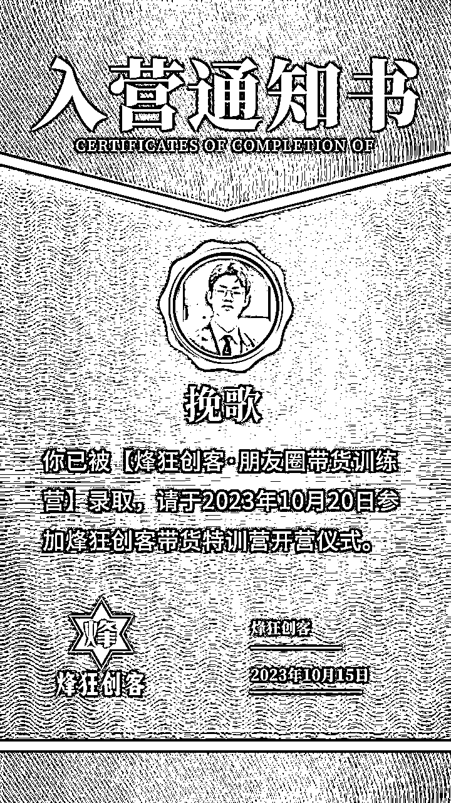

当然，所有传播玩法都有一个隐藏前提：稀缺、急需、高频露脸。三者缺一，无人理会。

第三招，点对点消息里的熟人扩散。活动引流是公开剧目，这招则聚焦一对一关系中的信任增量。熟人扩散有两种形态：自然转介绍和激励转介绍。自然转介绍靠的是极致交付，朋友有需求时主动替你说话；激励转介绍则是用分佣机制点燃老客带新客的意愿。我的做法是：任何人引荐的客人一旦买单，我都会拿出60%的收益，在专属群里直接转给介绍人。介绍人收得踏实，推荐起来自然带劲；我则用这笔利润换来了原本触达不到的目光，还让圈子更有凝聚力。启动这套机制后，九成五的新客都来自老客引荐，信任的雪球越滚越大。

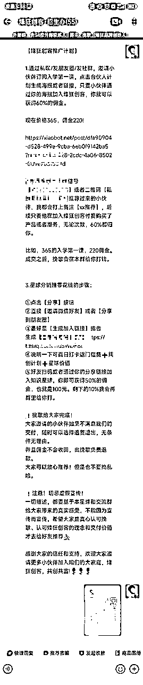

只是，熟人转介看着美，前提却是你的交付、服务、售后全部过硬。

### 主动出击，加人对路

如果暂时等不到别人来，或你还在新手期，就主动去链接。添加好友的第一原则，不是数量大，而是匹配度高。泛泛之交再多，也不如几百个高度同频的人。我通讯录只有两千出头，可付费用户超过一千五，转化率七成以上。之所以这么高，是因为这里聚拢的几乎都是对赚钱、自媒体、个人品牌感兴趣的人。他们的需求和我的定位天然咬合。请记住：成交率与匹配度成正比。把你的时间花在真正需要你的人身上。

链接陌生人的完整流程，可以拆成四步：

一、加人前先自问：想清楚认识此人的缘由？通过何种路径搭上线？是否真心想有往来？有没有读过对方的内容？

二、正式去加之前，学着换位思考。有中间人牵线最理想；同处一个高质量圈子里也有助于通过；再或者，先在合适的舞台展示自己、帮别人解题，让对方先被你吸引。

三、申请语要用心。友好问候，讲清自己是谁，理由要简短，最好带出一个共同点。好比：“你好，我是XX圈子的成员，看过你在XX发表的观点，很受启发，想和你多聊聊。”

四、通过好友后，若对方不是大咖，可以准备一份资源包作为见面礼；若对方是大咖，发个18.8以上的小额红包，附上一句真诚的感谢。紧接着发一段个人简介——不必长篇大论，只要把你的高光成绩、所需帮助、可提供的资源亮出来即可。别忘了，向上社交的核心，是让对方看到你的可利用价值。

## 如何击穿成交关卡？

其实，自有池就是一家线上门店，好友就是进店的顾客。顾客来了，下一步便是促成交易。成交的本质，是让顾客看见商品、认同价值、最后买单。这个过程靠的是社交：点对点私聊，以及一对多的动态、圈子和知识星球。我始终认为，所有自有池里的生意，本质都是关系生意。关系顺了，交易自然发生。

经营用户关系的四大核心动作：不断新增链接、激活旧有链接、为关系分层归类、按分层区别对待。把这些基本功练到极致，你的用户盘子就会长得很稳。

激活关系的方法并不复杂：在动态下点赞留言、私信里真诚赞美、发状态时点名某个人、偶尔找人帮忙然后厚答回报、主动帮别人处理难题、购买对方的产品与服务、定期送出小礼物或有效信息、始终记得饮水思源、把正面案例大方晒出来……这些都不仅仅是互动，而是在给关系账户持续充值。

说到关系分层，完全可以从“信赖指数”和“实力值”两个轴来切分。把联系人放进二维矩阵，你就会看清谁该深交、谁该请教、谁该拉一把。对信任你的人加倍好，对强者多请教，对同段位的人多切磋，对后来者多扶持。时间久了，矩阵会产生向心力，让人不自觉地靠近。

成交关的底层逻辑，凝练成四个字：被看到。你再稀缺，再被需要，如果无人知晓，生意也做不成。许多人不爱打广告，是中了“酒香不怕巷子深”的毒。其实，不是广告托起产品，而是产品应该服务于已验证的需求。公域里的爆款内容、自有池里的日常互动，目标都指向同一件事——让自己出现在更多人的视线里。我十个月能赚到几十万，不是实力碾压谁，而是我让足够多的人看到了“我有而他们没有、他们恰好需要”的东西。

营销这件事也能分出境界：上策是把人设立住，中策是让观念被认同，下策才是卖掉货品。能够把商品卖出去，只能赚到一单；能够把自己卖出去，才能收获长期溢价。个人IP的核心秘密就在这里：先卖人，再卖观点，最后卖货，路径一旦打通，收益会是顺理成章的事。

所以，所谓“卖自己”，就是把持续曝光变成肌肉记忆。主动型卖自己，靠的是动态、圈子、社群和点对点私聊的关系经营；被动型卖自己，则需要剧本营销，例如用案例、事件、故事共同搭建人设。

剧本营销并不玄乎：用一段有起承转合的情节，把品牌信息埋进用户的情绪里。它可以是文字，可以是音频，也可以是一支短视频。关键不在于硬推商品，而在于让人记住故事里的那个你。

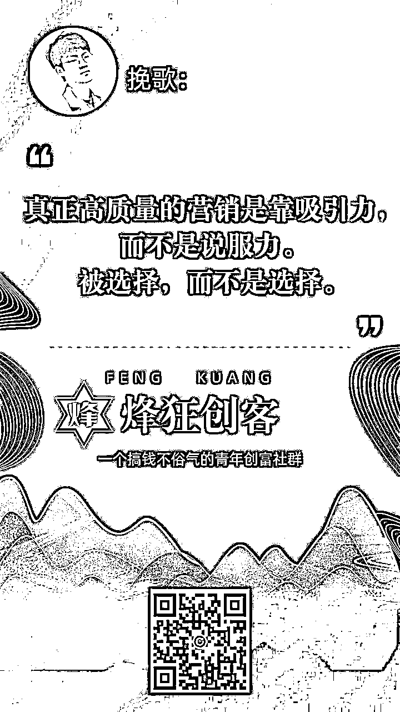

举个例子，“招生办”玩法是我常用的招数。我会把所有分销者拉进一个专属群，谁引荐的客户完成付款，我立刻在群里晒出奖金。眼见为实，大家看到别人轻松赚到钱，“我也能上”的念头就会被点燃，转介行为自然被刺激出来。

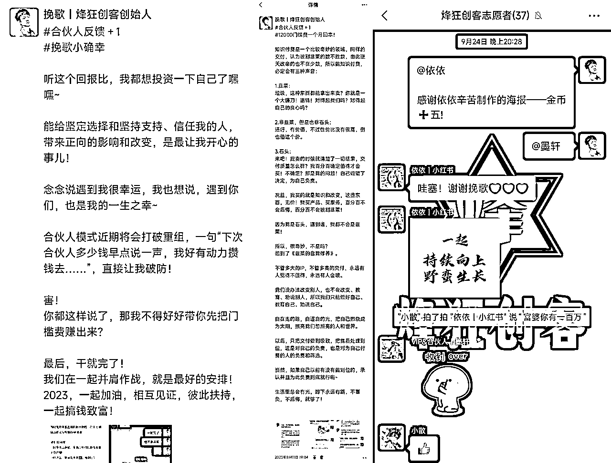

再比如，我常在动态里晒出会员的成长反馈，用“创客币”给志愿者发奖励，也把“跟着烽狂创客赚到第一个一万元”的同学打造成代言人。这些公开的正面样本，都在源源不断地吸引同类人。

活动营销的典型样板，就是烽狂创客高校创业者峰会，完整复盘可以看这篇帖：https://t.zsxq.com/13w27eYbd

复购的秘诀，我复盘到最后只剩四个字：极致交付。至于裂变，前文已经讲透，这里不再赘述。

## 写在最后

以上，是挽歌半年多时间，纯靠自有池从零建立搞钱圈子【烽狂创客】的完整心法沉淀。这里面既有关于流量、成交、变现的真实战绩，也有我对用户关系的深度反思。希望它能给你带来一点启发，也欢迎随时指正。

如今，随着合伙人团队与运营机制渐渐成熟，烽狂创客已进入半自动运转阶段。我也能腾出更多时间，去专注圈子的迭代和会员的价值体验。每天都有不少新朋友走进来，大多源于老成员转介，这种感觉非常奇妙。想到这一切都由我亲手从零点燃，我就觉得无比浪漫。以一灯传诸灯，终至万灯皆明——这是我深信的方向。我会在大学剩下的时间里全力奔跑，争取毕业前让这个社区突破一万人。现在才大二，我还有三年。

但我也清醒：创业不属于大多数人，搞钱也不会是多数大学生的大学主题。这就是二八法则，没人能逆转。可我还是选择去做，因为那20%的人需要一个起点、一个路标、一盏灯。也许有人觉得我太理想化，可我想得清楚：这件事有概率可见的路径，有无论成败都值得的理由，还有即使失败也能接受的安排。所以我在第一课还没开讲时，就公开喊出了烽狂创客的名字，把自己逼到没有退路。说实话，八月到九月我常有整夜失眠的时刻，但此刻一切都在往前走。做成，是惊喜；做不成，至少没有辜负这段青春。

文章到此结束。感谢你的阅读，愿我们都在各自的方向上闪闪发光。