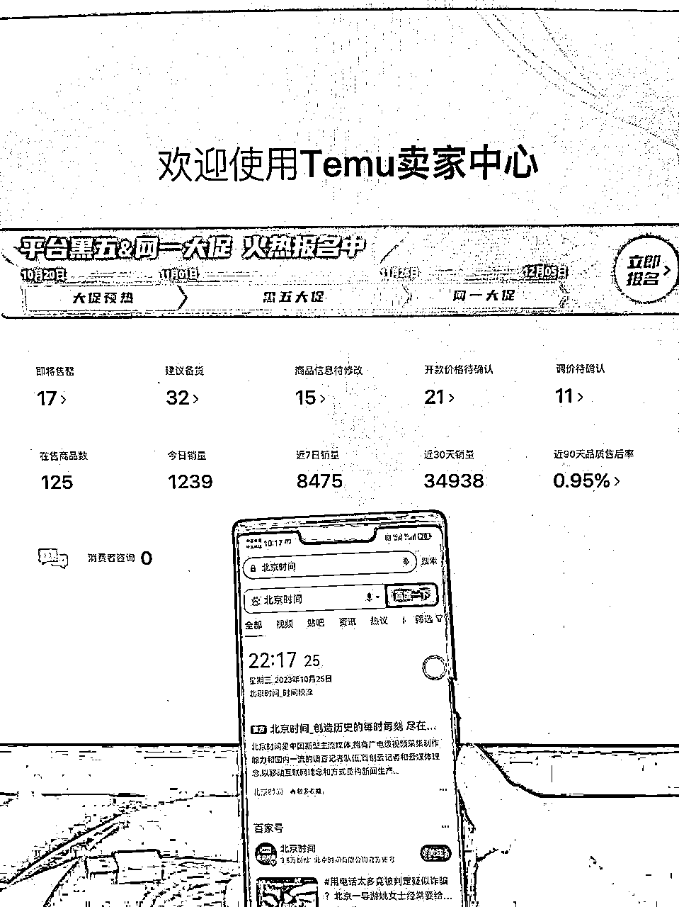
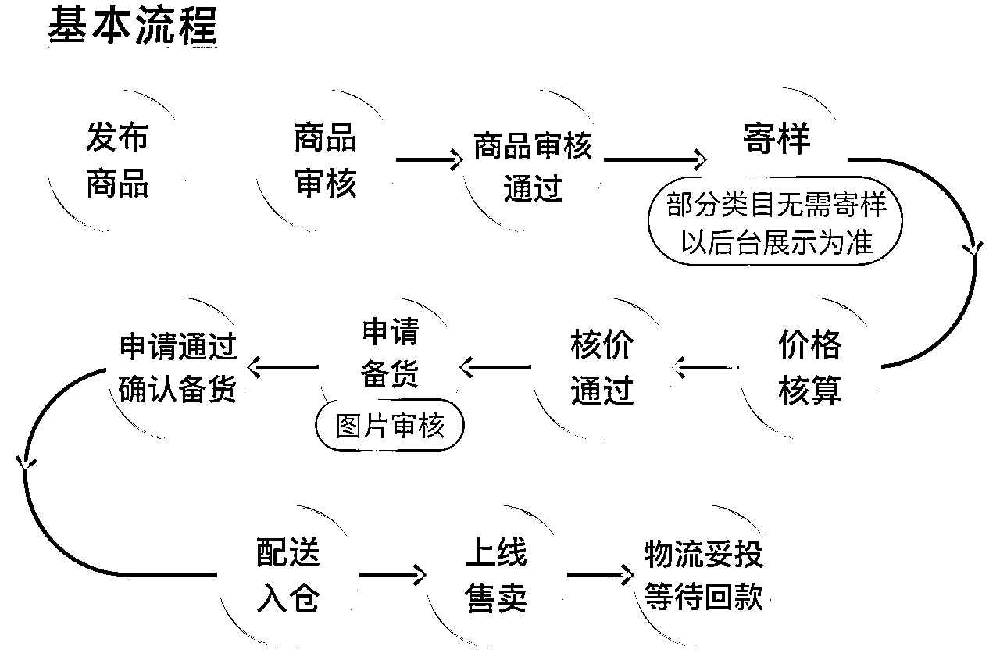
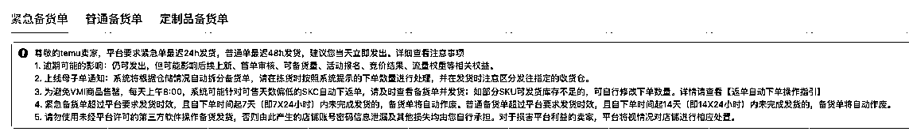
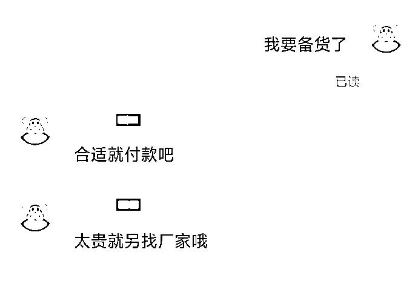
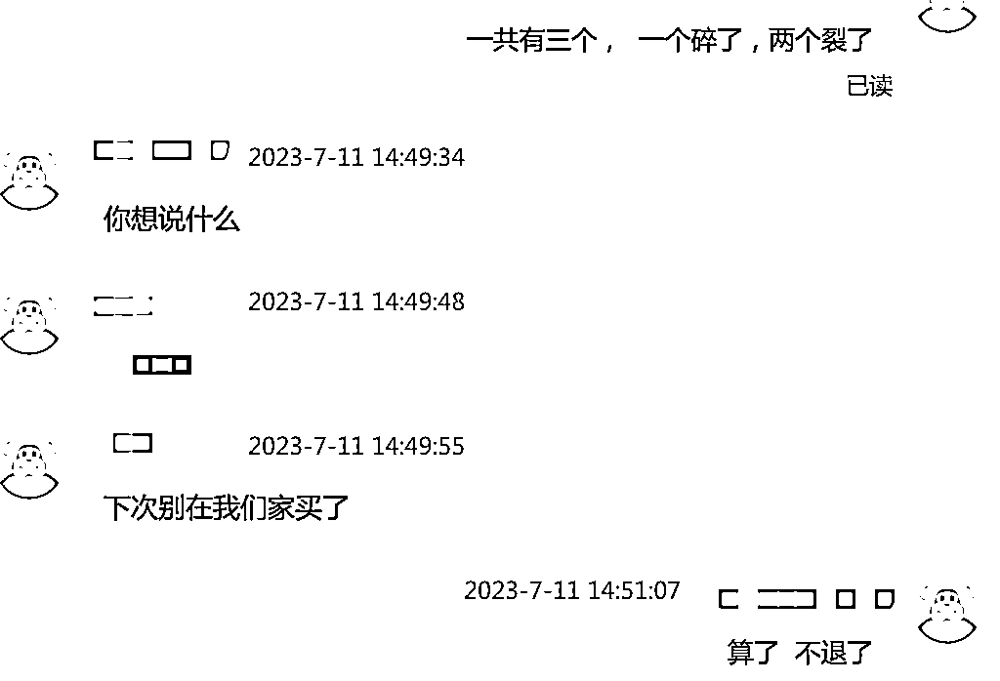
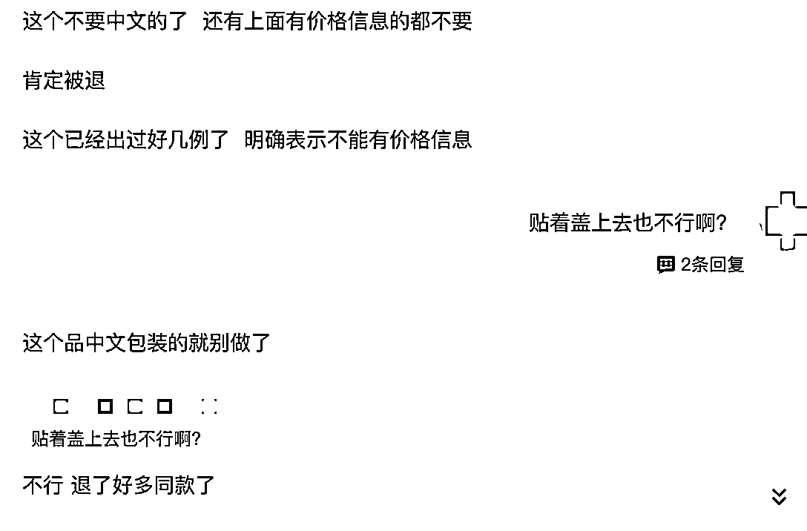

# 被裁后我在TEMU上翻身：从0到月入10W+，全托管玩法拆解
作者：龙哥

大家好，我是龙哥。年初被裁后回到三线小城，试了一堆项目，学费交了不少，也被割过几次，始终没起色，整个人特别迷茫。直到五月初碰上TEMU，现在每天平均利润能稳定在3500块左右，一个月下来十万多。

为什么挑TEMU？

一是门槛真的不高：个人身份，有张银行卡就能注册开店。二是平台是全托管的，运营、国际物流、售后这些统统归平台管，我们只需要专心找货、发好货就行，不需要什么电商运营经验。三是它正好在流量红利期，站点已经开了接近50个国家，一个链接就能卖到全球。

我的路线是：先注册，再上品，接着测品，然后备货，最后爆单。

注册就不啰嗦了，按要求填资料即可。链接放这：https://kuajing.pinduoduo.com/login/register

审核通过当天就能传品。平台有一套商品生命周期管理：买手挑中才算过审，核价师会给建议售价，然后申请备货做首发测试。

关于测品：等你和平台把价格谈妥后，就能申请发首单到仓库测试。一开始发5件也行，后来平台硬性规定最少15或20件。货值低的品，200块以内就能测完。平台怎么判断测品成没成？标准如下：

- SKC日均销量超10，就是爆款；
- 日均销量超5，就是旺款；
- 近7天总销量超7，算上新成功。

再说备货：分首单和返单。返单还有两种：一种是普通备货，另一种是紧急备货。普通备货你主动下也行，平台自动补也行；卖得越好的品，系统给的备货额度就越大。

爆单这块，我前后测了100多个品，其中十多个慢慢起量，最后成了每天能出几百单的爆款。那段时间天天打包，累是真的累，开心也是真的开心。

接下来聊聊我踩过的坑，希望对大家有帮助：

第一，供应商不靠谱。我在1688拿货，经常遇到发错货的情况，只能退货。后来学乖了，下单前反复跟商家确认清楚。

第二，资质问题。带电产品、14岁以下儿童用品需要FCC、CE这些认证。以前平台允许你先把货卖起来，比如卖到1000件后才要求认证；现在不行，强制要求提前提供，没有不给你入仓。

第三，侵权风险。比如“Frisbee”这个词被注册了专利，很多卖飞盘的商家标题里用了它，结果被起诉，收到TRO，最后花一大笔钱和解。关键词一定要小心。

第四，商品条码标签不能贴在封口上，否则质检不过，直接退回。

第五，封口长度超过12.5厘米必须贴防窒息标签，不然也会被退。

第六，粉末、液体、磁性这类特殊属性要如实填写，我之前没填对，货到仓后半个月都不上架，拖了很久才知道原因。

第七，产品本身有瑕疵也会被退，比如木制品有毛刺、热熔胶溢胶等，品控一定要抓。

第八，物流贴错面单，A单贴到B包上，不仅亏运费，还占用备货额度，严重的链接直接废掉。

还有一些扎心时刻。比如我从批发商拿货，质量比零售差，出了问题去找对方，人家直接说“下次别在我家买了”。也有一个爆品，一开始中文包装没问题，后来平台说价格不行要盖住，再后来又说盖住也不行要退回，最后只好花钱开模做英文包装，才保下来。

下面分享几条实战经验：

1. 二八法则在TEMU上很灵，80%单量来自20%的爆款。所以别急着开发新品，先把一个爆款的颜色做全，比如洗碗刷，单支卖得好，就上四支装、六支装、八支装，组合全做；接着把同一个品铺到家居、工具、工业等多个类目，全部上一遍。这样布局下来，一天几千单都有可能。

2. 如果发现某个类目审核普遍慢，或者核价通过率很低，赶紧撤，换产品线甚至换类目。因为买手的判断影响太大，效率就是一切，别在一个环节上死磕。

3. 控制人均产值，不要急着扩团队。打包这类活儿找临时工就行，没必要养全职。

4. 先做泛类目，再做垂直店。一开始就垂直很容易把自己卡死，只有不断选品测品，筛出爆款后，才知道自己适合哪个类目。泛类目走量容易，有单量了再去垂直深耕供应链。

5. 不要靠压低利润换单量，没意义。

现在还能不能入局？TEMU从去年9月上线到现在也就一年多，规则还在完善，我个人觉得红利期还没结束。想做就趁早，尤其是没有电商经验、想低成本试水的朋友，是个不错的机会。

第一次写分享，笔力有限，写出来的可能连想表达的十分之一都不到，大家别嫌弃。

一起龙哥盟！