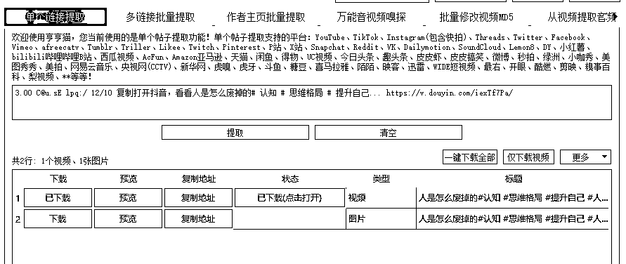
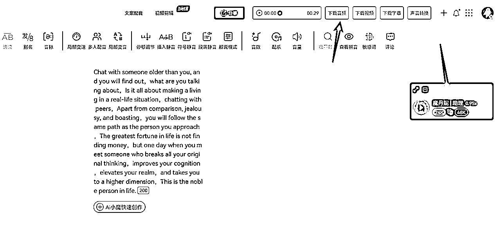

最近刷抖音，可能你也刷到过那种“数字人口播讲认知”的视频——一个虚拟人像，配着字幕，讲着成长、思维、搞钱一类的内容。很多人以为这需要多高深的技术，其实真不是。我亲自下场试了试，流量确实不错，而且性价比极高。

先说说我的背景：前大厂员工，MBA出身，业余时间喜欢研究编程、副业、项目运营、商业模型这些，算是个杂家。这次也是看到生财有术里有人分享了一个风向标账号，涨得非常快，一周就能涨21万粉。我看了一下制作流程，发现比想象中简单太多——不需要像漫画号那样每期自己写脚本，只要做好字幕、做好人像就差不多了。后来我自己测试了几个号，发现爆流量挺容易的，而且这类项目拼的就是速度，越早入场越好。

这个玩法适合谁呢？如果你没做过抖音，或者以前做口播效果一般，又或者之前做过成长、思维类账号、书单号，那都很适合。尤其前期流量大，后期还能转型做书单号。

具体怎么操作？我一步步说。

**第一步，找对标账号。** 在小红书、抖音、快手、视频号上都能搜到一批用这种方式做矩阵的账号，数据都不差，少的几万粉，多的已经上百万了。方法很简单，就是在抖音里搜相关关键词，一抓一大把。

**第二步，提取文案。** 先把别人的视频下载下来，工具很多，比如哼哼猫（收费），免费的话可以用小程序“轻抖”。然后提取音频里的文案，自己稍微改一改，或者重新配音也行。再拿翻译软件，比如用百度翻译，把中文翻成英文。

**第三步，配音。** 我用的魔音工坊，选“魔丹妮”这个声音，一个月99元。把翻译好的英文导进去，生成配音再导出来就行。

**第四步，做数字人。** 比较常用的工具是HeyGen，官网是 https://www.heygen.com/。有两种省钱办法：一是用临时邮箱注册，可能不稳，需要自己找没被官网限制的邮箱，新用户会送1个积分。比如这个邮箱可以试试：https://www.mohmal.com/zh。二就是直接去淘宝买成品积分账号，5块钱能买到11积分，0.5分钟的视频消耗0.5积分。把英文音轨导进去，就能生成数字人视频了。

**第五步，剪辑。** 先准备一张背景图导进去，再把数字人视频放上去。用智能字幕识别英文，识别出来的是英文文本。但中文字幕要自己手动输入，再挑个好看的字体。

**第六步，发布抖音。** 注册新账号，设置好昵称和签名，直接发布就行。

最后说点实在的：这个玩法本身不难，强烈建议趁早做。谁也不知道以后平台规则会不会变，或者抖音会不会限制这类内容。至少现在效果还不错，很适合小白尝试，涨粉的快乐你体验过就懂。我第一次做，几天就涨了几千粉，心里还是很爽的。

这是我的第一篇生财分享，感谢平台，也欢迎大家留言交流，链接奉上。